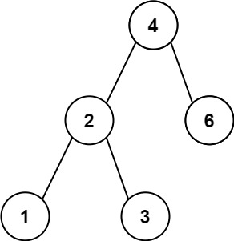
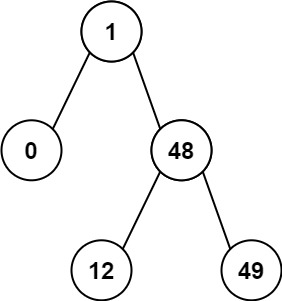

# 530. 二叉搜索树的最小绝对差

| 题目信息 | 内容 |
|---|---|
| 难度 | 简单 |
| 核心模式 | BST 中序遍历有序，取相邻差值最小 |
| 时间复杂度 | O(n) |
| 空间复杂度 | O(h) |

## 题目与约束

给你一个二叉搜索树的根节点 `root` ，返回 树中任意两不同节点值之间的最小差值 。

差值是一个正数，其数值等于两值之差的绝对值。

 

示例 1：



输入：root = [4,2,6,1,3]  
输出：1

示例 2：



输入：root = [1,0,48,null,null,12,49]  
输出：1

 

提示：

- 树中节点的数目范围是 `[2, 104]`

- `0 <= Node.val <= 105`

 

注意：本题与 783 https://leetcode.cn/problems/minimum-distance-between-bst-nodes/ 相同

[🔗 前往力扣原题验证 →](https://leetcode.cn/problems/minimum-absolute-difference-in-bst/)

## 核心不变量

> 二叉搜索树的中序遍历结果是一个严格递增序列，全局最小差值一定出现在这个序列中相邻的两个元素之间。

## 完整推导

### 思路推导

1. **直觉与痛点（为什么不能两两暴力比较）**：任意两节点值的最小差值，暴力做法是收集所有值两两相减，时间 `O(n²)`。但题目给出的是一棵 **二叉搜索树**，这个额外性质必须用上，否则就浪费了条件。

2. **破局思路（利用 BST 的有序性）**：BST 的性质是「左子树全部小于根、右子树全部大于根」。对它做 **中序遍历（左 → 根 → 右）**，得到的节点值序列天然是 **严格递增** 的。在一个递增序列中，最小差值只会出现在相邻元素之间——隔着更远的元素，差值只会更大。

3. **实现（边走边比）**：中序遍历时用一个 `prev` 变量记住「上一个访问到的节点值」。每访问到一个新节点，就用 `node.val - prev` 更新答案，再把 `prev` 更新为当前值。这样只需一次遍历，不需要把整个数组存下来。

   小例子：`[4,2,6,1,3]` 的中序序列是 `1,2,3,4,6`，相邻差值 `1,1,1,2`，最小为 `1`。

### Java 实现（中序遍历 + 前驱指针）

```java
/**
 * Definition for a binary tree node.
 * public class TreeNode {
 *     int val;
 *     TreeNode left;
 *     TreeNode right;
 *     TreeNode() {}
 *     TreeNode(int val) { this.val = val; }
 *     TreeNode(int val, TreeNode left, TreeNode right) {
 *         this.val = val;
 *         this.left = left;
 *         this.right = right;
 *     }
 * }
 */
class Solution {
    // 记录上一个被访问的节点值；用包装类以便判断是否为空
    private Integer prev = null;
    // 记录当前最小差值
    private int ans = Integer.MAX_VALUE;

    public int getMinimumDifference(TreeNode root) {
        inorder(root);
        return ans;
    }

    private void inorder(TreeNode node) {
        if (node == null) {
            return;
        }
        // 1. 递归左子树
        inorder(node.left);
        // 2. 处理当前节点：与中序前驱作差（中序有序，差值必非负）
        if (prev != null) {
            ans = Math.min(ans, node.val - prev);
        }
        prev = node.val;
        // 3. 递归右子树
        inorder(node.right);
    }
}
```

### 复杂度

- 时间：O(n)，每个节点恰好被访问一次。
- 空间：O(h)，递归栈深度等于树高 `h`；最坏（退化成链）为 `O(n)`，平衡时为 `O(log n)`。没有额外存储整个序列。

### 易错点与扩展（面试高频考点）

1. **不要用全局两两比较**：`O(n²)` 能过小数据，但不是考点；必须点出「BST 中序有序」这一性质才能拿到 `O(n)`。
2. **前驱要判空**：第一个访问到的节点前方没有前驱，`node.val - prev` 会出错，必须用 `prev != null` 守卫。
3. **差值方向**：中序递增，`node.val - prev` 永远非负，不必取绝对值；若写成绝对值反而暴露对有序性没吃透。
4. **栈溢出风险**：节点数上限 `10^4`，若树退化成链，朴素递归可能逼近调用栈上限；可改用显式栈做迭代中序，或面试时说明这一点。
5. **举一反三**：同类「BST 中序有序」的题目还有 98 验证 BST、501 众数、530/783 最小差值，核心都是把 BST 问题转成有序序列问题。

## 力扣原题

[530. 二叉搜索树的最小绝对差](https://leetcode.cn/problems/minimum-absolute-difference-in-bst/)

### C++ 实现

```cpp
/**
 * Definition for a binary tree node.
 * struct TreeNode {
 *     int val;
 *     TreeNode *left;
 *     TreeNode *right;
 *     TreeNode() : val(0), left(nullptr), right(nullptr) {}
 *     TreeNode(int x) : val(x), left(nullptr), right(nullptr) {}
 *     TreeNode(int x, TreeNode *left, TreeNode *right) : val(x), left(left), right(right) {}
 * };
 */
class Solution {
public:
    int getMinimumDifference(TreeNode* root) {
        int ans = INT_MAX;
        TreeNode* prev = nullptr;
        inorder(root, prev, ans);
        return ans;
    }

private:
    void inorder(TreeNode* node, TreeNode*& prev, int& ans) {
        if (!node) return;
        inorder(node->left, prev, ans);          // 左
        if (prev) ans = min(ans, node->val - prev->val);  // 根：与中序前驱作差
        prev = node;
        inorder(node->right, prev, ans);         // 右
    }
};
```

### Python 实现

```python
# Definition for a binary tree node.
# class TreeNode:
#     def __init__(self, val=0, left=None, right=None):
#         self.val = val
#         self.left = left
#         self.right = right
class Solution:
    def getMinimumDifference(self, root: Optional[TreeNode]) -> int:
        self.prev = None
        self.ans = float('inf')

        def inorder(node: Optional[TreeNode]) -> None:
            if not node:
                return
            inorder(node.left)                       # 左
            if self.prev is not None:                # 根：与前驱作差
                self.ans = min(self.ans, node.val - self.prev)
            self.prev = node.val
            inorder(node.right)                      # 右

        inorder(root)
        return self.ans
```
