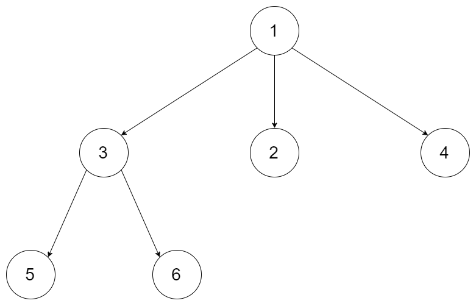
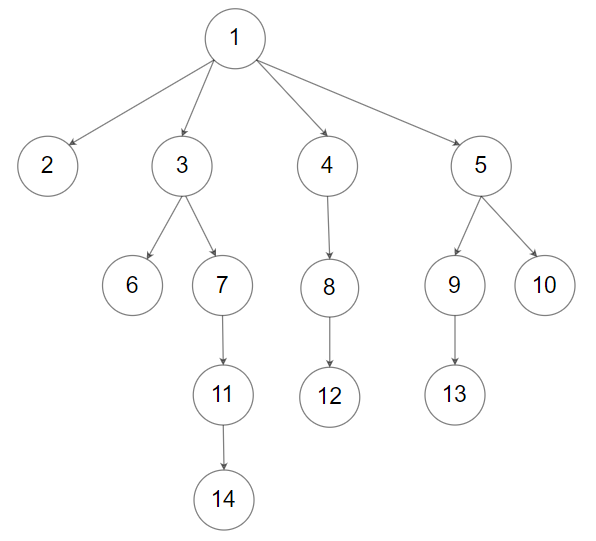

# 559. N 叉树的最大深度

| 题目信息 | 内容 |
|---|---|
| 难度 | 简单 |
| 核心模式 | DFS 递归：深度 = 1 + 子树最大深度 |
| 时间复杂度 | O(n) |
| 空间复杂度 | O(h) |

## 题目与约束

给定一个 N 叉树，找到其最大深度。

最大深度是指从根节点到最远叶子节点的最长路径上的节点总数。

N 叉树输入按层序遍历序列化表示，每组子节点由空值分隔（请参见示例）。

 

示例 1：



输入：root = [1,null,3,2,4,null,5,6]  
输出：3

示例 2：



输入：root = [1,null,2,3,4,5,null,null,6,7,null,8,null,9,10,null,null,11,null,12,null,13,null,null,14]  
输出：5

 

提示：

- 树的深度不会超过 `1000` 。

- 树的节点数目位于 `[0, 104]` 之间。

[🔗 前往力扣原题验证 →](https://leetcode.cn/problems/maximum-depth-of-n-ary-tree/)

## 核心不变量

> 一棵树的最大深度等于 `1 + 所有子树最大深度的最大值`；空树深度为 0。

## 完整推导

### 思路推导

1. **把大问题拆成同构的小问题**

   要求整棵树的最大深度，先看根节点。根节点自己贡献 1 层，剩下的深度完全由“哪一棵子树最深”决定。也就是说：`maxDepth(root) = 1 + max(maxDepth(每个孩子))`，这正是一个可以递归的自相似结构。

2. **确定递归边界**

   当节点为空（`root == null`）时没有任何节点，深度为 0，直接返回。这就是递归的出口。

3. **小例子（`[1,null,3,2,4,null,5,6]`）**

   根节点 `1` 有三个孩子 `3, 2, 4`。其中 `3` 又有两个孩子 `5, 6`。
   - `5`、`6`、`2`、`4` 都是叶子，深度为 1。
   - `3` 的深度 = 1 + max(1, 1) = 2。
   - 根 `1` 的深度 = 1 + max(2, 1, 1) = 3。与示例输出一致。

4. **为什么不用 BFS？**

   本题用 BFS 逐层计数同样可行（每遍历一层答案加一），但 DFS 递归只需几行，且无需队列，代码更短。BFS 的写法可作为面试扩展。

### Java 实现（maxDepth）

```java
import java.util.List;

/*
// Definition for a Node.
class Node {
    public int val;
    public List<Node> children;

    public Node() {}

    public Node(int _val) {
        val = _val;
    }

    public Node(int _val, List<Node> _children) {
        val = _val;
        children = _children;
    }
};
*/

class Solution {
    public int maxDepth(Node root) {
        // 递归边界：空树深度为 0
        if (root == null) {
            return 0;
        }
        int maxChildDepth = 0;
        // 在所有子树里找最深的那一棵
        for (Node child : root.children) {
            maxChildDepth = Math.max(maxChildDepth, maxDepth(child));
        }
        // 当前节点自身贡献 1 层
        return maxChildDepth + 1;
    }
}
```

### 复杂度

- 时间：O(n)，每个节点恰好被访问一次。
- 空间：O(h)，递归栈的深度等于树的高度 `h`，最坏（退化成链）为 O(n)。

### 易错点与扩展（面试高频考点）

1. **忘记空树判断**：题目节点数可为 0，`root` 可能为 `null`，不判断会抛空指针。
2. **叶子节点处理**：`children` 为空列表时循环不执行，`maxChildDepth` 保持 0，返回 1，正好是叶子深度，无需特判。
3. **`children` 可能为 `null`**：部分环境给出的节点 `children` 未初始化，若不确定可先判空；LeetCode 保证为空列表。
4. **BFS 扩展写法**：用队列按层遍历，每处理完一层 `depth++`，最后返回 `depth`，时间 O(n) 空间 O(w)（w 为最大宽度）。
5. **等价变形**：求“最小深度”时不能简单取 `min`，因为空孩子会把结果压成 1，需要跳过空子树，这是常见陷阱。

## 力扣原题

[559. N 叉树的最大深度](https://leetcode.cn/problems/maximum-depth-of-n-ary-tree/)

### C++ 实现

```cpp
#include <vector>
#include <algorithm>
using namespace std;

/*
// Definition for a Node.
class Node {
public:
    int val;
    vector<Node*> children;

    Node() {}
    Node(int _val) { val = _val; }
    Node(int _val, vector<Node*> _children) {
        val = _val;
        children = _children;
    }
};
*/

class Solution {
public:
    int maxDepth(Node* root) {
        if (root == nullptr) {
            return 0; // 空树深度为 0
        }
        int maxChildDepth = 0;
        for (Node* child : root->children) {
            maxChildDepth = max(maxChildDepth, maxDepth(child));
        }
        return maxChildDepth + 1; // 加上当前这一层
    }
};
```

### Python 实现

```python
class Solution:
    def maxDepth(self, root: 'Node') -> int:
        if not root:
            return 0
        # 在所有子树里取最大深度，default=0 处理叶子节点
        return 1 + max((self.maxDepth(child) for child in root.children), default=0)
```
