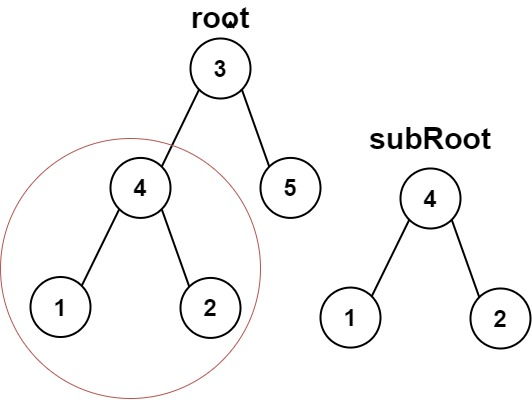
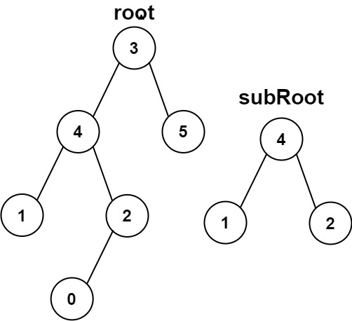

# 572. 另一棵树的子树

| 题目信息 | 内容 |
|---|---|
| 难度 | 简单 |
| 核心模式 | 遍历每个节点 + 子树同构判定 |
| 时间复杂度 | O(n·m) |
| 空间复杂度 | O(h) |

## 题目与约束

给你两棵二叉树 `root` 和 `subRoot` 。检验 `root` 中是否包含和 `subRoot` 具有相同结构和节点值的子树。如果存在，返回 `true` ；否则，返回 `false` 。

二叉树 `tree` 的一棵子树包括 `tree` 的某个节点和这个节点的所有后代节点。`tree` 也可以看做它自身的一棵子树。

 

示例 1：



输入：root = [3,4,5,1,2], subRoot = [4,1,2]  
输出：true

示例 2：



输入：root = [3,4,5,1,2,null,null,null,null,0], subRoot = [4,1,2]  
输出：false

 

提示：

- `root` 树上的节点数量范围是 `[1, 2000]`

- `subRoot` 树上的节点数量范围是 `[1, 1000]`

- `-104 <= root.val <= 104`

- `-104 <= subRoot.val <= 104`

[🔗 前往力扣原题验证 →](https://leetcode.cn/problems/subtree-of-another-tree/)

## 核心不变量

> `root` 含与 `subRoot` 相同的子树 ⟺ 存在 `root` 中某节点 `x`，使得以 `x` 为根的子树与 `subRoot` **结构完全相同且每个对应节点值相等**。

## 完整推导

### 思路推导

1. **拆成两个子问题**

   问题本身是"存在性"：在 `root` 中找一个位置，使得那里的子树等于 `subRoot`。先写好一个基础函数 `isSame(a, b)`：判断两棵树是否**完全相同**（结构一致且对应节点值相等），它就是「相同的树」那题。

2. **枚举所有候选根**

   `root` 中每个节点都可能是那棵子树的根。对每个节点 `x` 调用 `isSame(x, subRoot)`，只要有一个返回 `true`，整体就是 `true`。

3. **递归组织**

   `isSubtree(root, subRoot) = isSame(root, subRoot) || isSubtree(root.left, subRoot) || isSubtree(root.right, subRoot)`，出口是 `root == null`（此时返回 `false`，因为 `subRoot` 至少有一个节点）。

4. **小例子（示例 2 为什么是 false）**

   `root` 中值为 4 的节点，其子树是 `[4,1,2]` 且 2 下还挂着一个 0。`subRoot` 是 `[4,1,2]`，叶子 2 没有孩子。结构不一致，`isSame` 返回 `false`；`root` 中再没有别的 4，故整体 `false`。

### Java 实现（isSubtree）

```java
/**
 * Definition for a binary tree node.
 * public class TreeNode {
 *     int val;
 *     TreeNode left;
 *     TreeNode right;
 *     TreeNode() {}
 *     TreeNode(int val) { this.val = val; }
 *     TreeNode(int val, TreeNode left, TreeNode right) {
 *         this.val = val;
 *         this.left = left;
 *         this.right = right;
 *     }
 * }
 */
class Solution {
    public boolean isSubtree(TreeNode root, TreeNode subRoot) {
        // root 为空，而 subRoot 至少一个节点，不可能匹配
        if (root == null) return false;
        // 三种情况：当前节点为根就相同，或在左子树中，或在右子树中
        return isSame(root, subRoot)
                || isSubtree(root.left, subRoot)
                || isSubtree(root.right, subRoot);
    }

    // 判断两棵树是否完全相同（结构 + 值）
    private boolean isSame(TreeNode a, TreeNode b) {
        if (a == null && b == null) return true;
        if (a == null || b == null) return false;
        if (a.val != b.val) return false;
        return isSame(a.left, b.left) && isSame(a.right, b.right);
    }
}
```

### 复杂度

- 时间：O(n·m)，n 为 `root` 节点数、m 为 `subRoot` 节点数。最坏情况下对 `root` 的每个节点都做一次 `isSame`，每次最多比较 m 个节点。
- 空间：O(h)，h 为递归栈深度，最坏（链状树）为 O(n)。

### 易错点与扩展（面试高频考点）

1. **`isSame` 的判断顺序**：必须先判 `a == null && b == null`，再判 `a == null || b == null`，最后比值，顺序颠倒会漏掉"都为空"的正确情形。
2. **`root` 为空而 `subRoot` 非空**：直接返回 `false`，不要误判为 `true`。
3. **序列化 + 子串匹配的坑**：把树序列化成字符串再用 `contains` 判断看似 O(n)，但若不加分隔符和空节点占位（如 `#`、`null`），会因值拼接产生误判；加好占位后可配合 KMP 做到 O(n+m)。
4. **暴力可过**：本题数据 n ≤ 2000、m ≤ 1000，O(n·m) 约 2×10⁶ 次操作，完全够用，不必强上树哈希。
5. **与「判断子树是否相同」的区别**：题目要求的是"完全相同的子树"，不能只比较部分路径或仅根值相等。

## 力扣原题

[572. 另一棵树的子树](https://leetcode.cn/problems/subtree-of-another-tree/)

### C++ 实现

```cpp
class Solution {
public:
    bool isSubtree(TreeNode* root, TreeNode* subRoot) {
        if (root == nullptr) return false;
        return isSame(root, subRoot)
            || isSubtree(root->left, subRoot)
            || isSubtree(root->right, subRoot);
    }

private:
    bool isSame(TreeNode* a, TreeNode* b) {
        if (a == nullptr && b == nullptr) return true;
        if (a == nullptr || b == nullptr) return false;
        if (a->val != b->val) return false;
        return isSame(a->left, b->left) && isSame(a->right, b->right);
    }
};
```

### Python 实现

```python
class Solution:
    def isSubtree(self, root: Optional[TreeNode], subRoot: Optional[TreeNode]) -> bool:
        if root is None:
            return False
        return (self._is_same(root, subRoot)
                or self.isSubtree(root.left, subRoot)
                or self.isSubtree(root.right, subRoot))

    def _is_same(self, a: Optional[TreeNode], b: Optional[TreeNode]) -> bool:
        if a is None and b is None:
            return True
        if a is None or b is None:
            return False
        if a.val != b.val:
            return False
        return self._is_same(a.left, b.left) and self._is_same(a.right, b.right)
```
