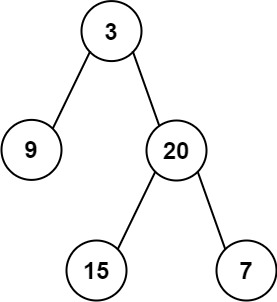
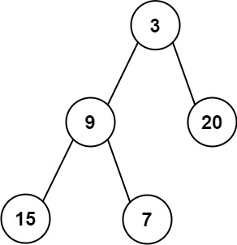

# 637. 二叉树的层平均值

| 题目信息 | 内容 |
|---|---|
| 难度 | 简单 |
| 核心模式 | BFS 分层，逐层求平均值 |
| 时间复杂度 | O(n) |
| 空间复杂度 | O(w) |

## 题目与约束

给定一个非空二叉树的根节点 `root` , 以数组的形式返回每一层节点的平均值。与实际答案相差 `10-5` 以内的答案可以被接受。

 

示例 1：



```
<strong>输入：</strong>root = [3,9,20,null,null,15,7]
<strong>输出：</strong>[3.00000,14.50000,11.00000]
<strong>解释：</strong>第 0 层的平均值为 3,第 1 层的平均值为 14.5,第 2 层的平均值为 11 。
因此返回 [3, 14.5, 11] 。
```

示例 2:



```
<strong>输入：</strong>root = [3,9,20,15,7]
<strong>输出：</strong>[3.00000,14.50000,11.00000]
```

 

提示：

- 树中节点数量在 `[1, 104]` 范围内

- `-231 <= Node.val <= 231 - 1`

[🔗 前往力扣原题验证 →](https://leetcode.cn/problems/average-of-levels-in-binary-tree/)

## 核心不变量

> 每一轮 BFS 前先固定队列长度 `size`，它就是当前层的节点个数；遍历这 `size` 个节点累加它们的值，最后用 `sum / size` 得到该层平均值。

## 完整推导

### 思路推导

1. **直觉与痛点（为什么要分层）**

   题目要的是「每一层」的平均值，而不是整棵树的总平均。如果只是简单 BFS 把所有节点混在一起遍历，就无法知道哪些节点属于同一层，因此必须像「二叉树层序遍历」那样把每一层单独处理。

2. **破局思路（快照队列长度 + 逐层求和）**

   用队列做 BFS，先把根入队。每轮循环开始时，先记录当前队列长度 `size`，这正是当前层的节点数。然后在 `for` 循环里严格弹出 `size` 个节点：累加它们的值，同时把左右孩子入队（孩子属于下一层）。循环结束后 `sum / size` 就是本层平均值，加入结果数组。

3. **关键追问（为什么用快照而非动态 size）**

   在遍历过程中会不断把下一层的孩子塞进队列，队列长度动态变大。如果直接用 `while (!queue.isEmpty())` 里又去读实时长度，就会把不同层混在一起。所以必须**在每层开始处理前把 `size` 固定下来**。

4. **小例子**

   `root = [3,9,20,null,null,15,7]`：第一层 `[3]` → 平均 3；第二层 `[9,20]` → 平均 14.5；第三层 `[15,7]` → 平均 11。结果 `[3, 14.5, 11]`。

### Java 实现（averageOfLevels）

```java
import java.util.*;

class Solution {
    public List<Double> averageOfLevels(TreeNode root) {
        List<Double> res = new ArrayList<>();
        if (root == null) {
            return res;
        }

        Queue<TreeNode> queue = new LinkedList<>();
        queue.offer(root);

        while (!queue.isEmpty()) {
            // 快照：当前层的节点个数
            int size = queue.size();
            double sum = 0; // 用 double 累加，避免整型除法丢精度

            for (int i = 0; i < size; i++) {
                TreeNode node = queue.poll();
                sum += node.val;
                // 孩子属于下一层，先排进队列
                if (node.left != null) {
                    queue.offer(node.left);
                }
                if (node.right != null) {
                    queue.offer(node.right);
                }
            }
            // 本层平均值
            res.add(sum / size);
        }
        return res;
    }
}
```

### 复杂度

- 时间：`O(n)`，每个节点恰好入队、出队各一次，并做一次常数时间的累加。
- 空间：`O(w)`，`w` 为树的最大宽度；队列中最多同时存放一层节点，最坏（满二叉树最后一层）约为 `n/2`，即 `O(n)`。

### 易错点与扩展（面试高频考点）

1. **整数除法陷阱**：`sum` 必须用 `double`（或先转 `double`），否则 `sum / size` 会做整除截断，结果错误。
2. **动态 `size` 的坑**：`for` 的边界要用循环外固定的 `int size`，不能在循环里反复读 `queue.size()`，否则会把下一层混进来。
3. **下标 `i` 与 `size`**：每层处理完要重新读取新的 `size`，不能复用上一层的值。
4. **空树与单节点**：虽然本题保证非空，但实现里加 `root == null` 防御更稳妥；单节点时直接得到 `[root.val]`。
5. **扩展（DFS 写法）**：也可用 DFS，额外传 `level` 参数，用两个数组分别记录每层的「和」与「节点个数」，回溯时累加，最后逐层相除。BFS 更直观，DFS 空间是 `O(h)`（`h` 为树高），在极深树上更省空间。

## 力扣原题

[637. 二叉树的层平均值](https://leetcode.cn/problems/average-of-levels-in-binary-tree/)

### C++ 实现

```cpp
#include <vector>
#include <queue>
using namespace std;

/**
 * Definition for a binary tree node.
 * struct TreeNode {
 *     int val;
 *     TreeNode *left;
 *     TreeNode *right;
 *     TreeNode() : val(0), left(nullptr), right(nullptr) {}
 *     TreeNode(int x) : val(x), left(nullptr), right(nullptr) {}
 *     TreeNode(int x, TreeNode *left, TreeNode *right) : val(x), left(left), right(right) {}
 * };
 */
class Solution {
public:
    vector<double> averageOfLevels(TreeNode* root) {
        vector<double> res;
        if (!root) return res;

        queue<TreeNode*> q;
        q.push(root);

        while (!q.empty()) {
            int size = q.size();   // 当前层节点数（快照）
            double sum = 0;

            for (int i = 0; i < size; i++) {
                TreeNode* node = q.front();
                q.pop();
                sum += node->val;
                if (node->left) q.push(node->left);
                if (node->right) q.push(node->right);
            }
            res.push_back(sum / size); // 本层平均值
        }
        return res;
    }
};
```

### Python 实现

```python
import collections


class Solution:
    def averageOfLevels(self, root) -> list[float]:
        res = []
        if root is None:
            return res

        q = collections.deque([root])
        while q:
            size = len(q)   # 当前层节点数（快照）
            total = 0
            for _ in range(size):
                node = q.popleft()
                total += node.val
                if node.left:
                    q.append(node.left)
                if node.right:
                    q.append(node.right)
            res.append(total / size)  # 本层平均值
        return res
```
