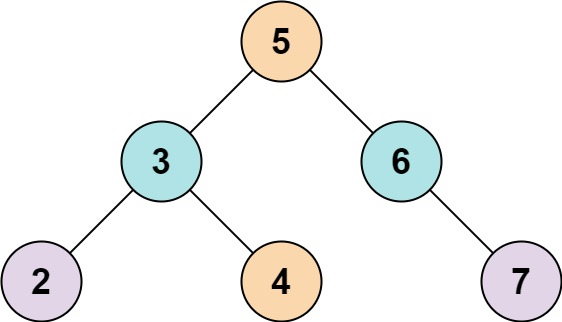
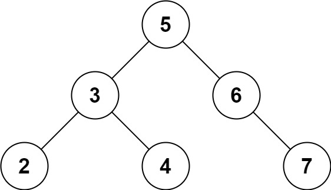

# 653. 两数之和 IV - 输入二叉搜索树

| 题目信息 | 内容 |
|---|---|
| 难度 | 简单 |
| 核心模式 | 遍历二叉树 + 哈希集合边查边存 |
| 时间复杂度 | O(n) |
| 空间复杂度 | O(n) |

## 题目与约束

给定一个二叉搜索树 `root` 和一个目标结果 `k`，如果二叉搜索树中存在两个元素且它们的和等于给定的目标结果，则返回 `true`。

 

示例 1：



输入: root = [5,3,6,2,4,null,7], k = 9  
输出: true

示例 2：



输入: root = [5,3,6,2,4,null,7], k = 28  
输出: false

 

提示:

- 二叉树的节点个数的范围是  `[1, 104]`.

- `-104 <= Node.val <= 104`

- 题目数据保证，输入的 `root` 是一棵 有效 的二叉搜索树

- `-105 <= k <= 105`

[🔗 前往力扣原题验证 →](https://leetcode.cn/problems/two-sum-iv-input-is-a-bst/)

## 核心不变量

> 遍历到某个节点值 `v` 时，只需判断此前是否访问过 `k - v`；若访问过就存在一对和为 `k`，否则把 `v` 记入集合继续遍历。

## 完整推导

### 思路推导

1. **直觉（两数之和的通用套路）**

   这本质是"两数之和"：给定一堆数，问是否存在两个和为 `k`。经典解法是一边遍历、一边用哈希集合记住访问过的值，对每个新值 `v` 查 `k - v` 是否已存在。

2. **套到二叉树上**

   树只是"存这堆数"的容器，遍历顺序（前/中/后/层序）都不影响答案。任选一种遍历（这里用 DFS 递归），把节点值当成数组元素逐个处理即可。

3. **为什么"边查边存"能避免重复用同一个节点**

   查的是 `k - v`，而 `v` 本身在加入集合后才可能被后面的节点匹配。同一节点不会匹配到自己（除非 `k = 2v` 且值 `v` 出现两次，而 BST 值唯一，所以安全）。

4. **小例子（示例 1，k = 9）**

   遍历到 `5`：集合 `{5}`，查 `4` 不在；
   遍历到 `3`：查 `6` 不在，加入 `3`；
   遍历到 `6`：查 `3` 在集合中 → 命中，返回 `true`（3 + 6 = 9）。

5. **进阶（利用 BST 有序性）**

   中序遍历 BST 得到严格递增数组，再用左右双指针 `lo/hi` 相向求和，可做到 `O(n)` 时间、`O(n)` 空间（存中序序列）或 `O(h)` 额外空间（用迭代器中序 + 双指针）。哈希法最直观，先用它。

### Java 实现（findTarget）

```java
import java.util.HashSet;
import java.util.Set;

class Solution {
    public boolean findTarget(TreeNode root, int k) {
        Set<Integer> seen = new HashSet<>();
        return dfs(root, k, seen);
    }

    private boolean dfs(TreeNode node, int k, Set<Integer> seen) {
        if (node == null) {
            return false;
        }
        // 先查：有没有之前访问过的值与当前值互补
        if (seen.contains(k - node.val)) {
            return true;
        }
        // 再把当前值记入集合，继续遍历左右子树
        seen.add(node.val);
        return dfs(node.left, k, seen) || dfs(node.right, k, seen);
    }
}
```

### 复杂度

- 时间：O(n)，每个节点访问一次，哈希查询/插入均摊 O(1)。
- 空间：O(n)，哈希集合最多存 n 个值；递归栈深度 O(h)（最坏 O(n)），整体 O(n)。

### 易错点与扩展（面试高频考点）

1. **先查后存**：顺序必须是"先判断 `k - v` 是否存在，再 `add(v)`"，否则会把自己算进去（当 `k = 2v` 时误判）。
2. **不要用两次遍历**：把树收集成数组再双重循环是 O(n²)，直接边遍历边哈希即可。
3. **BST 值唯一**：题目保证是有效 BST，节点值互不相同，因此 `k - v == v` 的情形不会由同一节点触发。
4. **空子树**：递归基线 `node == null` 返回 `false`，别忘了。
5. **扩展（双指针中序）**：中序得到升序数组后左右指针求和；若想省空间，可用两个迭代器分别做正向/反向中序，实现 O(h) 额外空间。

## 力扣原题

[653. 两数之和 IV - 输入二叉搜索树](https://leetcode.cn/problems/two-sum-iv-input-is-a-bst/)

### C++ 实现

```cpp
class Solution {
public:
    bool findTarget(TreeNode* root, int k) {
        unordered_set<int> seen;
        return dfs(root, k, seen);
    }

private:
    bool dfs(TreeNode* node, int k, unordered_set<int>& seen) {
        if (!node) return false;
        // 先查互补值是否存在
        if (seen.count(k - node->val)) return true;
        // 再记录当前值
        seen.insert(node->val);
        return dfs(node->left, k, seen) || dfs(node->right, k, seen);
    }
};
```

### Python 实现

```python
class Solution:
    def findTarget(self, root: Optional[TreeNode], k: int) -> bool:
        seen = set()

        def dfs(node: Optional[TreeNode]) -> bool:
            if not node:
                return False
            # 先查互补值是否已出现
            if k - node.val in seen:
                return True
            # 再记录当前值
            seen.add(node.val)
            return dfs(node.left) or dfs(node.right)

        return dfs(root)
```
