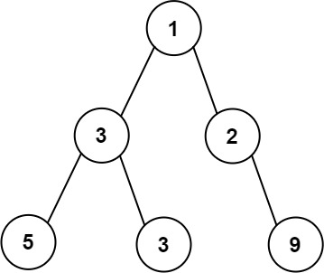
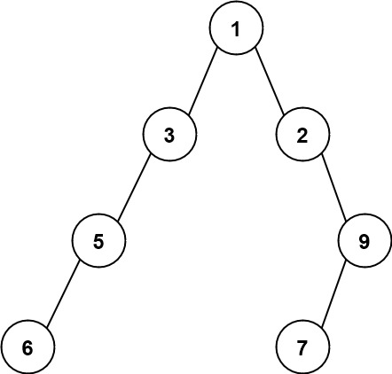
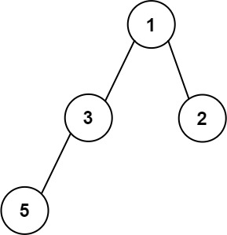

# 662. 二叉树最大宽度

| 题目信息 | 内容 |
|---|---|
| 难度 | 中等 |
| 核心模式 | BFS 逐层 + 完全二叉树下标编号 |
| 时间复杂度 | O(n) |
| 空间复杂度 | O(n) |

## 题目与约束

给你一棵二叉树的根节点 `root` ，返回树的 最大宽度 。

树的 最大宽度 是所有层中最大的 宽度 。

每一层的 宽度 被定义为该层最左和最右的非空节点（即，两个端点）之间的长度。将这个二叉树视作与满二叉树结构相同，两端点间会出现一些延伸到这一层的 `null` 节点，这些 `null` 节点也计入长度。

题目数据保证答案将会在  32 位 带符号整数范围内。

 

示例 1：



```
<strong>输入：</strong>root = [1,3,2,5,3,null,9]
<strong>输出：</strong>4
<strong>解释：</strong>最大宽度出现在树的第 3 层，宽度为 4 (5,3,null,9) 。
```

示例 2：



```
<strong>输入：</strong>root = [1,3,2,5,null,null,9,6,null,7]
<strong>输出：</strong>7
<strong>解释：</strong>最大宽度出现在树的第 4 层，宽度为 7 (6,null,null,null,null,null,7) 。
```

示例 3：



```
<strong>输入：</strong>root = [1,3,2,5]
<strong>输出：</strong>2
<strong>解释：</strong>最大宽度出现在树的第 2 层，宽度为 2 (3,2) 。
```

 

提示：

- 树中节点的数目范围是 `[1, 3000]`

- `-100 <= Node.val <= 100`

[🔗 前往力扣原题验证 →](https://leetcode.cn/problems/maximum-width-of-binary-tree/)

## 核心不变量

> 把每个节点按完全二叉树规则编号（根为 0，左孩子 `2*i`，右孩子 `2*i+1`），则某一层的宽度恰为「最右编号 − 最左编号 + 1」，中间的 `null` 会自动被计入。

## 完整推导

### 思路推导

1. **痛点：不能只数节点个数**。题目明确要求把中间的 `null` 也计入长度。比如第 3 层只有 `5,3,9` 三个真实节点，但它们在满二叉树中的位置跨度是 4，所以答案是 4 而不是 3。因此我们需要一种能体现「位置」的度量。

2. **用完全二叉树编号度量位置**。给每个节点编一个下标：根记为 `0`，对下标为 `i` 的节点，左孩子记 `2*i`，右孩子记 `2*i+1`。这正是堆/满二叉树的下标规律。某一层最左节点编号为 `L`、最右为 `R`，则该层宽度就是 `R - L + 1`，中间所有被跳过的编号（对应 `null` 位置）自然被算进去。

3. **逐层 BFS 取左右端点**。用 BFS 按层处理，队列里同时存 `(节点, 编号)`。每层开始时记录队首编号作为 `L`，把这一层 `size` 个节点依次弹出，最后一个弹出的编号就是 `R`，`R - L + 1` 更新答案。

4. **防溢出：每层归一化**。编号会随深度呈指数增长（`2^depth`），深度较大时 64 位整数都存不下。技巧是每一层都用该层最左编号做基准，把子节点编号按 `(idx - L) * 2`、`(idx - L) * 2 + 1` 计算。这样编号始终只与「本层宽度」同阶，规模被压在 O(n)，不会溢出。

小例子：`root = [1,3,2,5,3,null,9]`，第 3 层编号为 `4,5,7`（`3` 的左/右孩子 `4,5`，`2` 的右孩子 `9` 落在编号 `7`），宽度 `7 - 4 + 1 = 4` ✓。

### Java 实现（BFS + 下标编号）

```java
import java.util.ArrayDeque;
import java.util.Deque;

/**
 * Definition for a binary tree node.
 * public class TreeNode {
 *     int val;
 *     TreeNode left;
 *     TreeNode right;
 *     TreeNode() {}
 *     TreeNode(int val) { this.val = val; }
 *     TreeNode(int val, TreeNode left, TreeNode right) {
 *         this.val = val;
 *         this.left = left;
 *         this.right = right;
 *     }
 * }
 */
class Solution {
    public int widthOfBinaryTree(TreeNode root) {
        if (root == null) {
            return 0;
        }
        int maxWidth = 0;
        // 用两个队列同步保存节点与其在「当前层坐标系」下的编号
        Deque<TreeNode> nodes = new ArrayDeque<>();
        Deque<Long> idxs = new ArrayDeque<>();
        nodes.offerLast(root);
        idxs.offerLast(0L);

        while (!nodes.isEmpty()) {
            int size = nodes.size();
            long left = idxs.peekFirst(); // 本层最左编号
            long right = left;            // 本层最右编号（逐次更新）

            for (int i = 0; i < size; i++) {
                TreeNode node = nodes.pollFirst();
                long idx = idxs.pollFirst();
                right = idx;

                // 归一化：以本层 left 为基准，避免指数级溢出
                if (node.left != null) {
                    nodes.offerLast(node.left);
                    idxs.offerLast((idx - left) * 2);
                }
                if (node.right != null) {
                    nodes.offerLast(node.right);
                    idxs.offerLast((idx - left) * 2 + 1);
                }
            }
            maxWidth = Math.max(maxWidth, (int) (right - left + 1));
        }
        return maxWidth;
    }
}
```

### 复杂度

- 时间：O(n)。每个节点入队、出队各一次，常数级操作。
- 空间：O(n)。BFS 队列最坏同时存放最宽一层的节点，规模线性。

### 易错点与扩展（面试高频考点）

1. **把「节点个数」当宽度**：若只统计每层实际节点数，示例 1 会得到 3，而正确是 4。必须用下标差来体现 `null` 占位。
2. **编号溢出**：单链退化树深度可达 3000，`2^3000` 远超 `long`。务必在每层做归一化，或使用大整数。
3. **宽度的计算对象**：`R - L + 1` 中的 `L/R` 是「同一层」的最左/最右编号，不要跨层混用。
4. **空树**：`root == null` 直接返回 0。
5. **可扩展**：如果只求某一层的宽度可直接定位该层；也可用 DFS（带 `(node, level, idx)`）递归记录每层最左编号后计算，时间复杂度同为 O(n)。

## 力扣原题

[662. 二叉树最大宽度](https://leetcode.cn/problems/maximum-width-of-binary-tree/)

### C++ 实现

```cpp
#include <queue>
#include <algorithm>
using namespace std;

/**
 * Definition for a binary tree node.
 * struct TreeNode {
 *     int val;
 *     TreeNode *left;
 *     TreeNode *right;
 *     TreeNode() : val(0), left(nullptr), right(nullptr) {}
 *     TreeNode(int x) : val(x), left(nullptr), right(nullptr) {}
 *     TreeNode(int x, TreeNode *left, TreeNode *right) : val(x), left(left), right(right) {}
 * };
 */
class Solution {
public:
    int widthOfBinaryTree(TreeNode* root) {
        if (!root) return 0;
        int maxWidth = 0;
        queue<pair<TreeNode*, long long>> q;
        q.push({root, 0});
        while (!q.empty()) {
            int size = q.size();
            long long left = q.front().second;
            long long right = left;
            for (int i = 0; i < size; ++i) {
                auto [node, idx] = q.front();
                q.pop();
                right = idx;
                // 归一化，防止编号指数级溢出
                if (node->left) q.push({node->left, (idx - left) * 2});
                if (node->right) q.push({node->right, (idx - left) * 2 + 1});
            }
            maxWidth = max(maxWidth, (int)(right - left + 1));
        }
        return maxWidth;
    }
};
```

### Python 实现

```python
from collections import deque

# Definition for a binary tree node.
# class TreeNode:
#     def __init__(self, val=0, left=None, right=None):
#         self.val = val
#         self.left = left
#         self.right = right
class Solution:
    def widthOfBinaryTree(self, root) -> int:
        if not root:
            return 0
        max_width = 0
        q = deque([(root, 0)])
        while q:
            size = len(q)
            left = q[0][1]
            right = left
            for _ in range(size):
                node, idx = q.popleft()
                right = idx
                # 归一化，防止编号指数级膨胀
                if node.left:
                    q.append((node.left, (idx - left) * 2))
                if node.right:
                    q.append((node.right, (idx - left) * 2 + 1))
            max_width = max(max_width, right - left + 1)
        return max_width
```
