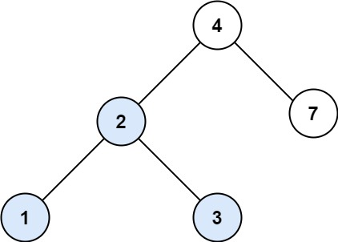
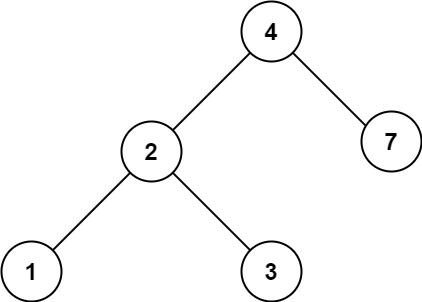

# 700. 二叉搜索树中的搜索

| 题目信息 | 内容 |
|---|---|
| 难度 | 简单 |
| 核心模式 | 利用 BST 有序性二分下降 |
| 时间复杂度 | O(h) |
| 空间复杂度 | O(1) |

## 题目与约束

给定二叉搜索树（BST）的根节点 `root` 和一个整数值 `val`。

你需要在 BST 中找到节点值等于 `val` 的节点。 返回以该节点为根的子树。 如果节点不存在，则返回 `null` 。

 

示例 1:



```
<b>输入：</b>root = [4,2,7,1,3], val = 2
<b>输出：</b>[2,1,3]
```

示例 2:



```
<b>输入：</b>root = [4,2,7,1,3], val = 5
<b>输出：</b>[]
```

 

提示：

- 树中节点数在 `[1, 5000]` 范围内

- `1 <= Node.val <= 107`

- `root` 是二叉搜索树

- `1 <= val <= 107`

[🔗 前往力扣原题验证 →](https://leetcode.cn/problems/search-in-a-binary-search-tree/)

## 核心不变量

> 对 BST，若 `val` 小于当前节点值则目标只可能在左子树，大于则只在右子树，相等即命中。

## 完整推导

### 思路推导

1. **BST 的有序性**：二叉搜索树中，任一节点左子树的所有值都小于它，右子树的所有值都大于它。因此查找无需遍历整棵树。

2. **二分式下降**：从根出发比较当前节点值与 `val`：
   - `val < root.val` → 目标只可能在左子树，`root = root.left`；
   - `val > root.val` → 目标只可能在右子树，`root = root.right`；
   - `val == root.val` → 命中，直接返回当前节点。

3. **结束条件**：走到 `null` 说明树中没有该值，返回 `null`。整个下降过程只沿一条路径走，长度为树高 h。

   **小例子**：`root = [4,2,7,1,3], val = 2`：`2 < 4` 去左子树到节点 2，命中，返回以 2 为根的子树 `[2,1,3]`。

### Java 实现（searchBST）

```java
/**
 * Definition for a binary tree node.
 * public class TreeNode {
 *     int val;
 *     TreeNode left;
 *     TreeNode right;
 *     TreeNode() {}
 *     TreeNode(int val) { this.val = val; }
 *     TreeNode(int val, TreeNode left, TreeNode right) {
 *         this.val = val;
 *         this.left = left;
 *         this.right = right;
 *     }
 * }
 */
class Solution {
    public TreeNode searchBST(TreeNode root, int val) {
        // 沿一条路径二分下降：只有 val 与当前值比较决定方向
        while (root != null && root.val != val) {
            root = val < root.val ? root.left : root.right;
        }
        // root 可能是命中的节点，也可能是 null
        return root;
    }
}
```

### 复杂度

- 时间：O(h)，h 为树高，只沿一条从根到叶的路径下降；最坏（退化成链）O(n)，平均（平衡）O(log n)。
- 空间：O(1)，迭代写法只用了常数个指针变量，无需递归栈。

### 易错点与扩展（面试高频考点）

1. **误用普通二叉树思路**：不利用 BST 性质而全树搜索会把 O(h) 退化成 O(n)，失去题目考察点。
2. **返回的是子树根**：题目要求返回以命中节点为根的整棵子树，而不是只返回值；直接返回该 `TreeNode` 即可。
3. **null 处理**：走到空节点必须返回 `null`，循环条件 `root != null` 已自然覆盖。
4. **递归 vs 迭代**：递归写法是 `return val < root.val ? searchBST(root.left, val) : searchBST(root.right, val)`，迭代更省栈空间。
5. **值域注意**：`Node.val` 最大 `10^7`，在 int 范围内，安全。

## 力扣原题

[700. 二叉搜索树中的搜索](https://leetcode.cn/problems/search-in-a-binary-search-tree/)

### C++ 实现

```cpp
/**
 * Definition for a binary tree node.
 * struct TreeNode {
 *     int val;
 *     TreeNode *left;
 *     TreeNode *right;
 *     TreeNode() : val(0), left(nullptr), right(nullptr) {}
 *     TreeNode(int x) : val(x), left(nullptr), right(nullptr) {}
 *     TreeNode(int x, TreeNode *left, TreeNode *right) : val(x), left(left), right(right) {}
 * };
 */
class Solution {
public:
    TreeNode* searchBST(TreeNode* root, int val) {
        while (root && root->val != val) {
            root = (val < root->val) ? root->left : root->right;
        }
        return root;
    }
};
```

### Python 实现

```python
# Definition for a binary tree node.
# class TreeNode:
#     def __init__(self, val=0, left=None, right=None):
#         self.val = val
#         self.left = left
#         self.right = right
class Solution:
    def searchBST(self, root: TreeNode | None, val: int) -> TreeNode | None:
        while root and root.val != val:
            root = root.left if val < root.val else root.right
        return root
```
