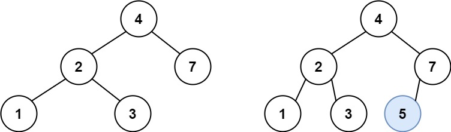

# 701. 二叉搜索树中的插入操作

| 题目信息 | 内容 |
|---|---|
| 难度 | 中等 |
| 核心模式 | 按 BST 有序性单向递归下降，找空位插入 |
| 时间复杂度 | O(h) |
| 空间复杂度 | O(h) |

## 题目与约束

给定二叉搜索树（BST）的根节点 `root` 和要插入树中的值 `value` ，将值插入二叉搜索树。 返回插入后二叉搜索树的根节点。 输入数据 保证 ，新值和原始二叉搜索树中的任意节点值都不同。

注意，可能存在多种有效的插入方式，只要树在插入后仍保持为二叉搜索树即可。 你可以返回 任意有效的结果 。

 

示例 1：



输入：root = [4,2,7,1,3], val = 5  
输出：[4,2,7,1,3,5]  
解释：另一个满足题目要求可以通过的树是：

示例 2：

输入：root = [40,20,60,10,30,50,70], val = 25  
输出：[40,20,60,10,30,50,70,null,null,25]

示例 3：

输入：root = [4,2,7,1,3,null,null,null,null,null,null], val = 5  
输出：[4,2,7,1,3,5]

 

提示：

- 树中的节点数将在 `[0, 104]`的范围内。

- `-108 <= Node.val <= 108`

- 所有值 `Node.val` 是 独一无二 的。

- `-108 <= val <= 108`

- 保证 `val` 在原始BST中不存在。

[🔗 前往力扣原题验证 →](https://leetcode.cn/problems/insert-into-a-binary-search-tree/)

## 核心不变量

> 对任意节点，`val` 若小于它就去左子树，大于它就去右子树；一路走到空的位置，就是合法插入点。

## 完整推导

### 思路推导

1. **直觉（为什么能"顺着方向"走？）**

   BST 的定义决定了整棵树的相对次序：左子树全小于根、右子树全大于根。因此拿 `val` 与当前节点比较，就唯一决定了它应该落在左边还是右边，无需回头搜索。

2. **递归下降（到空位即插入）**

   若 `root` 为空，说明"该来的位置到了"，直接 `new TreeNode(val)` 返回；否则按大小关系把问题交给左子树或右子树，并把返回的新子树接回 `root.left` / `root.right`。

3. **小例子（示例 1：root=[4,2,7,1,3], val=5）**

   5 > 4 去右子树（节点 7）；5 < 7 去左子树（空）；在 7 的左孩子位置插入 5。结果 `[4,2,7,1,3,5]`，仍是合法 BST。

4. **收尾（返回根）**

   递归始终返回当前子树的根，最外层接住整棵树的根即可；插入不会改变原有节点之间的连接，除新增叶子外结构不变。

### Java 实现（insertIntoBST）

```java
class Solution {
    public TreeNode insertIntoBST(TreeNode root, int val) {
        // 走到空位：这里就是新节点的正确落点
        if (root == null) {
            return new TreeNode(val);
        }
        // val 更小，插入左子树，并把新的左子树接回
        if (val < root.val) {
            root.left = insertIntoBST(root.left, val);
        } else {
            // val 更大，插入右子树（题目保证不相等，不会走等于分支）
            root.right = insertIntoBST(root.right, val);
        }
        return root;
    }
}
```

### 复杂度

- 时间：O(h)，h 为树高。每层只比较一次并下沉一层，最坏（链状树）退化为 O(n)，平均 O(log n)。
- 空间：O(h)，递归栈深度等于树高；链状树最坏 O(n)。

### 易错点与扩展（面试高频考点）

1. **忘记接回指针**：`root.left = insertIntoBST(...)` 必须把返回值赋回，否则新节点虽创建却挂不上树。
2. **以为要旋转重构**：本题不要求平衡，任意合法位置都行，最简单就是插到叶子空位，别把问题想复杂。
3. **迭代写法更省栈**：用一个 `cur` 指针边走边记录 `parent`，走到空位后挂到 `parent` 的对应侧；空间 O(1)，可作为追问答案。
4. **等于分支不存在**：题目保证 `val` 不与任何节点相等，若扩展为允许重复，需明确约定重复值放左还是放右。
5. **空树边界**：`root == null` 时直接返回新节点，是最容易被漏掉的用例。

## 力扣原题

[701. 二叉搜索树中的插入操作](https://leetcode.cn/problems/insert-into-a-binary-search-tree/)

### C++ 实现

```cpp
class Solution {
public:
    TreeNode* insertIntoBST(TreeNode* root, int val) {
        if (root == nullptr) {
            return new TreeNode(val);
        }
        if (val < root->val) {
            root->left = insertIntoBST(root->left, val);
        } else {
            root->right = insertIntoBST(root->right, val);
        }
        return root;
    }
};
```

### Python 实现

```python
class Solution:
    def insertIntoBST(self, root: Optional[TreeNode], val: int) -> Optional[TreeNode]:
        if root is None:
            return TreeNode(val)
        if val < root.val:
            root.left = self.insertIntoBST(root.left, val)
        else:
            root.right = self.insertIntoBST(root.right, val)
        return root
```
