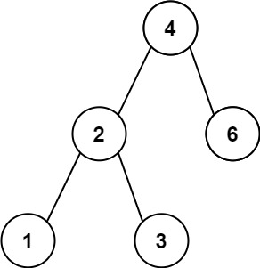
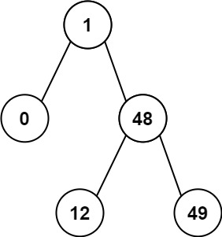

# 783. 二叉搜索树节点最小距离

| 题目信息 | 内容 |
|---|---|
| 难度 | 简单 |
| 核心模式 | 二叉搜索树中序遍历（有序序列相邻求差） |
| 时间复杂度 | O(n) |
| 空间复杂度 | O(h) |

## 题目与约束

给你一个二叉搜索树的根节点 `root` ，返回 树中任意两不同节点值之间的最小差值 。

差值是一个正数，其数值等于两值之差的绝对值。

 

示例 1：



输入：root = [4,2,6,1,3]  
输出：1

示例 2：



输入：root = [1,0,48,null,null,12,49]  
输出：1

 

提示：

- 树中节点的数目范围是 `[2, 100]`

- `0 <= Node.val <= 105`

 

注意：本题与 530：https://leetcode.cn/problems/minimum-absolute-difference-in-bst/ 相同

[🔗 前往力扣原题验证 →](https://leetcode.cn/problems/minimum-distance-between-bst-nodes/)

## 核心不变量

> 二叉搜索树的中序遍历序列严格递增，任意两节点值的最小差一定出现在这个有序序列的相邻元素之间。

## 完整推导

### 思路推导

1. **抓住 BST 的性质**：二叉搜索树满足"左子树 < 根 < 右子树"，对它做中序遍历（左→根→右）会得到一个**严格递增**的有序序列。

2. **最小差只在相邻处**：设有序序列为 `a0 < a1 < ... < an`。对任意 `i < j`，`aj - ai` 一定不小于 `a(i+1) - ai`（中间隔着更多正差值）。所以最小差值必然出现在某一对**相邻**元素之间。

3. **边遍历边比较**：中序遍历时用一个变量 `prev` 记录前一个访问到的节点值，每访问到一个新节点，就用 `当前值 - prev` 更新最小值。一次遍历即可，无需额外存整个数组。

4. **小例验证**：`root = [4,2,6,1,3]`，中序为 `1,2,3,4,6`，相邻差 `1,1,1,2`，最小值 1。

### Java 实现（中序遍历）
```java
/**
 * Definition for a binary tree node.
 * public class TreeNode {
 *     int val;
 *     TreeNode left;
 *     TreeNode right;
 *     TreeNode() {}
 *     TreeNode(int val) { this.val = val; }
 *     TreeNode(int val, TreeNode left, TreeNode right) {
 *         this.val = val;
 *         this.left = left;
 *         this.right = right;
 *     }
 * }
 */
class Solution {
    private Integer prev = null;             // 中序遍历中前一个节点的值
    private int minDiff = Integer.MAX_VALUE; // 记录最小差值

    public int minDiffInBST(TreeNode root) {
        inorder(root);
        return minDiff;
    }

    private void inorder(TreeNode node) {
        if (node == null) return;

        inorder(node.left);                  // 先遍历左子树

        if (prev != null) {                  // 与前驱比较，更新最小差
            minDiff = Math.min(minDiff, node.val - prev);
        }
        prev = node.val;                     // 更新前驱

        inorder(node.right);                 // 再遍历右子树
    }
}
```

### 复杂度
- 时间：`O(n)`。每个节点恰好被访问一次，做常数次比较。
- 空间：`O(h)`。递归调用栈深度等于树高 h，最好 O(log n)、最坏（链状）O(n)；没有额外存储整棵树的数组。

### 易错点与扩展（面试高频考点）

1. **误用"根与左右孩子比较"**：最小差可能出现在"左子树最大值与根"之间，直接比较父子节点会漏解；必须借助中序有序性。
2. **忘记更新 prev**：每访问一个节点都要把 `prev` 更新为当前值，否则会拿错误的前驱做差。
3. **绝对值处理**：因为中序严格递增，`node.val - prev` 天然为正，无需再取绝对值。
4. **空树 / 单节点**：题目保证至少 2 个节点，但代码用 `prev == null` 判断可安全处理第一个节点。
5. **扩展——Morris 中序遍历**：可把空间降到 `O(1)`，用线索化指针在中序遍历时复用空右指针，代价是代码更复杂。

## 力扣原题

[783. 二叉搜索树节点最小距离](https://leetcode.cn/problems/minimum-distance-between-bst-nodes/)

### C++ 实现
```cpp
#include <algorithm>
#include <climits>
using namespace std;

/**
 * Definition for a binary tree node.
 * struct TreeNode {
 *     int val;
 *     TreeNode *left;
 *     TreeNode *right;
 *     TreeNode() : val(0), left(nullptr), right(nullptr) {}
 *     TreeNode(int x) : val(x), left(nullptr), right(nullptr) {}
 *     TreeNode(int x, TreeNode *left, TreeNode *right)
 *         : val(x), left(left), right(right) {}
 * };
 */
class Solution {
public:
    int minDiffInBST(TreeNode* root) {
        inorder(root);
        return minDiff;
    }

private:
    int minDiff = INT_MAX;
    TreeNode* prev = nullptr;

    void inorder(TreeNode* node) {
        if (!node) return;
        inorder(node->left);
        if (prev) minDiff = min(minDiff, node->val - prev->val);
        prev = node;
        inorder(node->right);
    }
};
```

### Python 实现
```python
# Definition for a binary tree node.
# class TreeNode:
#     def __init__(self, val=0, left=None, right=None):
#         self.val = val
#         self.left = left
#         self.right = right
class Solution:
    def minDiffInBST(self, root) -> int:
        self.prev = None
        self.min_diff = float('inf')

        def inorder(node):
            if not node:
                return
            inorder(node.left)
            if self.prev is not None:
                self.min_diff = min(self.min_diff, node.val - self.prev)
            self.prev = node.val
            inorder(node.right)

        inorder(root)
        return self.min_diff
```
