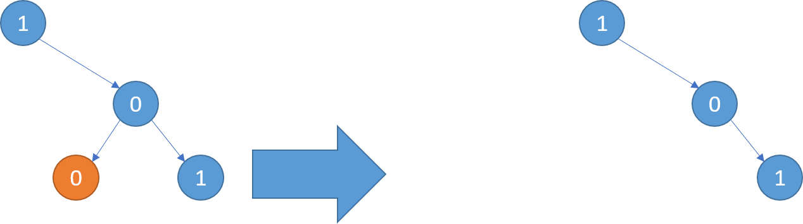
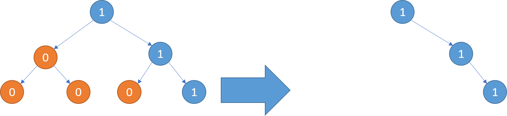
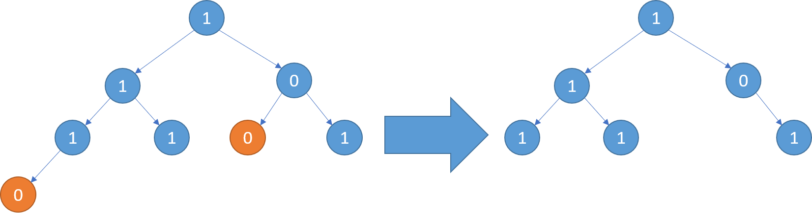

# 814. 二叉树剪枝

| 题目信息 | 内容 |
|---|---|
| 难度 | 中等 |
| 核心模式 | 后序遍历（先剪子树，再判断本节点） |
| 时间复杂度 | O(n) |
| 空间复杂度 | O(h) |

## 题目与约束

给你二叉树的根结点 `root` ，此外树的每个结点的值要么是 `0` ，要么是 `1` 。

返回移除了所有不包含 `1` 的子树的原二叉树。

节点 `node` 的子树为 `node` 本身加上所有 `node` 的后代。

 

示例 1：



```
<strong>输入：</strong>root = [1,null,0,0,1]
<strong>输出：</strong>[1,null,0,null,1]
<strong>解释：</strong>
只有红色节点满足条件“所有不包含 1 的子树”。 右图为返回的答案。
```

示例 2：



```
<strong>输入：</strong>root = [1,0,1,0,0,0,1]
<strong>输出：</strong>[1,null,1,null,1]
```

示例 3：



```
<strong>输入：</strong>root = [1,1,0,1,1,0,1,0]
<strong>输出：</strong>[1,1,0,1,1,null,1]
```

 

提示：

- 树中节点的数目在范围 `[1, 200]` 内

- `Node.val` 为 `0` 或 `1`

[🔗 前往力扣原题验证 →](https://leetcode.cn/problems/binary-tree-pruning/)

## 核心不变量

> 一个节点被删除，当且仅当它自己的值为 0 且它的左右子树都被剪成了空——这正是“整棵子树不含 1”的判定条件。

## 完整推导

### 思路推导

1. **先处理孩子，才能判断自己。** 一个节点是否该剪，取决于“它的子树里还有没有 1”。而子树有没有 1，得先把左右孩子处理完才知道。因此顺序必须是**后序遍历**：先递归剪左子树、再剪右子树，最后看自己。

2. **单节点的判定。** 递归处理完左右孩子后，如果 `node.val == 0` 且 `node.left == null` 且 `node.right == null`，说明以它为根的整棵子树全是 0（孩子里没留下 1），应返回 `null` 表示剪掉它；否则保留 `node` 返回。

3. **返回值向上汇总。** 递归函数返回“剪枝后这一子树的根”，父节点用 `root.left = pruneTree(root.left)` 接住即可，天然把剪掉的孩子置空。

4. **小例子。** `root = [1,null,0,0,1]`：右子树的左叶子 `0` 无孩子、值为 0，被剪成空；右子树的右叶子 `1` 保留；右子节点 `0` 因右孩子还有 `1` 而保留。最终得到 `[1,null,0,null,1]`。

### Java 实现（后序递归剪枝）

```java
class Solution {
    public TreeNode pruneTree(TreeNode root) {
        if (root == null) {
            return null;                       // 空节点直接返回
        }
        root.left = pruneTree(root.left);      // 先剪左子树
        root.right = pruneTree(root.right);    // 再剪右子树
        // 自己为 0 且左右都被剪空 —— 整棵子树不含 1，剪掉
        if (root.val == 0 && root.left == null && root.right == null) {
            return null;
        }
        return root;                            // 否则保留
    }
}
```

### 复杂度

- 时间：O(n)。每个节点恰好被访问一次，做常数时间的判断与指针赋值。
- 空间：O(h)。递归栈深度等于树高 h；最坏（链状树）为 O(n)，最好（平衡树）为 O(log n)。不计输出。

### 易错点与扩展（面试高频考点）

1. **顺序写反成前序。** 若先判断本节点再处理孩子，会误判（孩子还没剪，无法确定子树是否含 1）；必须后序。
2. **漏掉 `root.left == null && root.right == null`。** 只判断 `val == 0` 会把仍有值为 1 后代的 0 节点也误删。
3. **接口约定。** 递归返回“剪枝后的子树根”，父节点要接住返回值，不要写成只改动、不返回。
4. **扩展：非递归写法。** 可借助显式栈做后序遍历，用哈希表记录“子树是否含 1”，实现等价但代码更繁琐。

## 力扣原题

[814. 二叉树剪枝](https://leetcode.cn/problems/binary-tree-pruning/)

### C++ 实现

```cpp
// 力扣已预置 TreeNode 结构，无需重复定义；如需本地调试可取消下面注释：
// struct TreeNode {
//     int val;
//     TreeNode* left;
//     TreeNode* right;
//     TreeNode() : val(0), left(nullptr), right(nullptr) {}
//     TreeNode(int x) : val(x), left(nullptr), right(nullptr) {}
//     TreeNode(int x, TreeNode* l, TreeNode* r) : val(x), left(l), right(r) {}
// };

class Solution {
public:
    TreeNode* pruneTree(TreeNode* root) {
        if (root == nullptr) {
            return nullptr;
        }
        root->left = pruneTree(root->left);      // 先剪左子树
        root->right = pruneTree(root->right);    // 再剪右子树
        // 自身为 0 且左右皆空：整棵子树不含 1
        if (root->val == 0 && root->left == nullptr && root->right == nullptr) {
            return nullptr;
        }
        return root;
    }
};
```

### Python 实现

```python
from typing import Optional

# 力扣已预置 TreeNode，无需重复定义；本地调试可取消注释：
# class TreeNode:
#     def __init__(self, val=0, left=None, right=None):
#         self.val = val
#         self.left = left
#         self.right = right

class Solution:
    def pruneTree(self, root: Optional[TreeNode]) -> Optional[TreeNode]:
        if root is None:
            return None
        root.left = self.pruneTree(root.left)    # 先剪左子树
        root.right = self.pruneTree(root.right)  # 再剪右子树
        # 自身为 0 且左右皆空：整棵子树不含 1
        if root.val == 0 and root.left is None and root.right is None:
            return None
        return root
```
