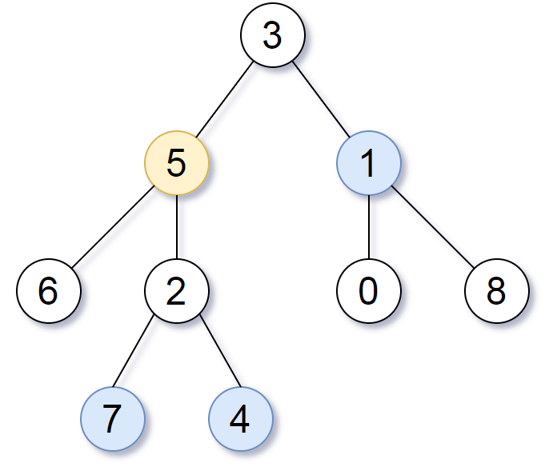

# 863. 二叉树中所有距离为 K 的结点

| 题目信息 | 内容 |
|---|---|
| 难度 | 中等 |
| 核心模式 | 补全父指针把树转成无向图，再从 target 做 BFS |
| 时间复杂度 | O(n) |
| 空间复杂度 | O(n) |

## 题目与约束

给定一个二叉树（具有根结点 `root`）， 一个目标结点 `target` ，和一个整数值 `k` ，返回到目标结点 `target` 距离为 `k` 的所有结点的值的数组。

答案可以以 任何顺序 返回。

 

示例 1：



```
<strong>输入：</strong>root = [3,5,1,6,2,0,8,null,null,7,4], target = 5, k = 2
<strong>输出：</strong>[7,4,1]
<strong>解释：</strong>所求结点为与目标结点（值为 5）距离为 2 的结点，值分别为 7，4，以及 1
```

示例 2:

```
<strong>输入:</strong> root = [1], target = 1, k = 3
<strong>输出:</strong> []
```

 

提示:

- 节点数在 `[1, 500]` 范围内

- `0 <= Node.val <= 500`

- `Node.val` 中所有值 不同

- 目标结点 `target` 是树上的结点。

- `0 <= k <= 1000`

[🔗 前往力扣原题验证 →](https://leetcode.cn/problems/all-nodes-distance-k-in-binary-tree/)

## 核心不变量

> 为每个节点补上指向父节点的指针后，树就变成一张无向图；从 `target` 出发做 k 层 BFS（用 visited 防止走回头路），第 k 层收集到的节点即为答案。

## 完整推导

### 思路推导

1. **痛点（只能往下走，不能往上走）**

   题目要的是"距离 `target` 为 k 的节点"。距离可以向上走（走向父节点）、也可以向下走（走向孩子）。但二叉树只给了 `left/right`，从 `target` 根本走不到它的祖先。只靠原树无法完成。

2. **破局（把树补成无向图）**

   先用一次 DFS 遍历整棵树，用一个哈希表 `parent` 记录每个节点的父节点。这样任意节点都拥有三个"邻居"：`left`、`right`、`parent`。原本的有向树就变成了一张连通无向图，从 `target` 出发可以朝任意方向扩散。

3. **搜索（分层 BFS，走 k 步）**

   从 `target` 开始做 BFS。用 `visited` 集合记录已访问节点，避免"从孩子又走回父节点"造成死循环。每扩散一层 `step+1`，当 `step == k` 时，当前队列里的节点就是答案（全部收下即可，无需再区分层）。若 `k == 0`，答案只有 `target` 自己。

4. **小例子（示例 1）**

   `target = 5, k = 2`。5 的邻居是父 3、左 6、右 2。第 1 层到达 `{3,6,2}`；第 2 层：从 3 到 1（`0`、`8` 是节点 1 的孩子，距 target 5 为 3，不算），从 2 到 7、4，从 6 无新邻居。得到 `{1,7,4}`，即 `[7,4,1]`。

### Java 实现（distanceK）

```java
import java.util.ArrayList;
import java.util.HashMap;
import java.util.HashSet;
import java.util.LinkedList;
import java.util.List;
import java.util.Map;
import java.util.Queue;
import java.util.Set;

/**
 * Definition for a binary tree node.
 * public class TreeNode {
 *     int val;
 *     TreeNode left;
 *     TreeNode right;
 *     TreeNode(int x) { val = x; }
 * }
 */
class Solution {
    public List<Integer> distanceK(TreeNode root, TreeNode target, int k) {
        List<Integer> res = new ArrayList<>();
        if (root == null || target == null) return res;

        // 1. DFS 记录每个节点的父节点，把树补成无向图
        Map<TreeNode, TreeNode> parent = new HashMap<>();
        parent.put(root, null);
        buildParent(root, parent);

        // 2. 从 target 出发做分层 BFS
        Queue<TreeNode> queue = new LinkedList<>();
        Set<TreeNode> visited = new HashSet<>();
        queue.offer(target);
        visited.add(target);

        int dist = 0;
        while (!queue.isEmpty()) {
            if (dist == k) {
                // 当前队列里恰好是距离 target 为 k 的节点
                for (TreeNode node : queue) {
                    res.add(node.val);
                }
                return res;
            }
            int size = queue.size();
            for (int i = 0; i < size; i++) {
                TreeNode cur = queue.poll();
                // 三个方向：左孩子、右孩子、父节点
                for (TreeNode next : new TreeNode[]{cur.left, cur.right, parent.get(cur)}) {
                    if (next != null && !visited.contains(next)) {
                        visited.add(next);
                        queue.offer(next);
                    }
                }
            }
            dist++;
        }
        return res; // k 大于树的高度时返回空列表
    }

    private void buildParent(TreeNode node, Map<TreeNode, TreeNode> parent) {
        if (node == null) return;
        if (node.left != null) {
            parent.put(node.left, node);
            buildParent(node.left, parent);
        }
        if (node.right != null) {
            parent.put(node.right, node);
            buildParent(node.right, parent);
        }
    }
}
```

### 复杂度

- 时间：O(n)。建父指针遍历每个节点一次；BFS 每个节点最多入队一次、访问三条边，整体线性。
- 空间：O(n)。`parent` 哈希表、`visited` 集合与队列在最坏情况下都存放 O(n) 个节点引用。

### 易错点与扩展（面试高频考点）

1. **忘记 `visited`**：补上父指针后图中存在环（子→父→子），不加 visited 会无限循环。这是本题第一大坑。
2. **`k == 0` 的边界**：此时答案就是 `target` 本身，代码里"到第 k 层就收集"的写法天然能处理，但要确保 `dist` 从 0 起、先判断再扩散。
3. **按"层"收集而非按"步数单个扩散"**：用 `size = queue.size()` 锁住当前层，`dist == k` 时整层即答案，可避免记录每个节点的距离。
4. **节点值唯一但不要用值骗自己**：虽然题目说值互不相同，但 visited 仍应基于节点引用，避免因值比较带来隐性错误。
5. **进阶**：也可先记录父指针后从 target 做一次普通 DFS，把 `target` 视作新根、深度为 k 的节点收集；本质相同，BFS 更好控制"距离恰好为 k"。

## 力扣原题

[863. 二叉树中所有距离为 K 的结点](https://leetcode.cn/problems/all-nodes-distance-k-in-binary-tree/)

### C++ 实现

```cpp
class Solution {
public:
    vector<int> distanceK(TreeNode* root, TreeNode* target, int k) {
        vector<int> res;
        if (!root || !target) return res;

        // 1. 记录父节点
        unordered_map<TreeNode*, TreeNode*> parent;
        parent[root] = nullptr;
        buildParent(root, parent);

        // 2. 从 target 分层 BFS
        queue<TreeNode*> q;
        unordered_set<TreeNode*> visited;
        q.push(target);
        visited.insert(target);

        int dist = 0;
        while (!q.empty()) {
            if (dist == k) {
                while (!q.empty()) {
                    res.push_back(q.front()->val);
                    q.pop();
                }
                return res;
            }
            int size = q.size();
            for (int i = 0; i < size; ++i) {
                TreeNode* cur = q.front();
                q.pop();
                TreeNode* neighbors[3] = {cur->left, cur->right, parent[cur]};
                for (TreeNode* nxt : neighbors) {
                    if (nxt && !visited.count(nxt)) {
                        visited.insert(nxt);
                        q.push(nxt);
                    }
                }
            }
            ++dist;
        }
        return res;
    }

private:
    void buildParent(TreeNode* node, unordered_map<TreeNode*, TreeNode*>& parent) {
        if (!node) return;
        if (node->left) {
            parent[node->left] = node;
            buildParent(node->left, parent);
        }
        if (node->right) {
            parent[node->right] = node;
            buildParent(node->right, parent);
        }
    }
};
```

### Python 实现

```python
class Solution:
    def distanceK(self, root: TreeNode, target: TreeNode, k: int) -> List[int]:
        import collections

        # 1. 记录父节点
        parent = {root: None}
        stack = [root]
        while stack:
            node = stack.pop()
            if node.left:
                parent[node.left] = node
                stack.append(node.left)
            if node.right:
                parent[node.right] = node
                stack.append(node.right)

        # 2. 从 target 分层 BFS
        queue = collections.deque([target])
        visited = {target}
        dist = 0

        while queue:
            if dist == k:
                return [node.val for node in queue]
            for _ in range(len(queue)):
                cur = queue.popleft()
                for nxt in (cur.left, cur.right, parent.get(cur)):
                    if nxt and nxt not in visited:
                        visited.add(nxt)
                        queue.append(nxt)
            dist += 1

        return []
```
