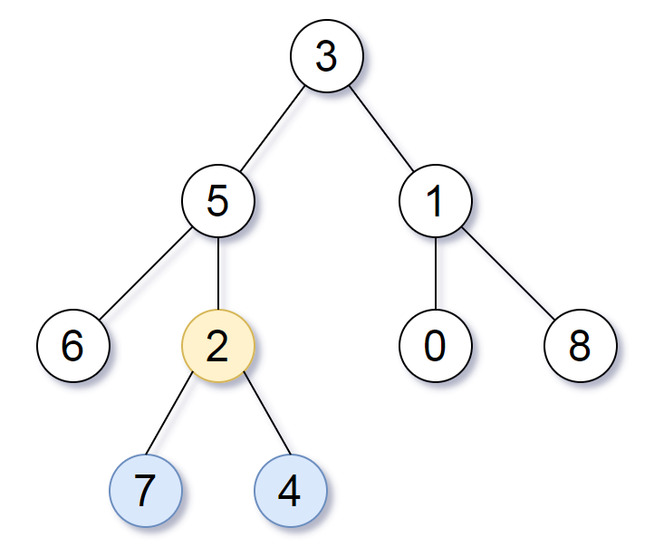

# 865. 具有所有最深节点的最小子树

| 题目信息 | 内容 |
|---|---|
| 难度 | 中等 |
| 核心模式 | 后序 DFS 同时返回"最大深度"与"最深节点的最近公共祖先" |
| 时间复杂度 | O(n) |
| 空间复杂度 | O(h) |

## 题目与约束

给定一个根为 `root` 的二叉树，每个节点的深度是 该节点到根的最短距离 。

返回包含原始树中所有 最深节点 的 最小子树 。

如果一个节点在 整个树 的任意节点之间具有最大的深度，则该节点是 最深的 。

一个节点的 子树 是该节点加上它的所有后代的集合。

 

示例 1：



输入：root = [3,5,1,6,2,0,8,null,null,7,4]  
输出：[2,7,4]  
解释：  
我们返回值为 2 的节点，在图中用黄色标记。  
在图中用蓝色标记的是树的最深的节点。  
注意，节点 5、3 和 2 包含树中最深的节点，但节点 2 的子树最小，因此我们返回它。

示例 2：

输入：root = [1]  
输出：[1]  
解释：根节点是树中最深的节点。

示例 3：

输入：root = [0,1,3,null,2]  
输出：[2]  
解释：树中最深的节点为 2 ，有效子树为节点 2、1 和 0 的子树，但节点 2 的子树最小。

 

提示：

- 树中节点的数量在 `[1, 500]` 范围内。

- `0 <= Node.val <= 500`

- 每个节点的值都是 独一无二 的。

 

注意：本题与力扣 1123 重复：https://leetcode.cn/problems/lowest-common-ancestor-of-deepest-leaves

[🔗 前往力扣原题验证 →](https://leetcode.cn/problems/smallest-subtree-with-all-the-deepest-nodes/)

## 核心不变量

> 对任意节点，它所在子树返回"最大深度"和"该子树内所有最深节点的最近公共祖先（LCA）"；若左右子树深度相等，则当前节点本身就是这个 LCA。

## 完整推导

### 思路推导

1. **转化问题（最小子树 = 最深节点的 LCA）**

   "包含所有最深节点的最小子树"的根，恰好就是所有最深节点的**最近公共祖先（LCA）**。因为要"最小"，根必须尽可能低；而所有最深节点必须都在它的子树里，最低的公共祖先就是 LCA。

2. **一次后序遍历自底向上求**

   定义 `dfs(node)` 返回一对信息：`(本子树最大深度, 本子树中最深节点的 LCA)`。空节点返回 `(0, null)`；叶子节点返回 `(1, 自己)`。

3. **分三种情况合并**

   - 左深 > 右深：最深节点全在左子树，LCA 取左子树的答案，深度 = 左深 + 1。
   - 右深 > 左深：对称，取右子树答案。
   - 左右深度相等：最深的叶子分散在两侧（或为空），它们的 LCA 只能是当前节点，返回 `(左深 + 1, 当前节点)`。

4. **小例子（示例 3）**

   树 `[0,1,3,null,2]`：3 是根 0 的右孩子，左子树最深路径是 1→2（深度 3）。节点 1 左空、右为 2 → `dfs(1)` 返回 `(3, 节点 2)`；根 0 左子树更深、最深节点在节点 2 那一支，最终答案就是节点 `2`，与示例一致。

### Java 实现（subtreeWithAllDeepest）

```java
/**
 * Definition for a binary tree node.
 * public class TreeNode {
 *     int val;
 *     TreeNode left;
 *     TreeNode right;
 *     TreeNode() {}
 *     TreeNode(int val) { this.val = val; }
 *     TreeNode(int val, TreeNode left, TreeNode right) {
 *         this.val = val;
 *         this.left = left;
 *         this.right = right;
 *     }
 * }
 */
class Solution {
    // 封装：子树最大深度 + 该子树内最深节点的 LCA
    private static class Info {
        int depth;
        TreeNode node;
        Info(int depth, TreeNode node) {
            this.depth = depth;
            this.node = node;
        }
    }

    public TreeNode subtreeWithAllDeepest(TreeNode root) {
        return dfs(root).node;
    }

    private Info dfs(TreeNode node) {
        if (node == null) {
            return new Info(0, null);
        }
        Info left = dfs(node.left);
        Info right = dfs(node.right);

        // 左侧更深：答案在左子树
        if (left.depth > right.depth) {
            return new Info(left.depth + 1, left.node);
        }
        // 右侧更深：答案在右子树
        if (right.depth > left.depth) {
            return new Info(right.depth + 1, right.node);
        }
        // 深度相等：当前节点即最深节点的 LCA
        return new Info(left.depth + 1, node);
    }
}
```

### 复杂度

- 时间：O(n)，每个节点只被后序遍历访问一次，合并为常数时间。
- 空间：O(h)，h 为树高，即递归调用栈深度；最坏退化为链时 O(n)。

### 易错点与扩展（面试高频考点）

1. **把"深度相等"误判为返回空**：左右深度相等时不能返回 `null`，必须返回当前节点——它正是两侧最深叶子的 LCA。
2. **深度基准的约定**：空节点深度取 0、叶子取 1，合并时统一 `+1`，避免差一位。
3. **不要两次遍历**：先求全局最大深度、再第二次找节点虽然也对（O(n) 两遍），但一次后序返回 `(depth, node)` 更优雅，面试更亮眼。
4. **与 1123 等价**：本题就是"最深叶节点的最近公共祖先"，两题可同一份代码通过。
5. **返回值是节点而非值**：题目要求返回子树根节点（`TreeNode`），不要只返回值或深度。

## 力扣原题

[865. 具有所有最深节点的最小子树](https://leetcode.cn/problems/smallest-subtree-with-all-the-deepest-nodes/)

### C++ 实现

```cpp
class Solution {
public:
    TreeNode* subtreeWithAllDeepest(TreeNode* root) {
        return dfs(root).second;
    }

private:
    // pair<深度, 最深节点LCA>
    pair<int, TreeNode*> dfs(TreeNode* node) {
        if (!node) return {0, nullptr};

        auto left = dfs(node->left);
        auto right = dfs(node->right);

        if (left.first > right.first) {
            return {left.first + 1, left.second};
        }
        if (right.first > left.first) {
            return {right.first + 1, right.second};
        }
        // 深度相等，当前节点即 LCA
        return {left.first + 1, node};
    }
};
```

### Python 实现

```python
class Solution:
    def subtreeWithAllDeepest(self, root: Optional[TreeNode]) -> Optional[TreeNode]:
        # 返回 (深度, 该子树内最深节点的 LCA)
        def dfs(node):
            if not node:
                return (0, None)

            left_depth, left_node = dfs(node.left)
            right_depth, right_node = dfs(node.right)

            if left_depth > right_depth:
                return (left_depth + 1, left_node)
            if right_depth > left_depth:
                return (right_depth + 1, right_node)
            # 深度相等，当前节点即最深节点的 LCA
            return (left_depth + 1, node)

        return dfs(root)[1]
```
