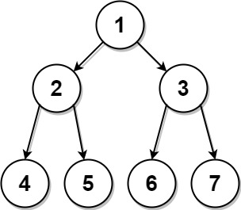

# 889. 从前序与后序遍历序列构造二叉树

| 题目信息 | 内容 |
|---|---|
| 难度 | 中等 |
| 核心模式 | 分治 + 哈希定位子树边界 |
| 时间复杂度 | O(n) |
| 空间复杂度 | O(n) |

## 题目与约束

给定两个整数数组，`preorder` 和 `postorder` ，其中 `preorder` 是一个具有 无重复 值的二叉树的前序遍历，`postorder` 是同一棵树的后序遍历，重构并返回二叉树。

如果存在多个答案，您可以返回其中 任何 一个。

 

示例 1：



```
<strong>输入：</strong>preorder = [1,2,4,5,3,6,7], postorder = [4,5,2,6,7,3,1]
<strong>输出：</strong>[1,2,3,4,5,6,7]
```

示例 2:

```
<strong>输入:</strong> preorder = [1], postorder = [1]
<strong>输出:</strong> [1]
```

 

提示：

- `1 <= preorder.length <= 30`

- `1 <= preorder[i] <= preorder.length`

- `preorder` 中所有值都 不同

- `postorder.length == preorder.length`

- `1 <= postorder[i] <= postorder.length`

- `postorder` 中所有值都 不同

- 保证 `preorder` 和 `postorder` 是同一棵二叉树的前序遍历和后序遍历

[🔗 前往力扣原题验证 →](https://leetcode.cn/problems/construct-binary-tree-from-preorder-and-postorder-traversal/)

## 核心不变量

> 前序的根后面紧跟的 `preorder[preL+1]` 是左子树的根；它在后序中的位置 `idx` 恰好是左子树在后序里的**最后一个元素**，于是左子树大小为 `idx - postL + 1`，据此一刀切出左右两棵子树。

## 完整推导

### 思路推导

1. **直觉与痛点（根好找，边界难切）**

   前序是“根 → 左 → 右”，后序是“左 → 右 → 根”，所以 `preorder[preL]` 和 `postorder[postR]` 都是当前子树的根，根很容易确定。难点在于：**怎么知道左子树有多大？** 只有确定了左子树规模，才能在 `preorder` 和 `postorder` 里同时切出左右两段。

2. **破局思路（用左子树根定位边界）**

   关键观察：如果当前子树不止一个结点，那么 `preorder[preL+1]` 一定是**左子树的根**（前序先访问根，再访问左子树）。而在后序中，左子树的所有结点排在右子树之前、根之前，所以左子树的最后一个结点正是 `preorder[preL+1]`。于是：

   - 在 `postorder` 中找到值 `preorder[preL+1]` 的下标 `idx`；
   - 左子树大小 `leftSize = idx - postL + 1`；
   - 前序左段 `[preL+1, preL+leftSize]`，右段 `[preL+leftSize+1, preR]`；
   - 后序左段 `[postL, idx]`，右段 `[idx+1, postR-1]`（`postR` 是根）。

3. **关键追问（怎么切得又快又准？）**

   如果每次都线性扫 `postorder` 找 `idx`，最坏 `O(n²)`。用一个哈希表 `pos` 记录“值 → 在后序中的下标”，定位就是 `O(1)`，整体降到 `O(n)`。递归出口是 `preL > preR`（空子树返回 `null`）以及 `preL == preR`（叶子结点直接返回）。

   用示例 `preorder=[1,2,4,5,3,6,7]`、`postorder=[4,5,2,6,7,3,1]` 走一遍：根 1，`preorder[1]=2` 在后序下标 2，`leftSize=2-0+1=3`（左子树 `[4,5,2]`，前序 `[2,4,5]`），右子树前序 `[3,6,7]`、后序 `[6,7,3]`，继续递归即可还原整棵树。

### Java 实现（constructFromPrePost）

```java
import java.util.HashMap;
import java.util.Map;

/**
 * Definition for a binary tree node.
 * public class TreeNode {
 *     int val;
 *     TreeNode left;
 *     TreeNode right;
 *     TreeNode() {}
 *     TreeNode(int val) { this.val = val; }
 *     TreeNode(int val, TreeNode left, TreeNode right) {
 *         this.val = val;
 *         this.left = left;
 *         this.right = right;
 *     }
 * }
 */
class Solution {
    private int[] pre;
    private int[] post;
    private Map<Integer, Integer> pos; // 值 -> 在 postorder 中的下标

    public TreeNode constructFromPrePost(int[] preorder, int[] postorder) {
        this.pre = preorder;
        this.post = postorder;
        this.pos = new HashMap<>();
        for (int i = 0; i < postorder.length; i++) {
            pos.put(postorder[i], i);
        }
        return build(0, preorder.length - 1, 0, postorder.length - 1);
    }

    private TreeNode build(int preL, int preR, int postL, int postR) {
        if (preL > preR) {
            return null;                       // 空子树
        }
        TreeNode root = new TreeNode(pre[preL]);
        if (preL == preR) {
            return root;                       // 叶子结点，无子
        }
        // pre[preL+1] 是左子树根，它在后序中的位置界定左子树范围
        int leftRootIdx = pos.get(pre[preL + 1]);
        int leftSize = leftRootIdx - postL + 1;
        root.left = build(preL + 1, preL + leftSize, postL, leftRootIdx);
        root.right = build(preL + leftSize + 1, preR, leftRootIdx + 1, postR - 1);
        return root;
    }
}
```

### 复杂度

- 时间：O(n)，每个结点只被创建一次，哈希定位子树边界为 `O(1)`。
- 空间：O(n)，哈希表占 `O(n)`，递归栈最坏为链状时的 `O(n)`。

### 易错点与扩展（面试高频考点）

1. **`leftSize` 的推导最容易错**：它等于“左子树根在后序中的下标 − `postL` + 1”，少写 `+1` 会漏掉左子树根，导致切分错位。
2. **只有一棵子树时存在歧义**：前序 + 后序无法区分“唯一的孩子在左还是在右”。本算法把 `preorder[preL+1] == postorder[postR-1]` 的情况判给左子树（`leftSize` 恰好等于剩余全部结点），这仍是合法答案——题目允许返回任意一个。
3. **必须加 `preL == preR` 的出口**：否则单结点时 `preorder[preL+1]` 越界。
4. **对比“前序 + 中序”**：中序能唯一确定二叉树，而前序 + 后序只能确定“满二叉树”才唯一，普通二叉树会多解；这是常考的概念区分。
5. **扩展：迭代写法** 可用栈模拟递归，用 `preorder` 建树、按 `postorder` 判断回溯，空间同样 `O(n)`，但边界更易出错，面试中优先写递归分治。

## 力扣原题

[889. 从前序与后序遍历序列构造二叉树](https://leetcode.cn/problems/construct-binary-tree-from-preorder-and-postorder-traversal/)

### C++ 实现

```cpp
#include <vector>
#include <unordered_map>
using namespace std;

/**
 * Definition for a binary tree node.
 * struct TreeNode {
 *     int val;
 *     TreeNode *left;
 *     TreeNode *right;
 *     TreeNode() : val(0), left(nullptr), right(nullptr) {}
 *     TreeNode(int x) : val(x), left(nullptr), right(nullptr) {}
 *     TreeNode(int x, TreeNode *left, TreeNode *right) : val(x), left(left), right(right) {}
 * };
 */
class Solution {
public:
    TreeNode* constructFromPrePost(vector<int>& preorder, vector<int>& postorder) {
        for (int i = 0; i < (int)postorder.size(); ++i) {
            pos[postorder[i]] = i;
        }
        return build(preorder, postorder, 0, (int)preorder.size() - 1,
                     0, (int)postorder.size() - 1);
    }

private:
    unordered_map<int, int> pos; // 值 -> 后序下标

    TreeNode* build(vector<int>& pre, vector<int>& post,
                    int preL, int preR, int postL, int postR) {
        if (preL > preR) return nullptr;
        TreeNode* root = new TreeNode(pre[preL]);
        if (preL == preR) return root;
        int leftRootIdx = pos[pre[preL + 1]];
        int leftSize = leftRootIdx - postL + 1;
        root->left = build(pre, post, preL + 1, preL + leftSize, postL, leftRootIdx);
        root->right = build(pre, post, preL + leftSize + 1, preR, leftRootIdx + 1, postR - 1);
        return root;
    }
};
```

### Python 实现

```python
# Definition for a binary tree node.
# class TreeNode:
#     def __init__(self, val=0, left=None, right=None):
#         self.val = val
#         self.left = left
#         self.right = right
class Solution:
    def constructFromPrePost(self, preorder, postorder):
        pos = {v: i for i, v in enumerate(postorder)}  # 值 -> 后序下标

        def build(preL, preR, postL, postR):
            if preL > preR:
                return None
            root = TreeNode(preorder[preL])
            if preL == preR:
                return root
            left_root_idx = pos[preorder[preL + 1]]
            left_size = left_root_idx - postL + 1
            root.left = build(preL + 1, preL + left_size, postL, left_root_idx)
            root.right = build(preL + left_size + 1, preR, left_root_idx + 1, postR - 1)
            return root

        return build(0, len(preorder) - 1, 0, len(postorder) - 1)
```
