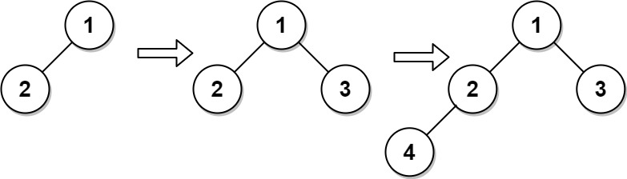

# 919. 完全二叉树插入器

| 题目信息 | 内容 |
|---|---|
| 难度 | 中等 |
| 核心模式 | BFS 维护「待补孩子」的候选父节点队列 |
| 时间复杂度 | 构造 O(n)，单次 insert O(1) 均摊 |
| 空间复杂度 | O(n) |

## 题目与约束

完全二叉树 是每一层（除最后一层外）都是完全填充（即，节点数达到最大）的，并且所有的节点都尽可能地集中在左侧。

设计一种算法，将一个新节点插入到一棵完全二叉树中，并在插入后保持其完整。

实现 `CBTInserter` 类:

- `CBTInserter(TreeNode root)` 使用头节点为 `root` 的给定树初始化该数据结构；

- `CBTInserter.insert(int v)`  向树中插入一个值为 `Node.val == val`的新节点 `TreeNode`。使树保持完全二叉树的状态，并返回插入节点 `TreeNode` 的父节点的值；

- `CBTInserter.get_root()` 将返回树的头节点。

 

示例 1：



输入  
["CBTInserter", "insert", "insert", "get_root"]  
[[[1, 2]], [3], [4], []]  
输出  
[null, 1, 2, [1, 2, 3, 4]]  
解释  
CBTInserter cBTInserter = new CBTInserter([1, 2]);  
cBTInserter.insert(3);  // 返回 1  
cBTInserter.insert(4);  // 返回 2  
cBTInserter.get_root(); // 返回 [1, 2, 3, 4]

 

提示：

- 树中节点数量范围为 `[1, 1000]` 

- `0 <= Node.val <= 5000`

- `root` 是完全二叉树

- `0 <= val <= 5000` 

- 每个测试用例最多调用 `insert` 和 `get_root` 操作 `104` 次

[🔗 前往力扣原题验证 →](https://leetcode.cn/problems/complete-binary-tree-inserter/)

## 核心不变量

> 完全二叉树按层序编号，新节点永远接在「层序中第一个还缺孩子」的节点上；因此只需用一个先进先出的队列保存所有「孩子未满」的节点，队首就是本次插入的父节点。

## 完整推导

### 思路推导

1. **直觉与痛点**：完全二叉树的插入位置是唯一的——永远填在层序第一个「左孩子或右孩子为空」的节点上。暴力做法每次插入都重新 BFS 找位置，单次 O(n)，多次调用就退化。

2. **提前保存候选**：能不能把「还缺孩子」的节点事先收集好？可以。构造时 BFS 遍历整棵树，凡是 `left` 或 `right` 为空的节点都按层序压入队列 `candidates`。这个队列的队首，就是下一个应该被填充孩子的位置。

3. **insert 的两种情形**：
   - 队首 `parent.left` 为空 → 新节点挂到左孩子，`parent` 仍留在队列（它还能接右孩子）。
   - 队首 `parent.left` 不为空（说明右孩子必空）→ 新节点挂到右孩子，此时 `parent` 孩子已满，把它弹出队列。

4. **新节点入队**：刚插入的节点没有任何孩子，天然是「缺孩子」的候选，压入队尾。返回 `parent.val` 即可。

5. **小例子**：`root = [1,2]`（`1` 的左孩子是 `2`）。BFS 从根 `1` 开始，先访问 `1`（有左无右，是候选）再访问 `2`（无孩子，是候选），队列为 `[1, 2]`。`insert(3)`：队首 `1` 左孩子非空 → 挂到右孩子，`1` 已满出队，返回 `1`；`insert(4)`：队首变为 `2`，左孩子为空 → 挂到左孩子，返回 `2`。最终树为 `[1,2,3,4]`，与示例输出一致。

### Java 实现（CBTInserter 构造 + insert + get_root）

```java
import java.util.ArrayDeque;
import java.util.Deque;
import java.util.LinkedList;
import java.util.Queue;

/**
 * Definition for a binary tree node.
 * public class TreeNode {
 *     int val;
 *     TreeNode left;
 *     TreeNode right;
 *     TreeNode() {}
 *     TreeNode(int val) { this.val = val; }
 *     TreeNode(int val, TreeNode left, TreeNode right) {
 *         this.val = val;
 *         this.left = left;
 *         this.right = right;
 *     }
 * }
 */
class CBTInserter {
    private final TreeNode root;
    // 按层序保存「孩子未满」的节点，队首即下一个父节点
    private final Deque<TreeNode> candidates;

    public CBTInserter(TreeNode root) {
        this.root = root;
        this.candidates = new ArrayDeque<>();

        Queue<TreeNode> queue = new LinkedList<>();
        queue.offer(root);
        while (!queue.isEmpty()) {
            TreeNode node = queue.poll();
            if (node.left != null) queue.offer(node.left);
            if (node.right != null) queue.offer(node.right);

            // 至少缺一个孩子，作为候选父节点
            if (node.left == null || node.right == null) {
                candidates.offerLast(node);
            }
        }
    }

    public int insert(int val) {
        TreeNode newNode = new TreeNode(val);
        TreeNode parent = candidates.peekFirst();

        if (parent.left == null) {
            parent.left = newNode;      // 补左孩子，parent 仍留在队列
        } else {
            parent.right = newNode;     // 补右孩子，parent 已满，出队
            candidates.pollFirst();
        }
        candidates.offerLast(newNode);  // 新节点还缺孩子
        return parent.val;
    }

    public TreeNode get_root() {
        return root;
    }
}
```

### 复杂度

- 时间：构造函数 BFS 遍历 O(n)；每次 `insert` 为 O(1)（队列操作均摊常数）；`get_root` 为 O(1)。
- 空间：O(n)，`candidates` 队列最多缓存全部节点，BFS 队列同为 O(n)。

### 易错点与扩展（面试高频考点）

1. **队首出队时机**：只有当父节点的右孩子也被填上（即原来左孩子非空）时才 `pollFirst`；补左孩子时父节点仍可接右孩子，不能提前出队。
2. **候选队列的顺序**：必须严格按层序（BFS）收集，否则插到的位置会破坏「尽可能靠左」的完全二叉树性质。
3. **新节点也要入队**：插入的节点没有孩子，属于下一轮的候选父节点，漏掉它会导致后续插入找不到正确父节点。
4. **返回值是父节点的值**：不是新节点的值，也不是父节点本身。
5. **替代思路**：也可用「节点总数 n 的二进制表示」来定位第 n+1 个节点的父节点路径（层序按二进制导航），无需维护队列，但要处理下标与位运算，面试中队列法更不易写错。

## 力扣原题

[919. 完全二叉树插入器](https://leetcode.cn/problems/complete-binary-tree-inserter/)

### C++ 实现

```cpp
/**
 * Definition for a binary tree node.
 * struct TreeNode {
 *     int val;
 *     TreeNode *left;
 *     TreeNode *right;
 *     TreeNode() : val(0), left(nullptr), right(nullptr) {}
 *     TreeNode(int x) : val(x), left(nullptr), right(nullptr) {}
 *     TreeNode(int x, TreeNode *left, TreeNode *right) : val(x), left(left), right(right) {}
 * };
 */
class CBTInserter {
    TreeNode* root;
    std::queue<TreeNode*> candidates;  // 孩子未满的节点，按层序

public:
    CBTInserter(TreeNode* root) {
        this->root = root;
        std::queue<TreeNode*> q;
        q.push(root);
        while (!q.empty()) {
            TreeNode* node = q.front();
            q.pop();
            if (node->left) q.push(node->left);
            if (node->right) q.push(node->right);
            if (!node->left || !node->right) {
                candidates.push(node);
            }
        }
    }

    int insert(int val) {
        TreeNode* node = new TreeNode(val);
        TreeNode* parent = candidates.front();

        if (!parent->left) {
            parent->left = node;      // 补左孩子
        } else {
            parent->right = node;     // 补右孩子，父节点已满
            candidates.pop();
        }
        candidates.push(node);
        return parent->val;
    }

    TreeNode* get_root() {
        return root;
    }
};
```

### Python 实现

```python
# Definition for a binary tree node.
# class TreeNode:
#     def __init__(self, val=0, left=None, right=None):
#         self.val = val
#         self.left = left
#         self.right = right
from collections import deque

class CBTInserter:
    def __init__(self, root: Optional[TreeNode]):
        self.root = root
        self.candidates = deque()

        q = deque([root])
        while q:
            node = q.popleft()
            if node.left:
                q.append(node.left)
            if node.right:
                q.append(node.right)
            if not node.left or not node.right:
                self.candidates.append(node)

    def insert(self, val: int) -> int:
        node = TreeNode(val)
        parent = self.candidates[0]

        if not parent.left:
            parent.left = node          # 补左孩子
        else:
            parent.right = node         # 补右孩子，父节点已满
            self.candidates.popleft()

        self.candidates.append(node)    # 新节点还缺孩子
        return parent.val

    def get_root(self) -> Optional[TreeNode]:
        return self.root
```
