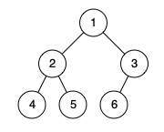
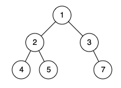

# 958. 二叉树的完全性检验

| 题目信息 | 内容 |
|---|---|
| 难度 | 中等 |
| 核心模式 | BFS 层序扫描，空节点也入队，遇到空节点后不得再出现非空节点 |
| 时间复杂度 | O(n) |
| 空间复杂度 | O(n) |

## 题目与约束

给你一棵二叉树的根节点 `root` ，请你判断这棵树是否是一棵 完全二叉树 。

在一棵 完全二叉树 中，除了最后一层外，所有层都被完全填满，并且最后一层中的所有节点都尽可能靠左。最后一层（第 `h` 层）中可以包含 `1` 到 `2h` 个节点。

 

示例 1：



输入：root = [1,2,3,4,5,6]  
输出：true  
解释：最后一层前的每一层都是满的（即，节点值为 {1} 和 {2,3} 的两层），且最后一层中的所有节点（{4,5,6}）尽可能靠左。

示例 2：



输入：root = [1,2,3,4,5,null,7]  
输出：false  
解释：值为 7 的节点不满足条件「节点尽可能靠左」。

 

提示：

- 树中节点数目在范围 `[1, 100]` 内

- `1 <= Node.val <= 1000`

[🔗 前往力扣原题验证 →](https://leetcode.cn/problems/check-completeness-of-a-binary-tree/)

## 核心不变量

> 按层序遍历（BFS，空孩子也入队占位）扫描，一旦遇到第一个空节点，其后不允许再出现任何非空节点。

## 完整推导

### 思路推导

1. **完全二叉树的等价刻画**：把节点按"从上到下、从左到右"的顺序编号，完全二叉树要求这些节点恰好占满编号 `1..n` 的位置，中间不能有空洞。

2. **用层序把空洞暴露出来**：对树做 BFS，但把空孩子也当作 `null` 入队占位。于是在层序序列中，完全二叉树一定表现为"前面连续一段非空，后面连续一段全是空"。

3. **判定办法**：扫一遍层序，用布尔标记 `seenNull`。一旦从队列里弹出了 `null` 就把标记置真；此后若再弹出非空节点，说明空洞之后又冒出了节点，直接返回 `false`；全部扫描完都不违规就返回 `true`。

4. **小例子（示例 2）**：`[1,2,3,4,5,null,7]` 的层序里，节点 `3` 的右孩子是 `null`，可下一层却出现了 `7`——空洞后又出现节点，判为 `false`。

### Java 实现（isCompleteTree）

```java
import java.util.LinkedList;
import java.util.Queue;

/**
 * Definition for a binary tree node.
 * public class TreeNode {
 *     int val;
 *     TreeNode left;
 *     TreeNode right;
 *     TreeNode() {}
 *     TreeNode(int val) { this.val = val; }
 *     TreeNode(int val, TreeNode left, TreeNode right) {
 *         this.val = val;
 *         this.left = left;
 *         this.right = right;
 *     }
 * }
 */
class Solution {
    public boolean isCompleteTree(TreeNode root) {
        Queue<TreeNode> queue = new LinkedList<>();
        queue.offer(root);
        boolean seenNull = false; // 是否已经出现过空节点

        while (!queue.isEmpty()) {
            TreeNode node = queue.poll();
            if (node == null) {
                // 记录第一次遇到空位
                seenNull = true;
            } else {
                // 空位之后还能弹出节点 => 不是完全二叉树
                if (seenNull) {
                    return false;
                }
                // 空孩子也要入队，用来占位以暴露空洞
                queue.offer(node.left);
                queue.offer(node.right);
            }
        }
        return true;
    }
}
```

### 复杂度

- 时间：O(n)，每个节点（连同其空孩子）最多入队、出队一次。
- 空间：O(n)，队列最坏同时容纳一整层的节点。

### 易错点与扩展（面试高频考点）

1. **空节点必须入队**：只把非空孩子入队，就看不出中间的空洞，判定会失效。
2. **只看局部条件不够**：仅判断"某节点左空右不空"只能抓一部分反例，跨层或跨分支的空洞必须靠全局层序判断。
3. **`seenNull` 不能重置**：一旦置真就保持到结束，别在循环里把它清掉。
4. **空间上限**：把空孩子也入队后，队列最坏可达到一层节点数量级，约 O(n)。
5. **等价写法**：按堆式编号（根为 `i`，左孩子 `2i`，右孩子 `2i+1`），统计节点总数 `n`，若最大编号恰为 `n` 则为完全二叉树。BFS 占位法更直观、更好写。

## 力扣原题

[958. 二叉树的完全性检验](https://leetcode.cn/problems/check-completeness-of-a-binary-tree/)

### C++ 实现

```cpp
class Solution {
public:
    bool isCompleteTree(TreeNode* root) {
        queue<TreeNode*> q;
        q.push(root);
        bool seenNull = false; // 是否已遇到空节点

        while (!q.empty()) {
            TreeNode* node = q.front();
            q.pop();
            if (node == nullptr) {
                seenNull = true; // 空位后不应再有节点
            } else {
                if (seenNull) return false;
                q.push(node->left);   // 空孩子也入队占位
                q.push(node->right);
            }
        }
        return true;
    }
};
```

### Python 实现

```python
import collections
from typing import Optional


class Solution:
    def isCompleteTree(self, root: Optional[TreeNode]) -> bool:
        queue = collections.deque([root])
        seen_null = False

        while queue:
            node = queue.popleft()
            if node is None:
                seen_null = True  # 出现空位
            else:
                if seen_null:
                    return False  # 空位后又有节点
                queue.append(node.left)   # 空孩子也入队
                queue.append(node.right)

        return True
```
