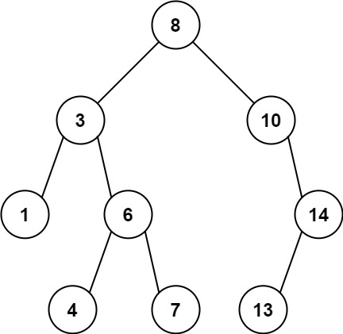
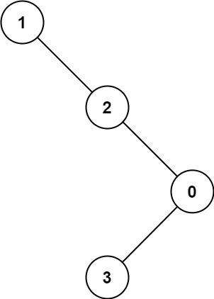

# 1026. 节点与其祖先之间的最大差值

| 题目信息 | 内容 |
|---|---|
| 难度 | 中等 |
| 核心模式 | 树形 DFS：沿根→当前路径维护最小/最大值，用极值之差更新答案 |
| 时间复杂度 | O(n) |
| 空间复杂度 | O(h) |

## 题目与约束

给定二叉树的根节点 `root`，找出存在于 不同 节点 `A` 和 `B` 之间的最大值 `V`，其中 `V = |A.val - B.val|`，且 `A` 是 `B` 的祖先。

（如果 A 的任何子节点之一为 B，或者 A 的任何子节点是 B 的祖先，那么我们认为 A 是 B 的祖先）

 

示例 1：



输入：root = [8,3,10,1,6,null,14,null,null,4,7,13]  
输出：7  
解释：  
我们有大量的节点与其祖先的差值，其中一些如下：  
|8 - 3| = 5  
|3 - 7| = 4  
|8 - 1| = 7  
|10 - 13| = 3  
在所有可能的差值中，最大值 7 由 |8 - 1| = 7 得出。

示例 2：



输入：root = [1,null,2,null,0,3]  
输出：3

 

提示：

- 树中的节点数在 `2` 到 `5000` 之间。

- `0 <= Node.val <= 105`

[🔗 前往力扣原题验证 →](https://leetcode.cn/problems/maximum-difference-between-node-and-ancestor/)

## 核心不变量

> 对任意节点 `B`，它与祖先的最大差值 = `max(B.val - 路径最小值, 路径最大值 - B.val)`；因此沿路径维护最小/最大值，路径极值之差就是该路径上的最大答案。

## 完整推导

### 思路推导

1. **朴素想法为什么慢**
   最直接的做法是枚举每个节点当 `B`，再沿父链枚举所有祖先 `A` 求 `|A.val - B.val|`。最坏情况树退化成链，复杂度 `O(n^2)`，`n = 5000` 时约 2500 万次，偏慢且实现别扭。

2. **换个视角：祖先 = 根到 B 路径上的点**
   “`A` 是 `B` 的祖先”等价于“`A` 出现在从根到 `B` 的路径上”。于是问题转化为：对每一条根→叶路径，求路径上最大值与最小值之差，再取全局最大。

3. **DFS 携带路径极值**
   递归时多传两个参数 `mn`、`mx`，表示从根走到当前节点这一路的最小值和最大值。每到一个新节点就用它的值更新 `mn`、`mx`，然后继续往左右子树走。走到空节点（路径尽头）时，`mx - mn` 就是这条路径上任意“祖先—后代”对能产生的最大差值。

4. **小例子**
   路径 `8 → 3 → 1`：`mn = 1, mx = 8`，差值 `7`；
   路径 `8 → 10 → 14 → 13`：`mn = 8, mx = 14`，差值 `6`；
   全局所有路径取最大，得到 `7`，与示例一致。

### Java 实现（路径极值 DFS）

```java
/**
 * Definition for a binary tree node.
 * public class TreeNode {
 *     int val;
 *     TreeNode left;
 *     TreeNode right;
 *     TreeNode() {}
 *     TreeNode(int val) { this.val = val; }
 *     TreeNode(int val, TreeNode left, TreeNode right) {
 *         this.val = val;
 *         this.left = left;
 *         this.right = right;
 *     }
 * }
 */
class Solution {
    public int maxAncestorDiff(TreeNode root) {
        // 初始路径极值都设为根节点的值
        return dfs(root, root.val, root.val);
    }

    // 返回：以 node 为根的子树中，节点与其祖先可能产生的最大差值
    private int dfs(TreeNode node, int minVal, int maxVal) {
        if (node == null) {
            // 路径走到尽头，这一路的极值之差即为该路径的答案
            return maxVal - minVal;
        }
        minVal = Math.min(minVal, node.val);
        maxVal = Math.max(maxVal, node.val);
        // 分别在左右子树中继续找更大的差值
        return Math.max(dfs(node.left, minVal, maxVal),
                        dfs(node.right, minVal, maxVal));
    }
}
```

### 复杂度

- 时间：`O(n)`。每个节点只被访问一次，常数时间更新极值。
- 空间：`O(h)`。递归栈深度等于树高 `h`，最好 `O(log n)`，链状树最坏 `O(n)`。

### 易错点与扩展（面试高频考点）

1. **只比较父子相邻节点**：差值可能跨越多个层级（如 `|8 - 1|`），必须维护整条路径的极值，不能只看相邻两代。
2. **空节点返回值的取舍**：写成空节点返回 `0` 再向上合并会漏解；正确做法是在路径尽头用 `mx - mn` 结算。
3. **不必单独取绝对值**：因为同时记录了 `mn` 与 `mx`，`mx - mn` 天然覆盖了“后代比祖先大”和“后代比祖先小”两种情况。
4. **全局变量的写法**：也可用成员变量 `ans` 在每步更新 `ans = max(ans, |node.val - mn|, |node.val - mx|)`，效果相同。
5. **深树栈溢出**：节点数最多 5000，链状树递归深度 5000，一般安全；面试可补充用显式栈的迭代写法。

## 力扣原题

[1026. 节点与其祖先之间的最大差值](https://leetcode.cn/problems/maximum-difference-between-node-and-ancestor/)

### C++ 实现

```cpp
#include <algorithm>
using namespace std;

/**
 * Definition for a binary tree node.
 * struct TreeNode {
 *     int val;
 *     TreeNode *left;
 *     TreeNode *right;
 *     TreeNode() : val(0), left(nullptr), right(nullptr) {}
 *     TreeNode(int x) : val(x), left(nullptr), right(nullptr) {}
 *     TreeNode(int x, TreeNode *left, TreeNode *right) : val(x), left(left), right(right) {}
 * };
 */
class Solution {
public:
    int maxAncestorDiff(TreeNode* root) {
        return dfs(root, root->val, root->val);
    }

private:
    int dfs(TreeNode* node, int mn, int mx) {
        if (node == nullptr) {
            return mx - mn;   // 路径尽头，极值之差即为该路径最大值
        }
        mn = min(mn, node->val);
        mx = max(mx, node->val);
        return max(dfs(node->left, mn, mx), dfs(node->right, mn, mx));
    }
};
```

### Python 实现

```python
# Definition for a binary tree node.
# class TreeNode:
#     def __init__(self, val=0, left=None, right=None):
#         self.val = val
#         self.left = left
#         self.right = right
from typing import Optional


class Solution:
    def maxAncestorDiff(self, root: Optional[TreeNode]) -> int:
        def dfs(node, mn, mx):
            if node is None:
                return mx - mn  # 到达路径尽头，极值之差即为该路径的答案
            mn = min(mn, node.val)
            mx = max(mx, node.val)
            return max(dfs(node.left, mn, mx), dfs(node.right, mn, mx))

        return dfs(root, root.val, root.val)
```
