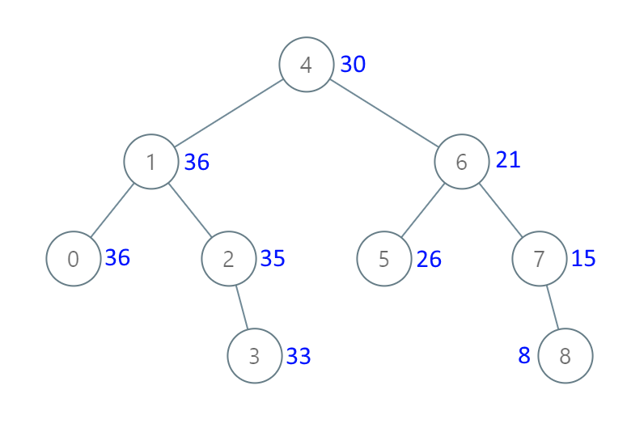

# 1038. 从二叉搜索树到更大和树

| 题目信息 | 内容 |
|---|---|
| 难度 | 中等 |
| 核心模式 | 反序中序遍历（右→根→左）+ 累加和 |
| 时间复杂度 | O(n) |
| 空间复杂度 | O(h) |

## 题目与约束

给定一个二叉搜索树 `root` (BST)，请将它的每个节点的值替换成树中大于或者等于该节点值的所有节点值之和。

提醒一下， 二叉搜索树 满足下列约束条件：

- 节点的左子树仅包含键 小于 节点键的节点。

- 节点的右子树仅包含键 大于 节点键的节点。

- 左右子树也必须是二叉搜索树。

 

示例 1：



```
<strong>输入：</strong>[4,1,6,0,2,5,7,null,null,null,3,null,null,null,8]
<strong>输出：</strong>[30,36,21,36,35,26,15,null,null,null,33,null,null,null,8]
```

示例 2：

```
<strong>输入：</strong>root = [0,null,1]
<strong>输出：</strong>[1,null,1]
```

 

提示：

- 树中的节点数在 `[1, 100]` 范围内。

- `0 <= Node.val <= 100`

- 树中的所有值均 不重复 。

 

注意：该题目与 538: https://leetcode.cn/problems/convert-bst-to-greater-tree/  相同

[🔗 前往力扣原题验证 →](https://leetcode.cn/problems/binary-search-tree-to-greater-sum-tree/)

## 核心不变量

> BST 的中序遍历是升序；把遍历顺序反过来（右→根→左）就是降序。用一个累加和 `sum` 依次累加降序节点值，`sum` 恰好就是“所有大于等于当前节点值之和”。

## 完整推导

### 思路推导

1. **BST 的有序性**
   对 BST 做中序遍历（左→根→右）会得到严格递增的序列。题目要的“大于等于当前节点值之和”，其实就是从最大值开始往小累加——也就是把中序**反过来**访问：右→根→左。

2. **边遍历边累加**
   维护一个全局累加和 `sum`。按“右→根→左”访问时，先处理完所有比当前节点大的右子树节点，此时 `sum` 已经累加了所有更大的值；再 `sum += node.val`，把当前值也加进去；最后把 `node.val` 改成 `sum`。由于当前节点是这一批里最小的，`sum` 正好等于“大于等于它的所有值之和”。

3. **小例子**
   `root = [0,null,1]`：右→根→左 访问顺序是 `1` 然后 `0`。
   访问 `1`：`sum = 0 + 1 = 1`，节点变 `1`；
   访问 `0`：`sum = 1 + 0 = 1`，节点变 `1`。
   结果 `[1,null,1]`，与示例一致。

4. **正确性**
   因为遍历顺序严格降序，处理节点 `x` 时，所有大于 `x` 的节点都已累加进 `sum`，加上 `x` 本身，`sum` 正是“≥ x 的值之和”，逐个替换即得答案，且天然满足 BST 结构不变。

### Java 实现（反序中序 + 累加）

```java
/**
 * Definition for a binary tree node.
 * public class TreeNode {
 *     int val;
 *     TreeNode left;
 *     TreeNode right;
 *     TreeNode() {}
 *     TreeNode(int val) { this.val = val; }
 *     TreeNode(int val, TreeNode left, TreeNode right) {
 *         this.val = val;
 *         this.left = left;
 *         this.right = right;
 *     }
 * }
 */
class Solution {
    private int sum = 0; // 已累加的所有更大节点值之和

    public TreeNode bstToGst(TreeNode root) {
        dfs(root);
        return root;
    }

    private void dfs(TreeNode node) {
        if (node == null) {
            return;
        }
        dfs(node.right);        // 1. 先访问所有更大的右子树节点
        sum += node.val;        // 2. 累加当前节点值
        node.val = sum;         // 3. 用累加和覆盖当前节点
        dfs(node.left);         // 4. 再访问更小的左子树节点
    }
}
```

### 复杂度

- 时间：`O(n)`。每个节点恰好被访问一次，常数时间更新。
- 空间：`O(h)`。递归栈深度等于树高 `h`，平衡树 `O(log n)`，链状树最坏 `O(n)`。

### 易错点与扩展（面试高频考点）

1. **顺序必须是“右→根→左”**：若写成普通中序（左→根→右）会变成累加更小的值，结果错误。
2. **先累加再赋值**：必须 `sum += node.val; node.val = sum;`，若先赋值再累加会少算自身。
3. **原地修改**：直接改 `node.val`、返回原 `root` 即可，不必新建节点，也不要返回新树。
4. **全局 `sum` 的复用**：若把 `sum` 写成成员变量，多次调用同一对象时记得重置（LeetCode 每次新建 Solution，实际无碍，但面试需注意）。
5. **本题等价于 538**：思路完全一致，可作为同一模板记忆。

## 力扣原题

[1038. 从二叉搜索树到更大和树](https://leetcode.cn/problems/binary-search-tree-to-greater-sum-tree/)

### C++ 实现

```cpp
/**
 * Definition for a binary tree node.
 * struct TreeNode {
 *     int val;
 *     TreeNode *left;
 *     TreeNode *right;
 *     TreeNode() : val(0), left(nullptr), right(nullptr) {}
 *     TreeNode(int x) : val(x), left(nullptr), right(nullptr) {}
 *     TreeNode(int x, TreeNode *left, TreeNode *right) : val(x), left(left), right(right) {}
 * };
 */
class Solution {
public:
    TreeNode* bstToGst(TreeNode* root) {
        sum = 0;
        dfs(root);
        return root;
    }

private:
    int sum = 0;
    void dfs(TreeNode* node) {
        if (node == nullptr) {
            return;
        }
        dfs(node->right);     // 先访问更大的右子树
        sum += node->val;     // 累加当前节点
        node->val = sum;      // 覆盖为累加和
        dfs(node->left);      // 再访问更小的左子树
    }
};
```

### Python 实现

```python
# Definition for a binary tree node.
# class TreeNode:
#     def __init__(self, val=0, left=None, right=None):
#         self.val = val
#         self.left = left
#         self.right = right
from typing import Optional


class Solution:
    def bstToGst(self, root: Optional[TreeNode]) -> Optional[TreeNode]:
        self.total = 0

        def dfs(node):
            if node is None:
                return
            dfs(node.right)        # 先访问更大的右子树
            self.total += node.val  # 累加当前节点
            node.val = self.total   # 覆盖为累加和
            dfs(node.left)          # 再访问更小的左子树

        dfs(root)
        return root
```
