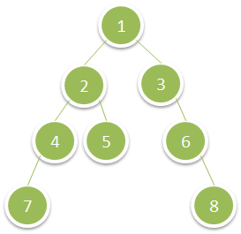

# 1302. 层数最深叶子节点的和

| 题目信息 | 内容 |
|---|---|
| 难度 | 中等 |
| 核心模式 | BFS 逐层遍历，取最后一层的和 |
| 时间复杂度 | O(n) |
| 空间复杂度 | O(w)，w 为树的最大宽度 |

## 题目与约束

给你一棵二叉树的根节点 `root` ，请你返回 层数最深的叶子节点的和 。

 

示例 1：



输入：root = [1,2,3,4,5,null,6,7,null,null,null,null,8]  
输出：15

示例 2：

输入：root = [6,7,8,2,7,1,3,9,null,1,4,null,null,null,5]  
输出：19

 

提示：

- 树中节点数目在范围 `[1, 104]` 之间。

- `1 <= Node.val <= 100`

[🔗 前往力扣原题验证 →](https://leetcode.cn/problems/deepest-leaves-sum/)

## 核心不变量

> 按层推进时，每处理完一整层就把该层节点值之和覆盖到 `sum` 上；循环结束时 `sum` 恰好是最后一层（最深叶子层）的和。

## 完整推导

### 思路推导

1. **如何找到「最深」**：最深一层天然就是层序遍历的最后一层。用 BFS 从根开始逐层向下，最后一个被处理完的层就是最深层。

2. **如何在过程中得到答案**：每进入一层，先把 `sum` 清零，再累加这一层所有节点的值。这样每层都会覆盖上一层的 `sum`，当队列为空时，`sum` 保留的就是最深一层的和。

3. **小例子**：`root = [1,2,3,4,5,null,6,7,null,null,null,null,8]`。
   - 第 0 层：`{1}`，`sum = 1`；
   - 第 1 层：`{2,3}`，`sum = 5`；
   - 第 2 层：`{4,5,6}`，`sum = 15`；
   - 第 3 层：`{7,8}`，`sum = 15`。队列空，返回 15。与该示例结果吻合。

4. **为什么不用 DFS**：DFS 也能做（记录深度，维护「最大深度」和该深度对应的和），但 BFS 逐层推进的语义与「最深一层」最贴合，写起来更直观。

### Java 实现（BFS 层序求和）

```java
import java.util.LinkedList;
import java.util.Queue;

class Solution {
    public int deepestLeavesSum(TreeNode root) {
        if (root == null) {
            return 0;
        }
        Queue<TreeNode> queue = new LinkedList<>();
        queue.offer(root);
        int sum = 0;
        while (!queue.isEmpty()) {
            int levelSize = queue.size();   // 锁定当前层节点数
            sum = 0;                        // 每层重新计数，最后一层的和会保留下来
            for (int i = 0; i < levelSize; i++) {
                TreeNode node = queue.poll();
                sum += node.val;
                if (node.left != null) {
                    queue.offer(node.left);
                }
                if (node.right != null) {
                    queue.offer(node.right);
                }
            }
        }
        return sum;
    }
}
```

### 复杂度

- 时间：O(n)，每个节点恰好入队、出队各一次。
- 空间：O(w)，队列中最多同时存放一层的节点，w 为树的最大宽度（最坏约 n/2，即 O(n)）。

### 易错点与扩展（面试高频考点）

1. **忘记每层清零**：若把 `sum = 0` 放在循环外，会把所有层累加在一起，答案错误。
2. **动态 `queue.size()` 陷阱**：`for` 循环边界必须用进入本层时固定的 `levelSize`，否则新入队的孩子会混淆层边界。
3. **空树防御**：虽然本题 `n >= 1`，但保留 `root == null` 判断是良好习惯。
4. **DFS 解法扩展**：递归时携带 `depth`，维护 `maxDepth` 与 `sum`：若 `depth > maxDepth` 则重置 `sum = node.val`；若 `depth == maxDepth` 则累加。面试常追问这种「一次遍历同时维护深度与和」的写法。
5. **溢出提醒**：本题节点值 ≤ 100、节点数 ≤ 10^4，最坏和不超过 10^6，`int` 足够；若数据范围更大应用 `long`。

## 力扣原题

[1302. 层数最深叶子节点的和](https://leetcode.cn/problems/deepest-leaves-sum/)

### C++ 实现

```cpp
class Solution {
public:
    int deepestLeavesSum(TreeNode* root) {
        if (!root) return 0;
        queue<TreeNode*> q;
        q.push(root);
        int sum = 0;
        while (!q.empty()) {
            int levelSize = q.size();
            sum = 0;
            for (int i = 0; i < levelSize; ++i) {
                TreeNode* node = q.front();
                q.pop();
                sum += node->val;
                if (node->left) q.push(node->left);
                if (node->right) q.push(node->right);
            }
        }
        return sum;
    }
};
```

### Python 实现

```python
from collections import deque


class Solution:
    def deepestLeavesSum(self, root) -> int:
        if root is None:
            return 0
        queue = deque([root])
        total = 0
        while queue:
            total = 0
            for _ in range(len(queue)):
                node = queue.popleft()
                total += node.val
                if node.left:
                    queue.append(node.left)
                if node.right:
                    queue.append(node.right)
        return total
```
