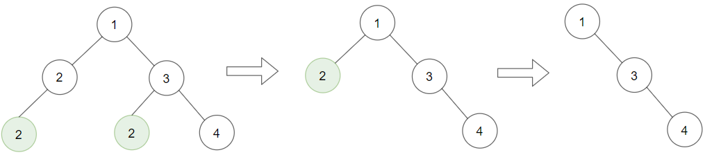
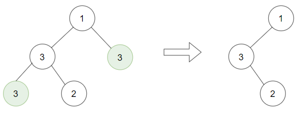
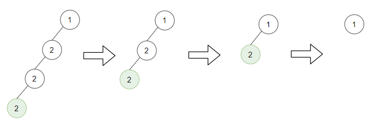

# 1325. 删除给定值的叶子节点

| 题目信息 | 内容 |
|---|---|
| 难度 | 中等 |
| 核心模式 | 后序 DFS 自底向上删除 |
| 时间复杂度 | O(n) |
| 空间复杂度 | O(h)，h 为树高 |

## 题目与约束

给你一棵以 `root` 为根的二叉树和一个整数 `target` ，请你删除所有值为 `target` 的 叶子节点 。

注意，一旦删除值为 `target` 的叶子节点，它的父节点就可能变成叶子节点；如果新叶子节点的值恰好也是 `target` ，那么这个节点也应该被删除。

也就是说，你需要重复此过程直到不能继续删除。

 

示例 1：



输入：root = [1,2,3,2,null,2,4], target = 2  
输出：[1,null,3,null,4]  
解释：  
上面左边的图中，绿色节点为叶子节点，且它们的值与 target 相同（同为 2 ），它们会被删除，得到中间的图。  
有一个新的节点变成了叶子节点且它的值与 target 相同，所以将再次进行删除，从而得到最右边的图。

示例 2：



输入：root = [1,3,3,3,2], target = 3  
输出：[1,3,null,null,2]

示例 3：



输入：root = [1,2,null,2,null,2], target = 2  
输出：[1]  
解释：每一步都删除一个绿色的叶子节点（值为 2）。

 

提示：

- 树中节点数量的范围是 `[1, 3000]`。

- `1 <= Node.val, target <= 1000`

[🔗 前往力扣原题验证 →](https://leetcode.cn/problems/delete-leaves-with-a-given-value/)

## 核心不变量

> 后序遍历保证：处理某个节点时，它的左右子树已经清理完毕；此时若它成为叶子且值等于 `target`，就应返回空指针表示删除。

## 完整推导

### 思路推导

1. **为什么要自底向上**：删除一个叶子后，它的父节点可能「新」变成叶子并需要继续删除。这个连锁反应是从下往上传导的，因此必须先处理子树、再判断自己——正是**后序遍历**的顺序。

2. **递归定义**：函数 `dfs(node)` 返回「清理完以 `node` 为根的子树后，新的子树根」。
   - 先递归处理 `node.left = dfs(node.left)`、`node.right = dfs(node.right)`；
   - 再判断：若 `node` 此时左右都为空（成了叶子）且 `node.val == target`，返回 `null`（表示被删掉）；
   - 否则返回 `node` 本身。

3. **小例子**：`root = [1,2,3,2,null,2,4]`，`target = 2`。
   - 先递归到底部的两个叶子 2，它们值等于 `target` 且无孩子，被删 → 其父节点 2 的左右变空；
   - 回到父节点 2，此时它已成叶子且值等于 `target`，继续被删；
   - 根 1 的左孩子变空、右子树 3 下的叶子 2 被删后 3 只剩右孩子 4，最终得到 `[1,null,3,null,4]`。

4. **为什么一遍递归就够**：后序执行天然完成了「反复删除直到不能删」的过程，不需要外层循环反复扫描。

### Java 实现（后序递归）

```java
class Solution {
    public TreeNode removeLeafNodes(TreeNode root, int target) {
        if (root == null) {
            return null;
        }
        // 先清理左右子树，返回值是清理后的新子树根
        root.left = removeLeafNodes(root.left, target);
        root.right = removeLeafNodes(root.right, target);
        // 后序判断：清理后自己成了叶子且值等于 target，则删除
        if (root.left == null && root.right == null && root.val == target) {
            return null;
        }
        return root;
    }
}
```

### 复杂度

- 时间：O(n)，每个节点被访问且判断一次，删除操作 O(1)。
- 空间：O(h)，递归调用栈深度等于树高；最坏（链状树）为 O(n)，平衡树为 O(log n)。

### 易错点与扩展（面试高频考点）

1. **顺序不能反**：必须在递归处理完孩子之后，再用「左右是否为空」判断自己是不是叶子；若先判断，父节点还没变成叶子，会漏删。
2. **返回值别丢**：`root.left = removeLeafNodes(...)` 一定要接住返回值，否则删除（返回 null）的效果不会反映到父节点上。
3. **根可能被删光**：如果整棵树最终都被删除，函数返回 `null`，调用方拿到的就是空树，这是正确结果。
4. **迭代写法**：可用栈做后序（记录访问状态）或反复 BFS 扫描，但都不如递归简洁。
5. **与「删除节点」类题对比**：本题只删叶子，逻辑简单；若是删除任意值节点并重建树（如 450 删除 BST 节点），需要处理用后继/前驱替换的情形。

## 力扣原题

[1325. 删除给定值的叶子节点](https://leetcode.cn/problems/delete-leaves-with-a-given-value/)

### C++ 实现

```cpp
class Solution {
public:
    TreeNode* removeLeafNodes(TreeNode* root, int target) {
        if (!root) return nullptr;
        root->left = removeLeafNodes(root->left, target);
        root->right = removeLeafNodes(root->right, target);
        if (!root->left && !root->right && root->val == target) {
            return nullptr;
        }
        return root;
    }
};
```

### Python 实现

```python
class Solution:
    def removeLeafNodes(self, root, target: int):
        if root is None:
            return None
        root.left = self.removeLeafNodes(root.left, target)
        root.right = self.removeLeafNodes(root.right, target)
        if root.left is None and root.right is None and root.val == target:
            return None
        return root
```
