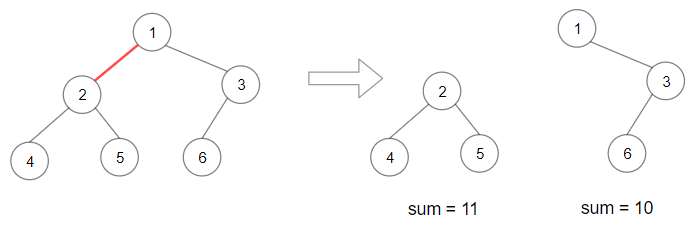
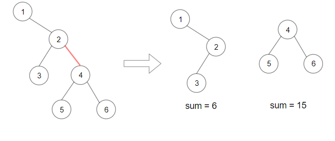

# 1339. 分裂二叉树的最大乘积

| 题目信息 | 内容 |
|---|---|
| 难度 | 中等 |
| 核心模式 | 树形 DFS 求子树和，枚举每条边 |
| 时间复杂度 | O(n) |
| 空间复杂度 | O(n) |

## 题目与约束

给你一棵二叉树，它的根为 `root` 。请你删除 1 条边，使二叉树分裂成两棵子树，且它们子树和的乘积尽可能大。

由于答案可能会很大，请你将结果对 10^9 + 7 取模后再返回。

 

示例 1：



输入：root = [1,2,3,4,5,6]  
输出：110  
解释：删除红色的边，得到 2 棵子树，和分别为 11 和 10 。它们的乘积是 110 （11*10）

示例 2：



输入：root = [1,null,2,3,4,null,null,5,6]  
输出：90  
解释：移除红色的边，得到 2 棵子树，和分别是 15 和 6 。它们的乘积为 90 （15*6）

示例 3：

输入：root = [2,3,9,10,7,8,6,5,4,11,1]  
输出：1025

示例 4：

输入：root = [1,1]  
输出：1

 

提示：

- 每棵树最多有 `50000` 个节点，且至少有 `2` 个节点。

- 每个节点的值在 `[1, 10000]` 之间。

[🔗 前往力扣原题验证 →](https://leetcode.cn/problems/maximum-product-of-splitted-binary-tree/)

## 核心不变量

> 删除某条边后，其中一棵子树的节点和记为 S，另一棵的和必为 `总和 T - S`，乘积即 `S * (T - S)`。

## 完整推导

### 思路推导

1. **把"删边"翻译成"选子树"**：每一条边都对应一个子树——即这条边下方的那一整棵子树。删除该边后分裂出的两棵树，恰好一棵是这棵子树（和为 `S`），另一棵是"整棵树去掉它"（和为 `T - S`）。于是问题变成：在所有权值非负的子树中挑一个，使 `S * (T - S)` 最大。

2. **先求总和 T**：一次后序遍历（左右根）即可算出每个节点的子树和，根节点的子树和就是整棵树的总和 `T`。在遍历过程中顺便把所有子树和都收集起来。

3. **枚举所有子树和取最大值**：对收集到的每个 `S`，计算 `S * (T - S)`，取最大。注意乘法要用 64 位整数，因为总和最大可达 `5×10^4 × 10^4 = 5×10^8`，平方量级约 `6×10^16`，必须用 `long` 才不溢出。

4. **最后才取模**：最大值是在原始数值上比较出来的，取模只用在最终结果上。若中途取模会破坏大小关系，得到错误答案。

### Java 实现（maxProduct + dfs）

```java
import java.util.ArrayList;
import java.util.List;

/**
 * Definition for a binary tree node.
 * public class TreeNode {
 *     int val;
 *     TreeNode left;
 *     TreeNode right;
 *     TreeNode() {}
 *     TreeNode(int val) { this.val = val; }
 *     TreeNode(int val, TreeNode left, TreeNode right) {
 *         this.val = val;
 *         this.left = left;
 *         this.right = right;
 *     }
 * }
 */
class Solution {
    private static final int MOD = 1_000_000_007;
    private final List<Long> sums = new ArrayList<>();

    public int maxProduct(TreeNode root) {
        long total = dfs(root);          // 后序遍历求总和，并收集所有子树和
        long best = 0;
        for (long s : sums) {
            best = Math.max(best, s * (total - s)); // 64 位乘法，避免溢出
        }
        return (int) (best % MOD);       // 只在最后取模
    }

    // 返回以 node 为根的子树和，同时把该子树和加入 sums
    private long dfs(TreeNode node) {
        if (node == null) return 0;
        long sum = node.val + dfs(node.left) + dfs(node.right);
        sums.add(sum);
        return sum;
    }
}
```

### 复杂度

- 时间：O(n)，一次后序遍历计算所有子树和，再一次线性扫描求最大乘积。
- 空间：O(n)，需要存储所有子树和（n 个），递归栈深度最坏 O(n)。

### 易错点与扩展（面试高频考点）

1. **中途取模**：必须用原始数值比较并求最大，最终再 `% MOD`；提前取模会打乱大小比较。
2. **整数溢出**：`S * (T - S)` 远超 `int`，Java 要用 `long`、C++ 要用 `long long`，否则结果错误。
3. **漏掉某棵子树**：每条边对应一个子树，DFS 时要对**每个**节点（含叶子）记录子树和；根节点对应的 `S = T` 会得到乘积 0，不影响取最大。
4. **负权值情形**：本题节点值全为正，贪心枚举安全；若节点可为负，"乘积最大"不一定在总和一半附近，需要更细致分析，但枚举所有 `S` 仍正确。
5. **两次遍历的取舍**：也可以用"第一遍求总和、第二遍求最大乘积"，但把子树和统一收集起来一次比较更直观、代码更短。

## 力扣原题

[1339. 分裂二叉树的最大乘积](https://leetcode.cn/problems/maximum-product-of-splitted-binary-tree/)

### C++ 实现

```cpp
/**
 * Definition for a binary tree node.
 * struct TreeNode {
 *     int val;
 *     TreeNode *left;
 *     TreeNode *right;
 *     TreeNode() : val(0), left(nullptr), right(nullptr) {}
 *     TreeNode(int x) : val(x), left(nullptr), right(nullptr) {}
 *     TreeNode(int x, TreeNode *left, TreeNode *right) : val(x), left(left), right(right) {}
 * };
 */
class Solution {
public:
    vector<long long> sums;

    long long dfs(TreeNode* node) {
        if (!node) return 0;
        long long sum = (long long)node->val + dfs(node->left) + dfs(node->right);
        sums.push_back(sum);
        return sum;
    }

    int maxProduct(TreeNode* root) {
        long long total = dfs(root);
        long long best = 0;
        for (long long s : sums) {
            best = max(best, s * (total - s));   // 64 位乘法
        }
        return (int)(best % 1000000007LL);
    }
};
```

### Python 实现

```python
from typing import Optional

# Definition for a binary tree node.
# class TreeNode:
#     def __init__(self, val=0, left=None, right=None):
#         self.val = val
#         self.left = left
#         self.right = right
class Solution:
    def maxProduct(self, root: Optional[TreeNode]) -> int:
        MOD = 10 ** 9 + 7
        sums = []

        def dfs(node):
            if not node:
                return 0
            s = node.val + dfs(node.left) + dfs(node.right)
            sums.append(s)
            return s

        total = dfs(root)                    # 后序遍历求总和
        best = 0
        for s in sums:                       # Python 大整数无溢出问题
            best = max(best, s * (total - s))
        return best % MOD
```
