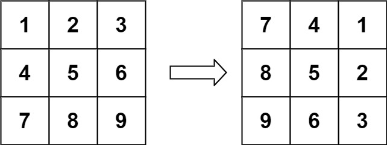
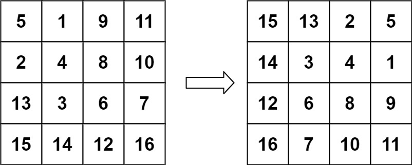

# 48. 旋转图像

[← 矩阵专题](../../02-专题/06-矩阵.md) · [总目录](../../../../README.md) · [复习清单](../../00-总览/03-复习清单.md)

<div class="meta-badges problem-meta-common" aria-label="公共题目信息"><span class="mb diff-中等"><span class="mb-k">难度</span><b>中等</b></span></div>

<div class="meta-badges problem-meta legacy-problem-meta" data-hide-in-language="python" aria-label="Java 及同源语言解题信息"><span class="mb"><span class="mb-k">Java 主方法</span><b>转置 + 每行反转</b></span><span class="mb"><span class="mb-k">时间</span><b>O(n²)</b></span><span class="mb"><span class="mb-k">空间</span><b>O(1)</b></span></div>

<div class="meta-badges problem-meta" data-lang-scope="true" data-lang="python" aria-label="Python 解题信息"><span class="mb"><span class="mb-k">Python 主方法</span><b>转置 + 水平翻转</b></span><span class="mb"><span class="mb-k">时间</span><b>O(n²)</b></span><span class="mb"><span class="mb-k">空间</span><b>O(1)</b></span></div>


## 题目与约束

给定一个 *n*× *n* 的二维矩阵 `matrix` 表示一个图像。请你将图像顺时针旋转 90 度。

  你必须在**[原地](https://baike.baidu.com/item/%E5%8E%9F%E5%9C%B0%E7%AE%97%E6%B3%95)** 旋转图像，这意味着你需要直接修改输入的二维矩阵。**请不要**使用另一个矩阵来旋转图像。

  **示例 1：**

  

  **输入：**matrix = [[1,2,3],[4,5,6],[7,8,9]]<br>**输出：**[[7,4,1],[8,5,2],[9,6,3]]

  **示例 2：**

  

  **输入：**matrix = [[5,1,9,11],[2,4,8,10],[13,3,6,7],[15,14,12,16]]<br>**输出：**[[15,13,2,5],[14,3,4,1],[12,6,8,9],[16,7,10,11]]

  **提示：**

  - `n == matrix.length == matrix[i].length`
  - `1 <= n <= 20`
  - `-1000 <= matrix[i][j] <= 1000`

[🔗 前往力扣原题验证 →](https://leetcode.cn/problems/rotate-image/?envType=study-plan-v2&envId=top-100-liked)

<section class="legacy-solution-panel java-solution-panel" data-hide-in-language="python" data-legacy-scope="true" markdown="1">

## Java 完整推导


### Java 核心不变量


> 转置完成行列交换，水平翻转完成顺时针旋转。

## 完整推导

### 思路推导
  1. **直觉与痛点（强行旋转）**：

     顺时针旋转 90 度，本质上是把顶部一行变成了右侧一列，右侧一列变成底部一行... 这叫做“四角轮换”。你可以用一层层的 `for` 循环去推导下标关系，但稍微一不留神就会越界，或者把已经转过来的数字又覆盖掉了。

  2. **破局思路（数学折纸法：转置 + 镜像翻转）**：

     顺时针旋转 90 度，其实等价于两个简单的轴对称翻转操作的组合：

     - **第一步：沿主对角线（左上到右下）“转置”矩阵。**（就是把矩阵沿着对角线折叠一下，右上角的数字和左下角的数字互换）。
     - **第二步：将每一行“水平镜像翻转”。**（就是把每一行的左右元素互换）。

  3. **逻辑推演（以一个 3x3 矩阵为例）**：

     - **原矩阵**：

       Plaintext

```
1  2  3
4  5  6
7  8  9
```

     - **沿主对角线转置（`mat[i][j]` 与 `mat[j][i]` 互换）**：

```
1  4  7
2  5  8
3  6  9
```
     - **每一行水平翻转（左右互换）**：
```text
7  4  1
8  5  2
9  6  3
```
         大功告成！不仅代码逻辑简单得令人发指，而且完美实现了原地旋转！
### Java 实现
```java
class Solution {
    public void rotate(int[][] matrix) {
        int n = matrix.length;

        // 1. 第一步：沿主对角线翻转矩阵（转置）
        // 注意内层循环 j 从 i 开始！如果 j 从 0 开始，会导致刚换过去的数字又被换回来！
        for (int i = 0; i < n; i++) {
            for (int j = i; j < n; j++) {
                int temp = matrix[i][j];
                matrix[i][j] = matrix[j][i];
                matrix[j][i] = temp;
            }
        }

        // 2. 第二步：水平翻转每一行
        for (int i = 0; i < n; i++) {
            // 双指针翻转数组的标准写法，只需要遍历到列的一半即可
            for (int j = 0; j < n / 2; j++) {
                int temp = matrix[i][j];
                matrix[i][j] = matrix[i][n - 1 - j];
                matrix[i][n - 1 - j] = temp;
            }
        }
    }
}
```
### 复杂度
  - **时间复杂度**：$O(N^2)$。我们需要遍历矩阵的两遍。第一遍只遍历对角线以上的元素（约 $N^2/2$），第二遍遍历矩阵的左半部分（约 $N^2/2$），总操作次数为 $O(N^2)$。
  - **空间复杂度**：$O(1)$。我们仅仅使用了一个常数变量 `temp` 在原矩阵上进行元素交换，完美符合 $O(1)$ 的原地限制。

### 易错点与扩展（极其经典的连环追问）

1. **致命踩坑点：为什么转置时 `j` 要从 `i` 开始？（`for (int j = i; j < n; j++)`）**
   - 如果在转置操作里写成 `j = 0`，当外层走到 `i=1, j=0` 时，你交换了 `[1][0]` 和 `[0][1]`；但之前在 `i=0, j=1` 时你已经交换过它们了！结果就是**换了两次等于没换**。`j` 从 `i` 开始，保证了我们只遍历主对角线“右上方”的三角形区域，把它和“左下方”对调。
2. **面试官发难：“如果我现在要你【逆时针旋转 90 度】呢？”**
   - **底气十足的秒答**：逆时针旋转也是两次翻转的组合。
   - 方案 A：先沿主对角线“转置”，然后再把**每一列“上下翻转”**。
   - 方案 B：先沿**副对角线**（右上到左下）“转置”，然后再把每一行“水平翻转”。
   - *算法之美，在于通过简单对称操作的组合，替代复杂的路径追踪。*

</section>

<section class="language-panel" data-lang-scope="true" data-lang="python" markdown="1">

## Python 完整推导

### 转置交换行列，左右翻转改变方向

把原矩阵沿主对角线转置：matrix[row][col] 与 matrix[col][row] 互换。再把每一行左右翻转。

组合后的映射是 (r, c) → (c, n-1-r)，正好是顺时针旋转 90 度的位置。

### 用 3×3 矩阵追踪

起点：

[1,2,3]  
[4,5,6]  
[7,8,9]

只交换主对角线右上侧：2 与 4、3 与 7、6 与 8。转置后得到：

[1,4,7]  
[2,5,8]  
[3,6,9]

逐行左右翻转：

[7,4,1]  
[8,5,2]  
[9,6,3]

### 追踪四个角

- 原左上角 1 转置后仍在左上，水平翻转后到右上。
- 原右上角 3 转置后到左下，水平翻转后到右下。
- 原左下角 7 转置后到右上，水平翻转后到左上。
- 原右下角 9 转置后到右下，水平翻转后到左下。

### Python 实现

> 参考来源：经典解法实现
>
> 保留旧 Python 的转置加逐行翻转实现，只整理变量与签名；算法未改变。

```python
from typing import List


class Solution:
    def rotate(self, matrix: List[List[int]]) -> None:
        n = len(matrix)
        for row in range(n):
            for col in range(row + 1, n):
                matrix[row][col], matrix[col][row] = matrix[col][row], matrix[row][col]
        for row in matrix:
            row.reverse()
```

### 只交换一次每条对角线

内层 col 从 row+1 开始，只处理主对角线上侧。若从 0 开始，(0,1) 与 (1,0) 会在两轮中交换两次，最终恢复原状。

### 二阶矩阵

2×2 的非对角位置只有一对：matrix[0][1] 与 matrix[1][0] 交换一次。之后两行各自左右翻转，得到 [[3,1],[4,2]]。

### 原地性

转置和对角线交换只改写矩阵已有位置。row.reverse() 也直接翻转列表本身，不会创建新的二维矩阵。

### 复杂度

- 时间复杂度：`O(n²)`。
- 空间复杂度：`O(1)`。

每个方阵位置参与常数次交换，时间 O(n²)；只交换矩阵内元素，额外空间 O(1)。

</section>

## 力扣原题

[🔗 前往力扣原题验证 →](https://leetcode.cn/problems/rotate-image/?envType=study-plan-v2&envId=top-100-liked)

<section class="language-panel cpp-solution-panel" data-lang-scope="true" data-lang="cpp" markdown="1">

## C++ 实现

> 实现来源：经典解法实现

<ol class="lang-steps"><li>顺时针旋转 90° = 先沿主对角线转置，再每行左右翻转</li><li>转置：交换 g[i][j] 与 g[j][i]（只走上三角避免二次交换）</li><li>翻转：每行首尾双指针交换</li></ol>

```cpp
class Solution {
public:
    void rotate(vector<vector<int>>& matrix) {
        int n = matrix.size();
        for (int i = 0; i < n; i++)               // ① 转置
            for (int j = i + 1; j < n; j++)
                swap(matrix[i][j], matrix[j][i]);
        for (auto& row : matrix)                   // ② 每行左右翻转
            reverse(row.begin(), row.end());
    }
};
```

</section>

<section class="language-panel go-solution-panel" data-lang-scope="true" data-lang="go" markdown="1">

## Go 实现

> 实现来源：经典解法实现

<ol class="lang-steps"><li>顺时针旋转 90° = 先沿主对角线转置，再每行左右翻转</li><li>转置：交换 g[i][j] 与 g[j][i]（只走上三角避免二次交换）</li><li>翻转：每行首尾双指针交换</li></ol>

```go
func rotate(matrix [][]int) {
    n := len(matrix)
    for i := 0; i < n; i++ { // ① 转置
        for j := i + 1; j < n; j++ {
            matrix[i][j], matrix[j][i] = matrix[j][i], matrix[i][j]
        }
    }
    for _, row := range matrix { // ② 每行左右翻转
        for l, r := 0, n-1; l < r; l, r = l+1, r-1 {
            row[l], row[r] = row[r], row[l]
        }
    }
}
```

</section>

<section class="language-panel c-solution-panel" data-lang-scope="true" data-lang="c" markdown="1">

## C 实现

> 实现来源：经典解法实现

<ol class="lang-steps"><li>顺时针旋转 90° = 先沿主对角线转置，再每行左右翻转</li><li>转置：交换 g[i][j] 与 g[j][i]（只走上三角避免二次交换）</li><li>翻转：每行首尾双指针交换</li></ol>

```c
void rotate(int** matrix, int matrixSize, int* matrixColSize) {
    for (int i = 0; i < matrixSize; i++) {         /* ① 转置 */
        for (int j = i + 1; j < matrixSize; j++) {
            int t = matrix[i][j];
            matrix[i][j] = matrix[j][i];
            matrix[j][i] = t;
        }
    }
    for (int r = 0; r < matrixSize; r++) {         /* ② 每行左右翻转 */
        for (int l = 0, rt = matrixSize - 1; l < rt; l++, rt--) {
            int t = matrix[r][l];
            matrix[r][l] = matrix[r][rt];
            matrix[r][rt] = t;
        }
    }
}
```

</section>

<!--bottom-nav-->
<div class="problem-nav">
<a class="problem-nav-btn" href="../06-矩阵/0054-螺旋矩阵.html" target="_blank" rel="noopener noreferrer">← 上一题</a>
<a class="problem-nav-btn" href="../../../../index.html">🏠 回到 Hot 100 目录</a>
<a class="problem-nav-btn primary" href="../06-矩阵/0240-搜索二维矩阵 II.html" target="_blank" rel="noopener noreferrer">下一题 →</a>
</div>
<!--/bottom-nav-->
