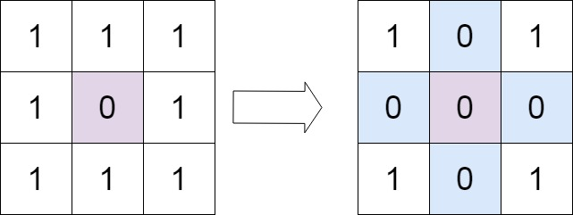
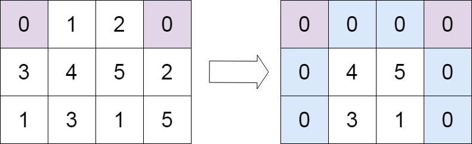

# 73. 矩阵置零

[← 矩阵专题](../../02-专题/06-矩阵.md) · [总目录](../../../../README.md) · [复习清单](../../00-总览/03-复习清单.md)

<div class="meta-badges problem-meta-common" aria-label="公共题目信息"><span class="mb diff-中等"><span class="mb-k">难度</span><b>中等</b></span></div>

<div class="meta-badges problem-meta legacy-problem-meta" data-hide-in-language="python" aria-label="Java 及同源语言解题信息"><span class="mb"><span class="mb-k">Java 主方法</span><b>首行首列原地标记</b></span><span class="mb"><span class="mb-k">时间</span><b>O(mn)</b></span><span class="mb"><span class="mb-k">空间</span><b>O(1)</b></span></div>

<div class="meta-badges problem-meta" data-lang-scope="true" data-lang="python" aria-label="Python 解题信息"><span class="mb"><span class="mb-k">Python 主方法</span><b>首行首列原地标记</b></span><span class="mb"><span class="mb-k">时间</span><b>O(mn)</b></span><span class="mb"><span class="mb-k">空间</span><b>O(1)</b></span></div>


## 题目与约束

给定一个 `m x n` 的矩阵，如果一个元素为 **0**，则将其所在行和列的所有元素都设为 **0** 。请使用 **[原地](http://baike.baidu.com/item/%E5%8E%9F%E5%9C%B0%E7%AE%97%E6%B3%95)** 算法**。**

  **示例 1：**

  

  **输入：**matrix = [[1,1,1],[1,0,1],[1,1,1]]<br>**输出：**[[1,0,1],[0,0,0],[1,0,1]]

  **示例 2：**

  

  **输入：**matrix = [[0,1,2,0],[3,4,5,2],[1,3,1,5]]<br>**输出：**[[0,0,0,0],[0,4,5,0],[0,3,1,0]]

  **提示：**

  - `m == matrix.length`
  - `n == matrix[0].length`
  - `1 <= m, n <= 200`
  - `-231 <= matrix[i][j] <= 231 - 1`

  **进阶：**

  - 一个直观的解决方案是使用  `O(mn)` 的额外空间，但这并不是一个好的解决方案。
  - 一个简单的改进方案是使用 `O(m + n)` 的额外空间，但这仍然不是最好的解决方案。
  - 你能想出一个仅使用常量空间的解决方案吗？

[🔗 前往力扣原题验证 →](https://leetcode.cn/problems/set-matrix-zeroes/?envType=study-plan-v2&envId=top-100-liked)

<section class="legacy-solution-panel java-solution-panel" data-hide-in-language="python" data-legacy-scope="true" markdown="1">

## Java 完整推导


### Java 核心不变量


> 首行首列兼作标记，另存它们自身是否需要清零。

## 完整推导

### 思路推导
  1. **直觉与痛点（连环爆炸陷阱）**：

     最无脑的做法：遇到 0，就把整行整列设为 0。

     **致命痛点**：这会引发“连环爆炸”！被你新变成 0 的那些格子，在后续遍历中又会被当成原来的 0，继续把别的行列炸成 0，最后整个矩阵全变成了 0。

  2. **破局思路 1（额外数组，空间 $O(M+N)$）**：

     我们可以先完整扫一遍，把所有有 0 的**行号**存入一个 Set，**列号**存入另一个 Set。最后再扫一遍，按照 Set 里的行号列号集体置零。这是非常标准的做法，但空间不是 $O(1)$。

  3. **终极破局思路（原地标记法 / 借用第一行和第一列）**：

     要想不用额外空间，我们可以**把矩阵自己的“第一行”和“第一列”当成上面说的 Set（记事本）！**

     - 但是这里有一个冲突：`matrix[0][0]` 这个格子，既属于第一行，又属于第一列。如果把它设为 0，到底代表第一行要全变 0，还是第一列要全变 0？
     - **解决方案**：我们额外用两个 boolean 变量 `firstRowZero` 和 `firstColZero`，先提前记录第一行和第一列**原本**有没有 0。然后 `matrix[0][0]` 以及整个第一行第一列，就可以放心大胆地当“记事本”用了！
### Java 实现
```java
class Solution {
    public void setZeroes(int[][] matrix) {
        int m = matrix.length;
        int n = matrix[0].length;

        boolean firstRowZero = false;
        boolean firstColZero = false;

        // 1. 先扫雷：确定第一行和第一列原本是否包含 0
        for (int i = 0; i < m; i++) {
            if (matrix[i][0] == 0) firstColZero = true;
        }
        for (int j = 0; j < n; j++) {
            if (matrix[0][j] == 0) firstRowZero = true;
        }

        // 2. 核心标记：用第一行和第一列作为“记事本”
        // 注意：从下标 1 开始遍历，避开已经被当做记事本的第一行和第一列
        for (int i = 1; i < m; i++) {
            for (int j = 1; j < n; j++) {
                if (matrix[i][j] == 0) {
                    matrix[i][0] = 0; // 标记该行需要置零
                    matrix[0][j] = 0; // 标记该列需要置零
                }
            }
        }

        // 3. 执行置零：根据记事本上的标记，把内部的格子置零
        // 同样从下标 1 开始
        for (int i = 1; i < m; i++) {
            for (int j = 1; j < n; j++) {
                // 如果当前格子对应的行首或列首有 0 标记，它就必须是 0
                if (matrix[i][0] == 0 || matrix[0][j] == 0) {
                    matrix[i][j] = 0;
                }
            }
        }

        // 4. 打扫战场：处理第一行和第一列的置零
        if (firstColZero) {
            for (int i = 0; i < m; i++) matrix[i][0] = 0;
        }
        if (firstRowZero) {
            for (int j = 0; j < n; j++) matrix[0][j] = 0;
        }
    }
}
```
### 复杂度
  - **时间复杂度**：$O(M \times N)$。我们遍历了矩阵两三次，常数级别的扫描，总体依然是线性的。
  - **空间复杂度**：$O(1)$。我们仅仅用了 `firstRowZero` 和 `firstColZero` 两个布尔变量，非常优雅地完成了原地操作。

### 易错点与扩展（极易翻车点）

1. **为什么执行置零（步骤3）时，也必须从 `i=1`, `j=1` 开始？**
   - **致命翻车**：有些同学在步骤 3 从 `i=0` 开始更新。这就完了！因为第一行是你的“记事本”，如果你在更新内部元素之前，提前把第一行的记事本数据给抹成了 0，那后面的列就全都失去原本的标记了。**记事本必须留到最后才处理（步骤4）**。
2. **更极致的优化（只用 1 个变量）**：
   - 能不能连 2 个 boolean 都不用，只用 1 个？可以！第一行的标记存放在 `matrix[0][0]`，第一列的标记存放在额外的一个变量 `col0` 里。但这种做法代码可读性会略微下降，面试中写我上面提供的 2 个 boolean 变量的版本是最清晰、最不容易出错的。

</section>

<section class="language-panel" data-lang-scope="true" data-lang="python" markdown="1">

## Python 完整推导

### 第一行和第一列可以当行列记事本

遇到内部的 0 时，把对应行首和列首写成 0。这两个标记分别表示“该行最终清零”和“该列最终清零”。

首行和首列本身也承担标记任务，所以必须在写标记前，用两个布尔变量保存它们原本是否含 0。内部清零完成后再处理首行首列。

### 用 [[1,1,1],[1,0,1],[1,1,1]] 走一遍

首行、首列原本都无 0，两个布尔量都是 False。内部只有 matrix[1][1] 为 0：

- 写 matrix[1][0] = 0，记下第 1 行；
- 写 matrix[0][1] = 0，记下第 1 列。

随后按标记清零内部，得到 [[1,0,1],[0,0,0],[1,0,1]]。

### 首行自身含零

输入 [[0,2],[3,4]] 时，first_row_zero=True，first_col_zero=True。内部没有需要标记的 0。

最后先把首行写成 [0,0]，再按首列标记把 matrix[1][0] 写成 0，结果是 **[[0,0],[0,4]]**。第二列第二行的 4 不属于任何含零行或含零列，因此保留。

### Python 实现

> 参考来源：经典解法实现
>
> 保留旧 Python 的首行首列标记实现，只整理变量名、循环与签名；算法未改变。

```python
from typing import List


class Solution:
    def setZeroes(self, matrix: List[List[int]]) -> None:
        rows, cols = len(matrix), len(matrix[0])
        first_row_zero = any(value == 0 for value in matrix[0])
        first_col_zero = any(matrix[row][0] == 0 for row in range(rows))
        for row in range(1, rows):
            for col in range(1, cols):
                if matrix[row][col] == 0:
                    matrix[0][col] = 0
                    matrix[row][0] = 0
        for row in range(1, rows):
            for col in range(1, cols):
                if matrix[0][col] == 0 or matrix[row][0] == 0:
                    matrix[row][col] = 0
        if first_row_zero:
            for col in range(cols):
                matrix[0][col] = 0
        if first_col_zero:
            for row in range(rows):
                matrix[row][0] = 0
```

### 三个阶段

- any 先保存首行、首列的原状态。
- 内部扫描只写行首、列首的标记。
- 内部按标记清零后，最后处理首行和首列。

### 为什么最后才处理首行首列

若提前把首行清零，原本只用于记录某列的标记会被混入新的 0，后续无法区分哪些列原本含零。先标记、再清零、最后打扫首行首列，逻辑才闭合。

### 单行与单列

单行矩阵的内部循环为空，首行状态为真时整行清零。单列矩阵同理，最终整列清零。无零矩阵不会进入任何清零分支。

### 复杂度

- 时间复杂度：`O(mn)`。
- 空间复杂度：`O(1)`。

矩阵被常数次完整扫描，时间 O(mn)；只用 first_row_zero、first_col_zero 两个额外布尔量。

</section>

## 力扣原题

[🔗 前往力扣原题验证 →](https://leetcode.cn/problems/set-matrix-zeroes/?envType=study-plan-v2&envId=top-100-liked)

<section class="language-panel cpp-solution-panel" data-lang-scope="true" data-lang="cpp" markdown="1">

## C++ 实现

> 实现来源：经典解法实现

<ol class="lang-steps"><li>用第一行和第一列做标记位（O(1) 额外空间）</li><li>先记下首行首列自身是否含 0</li><li>扫描内部：凡 0 就在对应的第一行/第一列打标记</li><li>按标记清零内部，最后处理首行首列</li></ol>

```cpp
class Solution {
public:
    void setZeroes(vector<vector<int>>& matrix) {
        int m = matrix.size(), n = matrix[0].size();
        bool row0 = false, col0 = false;
        for (int c = 0; c < n; c++) if (matrix[0][c] == 0) row0 = true;
        for (int r = 0; r < m; r++) if (matrix[r][0] == 0) col0 = true;
        for (int r = 1; r < m; r++)
            for (int c = 1; c < n; c++)
                if (matrix[r][c] == 0) matrix[0][c] = matrix[r][0] = 0;
        for (int r = 1; r < m; r++)
            for (int c = 1; c < n; c++)
                if (matrix[0][c] == 0 || matrix[r][0] == 0) matrix[r][c] = 0;
        if (row0) for (int c = 0; c < n; c++) matrix[0][c] = 0;
        if (col0) for (int r = 0; r < m; r++) matrix[r][0] = 0;
    }
};
```

</section>

<section class="language-panel go-solution-panel" data-lang-scope="true" data-lang="go" markdown="1">

## Go 实现

> 实现来源：经典解法实现

<ol class="lang-steps"><li>用第一行和第一列做标记位（O(1) 额外空间）</li><li>先记下首行首列自身是否含 0</li><li>扫描内部：凡 0 就在对应的第一行/第一列打标记</li><li>按标记清零内部，最后处理首行首列</li></ol>

```go
func setZeroes(matrix [][]int) {
    m, n := len(matrix), len(matrix[0])
    row0, col0 := false, false
    for c := 0; c < n; c++ {
        if matrix[0][c] == 0 { row0 = true }
    }
    for r := 0; r < m; r++ {
        if matrix[r][0] == 0 { col0 = true }
    }
    for r := 1; r < m; r++ {
        for c := 1; c < n; c++ {
            if matrix[r][c] == 0 { matrix[0][c], matrix[r][0] = 0, 0 }
        }
    }
    for r := 1; r < m; r++ {
        for c := 1; c < n; c++ {
            if matrix[0][c] == 0 || matrix[r][0] == 0 { matrix[r][c] = 0 }
        }
    }
    if row0 { for c := 0; c < n; c++ { matrix[0][c] = 0 } }
    if col0 { for r := 0; r < m; r++ { matrix[r][0] = 0 } }
}
```

</section>

<section class="language-panel c-solution-panel" data-lang-scope="true" data-lang="c" markdown="1">

## C 实现

> 实现来源：经典解法实现

<ol class="lang-steps"><li>用第一行和第一列做标记位（O(1) 额外空间）</li><li>先记下首行首列自身是否含 0</li><li>扫描内部：凡 0 就在对应的第一行/第一列打标记</li><li>按标记清零内部，最后处理首行首列</li></ol>

```c
void setZeroes(int** matrix, int matrixSize, int* matrixColSize) {
    int m = matrixSize, n = matrixColSize[0];
    int row0 = 0, col0 = 0;
    for (int c = 0; c < n; c++) if (matrix[0][c] == 0) row0 = 1;
    for (int r = 0; r < m; r++) if (matrix[r][0] == 0) col0 = 1;
    for (int r = 1; r < m; r++)
        for (int c = 1; c < n; c++)
            if (matrix[r][c] == 0) { matrix[0][c] = 0; matrix[r][0] = 0; }
    for (int r = 1; r < m; r++)
        for (int c = 1; c < n; c++)
            if (matrix[0][c] == 0 || matrix[r][0] == 0) matrix[r][c] = 0;
    if (row0) for (int c = 0; c < n; c++) matrix[0][c] = 0;
    if (col0) for (int r = 0; r < m; r++) matrix[r][0] = 0;
}
```

</section>

<!--bottom-nav-->
<div class="problem-nav">
<a class="problem-nav-btn" href="../05-普通数组/0041-缺失的第一个正数.html" target="_blank" rel="noopener noreferrer">← 上一题</a>
<a class="problem-nav-btn" href="../../../../index.html">🏠 回到 Hot 100 目录</a>
<a class="problem-nav-btn primary" href="../06-矩阵/0054-螺旋矩阵.html" target="_blank" rel="noopener noreferrer">下一题 →</a>
</div>
<!--/bottom-nav-->
