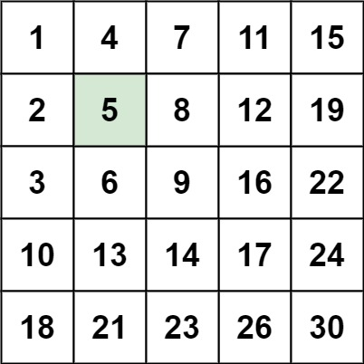
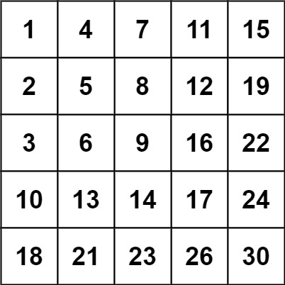

# 240. 搜索二维矩阵 II

[← 矩阵专题](../../02-专题/06-矩阵.md) · [总目录](../../../../README.md) · [复习清单](../../00-总览/03-复习清单.md)

<div class="meta-badges problem-meta-common" aria-label="公共题目信息"><span class="mb diff-中等"><span class="mb-k">难度</span><b>中等</b></span></div>

<div class="meta-badges problem-meta legacy-problem-meta" data-hide-in-language="python" aria-label="Java 及同源语言解题信息"><span class="mb"><span class="mb-k">Java 主方法</span><b>右上角阶梯搜索</b></span><span class="mb"><span class="mb-k">时间</span><b>O(m+n)</b></span><span class="mb"><span class="mb-k">空间</span><b>O(1)</b></span></div>

<div class="meta-badges problem-meta" data-lang-scope="true" data-lang="python" aria-label="Python 解题信息"><span class="mb"><span class="mb-k">Python 主方法</span><b>右上角阶梯搜索</b></span><span class="mb"><span class="mb-k">时间</span><b>O(m + n)</b></span><span class="mb"><span class="mb-k">空间</span><b>O(1)</b></span></div>


## 题目与约束

编写一个高效的算法来搜索 `m x n` 矩阵 `matrix` 中的一个目标值 `target` 。该矩阵具有以下特性：

  - 每行的元素从左到右升序排列。
  - 每列的元素从上到下升序排列。

  **示例 1：**

  

  **输入：**matrix = [[1,4,7,11,15],[2,5,8,12,19],[3,6,9,16,22],[10,13,14,17,24],[18,21,23,26,30]], target = 5<br>**输出：**true

  **示例 2：**

  

  **输入：**matrix = [[1,4,7,11,15],[2,5,8,12,19],[3,6,9,16,22],[10,13,14,17,24],[18,21,23,26,30]], target = 20<br>**输出：**false

  **提示：**

  - `m == matrix.length`
  - `n == matrix[i].length`
  - `1 <= n, m <= 300`
  - `-109 <= matrix[i][j] <= 109`
  - 每行的所有元素从左到右升序排列
  - 每列的所有元素从上到下升序排列
  - `-109 <= target <= 109`

[🔗 前往力扣原题验证 →](https://leetcode.cn/problems/search-a-2d-matrix-ii/?envType=study-plan-v2&envId=top-100-liked)

<section class="legacy-solution-panel java-solution-panel" data-hide-in-language="python" data-legacy-scope="true" markdown="1">

## Java 完整推导


### Java 核心不变量


> 每次比较都能排除一整行或一整列。

## 完整推导

### 思路推导
  1. **直觉与痛点（二分查找的困境）**：

     既然行和列都有序，很多人第一反应是对每一行做二分查找，时间复杂度是 $O(M \log N)$；或者尝试沿着对角线做二分，代码极其复杂且边界难理清。能不能更快？

  2. **破局思路（寻找绝对的分界点）**：

     我们把这个矩阵想象成一棵**二叉搜索树（BST）**。

     - 如果从**左上角**出发：往右变大，往下也变大。一旦目标值大于当前值，你该往右还是往下？**迷茫了，无法抉择。**（右下角同理，往左往上都变小，无法抉择）。

     - 如果从**右上角**出发：神奇的事情发生了！

       - 往**左**走，元素**变小**。

       - 往**下**走，元素**变大**。

         这简直就是一个完美的二叉搜索树节点啊！（左子树小，右子树大）。

  3. **逻辑推演（站在右上角俯视全局）**：

     设当前位置为 `(row, col)`，初始站在右上角 `row = 0, col = n - 1`。

     比较 `matrix[row][col]` 和 `target`：

     - **如果等于 `target`**：恭喜，直接找到，返回 `true`。
     - **如果大于 `target`**：说明当前数字太大了。因为这一列下方的数字只会更大，所以**当前列没救了（全部被淘汰）**，果断向左走：`col--`。
     - **如果小于 `target`**：说明当前数字太小了。因为这一行左边的数字只会更小，所以**当前行没救了（全部被淘汰）**，果断向下走：`row++`。
### Java 实现
```java
class Solution {
    public boolean searchMatrix(int[][] matrix, int target) {
        // 应对极端情况
        if (matrix == null || matrix.length == 0 || matrix[0].length == 0) {
            return false;
        }

        int rows = matrix.length;
        int cols = matrix[0].length;

        // 初始位置：站在右上角
        int r = 0;
        int c = cols - 1;

        // 只要没有走出矩阵的左下角边界，就继续搜索
        while (r < rows && c >= 0) {
            if (matrix[r][c] == target) {
                return true; // 找到了！
            } else if (matrix[r][c] > target) {
                c--; // 当前数字太大，抛弃这一列，向左走
            } else {
                r++; // 当前数字太小，抛弃这一行，向下走
            }
        }

        // 走出边界了都没找到，说明目标值不存在
        return false;
    }
}
```
### 复杂度
  - **时间复杂度**：$O(M + N)$。每一次比较，我们要么抛弃一行（`row++`），要么抛弃一列（`col--`）。最多抛弃 $M$ 行和 $N$ 列，所以搜索的步数最多为 $M + N$ 步。这比二分查找的 $O(M \log N)$ 还要快得多！
  - **空间复杂度**：$O(1)$。只使用了两个指针变量 `r` 和 `c`。

### 易错点与扩展（极其经典的连环追问）

1. **面试官发难：“为什么选右上角？左下角可以吗？”**

   - **满分回答**：**完全可以！** 站在左下角 `(M-1, 0)` 时：

     - 往**上**走，元素**变小**。

     - 往**右**走，元素**变大**。

       依然满足“二选一”的单调性。只要不选左上角和右下角这两个“死胡同”就行。选右上角还是左下角，本质上是对称的。

2. **相关进阶题**：

   - 如果题目变成：“每行有序，且**每一行的第一个整数大于前一行的最后一个整数**”（LeetCode 74: 搜索二维矩阵 I）。
   - 那题更简单，整个矩阵其实可以直接拉平看作一个严格递增的一维数组，直接使用纯正的**全局一维二分查找**，时间复杂度是 $O(\log(M \times N))$。注意区分这两道题的区别！

</section>

<section class="language-panel" data-lang-scope="true" data-lang="python" markdown="1">

## Python 完整推导

### 从右上角出发，每一步只留一个方向

每行从左到右递增，每列从上到下递增。站在右上角时，向左的值更小，向下的值更大。

当前值大于 target 时，这一列从当前行往下都更大，可以排除整列并左移；当前值小于 target 时，这一行从当前位置往左都更小，可以排除整行并下移。

### 用题中矩阵查找 5

从右上角 15 开始：

- 15、11、7 都大于 5，所以 col 依次从 4 减到 1。
- 此时 matrix[0][1]=4 小于 5，当前行左侧的 1 更小，排除第 0 行并下移。
- 到 matrix[1][1]=5，返回 True。

### 找不到时

col 变成 -1 表示所有列都已排除；row 到达 rows 表示所有行都已排除。任一越界都结束搜索并返回 False。

### Python 实现

> 参考来源：经典解法实现
>
> 保留旧 Python 的右上角阶梯搜索实现，只整理行列规模变量与签名；算法未改变。

```python
from typing import List


class Solution:
    def searchMatrix(self, matrix: List[List[int]], target: int) -> bool:
        rows, cols = len(matrix), len(matrix[0])
        row, col = 0, cols - 1
        while row < rows and col >= 0:
            value = matrix[row][col]
            if value == target:
                return True
            if value > target:
                col -= 1
            else:
                row += 1
        return False
```

### 方向与排除范围

- value > target：当前列下半部都不小于 value，因此 col -= 1。
- value < target：当前行左半部都不大于 value，因此 row += 1。
- 当前行已经排除；被排除的是尚未访问的当前行前缀（都小于等于 value），不是此前已经删掉的右侧列。

### 行列规模

rows 和 cols 分别读取，搜索可以用于长方形矩阵。row 只向下走，col 只向左走，两者互不干扰。

### 为什么左上角不行

左上角向右和向下都会变大，遇到当前值小于 target 时无法决定淘汰哪一侧。右上角和左下角各自具有一增一减的两个方向，才适合阶梯搜索。

### 复杂度

- 时间复杂度：`O(m + n)`。
- 空间复杂度：`O(1)`。

每轮 row 加一或 col 减一，行最多下降 m 次、列最多左移 n 次，总步数 O(m+n)。

</section>

## 力扣原题

[🔗 前往力扣原题验证 →](https://leetcode.cn/problems/search-a-2d-matrix-ii/?envType=study-plan-v2&envId=top-100-liked)

<section class="language-panel cpp-solution-panel" data-lang-scope="true" data-lang="cpp" markdown="1">

## C++ 实现

> 实现来源：经典解法实现

<ol class="lang-steps"><li>从右上角出发（元素同时是行最大、列最小）</li><li>当前值 > target → 整列排除，左移</li><li>当前值 < target → 整行排除，下移</li><li>越界仍未命中 → false</li></ol>

```cpp
class Solution {
public:
    bool searchMatrix(vector<vector<int>>& matrix, int target) {
        int r = 0, c = matrix[0].size() - 1;
        while (r < matrix.size() && c >= 0) {
            if (matrix[r][c] == target) return true;
            matrix[r][c] > target ? c-- : r++;   // 大了删列，小了删行
        }
        return false;
    }
};
```

</section>

<section class="language-panel go-solution-panel" data-lang-scope="true" data-lang="go" markdown="1">

## Go 实现

> 实现来源：经典解法实现

<ol class="lang-steps"><li>从右上角出发（元素同时是行最大、列最小）</li><li>当前值 > target → 整列排除，左移</li><li>当前值 < target → 整行排除，下移</li><li>越界仍未命中 → false</li></ol>

```go
func searchMatrix(matrix [][]int, target int) bool {
    r, c := 0, len(matrix[0])-1
    for r < len(matrix) && c >= 0 {
        if matrix[r][c] == target { return true }
        if matrix[r][c] > target { c-- } else { r++ }
    }
    return false
}
```

</section>

<section class="language-panel c-solution-panel" data-lang-scope="true" data-lang="c" markdown="1">

## C 实现

> 实现来源：经典解法实现

<ol class="lang-steps"><li>从右上角出发（元素同时是行最大、列最小）</li><li>当前值 > target → 整列排除，左移</li><li>当前值 < target → 整行排除，下移</li><li>越界仍未命中 → false</li></ol>

```c
bool searchMatrix(int** matrix, int matrixSize, int* matrixColSize, int target) {
    int r = 0, c = matrixColSize[0] - 1;
    while (r < matrixSize && c >= 0) {
        if (matrix[r][c] == target) return true;
        if (matrix[r][c] > target) c--; else r++;
    }
    return false;
}
```

</section>

<!--bottom-nav-->
<div class="problem-nav">
<a class="problem-nav-btn" href="../06-矩阵/0048-旋转图像.html" target="_blank" rel="noopener noreferrer">← 上一题</a>
<a class="problem-nav-btn" href="../../../../index.html">🏠 回到 Hot 100 目录</a>
<a class="problem-nav-btn primary" href="../07-链表/0160-相交链表.html" target="_blank" rel="noopener noreferrer">下一题 →</a>
</div>
<!--/bottom-nav-->
