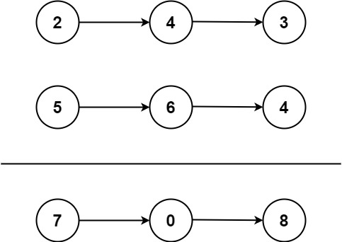

# 2. 两数相加

[← 链表专题](../../02-专题/07-链表.md) · [总目录](../../../../README.md) · [复习清单](../../00-总览/03-复习清单.md)

<div class="meta-badges problem-meta-common" aria-label="公共题目信息"><span class="mb diff-中等"><span class="mb-k">难度</span><b>中等</b></span></div>

<div class="meta-badges problem-meta legacy-problem-meta" data-hide-in-language="python" aria-label="Java 及同源语言解题信息"><span class="mb"><span class="mb-k">Java 主方法</span><b>逐位模拟 + 进位</b></span><span class="mb"><span class="mb-k">时间</span><b>O(max(m,n))</b></span><span class="mb"><span class="mb-k">空间</span><b>O(1) 除答案外</b></span></div>

<div class="meta-badges problem-meta" data-lang-scope="true" data-lang="python" aria-label="Python 解题信息"><span class="mb"><span class="mb-k">Python 主方法</span><b>逐位相加 + 进位</b></span><span class="mb"><span class="mb-k">时间</span><b>O(max(m,n))</b></span><span class="mb"><span class="mb-k">空间</span><b>O(1)（不含输出链表）</b></span></div>


## 题目与约束

给你两个 **非空** 的链表，表示两个非负的整数。它们每位数字都是按照 **逆序** 的方式存储的，并且每个节点只能存储 **一位** 数字。

  请你将两个数相加，并以相同形式返回一个表示和的链表。

  你可以假设除了数字 0 之外，这两个数都不会以 0 开头。

  **示例 1：**

  

  **输入：**l1 = [2,4,3], l2 = [5,6,4]<br>**输出：**[7,0,8]<br>**解释：**342 + 465 = 807.

  **示例 2：**

  **输入：**l1 = [0], l2 = [0]<br>**输出：**[0]

  **示例 3：**

  **输入：**l1 = [9,9,9,9,9,9,9], l2 = [9,9,9,9]<br>**输出：**[8,9,9,9,0,0,0,1]

  **提示：**

  - 每个链表中的节点数在范围 `[1, 100]` 内
  - `0 <= Node.val <= 9`
  - 题目数据保证列表表示的数字不含前导零

[🔗 前往力扣原题验证 →](https://leetcode.cn/problems/add-two-numbers/?envType=study-plan-v2&envId=top-100-liked)

<section class="legacy-solution-panel java-solution-panel" data-hide-in-language="python" data-legacy-scope="true" markdown="1">

## Java 完整推导


### Java 核心不变量


> 循环条件必须包含两个链表和最后的 carry。

## 完整推导

### 思路推导
  1. **直觉与痛点（转成整数再加）**：

     最容易想到的办法是：把链表里的数字读出来，拼成一个真正的 `int` 或 `long`，把两个数加起来，然后再拆成链表。

     **痛点**：极其危险！如果链表非常长（比如有 100 个节点），拼出来的数字连 `BigInteger` 处理起来都费劲，绝对会引发**数值溢出（Overflow）**。

  2. **破局思路（按位模拟竖式加法）**：

     回归小学数学，按位对齐相加，满十进一。

     我们需要三个“小助手”：

     - 指针 `p1`：负责遍历链表 1。
     - 指针 `p2`：负责遍历链表 2。
     - 变量 `carry`（进位）：负责记录相加满 10 后进位的值（要么是 0，要么是 1）。

  3. **灵魂技巧（虚拟头节点 Dummy Node）**：

     因为我们在不断生成新的结果节点，需要一个指针把它们串起来。为了避免判断“这是不是第一个节点”的繁琐逻辑，我们先造一个假的车头 `dummy`，最后直接返回 `dummy.next` 即可。

  4. **逻辑推演（以 `[2, 4, 3]` 和 `[5, 6, 6]` 为例）**：

     也就是计算 342 + 665：

     - **个位**：`2 + 5 + 进位0 = 7`。不进位 (`carry=0`)。结果链表挂上 `7`。
     - **十位**：`4 + 6 + 进位0 = 10`。满十进一 (`carry=1`)。当前位留下 `10 % 10 = 0`。结果链表挂上 `0`。
     - **百位**：`3 + 6 + 进位1 = 10`。满十进一 (`carry=1`)。当前位留下 `0`。结果链表挂上 `0`。
     - **收尾（极其重要）**：两个链表都走完了，但 `carry` 里还有个 `1`！我们必须为它新建一个节点挂在最后。结果链表挂上 `1`。
     - 最终结果链表：`[7, 0, 0, 1]` （即数字 1007，完美匹配）。
### Java 实现
```java
/**
 * Definition for singly-linked list.
 * public class ListNode {
 *     int val;
 *     ListNode next;
 *     ListNode() {}
 *     ListNode(int val) { this.val = val; }
 *     ListNode(int val, ListNode next) { this.val = val; this.next = next; }
 * }
 */
class Solution {
    public ListNode addTwoNumbers(ListNode l1, ListNode l2) {
        // 创建虚拟头节点，化解复杂的头节点判定逻辑
        ListNode dummy = new ListNode(-1);
        ListNode curr = dummy;

        int carry = 0; // 进位器

        // 核心循环：只要 l1 没走完，或者 l2 没走完，或者进位器里还有值，就继续加！
        // 这里的 carry != 0 是防止最高位溢出的灵魂判断！
        while (l1 != null || l2 != null || carry != 0) {
            // 如果链表短，走完了就用 0 占位代入计算
            int val1 = (l1 != null) ? l1.val : 0;
            int val2 = (l2 != null) ? l2.val : 0;

            // 计算当前位的总和
            int sum = val1 + val2 + carry;

            // 更新进位（满十进一）
            carry = sum / 10;

            // 计算当前位要留下的数字，并挂到结果链表上
            curr.next = new ListNode(sum % 10);
            curr = curr.next;

            // 稳步推进指针
            if (l1 != null) l1 = l1.next;
            if (l2 != null) l2 = l2.next;
        }

        return dummy.next;
    }
}
```
### 复杂度
  - **时间复杂度**：$O(\max(M, N))$。$M$ 和 $N$ 分别是两个链表的长度。我们最多只遍历较长链表的长度加一次额外收尾。
  - **空间复杂度**：$O(1)$。这里只算额外开销，返回的结果链表不算在空间复杂度内。我们只用了 `carry` 和几个指针。

### 易错点与扩展（你一定会踩的坑）

1. **最大陷阱：忽略最后的进位（Edge Case）**
   - 测试用例：`[9, 9]` 和 `[1]`（99 + 1 = 100）。
   - 如果不把 `carry != 0` 写进 `while` 的条件里，很多新手会在循环结束后漏掉最高位的 `1`，导致答案变成 `[0, 0]` 而不是正确的 `[0, 0, 1]`。
2. **面试追问：“如果这道题链表是正序存储的（比如 342 存为 `3 -> 4 -> 2`），你该怎么做？”**
   - **回答套路**：这是另一道经典题（LeetCode 445: 两数相加 II）。因为加法必须从低位开始，而链表只能从高位往低位走。破局方法有两个：
     - 方法一：先把两个链表**反转（Reverse）**，变成逆序，然后直接复用我们这道题的代码，最后把结果再反转回来。
     - 方法二：利用**栈（Stack）**。把两个链表的数字全压入栈中，然后利用栈“后进先出”的特性，依次弹栈进行加法运算，每次算出来的新节点用“头插法”接入结果链表。

</section>

<section class="language-panel" data-lang-scope="true" data-lang="python" markdown="1">

## Python 完整推导

### 按竖式从个位向高位相加

两条链表都低位在前，可以直接从当前节点取值相加，并把上一轮 carry 加进来。某条链表先为空时，该位按 0 处理。

divmod(total, 10) 同时给出新 carry 和当前位数字。新节点接到 dummy 后，tail 前移；循环条件同时检查 l1、l2 和 carry。

### 用 [2,4,3] 与 [5,6,6] 走一遍

两数分别是 342 和 665。

- 2 + 5 + 0 = 7，写入 7，carry=0。
- 4 + 6 + 0 = 10，写入 0，carry=1。
- 3 + 6 + 1 = 10，写入 0，carry=1。
- 两条输入都为空，但 carry=1，所以再建立最高位节点 1。

结果 [7,0,0,1] 表示 1007。

### Python 实现

> 参考来源：经典解法实现
>
> 保留旧 Python 的逐位加法与虚拟头构造，整理 divmod 写法、变量和签名；算法未改变。

```python
from typing import Optional


# ListNode 由力扣提供。
class Solution:
    def addTwoNumbers(
        self, l1: Optional[ListNode], l2: Optional[ListNode]
    ) -> Optional[ListNode]:
        dummy = ListNode()
        tail = dummy
        carry = 0
        while l1 or l2 or carry:
            left = l1.val if l1 else 0
            right = l2.val if l2 else 0
            carry, digit = divmod(left + right + carry, 10)
            tail.next = ListNode(digit)
            tail = tail.next
            l1 = l1.next if l1 else None
            l2 = l2.next if l2 else None
        return dummy.next
```

### divmod 的返回值顺序

carry, digit = divmod(total, 10) 中第一个值是商，第二个值是余数。商进入下一轮，余数写入当前节点。

### 为什么 carry 要放进循环条件

99 + 1 在两条链表都走完后仍有 carry=1。只写 while l1 or l2 会漏掉新增的最高位。

### 输入不变与输出空间

代码只读取输入节点的 val，并让 l1、l2 沿 next 前进；结果节点全部新建。dummy 和结果链表是输出构造的一部分，除此之外只保存 carry 与输入指针。

### 复杂度

- 时间复杂度：`O(max(m,n))`。
- 空间复杂度：`O(1)（不含输出链表）`。

每轮消耗至多一个输入节点并创建一个结果节点，轮数不超过 max(m,n)+1。

</section>

## 力扣原题

[🔗 前往力扣原题验证 →](https://leetcode.cn/problems/add-two-numbers/?envType=study-plan-v2&envId=top-100-liked)

<section class="language-panel cpp-solution-panel" data-lang-scope="true" data-lang="cpp" markdown="1">

## C++ 实现

> 实现来源：经典解法实现

<ol class="lang-steps"><li>两链表逐位相加，加上进位，头节点是最低位</li><li>sum = x + y + carry；新节点值 = sum % 10，新进位 = sum / 10</li><li>任一链表走完后按 0 补位；结束后若还有进位，追加一个节点</li></ol>

```cpp
class Solution {
public:
    ListNode* addTwoNumbers(ListNode* l1, ListNode* l2) {
        ListNode dummy(0), *tail = &dummy;
        int carry = 0;
        while (l1 || l2 || carry) {
            int sum = (l1 ? l1->val : 0) + (l2 ? l2->val : 0) + carry;
            tail->next = new ListNode(sum % 10);
            tail = tail->next;
            carry = sum / 10;
            if (l1) l1 = l1->next;
            if (l2) l2 = l2->next;
        }
        return dummy.next;
    }
};
```

</section>

<section class="language-panel go-solution-panel" data-lang-scope="true" data-lang="go" markdown="1">

## Go 实现

> 实现来源：经典解法实现

<ol class="lang-steps"><li>两链表逐位相加，加上进位，头节点是最低位</li><li>sum = x + y + carry；新节点值 = sum % 10，新进位 = sum / 10</li><li>任一链表走完后按 0 补位；结束后若还有进位，追加一个节点</li></ol>

```go
func addTwoNumbers(l1 *ListNode, l2 *ListNode) *ListNode {
    dummy := &ListNode{}
    tail := dummy
    carry := 0
    for l1 != nil || l2 != nil || carry != 0 {
        s := carry
        if l1 != nil { s += l1.Val; l1 = l1.Next }
        if l2 != nil { s += l2.Val; l2 = l2.Next }
        tail.Next = &ListNode{Val: s % 10}
        tail = tail.Next
        carry = s / 10
    }
    return dummy.Next
}
```

</section>

<section class="language-panel c-solution-panel" data-lang-scope="true" data-lang="c" markdown="1">

## C 实现

> 实现来源：经典解法实现

<ol class="lang-steps"><li>两链表逐位相加，加上进位，头节点是最低位</li><li>sum = x + y + carry；新节点值 = sum % 10，新进位 = sum / 10</li><li>任一链表走完后按 0 补位；结束后若还有进位，追加一个节点</li></ol>

```c
struct ListNode* addTwoNumbers(struct ListNode* l1, struct ListNode* l2) {
    struct ListNode dummy; dummy.next = NULL;
    struct ListNode* tail = &dummy;
    int carry = 0;
    while (l1 || l2 || carry) {
        int s = carry;
        if (l1) { s += l1->val; l1 = l1->next; }
        if (l2) { s += l2->val; l2 = l2->next; }
        tail->next = malloc(sizeof(struct ListNode));
        tail = tail->next;
        tail->val = s % 10;
        tail->next = NULL;
        carry = s / 10;
    }
    return dummy.next;
}
```

</section>

<!--bottom-nav-->
<div class="problem-nav">
<a class="problem-nav-btn" href="../07-链表/0021-合并两个有序链表.html" target="_blank" rel="noopener noreferrer">← 上一题</a>
<a class="problem-nav-btn" href="../../../../index.html">🏠 回到 Hot 100 目录</a>
<a class="problem-nav-btn primary" href="../07-链表/0019-删除链表的倒数第 N 个结点.html" target="_blank" rel="noopener noreferrer">下一题 →</a>
</div>
<!--/bottom-nav-->
