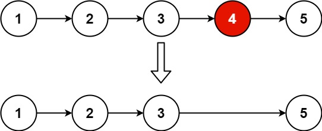

# 19. 删除链表的倒数第 N 个结点

[← 链表专题](../../02-专题/07-链表.md) · [总目录](../../../../README.md) · [复习清单](../../00-总览/03-复习清单.md)

<div class="meta-badges problem-meta-common" aria-label="公共题目信息"><span class="mb diff-中等"><span class="mb-k">难度</span><b>中等</b></span></div>

<div class="meta-badges problem-meta legacy-problem-meta" data-hide-in-language="python" aria-label="Java 及同源语言解题信息"><span class="mb"><span class="mb-k">Java 主方法</span><b>快慢指针 + 虚拟头</b></span><span class="mb"><span class="mb-k">时间</span><b>O(n)</b></span><span class="mb"><span class="mb-k">空间</span><b>O(1)</b></span></div>

<div class="meta-badges problem-meta" data-lang-scope="true" data-lang="python" aria-label="Python 解题信息"><span class="mb"><span class="mb-k">Python 主方法</span><b>虚拟头 + 固定间距快慢指针</b></span><span class="mb"><span class="mb-k">时间</span><b>O(L)</b></span><span class="mb"><span class="mb-k">空间</span><b>O(1)</b></span></div>


## 题目与约束

给你一个链表，删除链表的倒数第 `n`个结点，并且返回链表的头结点。

  **示例 1：**

  

  **输入：**head = [1,2,3,4,5], n = 2<br>**输出：**[1,2,3,5]

  **示例 2：**

  **输入：**head = [1], n = 1<br>**输出：**[]

  **示例 3：**

  **输入：**head = [1,2], n = 1<br>**输出：**[1]

  **提示：**

  - 链表中结点的数目为 `sz`
  - `1 <= sz <= 30`
  - `0 <= Node.val <= 100`
  - `1 <= n <= sz`

  **进阶：**你能尝试使用一趟扫描实现吗？

[🔗 前往力扣原题验证 →](https://leetcode.cn/problems/remove-nth-node-from-end-of-list/?envType=study-plan-v2&envId=top-100-liked)

<section class="legacy-solution-panel java-solution-panel" data-hide-in-language="python" data-legacy-scope="true" markdown="1">

## Java 完整推导


### Java 核心不变量


> fast 先走 n 步，随后保持固定间距。

## 完整推导

### 思路推导
  1. **直觉与痛点（两趟扫描法）**：

     最容易想到的方法是：先从头到尾遍历一遍链表，数一数总共有 $L$ 个节点。然后算一下，倒数第 $n$ 个，其实就是正数第 $L - n + 1$ 个。然后再从头遍历一次，找到那个节点删掉。

     **痛点**：需要遍历两次链表。虽然时间复杂度也是 $O(N)$，但面试官要求只遍历一次。

  2. **破局思路（快慢指针制造“距离差”）**：

     我们可以制造一把**长度刚好为 $n$ 的隐形尺子**！

     - 准备两个指针：`fast` 和 `slow`。
     - 先让 `fast` 一个人往前跑 $n$ 步。此时 `fast` 和 `slow` 之间刚好拉开了 $n$ 个节点的距离差（这就形成了一把尺子）。
     - 然后，让 `fast` 和 `slow` **保持这个距离，同时往前跑**。
     - 当 `fast` 跑到链表的最后一个节点时，由于尺子的长度是 $n$，`slow` 刚好就被拖到了**倒数第 $n+1$ 个节点**（也就是我们要删除的目标节点的前驱节点）！

  3. **灵魂防御（为什么需要 Dummy Node？）**：

     如果要删除的是链表的**第一个节点**（比如链表长度是 5，要删除倒数第 5 个），此时没有所谓的“前驱节点”，如果直接操作头节点 `head` 会非常麻烦，必须写一堆 `if-else`。

     **引入虚拟头节点 `dummy`**：让 `dummy.next = head`。把 `fast` 和 `slow` 都从 `dummy` 开始起跑。这样即使要删除真正的 `head`，`slow` 也会安稳地停在 `dummy` 上，我们只需要执行 `slow.next = slow.next.next`，逻辑完美统一！
### Java 实现（满分版）
```java
/**
 * Definition for singly-linked list.
 * public class ListNode {
 *     int val;
 *     ListNode next;
 *     ListNode() {}
 *     ListNode(int val) { this.val = val; }
 *     ListNode(int val, ListNode next) { this.val = val; this.next = next; }
 * }
 */
class Solution {
    public ListNode removeNthFromEnd(ListNode head, int n) {
        // 1. 祭出大杀器：虚拟头节点，化解删除头节点的极其繁琐的判定
        ListNode dummy = new ListNode(-1);
        dummy.next = head;

        // 2. 快慢指针都站在起跑线（虚拟头节点）上
        ListNode slow = dummy;
        ListNode fast = dummy;

        // 3. 快指针先跑 n 步，拉开距离差
        for (int i = 0; i < n; i++) {
            fast = fast.next;
        }

        // 4. 快慢指针同时往前跑，直到快指针跑到链表的最后一个节点
        while (fast.next != null) {
            fast = fast.next;
            slow = slow.next;
        }

        // 5. 此时 slow 刚好停在待删除节点的前驱节点上，执行“跨越”删除操作
        slow.next = slow.next.next;

        // 6. 返回真正的链表头节点
        return dummy.next;
    }
}
```
### 复杂度
  - **时间复杂度**：$O(L)$，其中 $L$ 是链表的长度。`fast` 指针刚好把链表遍历了一遍，严格满足“一趟扫描”的进阶要求。
  - **空间复杂度**：$O(1)$。我们仅仅用了 `dummy`、`slow` 和 `fast` 三个指针变量。

### 易错点与扩展（你一定会踩的坑）

- **致命陷阱：千万不要返回 `head`！**
  - 在代码的最后，极其容易顺手写成 `return head;`。
  - **为什么错？** 如果输入的链表是 `[1]`，`n = 1`。你要删除倒数第一个节点，也就是唯一的这个节点 1。删除后，链表变为空。如果你返回 `head`，依然会返回 `[1]`，答案错误。
  - **正确做法**：必须返回 `dummy.next`！因为当节点 1 被删除时，`dummy.next` 已经指向了 `null`，这才是完全正确的新链表头部。这就是 `dummy` 节点救你于水火之中的体现！

</section>

<section class="language-panel" data-lang-scope="true" data-lang="python" markdown="1">

## Python 完整推导

### 让 fast 先建立 n+1 个节点的间距

要删除倒数第 n 个节点，最终必须站在待删节点的前驱上。slow 和 fast 都从 dummy 出发，fast 先走 n+1 步，再与 slow 同步前进。fast 为空时，slow 正好在待删节点前一位。

### 用 [1,2,3,4,5], n=2 走一遍

建立 dummy→1→2→3→4→5。

1. fast 从 dummy 先走 3 步，到节点 3。
2. slow 到 1、fast 到 4。
3. slow 到 2、fast 到 5。
4. slow 到 3、fast 到 None。

此时 slow.next=4 是倒数第 2 个节点。执行 slow.next=slow.next.next，得到 1→2→3→5。

### Python 实现

> 参考来源：代码随想录（programmercarl.com）
>
> 保留旧 Python 的虚拟头加固定间距快慢指针实现，整理变量与签名；算法未改变。

```python
from typing import Optional


# ListNode 由力扣提供。
class Solution:
    def removeNthFromEnd(
        self, head: Optional[ListNode], n: int
    ) -> Optional[ListNode]:
        dummy = ListNode(0)
        dummy.next = head
        slow = fast = dummy
        for _ in range(n + 1):
            fast = fast.next
        while fast:
            slow = slow.next
            fast = fast.next
        slow.next = slow.next.next
        return dummy.next
```

### 设链长为 L

参数 n 表示倒数序号，链长单独记作 L。fast 先走 n+1 步，随后一直走到空；整个过程沿链表长度线性前进，因此时间按 L 记作 O(L)。

### 删除头节点

[1], n=1 时，fast 从 dummy 先走两步到 None，slow 仍在 dummy。slow.next=slow.next.next 直接跨过原头，返回 dummy.next 得到 None。

### 为什么不返回 head

删除的节点可能正是原 head。返回值必须来自 dummy.next，才会反映删除后的新头。

### 复杂度

- 时间复杂度：`O(L)`。
- 空间复杂度：`O(1)`。

设链长为 L。fast 先从 dummy 走到末尾，slow 随后走到待删节点前驱，均只做一趟线性移动；额外只保存三个引用。

</section>

## 力扣原题

[🔗 前往力扣原题验证 →](https://leetcode.cn/problems/remove-nth-node-from-end-of-list/?envType=study-plan-v2&envId=top-100-liked)

<section class="language-panel cpp-solution-panel" data-lang-scope="true" data-lang="cpp" markdown="1">

## C++ 实现

> 实现来源：代码随想录（programmercarl.com）


```cpp
class Solution {
public:
    ListNode* removeNthFromEnd(ListNode* head, int n) {
        ListNode* dummyHead = new ListNode(0);
        dummyHead->next = head;
        ListNode* slow = dummyHead;
        ListNode* fast = dummyHead;
        while(n-- && fast != NULL) {
            fast = fast->next;
        }
        fast = fast->next; // fast再提前走一步，因为需要让slow指向删除节点的上一个节点
        while (fast != NULL) {
            fast = fast->next;
            slow = slow->next;
        }
        slow->next = slow->next->next; 

        // ListNode *tmp = slow->next;  C++释放内存的逻辑
        // slow->next = tmp->next;
        // delete tmp;

        return dummyHead->next;
    }
};
```

</section>

<section class="language-panel go-solution-panel" data-lang-scope="true" data-lang="go" markdown="1">

## Go 实现

> 实现来源：代码随想录（programmercarl.com）


```go
/**
 * Definition for singly-linked list.
 * type ListNode struct {
 *     Val int
 *     Next *ListNode
 * }
 */
func removeNthFromEnd(head *ListNode, n int) *ListNode {
	dummyNode := &ListNode{0, head}
	fast, slow := dummyNode, dummyNode
	for i := 0; i <= n; i++ { // 注意<=，否则快指针为空时，慢指针正好在倒数第n个上面
		fast = fast.Next
	}
	for fast != nil {
		fast = fast.Next
		slow = slow.Next
	}
	slow.Next = slow.Next.Next
	return dummyNode.Next
}
```

</section>

<section class="language-panel c-solution-panel" data-lang-scope="true" data-lang="c" markdown="1">

## C 实现

> 实现来源：代码随想录（programmercarl.com）


```c
/**c语言单链表的定义
 * Definition for singly-linked list.
 * struct ListNode {
 *     int val;
 *     struct ListNode *next;
 * };
 */
struct ListNode* removeNthFromEnd(struct ListNode* head, int n) {
    //定义虚拟头节点dummy 并初始化使其指向head
    struct ListNode* dummy = malloc(sizeof(struct ListNode));
    dummy->val = 0;
    dummy->next = head;
    //定义 fast slow 双指针
    struct ListNode* fast = head;
    struct ListNode* slow = dummy;

    for (int i = 0; i < n; ++i) {
        fast = fast->next;
    }
    while (fast) {
        fast = fast->next;
        slow = slow->next;
    }
    slow->next = slow->next->next;//删除倒数第n个节点
    head = dummy->next;
    free(dummy);//删除虚拟节点dummy
    return head;
}
```

</section>

<!--bottom-nav-->
<div class="problem-nav">
<a class="problem-nav-btn" href="../07-链表/0002-两数相加.html" target="_blank" rel="noopener noreferrer">← 上一题</a>
<a class="problem-nav-btn" href="../../../../index.html">🏠 回到 Hot 100 目录</a>
<a class="problem-nav-btn primary" href="../07-链表/0024-两两交换链表中的节点.html" target="_blank" rel="noopener noreferrer">下一题 →</a>
</div>
<!--/bottom-nav-->
