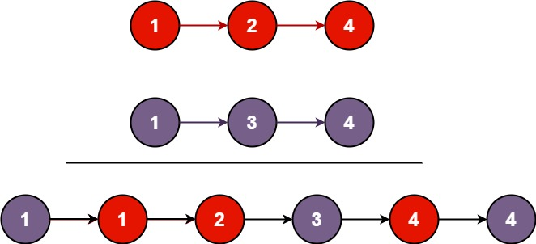

# 21. 合并两个有序链表

[← 链表专题](../../02-专题/07-链表.md) · [总目录](../../../../README.md) · [复习清单](../../00-总览/03-复习清单.md)

<div class="meta-badges problem-meta-common" aria-label="公共题目信息"><span class="mb diff-简单"><span class="mb-k">难度</span><b>简单</b></span></div>

<div class="meta-badges problem-meta legacy-problem-meta" data-hide-in-language="python" aria-label="Java 及同源语言解题信息"><span class="mb"><span class="mb-k">Java 主方法</span><b>虚拟头节点 + 尾插</b></span><span class="mb"><span class="mb-k">时间</span><b>O(m+n)</b></span><span class="mb"><span class="mb-k">空间</span><b>O(1)</b></span></div>

<div class="meta-badges problem-meta" data-lang-scope="true" data-lang="python" aria-label="Python 解题信息"><span class="mb"><span class="mb-k">Python 主方法</span><b>虚拟头节点双路归并</b></span><span class="mb"><span class="mb-k">时间</span><b>O(m+n)</b></span><span class="mb"><span class="mb-k">空间</span><b>O(1)</b></span></div>


## 题目与约束

将两个升序链表合并为一个新的 **升序** 链表并返回。新链表是通过拼接给定的两个链表的所有节点组成的。

  **示例 1：**

  

  **输入：**l1 = [1,2,4], l2 = [1,3,4]<br>**输出：**[1,1,2,3,4,4]

  **示例 2：**

  **输入：**l1 = [], l2 = []<br>**输出：**[]

  **示例 3：**

  **输入：**l1 = [], l2 = [0]<br>**输出：**[0]

  **提示：**

  - 两个链表的节点数目范围是 `[0, 50]`
  - `-100 <= Node.val <= 100`
  - `l1` 和 `l2` 均按 **非递减顺序** 排列

[🔗 前往力扣原题验证 →](https://leetcode.cn/problems/merge-two-sorted-lists/?envType=study-plan-v2&envId=top-100-liked)

<section class="legacy-solution-panel java-solution-panel" data-hide-in-language="python" data-legacy-scope="true" markdown="1">

## Java 完整推导


### Java 核心不变量


> tail 始终指向已合并部分的最后一个节点。

## 完整推导

### 思路推导
  1. **直觉与痛点（找车头）**：

     合并就像把两副排好序的扑克牌洗在一起。由于我们需要返回一个新链表的头节点（车头），如果直接操作，你需要先写一堆代码来判断：到底 `list1` 的第一个节点是车头，还是 `list2` 的第一个节点是车头？如果其中一个是空链表怎么办？这会导致开头充满繁琐的边界判断。

  2. **破局思路（引入“虚拟头节点/哨兵节点”）**：

     我们干脆自己造一个“假车头（Dummy Node）”。

     不需要管谁大谁小，我们直接把合并后的节点一个个挂在这个“假车头”后面。等全部合并完了，我们直接返回 `dummy.next`，这不就是真正的车头了吗！

  3. **逻辑推演（拉链法双指针）**：

     - 创建 `dummy` 节点，并用一个指针 `curr` 指向它，作为我们“穿针引线”的针头。
     - 比较 `list1` 和 `list2` 当前节点的值：
       - 谁的值小，就把 `curr.next` 指向谁。
       - 然后把那个被选中的节点往前挪一步。
       - 针头 `curr` 也往前挪一步，准备挂下一个节点。
     - **收尾**：如果循环结束时，有一个链表还没遍历完（说明剩下的数都比前面的大），直接把 `curr.next` 指向剩下的这串链表即可（链表的优势，不需要一个个挪，直接接上头就行）。
### Java 实现（迭代法）
```java
/**
 * Definition for singly-linked list.
 * public class ListNode {
 *     int val;
 *     ListNode next;
 *     ListNode() {}
 *     ListNode(int val) { this.val = val; }
 *     ListNode(int val, ListNode next) { this.val = val; this.next = next; }
 * }
 */
class Solution {
    public ListNode mergeTwoLists(ListNode list1, ListNode list2) {
        // 1. 创建虚拟头节点（值随意，这里给个 -1），化解复杂的边界情况
        ListNode dummy = new ListNode(-1);

        // curr 充当游标（针头），负责把节点一个个串起来
        ListNode curr = dummy;

        // 2. 只要两个链表都有数字，就开始“拉链”比大小
        while (list1 != null && list2 != null) {
            if (list1.val <= list2.val) {
                curr.next = list1;   // 把 list1 的节点串上来
                list1 = list1.next;  // list1 指针后移
            } else {
                curr.next = list2;   // 把 list2 的节点串上来
                list2 = list2.next;  // list2 指针后移
            }
            // 针头跟着后移，准备串下一个节点
            curr = curr.next;
        }

        // 3. 收尾处理：当其中一个链表被掏空后，把另一个链表剩下的部分一撸到底接上去
        curr.next = (list1 != null) ? list1 : list2;

        // 4. 返回真正的车头（虚拟头节点的下一个节点）
        return dummy.next;
    }
}
```
### 复杂度
  - **时间复杂度**：$O(N + M)$。其中 $N$ 和 $M$ 分别为两个链表的长度。因为每次循环只会让一个指针后移，直到遍历完其中一个链表，总循环次数不会超过 $N + M$。
  - **空间复杂度**：$O(1)$。我们仅仅用了几个指针在原有的节点上进行穿针引线，完全没有开辟任何新的节点空间（除了一开始那个用来方便操作的 dummy 节点）。

### 易错点与扩展（极其经典的连环追问）

1. **面试进阶追问：“你能用【递归】写一遍吗？”**

   - **递归思维的优化思路**：合并两个有序链表，等于“提取其中较小的头节点”，加上“合并剩余的两个链表”。

   - **优雅的递归代码**：

```java
class Solution {
    public ListNode mergeTwoLists(ListNode list1, ListNode list2) {
        // 递归的终止条件
        if (list1 == null) return list2;
        if (list2 == null) return list1;

        // 谁小，谁就当老大（当前的头节点）
        if (list1.val < list2.val) {
            // 老大的后面挂着：剩下的 list1 和 完整的 list2 合并的结果
            list1.next = mergeTwoLists(list1.next, list2);
            return list1;
        } else {
            list2.next = mergeTwoLists(list1, list2.next);
            return list2;
        }
    }
}
```

   - **两种解法的权衡（给面试官的加分回答）**：虽然递归解法代码只有短短几行，看起来极其优雅，但在工程实践中，由于递归会消耗方法栈空间，它的**空间复杂度是 $O(N + M)$**。如果链表非常长，可能会导致**栈溢出 (StackOverflowError)**。所以如果在真实业务代码中，**迭代法（拉链法）配合虚拟头节点是更安全、更优秀的选择**。

这道题里的 **“虚拟头节点（Dummy Node）”** 技巧，在后面的链表删除、链表翻转等题目中会频繁出现。记住它，它能拯救你无数脑细胞！

</section>

<section class="language-panel" data-lang-scope="true" data-lang="python" markdown="1">

## Python 完整推导

### dummy 和 tail 一开始指向同一个虚拟节点

创建 dummy 后执行 tail = dummy，这里没有 dummy→tail 这样两个实体；它们是同一个节点的两个名字。tail 随合并前进，dummy 始终留在开头。

每轮比较两条链表的当前头，把较小节点接到 tail.next，推进被选中的源链表，然后让 tail 前进到刚接上的节点。一方耗尽后，剩余整段直接接在尾部。

### 用 [1,2,4] 与 [1,3,4] 走一遍

- 初始 dummy 和 tail 是同一节点，两个输入头都是 1。
- 相等时选择 list1 的 1；tail 变成这条链上的值 1。
- 比较 list1 的 2 与 list2 的 1，选择第二个 1。
- 再选 2，随后依次接入 3、4、4。

已合并的取值顺序是 1→1→2→3→4→4。

### Python 实现

> 参考来源：经典解法实现
>
> 保留旧 Python 的虚拟头双路归并实现，补充 Optional 签名并省略判题环境提供的节点类。

```python
from typing import Optional


# ListNode 由力扣提供。
class Solution:
    def mergeTwoLists(
        self, list1: Optional[ListNode], list2: Optional[ListNode]
    ) -> Optional[ListNode]:
        dummy = ListNode()
        tail = dummy
        while list1 and list2:
            if list1.val <= list2.val:
                tail.next = list1
                list1 = list1.next
            else:
                tail.next = list2
                list2 = list2.next
            tail = tail.next
        tail.next = list1 if list1 else list2
        return dummy.next
```

### tail 的推进

tail.next 接上当前较小节点后，tail = tail.next 把游标移到该节点。接下一个节点之前，tail 指向已合并部分的最后一个节点。

### 最后一段

循环结束时至少一条源链表为空。另一条链表本身有序，且当前头不会小于已接内容，所以可以把整段直接挂到 tail.next。

### 为什么返回 dummy.next

dummy 是额外构造的节点，不保存答案数据。它唯一的作用是让首节点和空链表都走同一条构造路径；返回 dummy.next 才从第一个真实节点开始。

### 复杂度

- 时间复杂度：`O(m+n)`。
- 空间复杂度：`O(1)`。

每个输入节点只被 tail.next 接走一次，时间 O(m+n)；复用原节点，只额外创建一个 dummy。

</section>

## 力扣原题

[🔗 前往力扣原题验证 →](https://leetcode.cn/problems/merge-two-sorted-lists/?envType=study-plan-v2&envId=top-100-liked)

<section class="language-panel cpp-solution-panel" data-lang-scope="true" data-lang="cpp" markdown="1">

## C++ 实现

> 实现来源：经典解法实现

<ol class="lang-steps"><li>哑头节点 + tail 指针，逐个比较两链表当前节点</li><li>小的接在 tail 后，对应指针后移</li><li>一条走空后，另一条剩余部分整体接上</li></ol>

```cpp
class Solution {
public:
    ListNode* mergeTwoLists(ListNode* l1, ListNode* l2) {
        ListNode dummy(0), *tail = &dummy;
        while (l1 && l2) {
            if (l1->val <= l2->val) { tail->next = l1; l1 = l1->next; }
            else                    { tail->next = l2; l2 = l2->next; }
            tail = tail->next;
        }
        tail->next = l1 ? l1 : l2;
        return dummy.next;
    }
};
```

</section>

<section class="language-panel go-solution-panel" data-lang-scope="true" data-lang="go" markdown="1">

## Go 实现

> 实现来源：经典解法实现

<ol class="lang-steps"><li>哑头节点 + tail 指针，逐个比较两链表当前节点</li><li>小的接在 tail 后，对应指针后移</li><li>一条走空后，另一条剩余部分整体接上</li></ol>

```go
func mergeTwoLists(l1 *ListNode, l2 *ListNode) *ListNode {
    dummy := &ListNode{}
    tail := dummy
    for l1 != nil && l2 != nil {
        if l1.Val <= l2.Val { tail.Next = l1; l1 = l1.Next } else { tail.Next = l2; l2 = l2.Next }
        tail = tail.Next
    }
    if l1 != nil { tail.Next = l1 } else { tail.Next = l2 }
    return dummy.Next
}
```

</section>

<section class="language-panel c-solution-panel" data-lang-scope="true" data-lang="c" markdown="1">

## C 实现

> 实现来源：经典解法实现

<ol class="lang-steps"><li>哑头节点 + tail 指针，逐个比较两链表当前节点</li><li>小的接在 tail 后，对应指针后移</li><li>一条走空后，另一条剩余部分整体接上</li></ol>

```c
struct ListNode* mergeTwoLists(struct ListNode* l1, struct ListNode* l2) {
    struct ListNode dummy; dummy.next = NULL;
    struct ListNode* tail = &dummy;
    while (l1 && l2) {
        if (l1->val <= l2->val) { tail->next = l1; l1 = l1->next; }
        else                    { tail->next = l2; l2 = l2->next; }
        tail = tail->next;
    }
    tail->next = l1 ? l1 : l2;
    return dummy.next;
}
```

</section>

<!--bottom-nav-->
<div class="problem-nav">
<a class="problem-nav-btn" href="../07-链表/0142-环形链表 II.html" target="_blank" rel="noopener noreferrer">← 上一题</a>
<a class="problem-nav-btn" href="../../../../index.html">🏠 回到 Hot 100 目录</a>
<a class="problem-nav-btn primary" href="../07-链表/0002-两数相加.html" target="_blank" rel="noopener noreferrer">下一题 →</a>
</div>
<!--/bottom-nav-->
