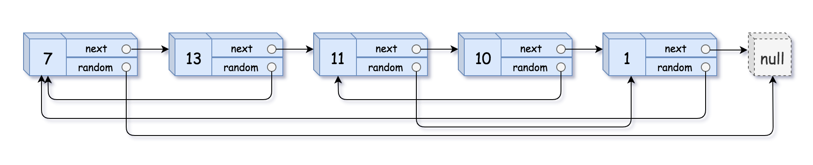

# 138. 随机链表的复制

[← 链表专题](../../02-专题/07-链表.md) · [总目录](../../../../README.md) · [复习清单](../../00-总览/03-复习清单.md)

<div class="meta-badges problem-meta-common" aria-label="公共题目信息"><span class="mb diff-中等"><span class="mb-k">难度</span><b>中等</b></span></div>

<div class="meta-badges problem-meta legacy-problem-meta" data-hide-in-language="python" aria-label="Java 及同源语言解题信息"><span class="mb"><span class="mb-k">Java 主方法</span><b>节点穿插复制</b></span><span class="mb"><span class="mb-k">时间</span><b>O(n)</b></span><span class="mb"><span class="mb-k">空间</span><b>O(1) 除答案外</b></span></div>

<div class="meta-badges problem-meta" data-lang-scope="true" data-lang="python" aria-label="Python 解题信息"><span class="mb"><span class="mb-k">Python 主方法</span><b>原链表穿插复制 + 三趟拆分</b></span><span class="mb"><span class="mb-k">时间</span><b>O(n)</b></span><span class="mb"><span class="mb-k">空间</span><b>O(1)（不计新建的输出节点）</b></span></div>


## 题目与约束

给你一个长度为 `n` 的链表，每个节点包含一个额外增加的随机指针 `random` ，该指针可以指向链表中的任何节点或空节点。

  构造这个链表的 **[深拷贝](https://baike.baidu.com/item/深拷贝/22785317?fr=aladdin)**。 深拷贝应该正好由 `n` 个 **全新** 节点组成，其中每个新节点的值都设为其对应的原节点的值。新节点的 `next` 指针和 `random` 指针也都应指向复制链表中的新节点，并使原链表和复制链表中的这些指针能够表示相同的链表状态。**复制链表中的指针都不应指向原链表中的节点**。

  例如，如果原链表中有 `X` 和 `Y` 两个节点，其中 `X.random --> Y` 。那么在复制链表中对应的两个节点 `x` 和 `y` ，同样有 `x.random --> y` 。

  返回复制链表的头节点。

  用一个由 `n` 个节点组成的链表来表示输入/输出中的链表。每个节点用一个 `[val, random_index]` 表示：

  - `val`：一个表示 `Node.val` 的整数。
  - `random_index`：随机指针指向的节点索引（范围从 `0` 到 `n-1`）；如果不指向任何节点，则为  `null` 。

  你的代码 **只** 接受原链表的头节点 `head` 作为传入参数。

  **示例 1：**

  

  **输入：**head = [[7,null],[13,0],[11,4],[10,2],[1,0]]<br>**输出：**[[7,null],[13,0],[11,4],[10,2],[1,0]]

  **示例 2：**

  

  **输入：**head = [[1,1],[2,1]]<br>**输出：**[[1,1],[2,1]]

  **示例 3：**

  ****

  **输入：**head = [[3,null],[3,0],[3,null]]<br>**输出：**[[3,null],[3,0],[3,null]]

  **提示：**

  - `0 <= n <= 1000`
  - `-104 <= Node.val <= 104`
  - `Node.random` 为 `null` 或指向链表中的节点。

[🔗 前往力扣原题验证 →](https://leetcode.cn/problems/copy-list-with-random-pointer/?envType=study-plan-v2&envId=top-100-liked)

<section class="legacy-solution-panel java-solution-panel" data-hide-in-language="python" data-legacy-scope="true" markdown="1">

## Java 完整推导


### Java 核心不变量


> 复制节点紧跟原节点，random 可由 original.random.next 得到。

## 完整推导

### 思路推导
  1. **直觉与痛点（哈希表映射法）**：

     深拷贝最头疼的是 `random` 指针。当你在复制节点 A 的时候，它的 `random` 可能指向节点 C，但此时节点 C **还没有被创建出来**！

     *常规解法*：用一个 `HashMap<Node, Node>`。第一遍遍历，只根据原节点创建新节点，并全存进 Map 里（原节点当 Key，新节点当 Value）。第二遍遍历，利用 Map 去查出对应的新节点，连上 `next` 和 `random`。

     **痛点**：空间复杂度是 $O(N)$，对于面试要求来说不够惊艳。

  2. **破局思路（原地克隆交织法）**：

     能不能不用 HashMap 也能记住“谁是谁的克隆体”？

     答案是：**把克隆体直接绑在本体的后面！**

     如果把原链表 $A \rightarrow B \rightarrow C$ 变成 $A \rightarrow A' \rightarrow B \rightarrow B' \rightarrow C \rightarrow C'$。

     此时，本体和克隆体的物理位置是绑定的。**$A$ 的克隆体永远是 $A.next$**！

  3. **逻辑推演（极度舒适的三步曲）**：

     - **第一步：克隆并交织（分裂）**。遍历链表，在每个节点后面插入一个它的克隆节点。

     - **第二步：分配 `random` 指针**。这是最巧妙的一步。克隆体 $A'$ 的 `random` 应该指向哪里？它应该指向本体 $A$ 的 `random` 的克隆体！

       公式化表述：**`A'.random = A.random.next`**。

     - **第三步：拆分链表（提取）**。将这个交织的链表一分为二，把本体和克隆体拆开。把克隆体串成一个新链表返回，同时**务必把原链表恢复原状**。
### Java 实现（O(1) 空间满分版）
```java
/*
// Definition for a Node.
class Node {
    int val;
    Node next;
    Node random;

    public Node(int val) {
        this.val = val;
        this.next = null;
        this.random = null;
    }
}
*/
class Solution {
    public Node copyRandomList(Node head) {
        if (head == null) {
            return null;
        }

        // 1. 第一步：克隆节点，并将其插入到原节点之后
        // 原链表：A -> B -> C
        // 现链表：A -> A' -> B -> B' -> C -> C'
        Node curr = head;
        while (curr != null) {
            Node clone = new Node(curr.val);
            clone.next = curr.next;
            curr.next = clone;
            curr = clone.next;
        }

        // 2. 第二步：设置克隆节点的 random 指针
        curr = head;
        while (curr != null) {
            if (curr.random != null) {
                // 克隆节点的 random 就是原节点 random 的下一个节点（即克隆体）
                curr.next.random = curr.random.next;
            }
            // 每次跳两步，跳到下一个原节点
            curr = curr.next.next;
        }

        // 3. 第三步：拆分链表，将新旧链表分离，并恢复原链表结构
        curr = head;
        Node cloneHead = head.next; // 克隆链表的头节点
        while (curr != null) {
            Node clone = curr.next;

            // 恢复原链表的 next 指针
            curr.next = clone.next;
            // 串联克隆链表的 next 指针（注意判断是否到了末尾）
            clone.next = (clone.next != null) ? clone.next.next : null;

            // 指针推进
            curr = curr.next;
        }

        return cloneHead;
    }
}
```
### 复杂度
  - **时间复杂度**：$O(N)$。我们一共遍历了原链表 3 次（克隆、分配随机指针、拆分），每次都是线性时间，总时间依然是 $O(N)$。
  - **空间复杂度**：$O(1)$。除了作为结果返回的 $N$ 个新节点外，我们只使用了几个常数级别的指针变量，没有借用任何哈希表结构。

### 易错点与扩展

- **致命踩坑：不要把原链表弄坏了！**

  在第三步“拆分链表”时，很多同学光顾着把 `A' -> B' -> C'` 串联起来，却忘记了让 `A -> B -> C` 恢复原样（比如把 `A.next` 置为了 `null`）。**在工程开发中，改变传入的原始数据结构是非常危险的操作。** 如果你能在写代码时主动向面试官解释：“我在最后一步不仅提取了深拷贝的链表，还特意将原链表完好无损地恢复了”，这绝对是极大的工程素养加分项！

</section>

<section class="language-panel" data-lang-scope="true" data-lang="python" markdown="1">

## Python 完整推导

### 把每个复制节点插在原节点后面

原链 A→B→C 在复制后变成 A→A'→B→B'→C→C'。这样原节点 r 的复制体 r' 永远是 r.next，不需要额外的原节点到副本映射表。

第一趟插入全部复制节点；第二趟通过 original.random.next 连接复制体的 random；第三趟把交错链拆开，并恢复原链。

### 用 A、B、C、D、E 走一遍

原链为 A→B→C→D→E，复制体记作 A' 到 E'。

- 第一趟后：A→A'→B→B'→C→C'→D→D'→E→E'。
- 若 B.random=A，则 B'.random=A.next=A'。
- 若 C.random=E，则 C'.random=E.next=E'。
- A.random 为空，因此 A'.random 保持空。

第三趟把 A'→B'→C'→D'→E' 串成新链，同时把原链恢复成 A→B→C→D→E。

### Python 实现

> 参考来源：灵茶山艾府题解（MIT License）
>
> 沿用旧来源的交错复制思路；旧 Python 拆分时未恢复原链，主代码按同题 Java 三趟拆分法改写了这一段。

```python
from typing import Optional


# Node 由力扣提供。
class Solution:
    def copyRandomList(self, head: Optional[Node]) -> Optional[Node]:
        original = head
        while original:
            copied = Node(original.val)
            copied.next = original.next
            original.next = copied
            original = copied.next

        original = head
        while original:
            if original.random:
                original.next.random = original.random.next
            original = original.next.next

        dummy = Node(0)
        copied_tail = dummy
        original = head
        while original:
            copied = original.next
            original.next = copied.next
            copied_tail.next = copied
            copied_tail = copied
            original = original.next
        return dummy.next
```

### 第二趟只访问原节点

original 每次执行 original.next.next，恰好跳过一个复制节点。只有 original.random 非空时才读取它的 next，因为目标必须是目标副本，而不是原目标节点。

### 目标副本与原节点要分清

若问题中 C 的 random 指向 E，原链里的 E 已经存在，但对应的副本 E' 在复制阶段才创建。交错结构让 E' 等于 E.next，因此 C'.random=E.next。这里连接的是副本链，不是把 C' 指回原节点 E。

### 第三趟负责两件事

先保存 copied=original.next，再令 original.next=copied.next 恢复原链下一条原节点；随后把 copied 接到 dummy 尾部，串出新链。两件事缺一不可。

### 空链表与空 random

head 为空时不进入任何遍历，返回 dummy.next=None。random 为空时复制节点的 random 未被赋值，仍为 Node 构造后的空值。

### 复杂度

- 时间复杂度：`O(n)`。
- 空间复杂度：`O(1)（不计新建的输出节点）`。

三趟都只沿 n 个原节点前进一次；新增复制节点是题目输出，额外工作引用为常数。

</section>

## 力扣原题

[🔗 前往力扣原题验证 →](https://leetcode.cn/problems/copy-list-with-random-pointer/?envType=study-plan-v2&envId=top-100-liked)

<section class="language-panel cpp-solution-panel" data-lang-scope="true" data-lang="cpp" markdown="1">

## C++ 实现

> 实现来源：灵茶山艾府题解（MIT License）


```cpp
class Solution {
public:
    Node* copyRandomList(Node* head) {
        // 复制每个节点，把新节点直接插到原节点的后面
        for (Node* cur = head; cur; cur = cur->next->next) {
            cur->next = new Node(cur->val, cur->next, nullptr);
        }

        // 遍历交错链表中的原链表节点
        for (Node* cur = head; cur; cur = cur->next->next) {
            if (cur->random) {
                // 要复制的 random 是 cur->random 的下一个节点
                cur->next->random = cur->random->next;
            }
        }

        // 把交错链表分离成两个链表
        Node dummy(0);
        Node* tail = &dummy;
        for (Node* cur = head; cur; cur = cur->next, tail = tail->next) {
            Node* copy = cur->next; // 新节点
            tail->next = copy; // 把新节点插在 tail 的后面，构建新的链表
            cur->next = copy->next; // 恢复原节点的 next
        }

        return dummy.next;
    }
};
```

</section>

<section class="language-panel go-solution-panel" data-lang-scope="true" data-lang="go" markdown="1">

## Go 实现

> 实现来源：灵茶山艾府题解（MIT License）


```go
func copyRandomList(head *Node) *Node {
    // 复制每个节点，把新节点直接插到原节点的后面
    for cur := head; cur != nil; cur = cur.Next.Next {
        cur.Next = &Node{Val: cur.Val, Next: cur.Next}
    }

    // 遍历交错链表中的原链表节点
    for cur := head; cur != nil; cur = cur.Next.Next {
        if cur.Random != nil {
            // 要复制的 random 是 cur.Random 的下一个节点
            cur.Next.Random = cur.Random.Next
        }
    }

    // 把交错链表分离成两个链表
    dummy := Node{}
    tail := &dummy
    for cur := head; cur != nil; cur, tail = cur.Next, tail.Next {
        clone := cur.Next     // 新节点
        tail.Next = clone     // 把新节点插在 tail 的后面，构建新的链表
        cur.Next = clone.Next // 恢复原节点的 next
    }

    return dummy.Next
}
```

</section>

<section class="language-panel c-solution-panel" data-lang-scope="true" data-lang="c" markdown="1">

## C 实现

> 实现来源：灵茶山艾府题解（MIT License）


```c
struct Node* copyRandomList(struct Node* head) {
    // 复制每个节点，把新节点直接插到原节点的后面
    for (struct Node* cur = head; cur; cur = cur->next->next) {
        struct Node* copy = malloc(sizeof(struct Node));
        copy->val = cur->val;
        copy->next = cur->next;
        copy->random = NULL;
        cur->next = copy;
    }

    // 遍历交错链表中的原链表节点
    for (struct Node* cur = head; cur; cur = cur->next->next) {
        if (cur->random) {
            // 要复制的 random 是 cur->random 的下一个节点
            cur->next->random = cur->random->next;
        }
    }

    // 把交错链表分离成两个链表
    struct Node dummy;
    struct Node* tail = &dummy;
    for (struct Node* cur = head; cur; cur = cur->next, tail = tail->next) {
        struct Node* copy = cur->next; // 新节点
        tail->next = copy; // 把新节点插在 tail 的后面，构建新的链表
        cur->next = copy->next; // 恢复原节点的 next
    }

    return dummy.next;
}
```

</section>

<!--bottom-nav-->
<div class="problem-nav">
<a class="problem-nav-btn" href="../07-链表/0025-K 个一组翻转链表.html" target="_blank" rel="noopener noreferrer">← 上一题</a>
<a class="problem-nav-btn" href="../../../../index.html">🏠 回到 Hot 100 目录</a>
<a class="problem-nav-btn primary" href="../07-链表/0148-排序链表.html" target="_blank" rel="noopener noreferrer">下一题 →</a>
</div>
<!--/bottom-nav-->
