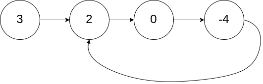
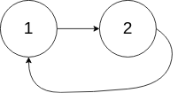
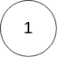

# 142. 环形链表 II

[← 链表专题](../../02-专题/07-链表.md) · [总目录](../../../../README.md) · [复习清单](../../00-总览/03-复习清单.md)

<div class="meta-badges problem-meta-common" aria-label="公共题目信息"><span class="mb diff-中等"><span class="mb-k">难度</span><b>中等</b></span></div>

<div class="meta-badges problem-meta legacy-problem-meta" data-hide-in-language="python" aria-label="Java 及同源语言解题信息"><span class="mb"><span class="mb-k">Java 主方法</span><b>Floyd 相遇后重置</b></span><span class="mb"><span class="mb-k">时间</span><b>O(n)</b></span><span class="mb"><span class="mb-k">空间</span><b>O(1)</b></span></div>

<div class="meta-badges problem-meta" data-lang-scope="true" data-lang="python" aria-label="Python 解题信息"><span class="mb"><span class="mb-k">Python 主方法</span><b>Floyd 相遇后同速找入口</b></span><span class="mb"><span class="mb-k">时间</span><b>O(n)</b></span><span class="mb"><span class="mb-k">空间</span><b>O(1)</b></span></div>


## 题目与约束

给定一个链表的头节点  `head` ，返回链表开始入环的第一个节点。 *如果链表无环，则返回 `null`。*

  如果链表中有某个节点，可以通过连续跟踪 `next` 指针再次到达，则链表中存在环。 为了表示给定链表中的环，评测系统内部使用整数 `pos` 来表示链表尾连接到链表中的位置（**索引从 0 开始**）。如果 `pos` 是 `-1`，则在该链表中没有环。**注意：`pos` 不作为参数进行传递**，仅仅是为了标识链表的实际情况。

  **不允许修改**链表。

  **示例 1：**

  

  **输入：**head = [3,2,0,-4], pos = 1<br>**输出：**返回索引为 1 的链表节点<br>**解释：**链表中有一个环，其尾部连接到第二个节点。

  **示例 2：**

  

  **输入：**head = [1,2], pos = 0<br>**输出：**返回索引为 0 的链表节点<br>**解释：**链表中有一个环，其尾部连接到第一个节点。

  **示例 3：**

  

  **输入：**head = [1], pos = -1<br>**输出：**返回 null<br>**解释：**链表中没有环。

  **提示：**

  - 链表中节点的数目范围在范围 `[0, 104]` 内
  - `-105 <= Node.val <= 105`
  - `pos` 的值为 `-1` 或者链表中的一个有效索引

  **进阶：**你是否可以使用 `O(1)` 空间解决此题？

[🔗 前往力扣原题验证 →](https://leetcode.cn/problems/linked-list-cycle-ii/?envType=study-plan-v2&envId=top-100-liked)

<section class="legacy-solution-panel java-solution-panel" data-hide-in-language="python" data-legacy-scope="true" markdown="1">

## Java 完整推导


### Java 核心不变量


> 相遇后一个回到头部，同速再走会在入口相遇。

## 完整推导

### 思路推导
  1. **直觉与痛点（HashSet 的诱惑）**：

     和 141 题一样，最简单的办法是用 `HashSet` 把走过的节点存起来。第一个发现重复的节点，就是环的入口。但空间复杂度是 $O(N)$，无法满足进阶要求。

  2. **破局思路（双指针的两阶段任务）**：

     - **阶段一：判断是否有环**。这一步和 141 题一模一样。乌龟（慢指针）一次走 1 步，兔子（快指针）一次走 2 步。如果它们相遇了，说明有环，记录下**相遇点**。
     - **阶段二：寻找环的入口（纯数学推演）**。这是全题的灵魂所在。

  3. **神级数学推导（白板推演必备）**：

     假设链表有环，我们把整条路线分为三段：

     - $a$：从链表头部到环形入口的距离（直道）。

     - $b$：从环形入口到快慢指针相遇点的距离。

     - $c$：从相遇点继续走到环形入口的距离。

       *(注意：环的总长度 $L = b + c$)*

     当快慢指针相遇时：

     - 慢指针走过的距离是：$a + b$
     - 快指针走过的距离是：$a + b + n(b + c)$ （$n$ 表示快指针在环里已经跑了 $n$ 圈）

     因为快指针的速度是慢指针的 2 倍，所以相同时间内快指针走过的距离是慢指针的 2 倍：

     $$2(a + b) = a + b + n(b + c)$$

     我们将等式化简，目标是求出我们要找的入口距离 $a$：

     $$a + b = n(b + c)$$

     $$a = n(b + c) - b$$

     由于我们需要拼凑出有物理意义的路径，我们可以提取出一个 $(b+c)$ 作为完整的一圈，把公式变形为：

     $$a = (n - 1)(b + c) + c$$

     **结论（见证奇迹的时刻）**：

     等式左边 $a$ 是**从头部到入口的距离**。

     等式右边 $(n - 1)(b + c) + c$ 的物理意义是：**从相遇点出发，在环里转了 $(n-1)$ 圈之后，再走 $c$ 的距离**。转圈相当于没动，所以它等价于**从相遇点走 $c$ 的距离到达入口**！**不是走 c 步就到入口，是总步数凑成 a，两者步数相等才相遇；a 可以远大于 c，多出来的部分就是在环里空转圈凑数。**

     **终极算法**：相遇后，让一个新指针从 `head` 出发，让慢指针从 `相遇点` 出发。两人每次都走 1 步。**当他们相遇时，相遇的位置绝对就是环的入口！**
### Java 实现
```java
/**
 * Definition for singly-linked list.
 * class ListNode {
 *     int val;
 *     ListNode next;
 *     ListNode(int x) {
 *         val = x;
 *         next = null;
 *     }
 * }
 */
public class Solution {
    public ListNode detectCycle(ListNode head) {
        // 边界条件防御
        if (head == null || head.next == null) {
            return null;
        }

        ListNode slow = head;
        ListNode fast = head;

        // 阶段一：快慢指针判断是否有环
        while (fast != null && fast.next != null) {
            slow = slow.next;
            fast = fast.next.next;

            // 发现环！
            if (slow == fast) {
                // 阶段二：寻找环的入口
                ListNode index1 = head; // 从头节点出发的新指针
                ListNode index2 = slow; // 从相遇点出发的慢指针

                // 两个指针每次各走一步，直到相遇
                while (index1 != index2) {
                    index1 = index1.next;
                    index2 = index2.next;
                }

                // 相遇的节点就是环的入口
                return index1;
            }
        }

        // 没环，直接返回 null
        return null;
    }
}
```
### 复杂度
  - **时间复杂度**：$O(N)$。在阶段一，快慢指针相遇所需的步数不会超过链表的总节点数 $N$。在阶段二，两个指针寻找入口走的步数 $a$ 也严格小于 $N$。因此总体依然是线性的。

  - **空间复杂度**：$O(1)$。全程只使用了 `slow`、`fast`、`index1` 和 `index2` 四个节点指针，达到了极致的内存压缩。

这道题是链表专题里的“拉链法”入门题，也是极其高频的面试题。

虽然这道题被标记为“简单（Easy）”，但它向我们揭示了链表操作中一个极其重要、能让你少写无数 `if-else` 的神仙技巧：**虚拟头节点（Dummy Node）**。

请查收你的专属笔记：

</section>

<section class="language-panel" data-lang-scope="true" data-lang="python" markdown="1">

## Python 完整推导

### 从相遇路程推出入口

设：

- a：head 到环入口；
- b：入口到第一次相遇点；
- c：相遇点继续到入口；
- L = b + c：环长。

设 fast 比 slow 多绕 q 圈（q≥1）。第一次相遇时 slow 走 a+b，fast 走 a+b+qL；由 2(a+b)=a+b+qL 得 a+b=qL，因此 a=(q-1)L+c。也就是说，从 head 走 a 步与从相遇点继续走若干整圈再加 c 步，会到达同一个入口。

相遇后让 entry 从 head、slow 从相遇点同速前进，二者第一次指向同一节点时就是环入口。

### 用 3→2→0→-4、-4 指回 2 走一遍

节点标成 n0(3)、n1(2)、n2(0)、n3(-4)，n3.next=n1。第一阶段按上一题的轨迹在 n3 相遇。

第二阶段 entry 从 n0 出发，slow 从 n3 出发：

- entry 走到 n1；
- slow 从 n3 也走到 n1；
- entry is slow，返回节点 n1，也就是值为 2 的入口。

### 入口就是 head

若 head 本身就是入口，第一阶段从入口开始绕环，快慢指针的第一次相遇仍会落在 head。进入第二阶段时 entry=head 已经与相遇点相同，循环不执行，直接返回 head。

### Python 实现

> 参考来源：代码随想录（programmercarl.com）
>
> 保留旧 Python 的两阶段 Floyd 实现，只整理变量、注释与签名；算法未改变。

```python
from typing import Optional


# ListNode 由力扣提供。
class Solution:
    def detectCycle(self, head: Optional[ListNode]) -> Optional[ListNode]:
        slow = fast = head
        while fast and fast.next:
            slow = slow.next
            fast = fast.next.next
            if slow is fast:
                entry = head
                while entry is not slow:
                    entry = entry.next
                    slow = slow.next
                return entry
        return None
```

### 第二阶段继续使用 slow

代码相遇后并不重置 slow，而是令 entry=head。原 fast 不再参与，entry 和 slow 每轮各走一步。

### 同速的含义

这里是两个同速指针从不同位置出发。若两个指针已经在同一环上以相同速度运行，它们会一直保持相对位置，不能拿这种情形解释追及；能够保证追上的是第一阶段的 2:1 速度差，第二阶段依靠的是已经证明的路程关系。

### 无环分支

主循环因 fast 或 fast.next 为空而结束时，没有发生第一次相遇，函数绕过入口搜索并返回 None。返回和相等判断都按节点对象身份进行。

### 复杂度

- 时间复杂度：`O(n)`。
- 空间复杂度：`O(1)`。

第一阶段相遇之前两个指针都只走线性步数，第二阶段也至多走 a 步；空间只保存指针。

</section>

## 力扣原题

[🔗 前往力扣原题验证 →](https://leetcode.cn/problems/linked-list-cycle-ii/?envType=study-plan-v2&envId=top-100-liked)

<section class="language-panel cpp-solution-panel" data-lang-scope="true" data-lang="cpp" markdown="1">

## C++ 实现

> 实现来源：代码随想录（programmercarl.com）


```cpp
/**
 * Definition for singly-linked list.
 * struct ListNode {
 *     int val;
 *     ListNode *next;
 *     ListNode(int x) : val(x), next(NULL) {}
 * };
 */
class Solution {
public:
    ListNode *detectCycle(ListNode *head) {
        ListNode* fast = head;
        ListNode* slow = head;
        while(fast != NULL && fast->next != NULL) {
            slow = slow->next;
            fast = fast->next->next;
            // 快慢指针相遇，此时从head 和 相遇点，同时查找直至相遇
            if (slow == fast) {
                ListNode* index1 = fast;
                ListNode* index2 = head;
                while (index1 != index2) {
                    index1 = index1->next;
                    index2 = index2->next;
                }
                return index2; // 返回环的入口
            }
        }
        return NULL;
    }
};
```

</section>

<section class="language-panel go-solution-panel" data-lang-scope="true" data-lang="go" markdown="1">

## Go 实现

> 实现来源：代码随想录（programmercarl.com）


```go
func detectCycle(head *ListNode) *ListNode {
    slow, fast := head, head
    for fast != nil && fast.Next != nil {
        slow = slow.Next
        fast = fast.Next.Next
        if slow == fast {
            for slow != head {
                slow = slow.Next
                head = head.Next
            }
            return head
        }
    }
    return nil
}
```

</section>

<section class="language-panel c-solution-panel" data-lang-scope="true" data-lang="c" markdown="1">

## C 实现

> 实现来源：代码随想录（programmercarl.com）


```c
ListNode *detectCycle(ListNode *head) {
    ListNode *fast = head, *slow = head;
    while (fast && fast->next) {
        // 这里判断两个指针是否相等，所以移位操作放在前面
        slow = slow->next;
        fast = fast->next->next;
        if (slow == fast) { // 相交，开始找环形入口：分别从头部和从交点出发，找到相遇的点就是环形入口
            ListNode *f = fast, *h = head;
            while (f != h) f = f->next, h = h->next;
            return h;
        }
    }
    return NULL;
}
```

</section>

<!--bottom-nav-->
<div class="problem-nav">
<a class="problem-nav-btn" href="../07-链表/0141-环形链表.html" target="_blank" rel="noopener noreferrer">← 上一题</a>
<a class="problem-nav-btn" href="../../../../index.html">🏠 回到 Hot 100 目录</a>
<a class="problem-nav-btn primary" href="../07-链表/0021-合并两个有序链表.html" target="_blank" rel="noopener noreferrer">下一题 →</a>
</div>
<!--/bottom-nav-->
