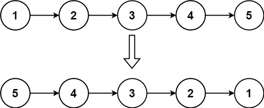
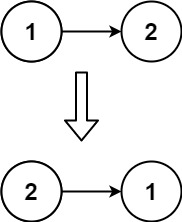

# 206. 反转链表

[← 链表专题](../../02-专题/07-链表.md) · [总目录](../../../../README.md) · [复习清单](../../00-总览/03-复习清单.md)

<div class="meta-badges problem-meta-common" aria-label="公共题目信息"><span class="mb diff-简单"><span class="mb-k">难度</span><b>简单</b></span></div>

<div class="meta-badges problem-meta legacy-problem-meta" data-hide-in-language="python" aria-label="Java 及同源语言解题信息"><span class="mb"><span class="mb-k">Java 主方法</span><b>迭代三指针</b></span><span class="mb"><span class="mb-k">时间</span><b>O(n)</b></span><span class="mb"><span class="mb-k">空间</span><b>O(1)</b></span></div>

<div class="meta-badges problem-meta" data-lang-scope="true" data-lang="python" aria-label="Python 解题信息"><span class="mb"><span class="mb-k">Python 主方法</span><b>迭代三指针原地反转</b></span><span class="mb"><span class="mb-k">时间</span><b>O(n)</b></span><span class="mb"><span class="mb-k">空间</span><b>O(1)</b></span></div>


## 题目与约束

给你单链表的头节点 `head` ，请你反转链表，并返回反转后的链表。

  **示例 1：**
  

  **输入：**head = [1,2,3,4,5]
  **输出：**[5,4,3,2,1]

  **示例 2：**
  

  **输入：**head = [1,2]
  **输出：**[2,1]

  **示例 3：**

  **输入：**head = []
  **输出：**[]

  **提示：**

  链表中节点的数目范围是 `[0, 5000]`
  `-5000 <= Node.val <= 5000`

  **进阶：**链表可以选用迭代或递归方式完成反转。你能否用两种方法解决这道题？

[🔗 前往力扣原题验证 →](https://leetcode.cn/problems/reverse-linked-list/?envType=study-plan-v2&envId=top-100-liked)

<section class="legacy-solution-panel java-solution-panel" data-hide-in-language="python" data-legacy-scope="true" markdown="1">

## Java 完整推导


### Java 核心不变量


> 修改 next 前必须先保存原来的后继。

## 完整推导

### 思路推导
  1. **直觉与痛点（单向的无奈）**：

     单链表只有 `next` 指针，只能往后走，不能往回走。我们想让 `1 -> 2` 变成 `1 <- 2`，也就是要修改 `2` 的 `next` 指针，让它指向 `1`。

     **痛点**：如果你直接写 `2.next = 1`，那么 `2` 原本指向 `3` 的指针就断了！你再也找不到 `3` 了。

  2. **破局思路（双指针 + 临时备忘录）**：

     我们需要两个核心指针在前面探路：

     - `prev`（前驱节点）：记录当前节点要指向的新主人。刚开始我们在车头，前面没有节点，所以初始值为 `null`。
     - `curr`（当前节点）：记录我们正准备反转的节点。初始值为 `head`。
     - **灵魂辅助 `next`（临时节点）**：在每次准备修改 `curr.next` 之前，先偷偷把 `curr.next` 存到 `next` 里，作为“备忘录”。这样就算链表断开了，我们照样能找到下一步该去哪。

  3. **逻辑推演（微操四步曲）**：

     以 `1 -> 2 -> 3 -> null` 为例：

     - **准备**：`prev = null`, `curr = 1`。
     - **第一轮反转**：
       1. 记下后路：`next = curr.next` (也就是记下 2)。
       2. 斩断旧缘，指向新欢：`curr.next = prev` (让 1 指向 null)。
       3. `prev` 前进：`prev = curr` (prev 移到 1)。
       4. `curr` 前进：`curr = next` (curr 移到 2)。
     - **第二轮反转**：此时 `prev=1`, `curr=2`。重复上面四步，2 的 next 会指向 1。
     - **结束条件**：当 `curr` 走到 `null` 时结束。此时的 `prev` 刚好停留在原来的尾节点（也就是新的头节点）上！
### Java 实现（迭代法）
```java
/**
 * Definition for singly-linked list.
 * public class ListNode {
 *     int val;
 *     ListNode next;
 *     ListNode() {}
 *     ListNode(int val) { this.val = val; }
 *     ListNode(int val, ListNode next) { this.val = val; this.next = next; }
 * }
 */
class Solution {
    public ListNode reverseList(ListNode head) {
        ListNode prev = null; // 前驱节点，初始为 null
        ListNode curr = head; // 当前节点，初始为 head

        // 只要当前节点不为空，就继续反转
        while (curr != null) {
            // 1. 记下后路：保存下一个节点，防止链表断裂丢失
            ListNode nextTemp = curr.next;

            // 2. 穿针引线：把当前节点的 next 指向前一个节点
            curr.next = prev;

            // 3. 稳步推进：prev 移动到当前节点
            prev = curr;

            // 4. 继续前行：curr 移动到之前保存的下一个节点
            curr = nextTemp;
        }

        // 当循环结束时，curr 变成了 null，而 prev 刚好停在了原链表的最后一个节点上。
        // 这个节点就是反转后新链表的头节点！
        return prev;
    }
}
```
### 复杂度
  - **时间复杂度**：$O(N)$。需要把链表中的每个节点都遍历一次。
  - **空间复杂度**：$O(1)$。只使用了 `prev`、`curr`、`nextTemp` 三个指针变量。

### 易错点与扩展（面试连环追问）

- **连环追问 1：代码怎么这么短？你这几行代码有没有处理空链表 (`head == null`) 或者是只有一个节点的链表？**
  - **满分回答**：完美兼容。如果 `head == null`，一开始 `curr` 就是 `null`，根本不会进 `while` 循环，直接返回 `prev`（也就是 `null`），完全正确；如果只有一个节点，进循环反转一次指向 `null`，退出返回原节点，也完全正确。不需要写多余的 `if` 特判。
- **连环追问 2：你能用【递归法】实现一遍吗？**
  - 这是面试极其喜欢考的变种。递归的本质是从后往前反转。
  - *核心逻辑*：假设除了头节点，后面的子链表都已经反转好了，变成了 `1 -> (2 <- 3 <- 4)`。此时 `1.next` 指向的其实是 `2`。要想把 `1` 融进去，只需要让 `1.next.next = 1`（让 2 指向 1），然后断开 1 的旧指针 `1.next = null`。

</section>

<section class="language-panel" data-lang-scope="true" data-lang="python" markdown="1">

## Python 完整推导

### 直觉：改 `next` 之前，要先记住后路

单链表只能沿 `next` 往后走。以 `1 -> 2 -> 3 -> None` 为例，如果直接把 `2.next` 改成 `1`，而事先没有保存 `2` 原来的后继 `3`，那么从 `2` 出发就再也找不到后面的节点了。

迭代反转需要三个引用：

- `previous` 指向已经反转部分的新头，初始为 `None`；
- `current` 是下一轮准备处理、尚未反转的节点；
- `following` 临时记住 `current` 原来的后继，是改完指针后继续前行的路线。

每轮固定做四件事：记下后路、反转当前节点的 `next`、让 `previous` 前进、让 `current` 沿后路前进。先把这四步里每个引用怎么变化看清楚，反转过程就能顺着走下来。

### 用 `1 -> 2 -> 3 -> None` 走一遍

初始状态是 `previous = None`、`current = 1`。

**第一轮：处理节点 1。**

1. 记下后路：`following = current.next`，暂时记住节点 `2`。
2. 调转方向：`current.next = previous`，让节点 `1` 指向 `None`。
3. 前驱前进：`previous = current`，现在已反转部分的头是节点 `1`。
4. 沿后路继续：`current = following`，接下来处理节点 `2`。

这一轮结束，已经反转的部分是 `1 -> None`，还没处理的部分是 `2 -> 3 -> None`。

**第二轮：处理节点 2。** 先把节点 `3` 存到 `following`，再让 `2.next` 指向节点 `1`；随后 `previous` 移到 `2`，`current` 移到 `3`。已反转部分变成 `2 -> 1 -> None`。

**第三轮：处理节点 3。** 后面没有节点，记下 `following = None`；让 `3.next` 指向节点 `2`，再把 `previous` 移到 `3`、`current` 移到 `None`。这时整条链已经变成 `3 -> 2 -> 1 -> None`。

第三轮结束时，`current` 已经为 `None`，而 `previous` 停在原来的尾节点 3 上。它就是反转后链表的头节点，所以要返回 `previous`。

### Python 实现

> 参考来源：代码随想录（programmercarl.com）
>
> 代码采用项目原收录的代码随想录迭代反转实现，只整理变量、注释与签名；四步顺序未变。

```python
from typing import Optional


# ListNode 由力扣提供。
class Solution:
    def reverseList(self, head: Optional[ListNode]) -> Optional[ListNode]:
        previous = None
        current = head

        while current is not None:
            following = current.next  # 1. 先记住原来的后继
            current.next = previous   # 2. 当前节点接入已反转部分
            previous = current        # 3. 前驱向前移动
            current = following       # 4. 当前节点沿后路继续

        return previous
```

### 这段代码的 Python 细节

- `Optional[ListNode]` 表示参数可以是力扣提供的 `ListNode`，也可以是空链表的 `None`；返回类型同理，所以从 `typing` 导入 `Optional`。提交时无需重复定义节点类。
- `following = current.next` 保存的是对下一个节点的引用，不是复制节点。赋值 `current.next = previous` 会原地修改链表，随后必须用已经保存的 `following` 继续走。
- `previous = current` 必须写在 `current = following` 之前。后一行会丢掉 `current` 对旧节点的引用，而该节点这时应该成为新的反转前缀头。
- `while current is not None` 会自然处理空链表和单节点链表：前者直接返回 `None`，后者只反转一次并返回原节点。最终不能返回 `head`，因为原头节点已经是新尾节点。

### 复杂度

- 时间复杂度：`O(n)`。
- 空间复杂度：`O(1)`。

每个节点只进入循环一次，四次引用赋值都是 O(1)；只保存 previous、current、following 三个引用。

</section>

## 力扣原题

[🔗 前往力扣原题验证 →](https://leetcode.cn/problems/reverse-linked-list/?envType=study-plan-v2&envId=top-100-liked)

<section class="language-panel cpp-solution-panel" data-lang-scope="true" data-lang="cpp" markdown="1">

## C++ 实现

> 实现来源：代码随想录（programmercarl.com）


```cpp
class Solution {
public:
    ListNode* reverseList(ListNode* head) {
        ListNode* temp; // 保存cur的下一个节点
        ListNode* cur = head;
        ListNode* pre = NULL;
        while(cur) {
            temp = cur->next;  // 保存一下 cur的下一个节点，因为接下来要改变cur->next
            cur->next = pre; // 翻转操作
            // 更新pre 和 cur指针
            pre = cur;
            cur = temp;
        }
        return pre;
    }
};
```

</section>

<section class="language-panel go-solution-panel" data-lang-scope="true" data-lang="go" markdown="1">

## Go 实现

> 实现来源：代码随想录（programmercarl.com）


```go
//双指针
func reverseList(head *ListNode) *ListNode {
    var pre *ListNode
    cur := head
    for cur != nil {
        next := cur.Next
        cur.Next = pre
        pre = cur
        cur = next
    }
    return pre
}
```

</section>

<section class="language-panel c-solution-panel" data-lang-scope="true" data-lang="c" markdown="1">

## C 实现

> 实现来源：代码随想录（programmercarl.com）


```c
struct ListNode* reverseList(struct ListNode* head){
    //保存cur的下一个结点
    struct ListNode* temp;
    //pre指针指向前一个当前结点的前一个结点
    struct ListNode* pre = NULL;
    //用head代替cur，也可以再定义一个cur结点指向head。
    while(head) {
        //保存下一个结点的位置
        temp = head->next;
        //翻转操作
        head->next = pre;
        //更新结点
        pre = head;
        head = temp;
    }
    return pre;
}
```

</section>

<!--bottom-nav-->
<div class="problem-nav">
<a class="problem-nav-btn" href="../07-链表/0160-相交链表.html" target="_blank" rel="noopener noreferrer">← 上一题</a>
<a class="problem-nav-btn" href="../../../../index.html">🏠 回到 Hot 100 目录</a>
<a class="problem-nav-btn primary" href="../07-链表/0234-回文链表.html" target="_blank" rel="noopener noreferrer">下一题 →</a>
</div>
<!--/bottom-nav-->
