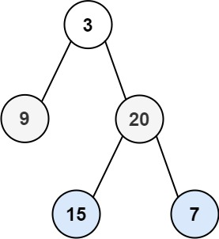

# 102. 二叉树的层序遍历

[← 二叉树专题](../../02-专题/08-二叉树.md) · [总目录](../../../../README.md) · [复习清单](../../00-总览/03-复习清单.md)

<div class="meta-badges problem-meta-common" aria-label="公共题目信息"><span class="mb diff-中等"><span class="mb-k">难度</span><b>中等</b></span></div>

<div class="meta-badges problem-meta legacy-problem-meta" data-hide-in-language="python" aria-label="Java 及同源语言解题信息"><span class="mb"><span class="mb-k">Java 主方法</span><b>BFS 分层</b></span><span class="mb"><span class="mb-k">时间</span><b>O(n)</b></span><span class="mb"><span class="mb-k">空间</span><b>O(w)</b></span></div>

<div class="meta-badges problem-meta" data-lang-scope="true" data-lang="python" aria-label="Python 解题信息"><span class="mb"><span class="mb-k">Python 主方法</span><b>BFS 固定当前层长度</b></span><span class="mb"><span class="mb-k">时间</span><b>O(n)</b></span><span class="mb"><span class="mb-k">空间</span><b>O(w)</b></span></div>


## 题目与约束

给你二叉树的根节点 `root` ，返回其节点值的 **层序遍历** 。 （即逐层地，从左到右访问所有节点）。

  **示例 1：**

  

  **输入：**root = [3,9,20,null,null,15,7]<br>**输出：**[[3],[9,20],[15,7]]

  **示例 2：**

  **输入：**root = [1]<br>**输出：**[[1]]

  **示例 3：**

  **输入：**root = []<br>**输出：**[]

  **提示：**

  - 树中节点数目在范围 `[0, 2000]` 内
  - `-1000 <= Node.val <= 1000`

[🔗 前往力扣原题验证 →](https://leetcode.cn/problems/binary-tree-level-order-traversal/?envType=study-plan-v2&envId=top-100-liked)

<section class="legacy-solution-panel java-solution-panel" data-hide-in-language="python" data-legacy-scope="true" markdown="1">

## Java 完整推导


### Java 核心不变量


> 每轮先固定队列长度，它就是当前层节点数。

## 完整推导

### 思路推导
  1. **直觉与痛点（拿什么装节点？）**：

     我们要一层层横向处理，也就是处理完父节点后，得**先把它所有的兄弟节点处理完**，然后再去处理它的孩子。

     这完美契合了“先进先出（FIFO）”的原则。所以，我们必须请出数据结构里的老大哥：**队列（Queue）**。

  2. **破局思路（雷达扫描法）**：

     - 先把树的根节点（司令）放进队列。
     - 只要队列里还有人，就弹出来，记录它的值，然后把它的左小弟和右小弟按顺序排进队列的末尾。

  3. **关键追问（怎么区分哪一层是哪一层？）**：

     这是整道题**唯一的难点**。如果只是盲目地“弹出一个，塞进两个”，队列里的父节点和子节点很快就会混在一起，你根本不知道哪里是第一层的结束，哪里是第二层的开始。

     **破局绝招：提前快照（Snapshot）！**

     在每一层开始处理**之前**，先问一下队列：“你现在里面有几个人？”。这几个人，绝对就是当前这一层的所有节点！我们把这个数量存入变量 `size` 中，然后**严格执行 `size` 次弹出操作**。在这个过程中新塞进去的孩子节点，全都会乖乖排在后面，留给下一轮循环去处理。
### Java 实现（BFS 黄金模板）
```java
import java.util.ArrayList;
import java.util.LinkedList;
import java.util.List;
import java.util.Queue;

/**
 * Definition for a binary tree node.
 * public class TreeNode {
 *     int val;
 *     TreeNode left;
 *     TreeNode right;
 *     TreeNode() {}
 *     TreeNode(int val) { this.val = val; }
 *     TreeNode(int val, TreeNode left, TreeNode right) {
 *         this.val = val;
 *         this.left = left;
 *         this.right = right;
 *     }
 * }
 */
class Solution {
    public List<List<Integer>> levelOrder(TreeNode root) {
        List<List<Integer>> res = new ArrayList<>();
        // 边界防御：如果树是空的，直接返回空列表
        if (root == null) {
            return res;
        }

        // 1. 初始化队列，并将根节点入队
        Queue<TreeNode> queue = new LinkedList<>();
        queue.offer(root);

        // 2. 雷达开启：只要队列不为空，说明还有节点没扫描完
        while (!queue.isEmpty()) {
            // 🌟 极其关键的一步：获取当前层的节点数量！
            int levelSize = queue.size();

            // 准备一个小篮子，装当前这一层的所有节点值
            List<Integer> currentLevel = new ArrayList<>();

            // 3. 严格按 levelSize 的数量进行遍历，不多也不少
            for (int i = 0; i < levelSize; i++) {
                // 弹出队头节点
                TreeNode node = queue.poll();
                currentLevel.add(node.val);

                // 如果有左孩子，排进队列（留给下一层处理）
                if (node.left != null) {
                    queue.offer(node.left);
                }
                // 如果有右孩子，排进队列（留给下一层处理）
                if (node.right != null) {
                    queue.offer(node.right);
                }
            }

            // 4. 当前层处理完毕，把小篮子放进最终的结果集里
            res.add(currentLevel);
        }

        return res;
    }
}
```
### 复杂度
  - **时间复杂度**：$O(N)$。每个节点进队一次、出队一次，并且做了一次常数时间的取值操作。
  - **空间复杂度**：$O(N)$。最坏的情况下（比如一棵完美的满二叉树），最下面一层的叶子节点数量大约是 $N/2$。当扫描到最底层时，队列里会同时装下这 $N/2$ 个节点，所以空间复杂度是线性的。

### 易错点与扩展（面试高频考点）

1. **踩坑警告：动态变化的 `queue.size()`（极其致命！）**

   - 新手最容易写出这样的作死代码：

```java
for (int i = 0; i < queue.size(); i++) { ... } // 绝对会死循环或逻辑混乱！
```

   - **原因解析**：每次你在循环里执行 `queue.offer()` 塞入新孩子时，`queue.size()` 都在动态变大！导致你的 `for` 循环边界不断向后推移，新旧层彻底混在一起。**必须在 `for` 循环外面用一个固定的 `int size` 把数量锁死！**

2. **面试追问：“既然层序遍历一维数组很简单，那你能用 DFS（深度优先搜索，递归）来实现这道层序遍历的二维返回格式吗？”**

   - **满分抢答**：能！这也是高级解法。
   - *思路简述*：我们在进行深度优先搜索时，除了传节点，再传一个 `level` 参数（代表当前在第几层，根节点是 0 层）。每次递归到一个节点时，如果发现最终结果集 `res` 的大小刚好等于 `level`，说明这一层还没建过小篮子，先 `new` 一个列表放进去。然后直接把当前节点的值塞进 `res.get(level)` 里。由于先遍历左子树再遍历右子树，同一层里的数据天然是从左到右有序的！

</section>

<section class="language-panel" data-lang-scope="true" data-lang="python" markdown="1">

## Python 完整推导

### 先拍下这一层的人数

层序遍历容易写出的错误版本是：弹出一个父节点，马上把两个孩子放到队尾，然后继续把整个队列当作“同一层”。此时父节点和子节点已经混在一起，输出就没有层边界。

解法是每轮开始时给队列拍一张快照：`level_size = len(queue)`。接下来的 `for` 只弹这么多次。新加入的孩子排在后半段，不会进入本轮的计数。

### 用 `[3,9,20,None,None,15,7]` 走一遍

1. 初始 `queue = [3]`，记下 `level_size = 1`。弹出 3，得到第一层 `[3]`；再加入 9 和 20，队列变为 `[9,20]`。
2. 新一轮在队列中还只有 9、20 时保存 `level_size = 2`。先弹出 9，它没有孩子；再弹出 20，并加入 15、7。当前层完整收集为 `[9,20]`。
3. 此时队列 `[15,7]`，第三轮长度是 2。依次弹出两个叶子，收集 `[15,7]`，没有新孩子。
4. 队列为空，返回 `[[3],[9,20],[15,7]]`。

每轮都先看边界，再处理节点；父节点加入的孩子只会等到下一次 `while` 才被消费，层与层的顺序就这样固定下来。

若树只有一条向左的链，每轮队列宽度都是 1，答案会逐层得到长度为 1 的列表；若某层很宽，孩子仍只会进入下一轮。轮末加入 level 的时机也很重要，它对应本轮全部值。

### Python 实现

> 参考来源：代码随想录（programmercarl.com）
>
> 沿用项目旧 Python 的 deque 分层代码和旧 Java 的“提前快照层人数”说明；仅整理变量、导入和注释。

```python
from collections import deque
from typing import List, Optional


class Solution:
    def levelOrder(self, root: Optional[TreeNode]) -> List[List[int]]:
        if root is None:
            return []

        answer = []
        queue = deque([root])
        while queue:
            level = []
            level_size = len(queue)
            for _ in range(level_size):
                node = queue.popleft()
                level.append(node.val)
                if node.left is not None:
                    queue.append(node.left)
                if node.right is not None:
                    queue.append(node.right)
            answer.append(level)
        return answer
```

### deque 的接口选择

`popleft()` 从队首取值，并返回被移除的节点；`append()` 从队尾加入孩子。二者平均都是 O(1)，比在普通 list 开头删除更适合 BFS。

`for _ in range(level_size)` 使用事先算好的整数，循环期间即使 `queue` 变长，循环次数也不会变化。空的当前层不会出现，因为只有 `queue` 非空才进入外层循环。

### 复杂度

- 时间复杂度：`O(n)`。
- 空间复杂度：`O(w)`。

每个节点入队、出队一次，popleft 为 O(1)，时间 O(n)；队列最多保存一层宽度 w 个节点，空间 O(w)。

</section>

## 力扣原题

[🔗 前往力扣原题验证 →](https://leetcode.cn/problems/binary-tree-level-order-traversal/?envType=study-plan-v2&envId=top-100-liked)

<section class="language-panel cpp-solution-panel" data-lang-scope="true" data-lang="cpp" markdown="1">

## C++ 实现

> 实现来源：代码随想录（programmercarl.com）


```cpp
class Solution {
public:
    vector<vector<int>> levelOrder(TreeNode* root) {
        queue<TreeNode*> que;
        if (root != NULL) que.push(root);
        vector<vector<int>> result;
        while (!que.empty()) {
            int size = que.size();
            vector<int> vec;
            // 这里一定要使用固定大小size，不要使用que.size()，因为que.size是不断变化的
            for (int i = 0; i < size; i++) {
                TreeNode* node = que.front();
                que.pop();
                vec.push_back(node->val);
                if (node->left) que.push(node->left);
                if (node->right) que.push(node->right);
            }
            result.push_back(vec);
        }
        return result;
    }
};
```

</section>

<section class="language-panel go-solution-panel" data-lang-scope="true" data-lang="go" markdown="1">

## Go 实现

> 实现来源：代码随想录（programmercarl.com）


```go
/**
102. 二叉树的递归遍历
 */
func levelOrder(root *TreeNode) [][]int {
	arr := [][]int{}

	depth := 0

	var order func(root *TreeNode, depth int)

	order = func(root *TreeNode, depth int) {
		if root == nil {
			return
		}
		if len(arr) == depth {
			arr = append(arr, []int{})
		}
		arr[depth] = append(arr[depth], root.Val)

		order(root.Left, depth+1)
		order(root.Right, depth+1)
	}

	order(root, depth)

	return arr
}


/**
102. 二叉树的层序遍历 使用container包
 */
func levelOrder(root *TreeNode) [][]int {
    res := [][]int{}
    if root == nil{//防止为空
        return res
    }
    queue := list.New()
    queue.PushBack(root)

    var tmpArr []int

    for queue.Len() > 0 {
        length := queue.Len()               //保存当前层的长度，然后处理当前层（十分重要，防止添加下层元素影响判断层中元素的个数）
        for i := 0; i < length; i++ {
            node := queue.Remove(queue.Front()).(*TreeNode)    //出队列
            if node.Left != nil {
                queue.PushBack(node.Left)
            }
            if node.Right != nil {
                queue.PushBack(node.Right)
            }
            tmpArr = append(tmpArr, node.Val)    //将值加入本层切片中
        }
        res = append(res, tmpArr)          //放入结果集
        tmpArr = []int{}                  //清空层的数据
    }

    return res
}

/**
  102. 二叉树的层序遍历 使用切片
*/
func levelOrder(root *TreeNode) [][]int {
     res := make([][]int, 0)
     if root == nil {
        return res
     }
     queue := make([]*TreeNode, 0)
     queue = append(queue, root)
     for len(queue) > 0 {
          size := len(queue)
          level := make([]int, 0)
          for i := 0; i < size; i++ {
               node := queue[0]
               queue = queue[1:]
               level = append(level, node.Val)
               if node.Left != nil {
				   queue = append(queue, node.Left)
               }
               if node.Right != nil {
				   queue = append(queue, node.Right)
               }
          }
          res = append(res, level)
     }
     return res
}

/**
102. 二叉树的层序遍历：使用切片模拟队列，易理解
 */
func levelOrder(root *TreeNode) (res [][]int) {
    if root == nil {
        return
    }

    curLevel := []*TreeNode{root}  // 存放当前层节点
    for len(curLevel) > 0 {
        nextLevel := []*TreeNode{}  // 准备通过当前层生成下一层
        vals := []int{}

        for _, node := range curLevel {
            vals = append(vals, node.Val) // 收集当前层的值
            // 收集下一层的节点
            if node.Left != nil {
                nextLevel = append(nextLevel, node.Left)
            }
            if node.Right != nil {
                nextLevel = append(nextLevel, node.Right)
            }
        }
        res = append(res, vals)
        curLevel = nextLevel // 将下一层变成当前层
    }

    return
}
```

</section>

<!--bottom-nav-->
<div class="problem-nav">
<a class="problem-nav-btn" href="../08-二叉树/0543-二叉树的直径.html" target="_blank" rel="noopener noreferrer">← 上一题</a>
<a class="problem-nav-btn" href="../../../../index.html">🏠 回到 Hot 100 目录</a>
<a class="problem-nav-btn primary" href="../08-二叉树/0108-将有序数组转换为二叉搜索树.html" target="_blank" rel="noopener noreferrer">下一题 →</a>
</div>
<!--/bottom-nav-->
