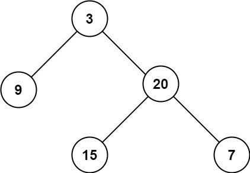

# 104. 二叉树的最大深度

[← 二叉树专题](../../02-专题/08-二叉树.md) · [总目录](../../../../README.md) · [复习清单](../../00-总览/03-复习清单.md)

<div class="meta-badges problem-meta-common" aria-label="公共题目信息"><span class="mb diff-简单"><span class="mb-k">难度</span><b>简单</b></span></div>

<div class="meta-badges problem-meta legacy-problem-meta" data-hide-in-language="python" aria-label="Java 及同源语言解题信息"><span class="mb"><span class="mb-k">Java 主方法</span><b>后序 DFS</b></span><span class="mb"><span class="mb-k">时间</span><b>O(n)</b></span><span class="mb"><span class="mb-k">空间</span><b>O(h)</b></span></div>

<div class="meta-badges problem-meta" data-lang-scope="true" data-lang="python" aria-label="Python 解题信息"><span class="mb"><span class="mb-k">Python 主方法</span><b>显式栈记录根到节点深度</b></span><span class="mb"><span class="mb-k">时间</span><b>O(n)</b></span><span class="mb"><span class="mb-k">空间</span><b>O(h)</b></span></div>


## 题目与约束

给定一个二叉树 `root` ，返回其最大深度。

  二叉树的 **最大深度** 是指从根节点到最远叶子节点的最长路径上的节点数。

  **示例 1：**

  

  **输入：**root = [3,9,20,null,null,15,7]<br>**输出：**3

  **示例 2：**

  **输入：**root = [1,null,2]<br>**输出：**2

  **提示：**

  - 树中节点的数量在 `[0, 104]` 区间内。
  - `-100 <= Node.val <= 100`

[🔗 前往力扣原题验证 →](https://leetcode.cn/problems/maximum-depth-of-binary-tree/?envType=study-plan-v2&envId=top-100-liked)

<section class="legacy-solution-panel java-solution-panel" data-hide-in-language="python" data-legacy-scope="true" markdown="1">

## Java 完整推导


### Java 核心不变量


> 节点深度等于左右子树最大深度加一。

## 完整推导

### 思路推导
  1. **直觉与痛点（数节点）**：

     就像数一棵真实大树有多高一样，你要从树根一直爬到最顶端的树叶。但是树有很多分叉，你该爬哪一边？显然，两边都要去试试，看看哪边更高。

  2. **破局思路（递归法 / 深度优先搜索 DFS）**：

     假设你站在这棵树的树根前，想要知道这棵树有多高，但是你视力不好看不清。你可以把任务**外包**给你的两个小弟：

     - 让小弟 A 去量一量**左子树**的最大高度。
     - 让小弟 B 去量一量**右子树**的最大高度。
     - 等他们俩汇报完，你只要挑出那个**最大的数字**，然后加上**你自己这层的 1**，不就是整棵树的最大深度了吗！

  3. **逻辑推演（微操设定）**：

     - 公式：`最大深度 = max(左子树深度, 右子树深度) + 1`
     - 终止条件（外包到头了）：如果当前是个空节点（比如叶子节点的下面），深度是多少？显然是 `0`。
### Java 实现（满分版）
```java
/**
 * Definition for a binary tree node.
 * public class TreeNode {
 *     int val;
 *     TreeNode left;
 *     TreeNode right;
 *     TreeNode() {}
 *     TreeNode(int val) { this.val = val; }
 *     TreeNode(int val, TreeNode left, TreeNode right) {
 *         this.val = val;
 *         this.left = left;
 *         this.right = right;
 *     }
 * }
 */
class Solution {
    public int maxDepth(TreeNode root) {
        // 1. 递归的终止条件：如果是空节点，高度就是 0
        if (root == null) {
            return 0;
        }

        // 2. 深入敌后：去向左子树和右子树要答案
        int leftDepth = maxDepth(root.left);
        int rightDepth = maxDepth(root.right);

        // 3. 汇总结果：左右两边谁更高，就取谁，再加上自己的 1 层高度
        return Math.max(leftDepth, rightDepth) + 1;
    }
}
```
### 复杂度
  - **时间复杂度**：$O(N)$。树中的每一个节点都会被精确地访问一次（外包任务派发下去再收回来）。
  - **空间复杂度**：$O(H)$。其中 $H$ 是树的高度。这是递归调用所消耗的系统栈空间。最坏情况（树是一条向一边偏的直线）是 $O(N)$，平均情况（比较平衡的树）是 $O(\log N)$。

### 易错点与扩展（面试喜欢怎么变体）

1. **极简主义的诱惑**：

   - 上面的代码略显啰嗦，大牛们通常会把它压缩成一行：

```java
     return root == null ? 0 : Math.max(maxDepth(root.left), maxDepth(root.right)) + 1;
```

   - *建议*：虽然一行代码看起来很帅，但在真实的白板面试中，建议还是像上面我给的标准版那样分行写。这样不仅思路清晰，还方便你在调试时打印 `leftDepth` 和 `rightDepth` 的值。

2. **面试追问：“如果这是一棵巨大的树，递归导致栈溢出怎么办？你能用迭代（非递归）来求最大深度吗？”**

   - **满分抢答**：绝对可以！使用**层序遍历（广度优先搜索 BFS）**。
   - *思路简述*：就像往树上泼水，水会一层一层往下流。我们用一个队列（Queue），先把根节点装进去。然后开始循环，每次循环开始时，队列里的节点数量就是**这一层**的所有节点。把这一层的节点全部弹出，并把它们的左右孩子全部塞进队列。**每一轮大循环，深度就加 1**。直到队列为空，水流到底了，深度也就求出来了。时间复杂度依然是 $O(N)$。

</section>

<section class="language-panel" data-lang-scope="true" data-lang="python" markdown="1">

## Python 完整推导

### 把“我现在在第几层”一起带到下面

树的最大深度可以看成所有从根出发、走到某个节点的路径中最长的节点数。既然深度不是树的固定属性，就要在向下走时把当前层数一起传递。

`stack` 的每一项不是单独的节点，而是 `(node, depth)`：前一个决定下一步去哪里，后一个记下从根走到它的节点数。每弹出一项，先用 `depth` 更新 `best`，再把孩子以 `depth + 1` 放入栈中。

### 示例中的状态变化

输入 `[3, 9, 20, None, None, 15, 7]`，它对应：

```text
      3
     / \
    9  20
      /  \
     15  7
```

初始 `stack = [(3, 1)]`、`best = 0`。

1. 弹出 `(3, 1)`，`best` 变为 1；左右孩子入栈后为 `[(9, 2), (20, 2)]`。
2. 栈顶是 `(20, 2)`，先处理右侧。`best` 变为 2；再把 `(15, 3)`、`(7, 3)` 入栈。
3. 弹出 `(7, 3)`，`best = 3`；它没有孩子。
4. 弹出 `(15, 3)`，深度仍为 3；随后弹出 `(9, 2)`，也不会再刷新记录。

最后返回 3。这里先处理右孩子还是左孩子不会影响答案，因为两边都会被访问，真正的深度已经随条目一起保存。

### Python 实现

> 参考来源：代码随想录（programmercarl.com）
>
> 沿用旧 Python/Java 的“最大子树深度加一”原理；因保留 1500 节点深链回归，将递归实现改为显式栈遍历，变量与注释由本站整理。

```python
from typing import Optional


class Solution:
    def maxDepth(self, root: Optional[TreeNode]) -> int:
        if root is None:
            return 0

        best = 0
        stack = [(root, 1)]
        while stack:
            node, depth = stack.pop()
            best = max(best, depth)
            if node.left is not None:
                stack.append((node.left, depth + 1))
            if node.right is not None:
                stack.append((node.right, depth + 1))
        return best
```

### 栈里为什么存二元组

只存节点时，弹出后已经不知道它离根有多远；再回到父节点寻找深度又会产生重复计算。把 `node` 和 `depth` 绑定成元组，弹出的同一瞬间就能完成判断和向下扩展。

`best = max(best, depth)` 是在每个节点处滚动更新。孩子为 `None` 时无需入栈，因此不会错误地把空节点也算成一层。

### 复杂度

- 时间复杂度：`O(n)`。
- 空间复杂度：`O(h)`。

每个节点入栈、出栈一次，时间 O(n)；显式栈最多保存一条路径高度 h 的节点深度对，空间 O(h)。

</section>

## 力扣原题

[🔗 前往力扣原题验证 →](https://leetcode.cn/problems/maximum-depth-of-binary-tree/?envType=study-plan-v2&envId=top-100-liked)

<section class="language-panel cpp-solution-panel" data-lang-scope="true" data-lang="cpp" markdown="1">

## C++ 实现

> 实现来源：代码随想录（programmercarl.com）


```cpp
int leftdepth = getdepth(node->left);       // 左
int rightdepth = getdepth(node->right);     // 右
int depth = 1 + max(leftdepth, rightdepth); // 中
return depth;
```

</section>

<section class="language-panel go-solution-panel" data-lang-scope="true" data-lang="go" markdown="1">

## Go 实现

> 实现来源：代码随想录（programmercarl.com）


```go
/**
 * definition for a binary tree node.
 * type treenode struct {
 *     val int
 *     left *treenode
 *     right *treenode
 * }
 */
func max (a, b int) int {
    if a > b {
        return a;
    }
    return b;
}
// 递归
func maxdepth(root *treenode) int {
    if root == nil {
        return 0;
    }
    return max(maxdepth(root.left), maxdepth(root.right)) + 1;
}
```

</section>

<section class="language-panel c-solution-panel" data-lang-scope="true" data-lang="c" markdown="1">

## C 实现

> 实现来源：代码随想录（programmercarl.com）


```c
int maxDepth(struct TreeNode* root){
    //若传入结点为NULL，返回0
    if(!root)
        return 0;

    //求出左子树深度
    int left = maxDepth(root->left);
    //求出右子树深度
    int right = maxDepth(root->right);
    //求出左子树深度和右子树深度的较大值
    int max = left > right ? left : right;
    //返回较大值+1（1为当前层数）
    return max + 1;
}
```

</section>

<!--bottom-nav-->
<div class="problem-nav">
<a class="problem-nav-btn" href="../08-二叉树/0094-二叉树的中序遍历.html" target="_blank" rel="noopener noreferrer">← 上一题</a>
<a class="problem-nav-btn" href="../../../../index.html">🏠 回到 Hot 100 目录</a>
<a class="problem-nav-btn primary" href="../08-二叉树/0226-翻转二叉树.html" target="_blank" rel="noopener noreferrer">下一题 →</a>
</div>
<!--/bottom-nav-->
