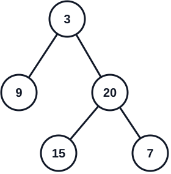

# 105. 从前序与中序遍历序列构造二叉树

[← 二叉树专题](../../02-专题/08-二叉树.md) · [总目录](../../../../README.md) · [复习清单](../../00-总览/03-复习清单.md)

<div class="meta-badges problem-meta-common" aria-label="公共题目信息"><span class="mb diff-中等"><span class="mb-k">难度</span><b>中等</b></span></div>

<div class="meta-badges problem-meta legacy-problem-meta" data-hide-in-language="python" aria-label="Java 及同源语言解题信息"><span class="mb"><span class="mb-k">Java 主方法</span><b>前序指针 + 中序索引表</b></span><span class="mb"><span class="mb-k">时间</span><b>O(n)</b></span><span class="mb"><span class="mb-k">空间</span><b>O(n)</b></span></div>

<div class="meta-badges problem-meta" data-lang-scope="true" data-lang="python" aria-label="Python 解题信息"><span class="mb"><span class="mb-k">Python 主方法</span><b>前序增量附着与中序游标</b></span><span class="mb"><span class="mb-k">时间</span><b>O(n)</b></span><span class="mb"><span class="mb-k">空间</span><b>O(h)</b></span></div>


## 题目与约束

给定两个整数数组 `preorder` 和 `inorder` ，其中 `preorder` 是二叉树的**先序遍历**， `inorder` 是同一棵树的**中序遍历**。请你构造并返回这棵二叉树。

*(题目保证输入的数据是一棵有效的二叉树，且树中没有重复元素)*

**示例 1：**



**输入：**`preorder = [3,9,20,15,7]`，`inorder = [9,3,15,20,7]`<br>
**输出：**`[3,9,20,null,null,15,7]`

**示例 2：**

**输入：**`preorder = [-1]`，`inorder = [-1]`<br>
**输出：**`[-1]`

[🔗 前往力扣原题验证 →](https://leetcode.cn/problems/construct-binary-tree-from-preorder-and-inorder-traversal/?envType=study-plan-v2&envId=top-100-liked)

<section class="legacy-solution-panel java-solution-panel" data-hide-in-language="python" data-legacy-scope="true" markdown="1">

## Java 完整推导


### Java 核心不变量


> 前序决定根，中序决定左右子树边界。

## 完整推导

### 思路推导
1. **直觉与痛点（两份线索的作用分别是什么？）**：

   只看前序遍历，我们能确定“谁先当根”，却不知道根的左边有多少节点、右边有多少节点；只看中序遍历，虽然根一旦确定就能用它把序列切成左右两半，但中序本身没有告诉我们根是谁。单独一份线索都不够：前序给出**根的身份和访问顺序**，中序给出**左右子树的边界**。

   把两份线索放在一起，就能逐层还原：前序区间的第一个值是当前子树的根；去中序中找到这个值，它左边的部分就是左子树，右边的部分就是右子树。题目保证节点值不重复，所以根在中序里的位置唯一，左右边界也就唯一。

2. **拿示例走一遍（先定根，再切左右）**：

```text
preorder = [3, 9, 20, 15, 7]
inorder  = [9, 3, 15, 20, 7]
```

   - 前序第一个值 `3` 是整棵树的根。在中序中找到 `3`，它左边是 `[9]`，右边是 `[15, 20, 7]`。因此左子树有 1 个节点，右子树有 3 个节点。
   - 前序中紧跟在根后面的 1 个值属于左子树，所以左子树的前序是 `[9]`；剩余的 `[20, 15, 7]` 属于右子树。
   - 对右子树重复同一过程：它的前序第一个值 `20` 是根；在对应的中序部分 `[15, 20, 7]` 中，`20` 左边是 `[15]`，右边是 `[7]`。

   最终得到：

```text
    3
   / \
  9  20
     / \
    15  7
```

3. **破局思路（用区间代表一棵子树）**：

   递归函数不必真的复制出新的前序、中序子数组，只需分别记录这棵子树在两个数组中的闭区间：`[preStart, preEnd]` 和 `[inStart, inEnd]`。这样每次递归只传几个下标，不会反复切片、复制数组。

   - **定根**：当前子树的根是 `preorder[preStart]`。
   - **找边界**：用哈希表查出根在中序中的位置 `inRoot`。`inStart` 到 `inRoot - 1` 是左子树，`inRoot + 1` 到 `inEnd` 是右子树。
   - **算左子树节点数**：`leftSize = inRoot - inStart`。前序里根后面的 `leftSize` 个元素属于左子树，剩下的属于右子树。
   - **递归并接回指针**：左、右两边分别按各自对应的前序区间和中序区间继续构造，返回的节点接到 `root.left`、`root.right`。
   - **停止条件**：若区间为空（起点大于终点），说明这边没有节点，返回 `null`。

   把区间边界写出来，能避免最容易错的“前序切分下标”：

```text
左子树 preorder: [preStart + 1,             preStart + leftSize]
左子树 inorder:  [inStart,                  inRoot - 1]
右子树 preorder: [preStart + leftSize + 1,  preEnd]
右子树 inorder:  [inRoot + 1,               inEnd]
```

   这里有个重要对应关系：**前序区间中，根后面的左子树节点数，必须与中序根左侧的节点数相同**。两边区间长度相等，递归拿到的才是同一棵子树的两份遍历线索。

4. **逻辑推演（为什么哈希表能把复杂度降到 `O(n)`）**：

   如果每次都从中序区间里顺序查找根，树越偏斜，反复查找的总成本越高，最坏会到 `O(n^2)`。先把“节点值 → 中序下标”放进 `HashMap`，每个根的位置就能平均 `O(1)` 查到；之后每个节点只创建、处理一次，整体时间为 `O(n)`。哈希表占 `O(n)`，递归栈占 `O(h)`（`h` 是树高），总空间为 `O(n)`。

### Java 实现（哈希表 $O(N)$ 优化版）
```java
import java.util.HashMap;
import java.util.Map;

/**
 * Definition for a binary tree node.
 * public class TreeNode {
 * int val;
 * TreeNode left;
 * TreeNode right;
 * TreeNode() {}
 * TreeNode(int val) { this.val = val; }
 * TreeNode(int val, TreeNode left, TreeNode right) {
 * this.val = val;
 * this.left = left;
 * this.right = right;
 * }
 * }
 */
class Solution {
    // 准备一个全局“雷达”，用来瞬间在 inorder 中找到老大
    private Map<Integer, Integer> inMap = new HashMap<>();

    public TreeNode buildTree(int[] preorder, int[] inorder) {
        // 将中序遍历的值和对应的索引存入哈希表，实现 O(1) 的超快查找
        for (int i = 0; i < inorder.length; i++) {
            inMap.put(inorder[i], i);
        }

        // 开始建树大业！初始范围是整个数组
        return build(preorder, 0, preorder.length - 1,
                     inorder, 0, inorder.length - 1);
    }

    // 辅助函数：在指定的前序和中序范围内，构建二叉树
    private TreeNode build(int[] preorder, int preStart, int preEnd,
                           int[] inorder, int inStart, int inEnd) {

        // 终止条件：当起始游标跑到了结束游标的右边，说明这块地盘已经没兵了
        if (preStart > preEnd || inStart > inEnd) {
            return null;
        }

        // 1. 【认老大】：前序遍历范围里的第一个元素，就是当前子树的根节点！
        int rootVal = preorder[preStart];
        TreeNode root = new TreeNode(rootVal);

        // 2. 【找定位】：用哈希表瞬间找到老大在中序遍历里的位置
        int inRoot = inMap.get(rootVal);

        // 3. 【点人数】：算出左子树一共分到了几个人
        int leftSize = inRoot - inStart;

        // 4. 【分封诸侯】：带着计算好的新边界，递归构建左右子树
        // 左子树的前序阵营：从老大后面一个开始，数 leftSize 个人
        // 左子树的中序阵营：从最左边开始，到老大前面一个结束
        root.left = build(preorder, preStart + 1, preStart + leftSize,
                          inorder, inStart, inRoot - 1);

        // 右子树的前序阵营：跳过老大和左子树的所有人，剩下的全包
        // 右子树的中序阵营：从老大后面一个开始，到最右边结束
        root.right = build(preorder, preStart + leftSize + 1, preEnd,
                           inorder, inRoot + 1, inEnd);

        // 5. 汇报战果
        return root;
    }
}
```
### 复杂度
  - **时间复杂度**：$O(N)$。由于我们在一开始用 HashMap 存储了中序遍历的索引，每次查找根节点只需要 $O(1)$ 的时间。整个构建过程只需要对每个节点访问一次。
  - **空间复杂度**：$O(N)$。使用了 HashMap 来存储中序数组的元素和索引映射，消耗 $O(N)$ 空间。同时递归调用栈最深为 $O(H)$，所以总体空间复杂度为 $O(N)$。

### 易错点与扩展（面试的隐蔽火力）

1. **踩坑警告：为什么必须要用 `HashMap`？**
   - 在很多新手的代码里，他们会在 `build` 函数内部写一个 `for` 循环，去 `inorder` 数组里挨个找 `rootVal`。
   - **致命后果**：如果在递归里嵌套 `for` 循环，最坏情况下（树退化成链表），每次找老大都要遍历整个数组，时间复杂度会直接飙升到 **$O(N^2)$**！在 LeetCode 上遇到大数据量会直接超时。面试面试官极度看重这种空间换时间的 $O(1)$ 优化嗅觉。
2. **面试追问：“如果给你的数组里有【重复元素】，这个算法还能奏效吗？”**
   - **满分抢答**：**不能！** 这个算法的绝对前提是“无重复元素”。如果 `inorder` 里有两个 `3`，我们的 HashMap 雷达就懵了，它不知道前序遍历里的老大 `3` 到底对应中序里的哪个 `3`。这种情况下，一棵前序和中序序列可能会还原出多种不同的二叉树形态。

</section>

<section class="language-panel" data-lang-scope="true" data-lang="python" markdown="1">

## Python 完整推导

### 前序给出“谁先来”，中序给出“何时回头”

前序的第一个值是当前子树的根；之后新增的值，暂时总是沿左边界向下，直到栈顶遇到的节点正好轮到中序序列的下一个值。这个相等关系说明某段左子树已经结束，应该回到祖先并考虑右孩子。

不必显式保存每棵子树的中序区间。`stack` 是还没完成的祖先链，`inorder_index` 是仍在等待完成的中序位置。新节点若不能作为栈顶左孩子，就会触发一次或多次弹栈；最后弹出的节点正是新右孩子的父节点。

### 用 `[3,9,20,15,7]` 与 `[9,3,15,20,7]` 走一遍

1. 根 3 入栈。读到 9 时，栈顶 3 不等于 `inorder[0] = 9`，所以 9 是 3 的左孩子，入栈。
2. 读到 20 时，栈顶 9 等于 `inorder[0]`。弹出 9、游标到 1；根 3 也等于新的 `inorder[1]`，继续弹出、游标到 2。最后弹出的父节点是 3，因此把 20 接到 3 的右边。
3. 读到 15 时，栈顶 20 不等于 `inorder[2] = 15`，把 15 接为 20 的左孩子。
4. 读到 7 时，15 正好等于 `inorder[2]`。先弹出 15、游标变成 3；此时栈顶 20 又等于新的 `inorder[3]`，所以继续弹出并把游标推进到 4。最后弹出的父节点是 20，把 7 接到 20 右边。

最终根 3 的两侧分别是 9 与 20，节点 20 两侧是 15 与 7，与两段遍历完全一致。

### Python 实现

> 参考来源：经典解法实现
>
> 沿用经典前序/中序定位思路和旧 Java 的“前序定根、中序切左右”；为保留 1500 节点深链回归，主实现由旧递归区间法改为显式栈增量附着，属于可靠性修正。

```python
from typing import List, Optional


class Solution:
    def buildTree(self, preorder: List[int], inorder: List[int]) -> Optional[TreeNode]:
        if not preorder:
            return None

        root = TreeNode(preorder[0])
        stack = [root]
        inorder_index = 0

        for index in range(1, len(preorder)):
            value = preorder[index]
            node = TreeNode(value)

            if stack[-1].val != inorder[inorder_index]:
                stack[-1].left = node
            else:
                while stack and stack[-1].val == inorder[inorder_index]:
                    parent = stack.pop()
                    inorder_index += 1
                parent.right = node
            stack.append(node)

        return root
```

### parent 必须来自最后一次 pop

`while stack and stack[-1].val == inorder[inorder_index]` 可能连续弹出多个祖先。新右孩子应接到这串弹出节点的最后一个，因此变量 `parent` 要在循环结束后仍保留最后赋值的节点。

游标从不回退；每次弹栈都说明这个中序位置已经完成。每个节点只入栈一次，最多出栈一次。深树也不会进入递归分支。

### 复杂度

- 时间复杂度：`O(n)`。
- 空间复杂度：`O(h)`。

前序每个节点处理一次，入栈出栈各一次；中序游标只前进 n 次，时间 O(n)。栈保存尚未完成的祖先，空间 O(h)，没有额外位置映射或递归栈。

</section>

## 力扣原题

[🔗 前往力扣原题验证 →](https://leetcode.cn/problems/construct-binary-tree-from-preorder-and-inorder-traversal/?envType=study-plan-v2&envId=top-100-liked)

<section class="language-panel cpp-solution-panel" data-lang-scope="true" data-lang="cpp" markdown="1">

## C++ 实现

> 实现来源：经典解法实现

<ol class="lang-steps"><li>前序第一个元素是根；在中序中定位根，左边是左子树、右边是右子树</li><li>递归：左子树用前序下一段 + 中序左段，右子树同理</li><li>用哈希表存中序值→下标，定位 O(1)</li></ol>

```cpp
class Solution {
    unordered_map<int, int> inIdx;
public:
    TreeNode* build(vector<int>& pre, int preL, int preR, int inL, int inR) {
        if (preL > preR) return nullptr;
        TreeNode* node = new TreeNode(pre[preL]);
        int mid = inIdx[pre[preL]], leftSize = mid - inL;
        node->left = build(pre, preL + 1, preL + leftSize, inL, mid - 1);
        node->right = build(pre, preL + leftSize + 1, preR, mid + 1, inR);
        return node;
    }
    TreeNode* buildTree(vector<int>& preorder, vector<int>& inorder) {
        for (int i = 0; i < inorder.size(); i++) inIdx[inorder[i]] = i;
        return build(preorder, 0, preorder.size() - 1, 0, inorder.size() - 1);
    }
};
```

</section>

<section class="language-panel go-solution-panel" data-lang-scope="true" data-lang="go" markdown="1">

## Go 实现

> 实现来源：经典解法实现

<ol class="lang-steps"><li>前序第一个元素是根；在中序中定位根，左边是左子树、右边是右子树</li><li>递归：左子树用前序下一段 + 中序左段，右子树同理</li><li>用哈希表存中序值→下标，定位 O(1)</li></ol>

```go
func buildTree(preorder []int, inorder []int) *TreeNode {
    idx := map[int]int{}
    for i, v := range inorder { idx[v] = i }
    var build func(preL, preR, inL, inR int) *TreeNode
    build = func(preL, preR, inL, inR int) *TreeNode {
        if preL > preR { return nil }
        rootVal := preorder[preL]
        mid := idx[rootVal]
        leftSize := mid - inL
        node := &TreeNode{Val: rootVal}
        node.Left = build(preL+1, preL+leftSize, inL, mid-1)
        node.Right = build(preL+leftSize+1, preR, mid+1, inR)
        return node
    }
    return build(0, len(preorder)-1, 0, len(inorder)-1)
}
```

</section>

<section class="language-panel c-solution-panel" data-lang-scope="true" data-lang="c" markdown="1">

## C 实现

> 实现来源：经典解法实现

<ol class="lang-steps"><li>前序第一个元素是根；在中序中定位根，左边是左子树、右边是右子树</li><li>递归：左子树用前序下一段 + 中序左段，右子树同理</li><li>用哈希表存中序值→下标，定位 O(1)</li></ol>

```c
struct TreeNode* build(int* pre, int preL, int preR, int* in, int inL, int inR) {
    if (preL > preR) return NULL;
    struct TreeNode* node = malloc(sizeof(struct TreeNode));
    node->val = pre[preL];
    int mid = inL;
    while (in[mid] != pre[preL]) mid++;   /* 中序定位根 */
    int leftSize = mid - inL;
    node->left = build(pre, preL + 1, preL + leftSize, in, inL, mid - 1);
    node->right = build(pre, preL + leftSize + 1, preR, in, mid + 1, inR);
    return node;
}
struct TreeNode* buildTree(int* preorder, int preorderSize, int* inorder, int inorderSize) {
    return build(preorder, 0, preorderSize - 1, inorder, 0, inorderSize - 1);
}
```

</section>

<!--bottom-nav-->
<div class="problem-nav">
<a class="problem-nav-btn" href="../08-二叉树/0114-二叉树展开为链表.html" target="_blank" rel="noopener noreferrer">← 上一题</a>
<a class="problem-nav-btn" href="../../../../index.html">🏠 回到 Hot 100 目录</a>
<a class="problem-nav-btn primary" href="../08-二叉树/0437-路径总和 III.html" target="_blank" rel="noopener noreferrer">下一题 →</a>
</div>
<!--/bottom-nav-->
