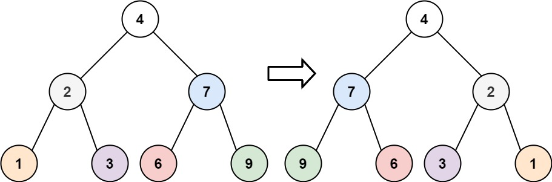
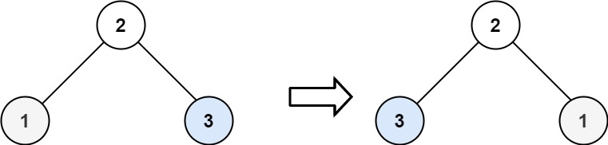

# 226. 翻转二叉树

[← 二叉树专题](../../02-专题/08-二叉树.md) · [总目录](../../../../README.md) · [复习清单](../../00-总览/03-复习清单.md)

<div class="meta-badges problem-meta-common" aria-label="公共题目信息"><span class="mb diff-简单"><span class="mb-k">难度</span><b>简单</b></span></div>

<div class="meta-badges problem-meta legacy-problem-meta" data-hide-in-language="python" aria-label="Java 及同源语言解题信息"><span class="mb"><span class="mb-k">Java 主方法</span><b>递归交换左右子树</b></span><span class="mb"><span class="mb-k">时间</span><b>O(n)</b></span><span class="mb"><span class="mb-k">空间</span><b>O(h)</b></span></div>

<div class="meta-badges problem-meta" data-lang-scope="true" data-lang="python" aria-label="Python 解题信息"><span class="mb"><span class="mb-k">Python 主方法</span><b>递归交换每个节点的左右子树</b></span><span class="mb"><span class="mb-k">时间</span><b>O(n)</b></span><span class="mb"><span class="mb-k">空间</span><b>O(h)</b></span></div>


## 题目与约束

给你一棵二叉树的根节点 `root` ，翻转这棵二叉树，并返回其根节点。

**示例 1：**



**输入：**root = [4,2,7,1,3,6,9]<br>**输出：**[4,7,2,9,6,3,1]

**示例 2：**



**输入：**root = [2,1,3]<br>**输出：**[2,3,1]

**示例 3：**

**输入：**root = []<br>**输出：**[]

**提示：**

- 树中节点数目范围在 `[0, 100]` 内
- `-100 <= Node.val <= 100`

[🔗 前往力扣原题验证 →](https://leetcode.cn/problems/invert-binary-tree/?envType=study-plan-v2&envId=top-100-liked)

<section class="legacy-solution-panel java-solution-panel" data-hide-in-language="python" data-legacy-scope="true" markdown="1">

## Java 完整推导


### Java 核心不变量


> 每个节点只做一件事：交换左右孩子。

## 完整推导

### 思路推导

这道题最适合训练“递归函数只负责当前节点”的思维：

1. 空节点无需处理，直接返回。
2. 当前节点交换 `left` 与 `right`。
3. 对交换后的左右子树继续做同样的事情。

先交换再递归、先递归再交换都能得到正确结果；关键是整棵树的每个节点都恰好被处理一次。

### Java 实现

```java
class Solution {
    public TreeNode invertTree(TreeNode root) {
        if (root == null) {
            return null;
        }

        TreeNode temp = root.left;
        root.left = root.right;
        root.right = temp;

        invertTree(root.left);
        invertTree(root.right);
        return root;
    }
}
```

### 复杂度

- 时间复杂度：`O(n)`，每个节点访问一次。
- 空间复杂度：`O(h)`，递归栈深度等于树高；退化链表时最坏为 `O(n)`。

### 易错点与扩展

1. 交换的是节点引用，而不是节点值。
2. 不要只交换根节点；左右子树也必须递归处理。
3. 迭代写法可使用队列做 BFS：节点出队后交换孩子，再把非空孩子入队。

</section>

<section class="language-panel" data-lang-scope="true" data-lang="python" markdown="1">

## Python 完整推导

### 镜像要落到每一棵子树

翻转二叉树不是只把根节点的左右孩子换一下。以根为界，整棵左子树应该接到右边，整棵右子树应该接到左边；并且原来的两棵子树内部也要继续翻转。

递归函数只回答一个问题：把传入的这棵树翻转完成后，新的根是谁？空树没有可翻转的内容，返回 `None`；非空时先分别处理两个子树，再交换它们返回的根。

### 以 `[4,2,7,1,3,6,9]` 为例

这棵完整的两层树在交换根的孩子之前，外层形态是 `4` 的左 `2`、右 `7`。为了让左右两边内部也镜像，先分别处理：

1. 对 `2` 翻转，孩子 `1`、`3` 交换，得到 `2` 下的 `3`、`1`。
2. 对 `7` 翻转，孩子 `6`、`9` 交换，得到 `7` 下的 `9`、`6`。
3. 回到根 `4`，把刚才完成翻转的两棵子树交换位置。

最终层序是 `[4,7,2,9,6,3,1]`。可以看到，根下面换了边，原来的 `1,3` 也换成 `3,1`；两处都发生变化，才是完整翻转。

代码先递归、后交换和先交换、后递归都可行。这里先递归是为了让 `left`、`right` 明确表示“两棵已经完成的子树”，随后一次元组赋值即可交换。

题目节点数不超过 100，因此即使树退化成一条链，递归深度也小于 101。这里保留递归是为了让“先完成子树，再交换引用”与返回新根的关系更直观，不必为了很小的输入引入额外容器。

### Python 实现

> 参考来源：代码随想录（programmercarl.com）
>
> 沿用项目旧 Python 的递归翻转代码与旧 Java 的“每层交换左右孩子”思路；仅整理导入、变量和注释。

```python
from typing import Optional


class Solution:
    def invertTree(self, root: Optional[TreeNode]) -> Optional[TreeNode]:
        if root is None:
            return None

        left = self.invertTree(root.left)
        right = self.invertTree(root.right)
        root.left, root.right = right, left
        return root
```

### 引用交换与返回新根

`root.left, root.right = right, left` 修改的是当前树的结构，右侧先取完成翻转的右子树根，再把它接到左边。Python 会先在等号右边计算好两个引用，因此不会出现第一项赋值覆盖第二项所需值的问题。

函数最后必须返回 `root`：父节点的递归调用需要拿这个根接到自己的孩子位置。空节点返回 `None`，保证叶子节点的孩子也能按同一条规则处理。

### 复杂度

- 时间复杂度：`O(n)`。
- 空间复杂度：`O(h)`。

每个节点访问一次并做常数次赋值，时间 O(n)；递归调用栈最深受树高 h 限制，题目 n <= 100。

</section>

## 力扣原题

[🔗 前往力扣原题验证 →](https://leetcode.cn/problems/invert-binary-tree/?envType=study-plan-v2&envId=top-100-liked)

<section class="language-panel cpp-solution-panel" data-lang-scope="true" data-lang="cpp" markdown="1">

## C++ 实现

> 实现来源：代码随想录（programmercarl.com）


```cpp
class Solution {
public:
    TreeNode* invertTree(TreeNode* root) {
        if (root == NULL) return root;
        swap(root->left, root->right);  // 中
        invertTree(root->left);         // 左
        invertTree(root->right);        // 右
        return root;
    }
};
```

</section>

<section class="language-panel go-solution-panel" data-lang-scope="true" data-lang="go" markdown="1">

## Go 实现

> 实现来源：代码随想录（programmercarl.com）


```go
func invertTree(root *TreeNode) *TreeNode {
    if root == nil {
        return nil
    }
    root.Left, root.Right = root.Right, root.Left    //交换

    invertTree(root.Left)
    invertTree(root.Right)

    return root
}
```

</section>

<section class="language-panel c-solution-panel" data-lang-scope="true" data-lang="c" markdown="1">

## C 实现

> 实现来源：代码随想录（programmercarl.com）


```c
struct TreeNode* invertTree(struct TreeNode* root){
    if(!root)
        return NULL;
    //交换结点的左右孩子（中）
    struct TreeNode* temp = root->right;
    root->right = root->left;
    root->left = temp;
    左
    invertTree(root->left);
    //右
    invertTree(root->right);
    return root;
}
```

</section>

<!--bottom-nav-->
<div class="problem-nav">
<a class="problem-nav-btn" href="../08-二叉树/0104-二叉树的最大深度.html" target="_blank" rel="noopener noreferrer">← 上一题</a>
<a class="problem-nav-btn" href="../../../../index.html">🏠 回到 Hot 100 目录</a>
<a class="problem-nav-btn primary" href="../08-二叉树/0101-对称二叉树.html" target="_blank" rel="noopener noreferrer">下一题 →</a>
</div>
<!--/bottom-nav-->
