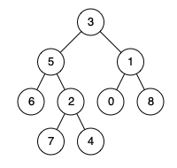

# 236. 二叉树的最近公共祖先

[← 二叉树专题](../../02-专题/08-二叉树.md) · [总目录](../../../../README.md) · [复习清单](../../00-总览/03-复习清单.md)

<div class="meta-badges problem-meta-common" aria-label="公共题目信息"><span class="mb diff-中等"><span class="mb-k">难度</span><b>中等</b></span></div>

<div class="meta-badges problem-meta legacy-problem-meta" data-hide-in-language="python" aria-label="Java 及同源语言解题信息"><span class="mb"><span class="mb-k">Java 主方法</span><b>后序递归</b></span><span class="mb"><span class="mb-k">时间</span><b>O(n)</b></span><span class="mb"><span class="mb-k">空间</span><b>O(h)</b></span></div>

<div class="meta-badges problem-meta" data-lang-scope="true" data-lang="python" aria-label="Python 解题信息"><span class="mb"><span class="mb-k">Python 主方法</span><b>父节点映射与祖先集合</b></span><span class="mb"><span class="mb-k">时间</span><b>O(n)</b></span><span class="mb"><span class="mb-k">空间</span><b>O(n)</b></span></div>


## 题目与约束

给定一个二叉树, 找到该树中两个指定节点 `p` 和 `q` 的最近公共祖先（LCA）。

*最近公共祖先定义*：“对于有根树 T 的两个节点 p、q，最近公共祖先表示为一个节点 x，满足 x 是 p、q 的祖先且 x 的深度尽可能大（一个节点也可以是它自己的祖先）。”

**示例 1：**



**输入：**`root = [3,5,1,6,2,0,8,null,null,7,4]`，`p = 5`，`q = 1`<br>
**输出：**`3`<br>
**解释：**节点 5 和节点 1 的最近公共祖先是节点 3。

**示例 2：**


**输入：**`root = [3,5,1,6,2,0,8,null,null,7,4]`，`p = 5`，`q = 4`<br>
**输出：**`5`<br>
**解释：**节点 5 是节点 4 的祖先；节点也可以是自己的祖先。

**示例 3：**`root = [1,2]`，`p = 1`，`q = 2`，输出 `1`。

[🔗 前往力扣原题验证 →](https://leetcode.cn/problems/lowest-common-ancestor-of-a-binary-tree/?envType=study-plan-v2&envId=top-100-liked)

<section class="legacy-solution-panel java-solution-panel" data-hide-in-language="python" data-legacy-scope="true" markdown="1">

## Java 完整推导


### Java 核心不变量


> 左右子树各找到一个目标时，当前节点就是最近公共祖先。

## 完整推导

### 思路推导
1. **直觉与痛点（自顶向下的迷茫）**：

   如果你站在树根往下看，你根本不知道 `p` 和 `q` 藏在哪个角落，你很难判断当前节点是不是“最近”的。

2. **破局思路（自底向上的情报网）**：

   我们要改变策略：**先让小弟们去底下找，找到了再层层往上报！**

   要想“先看底下，再处理自己”，这完美契合了后序遍历（左 -> 右 -> 中）的逻辑。

   - 我们定义一个递归函数：如果我在我这棵子树里发现了 `p` 或者 `q`，我就把发现的节点当做“情报”往上汇报。如果啥也没发现，我就汇报 `null`。

3. **逻辑推演（四种情报汇聚场景）**：

   假设你是一个父节点，你的左小弟和右小弟分别给你汇报了情报（`left` 和 `right`）：

   - **左右都有结果**：`p`、`q` 分居当前节点两侧，当前节点就是最近公共祖先。更高层的祖先也包含二者，但深度更浅，不再是“最近”的那个。
   - **只有左边有结果**：将左侧结果原样向父节点返回。它可能是 `p`/`q` 本身，也可能已经是更低处确定的 LCA。
   - **只有右边有结果**：对称地把右侧结果继续向上返回。
   - **两边都是 `null`**：当前子树没有目标，返回 `null`。

   **目标节点本身也要提前返回。** 若当前节点就是 `p` 或 `q`，递归直接返回它。比如 `p` 是 `q` 的祖先，`p` 返回后会一路向上传递，而另一个目标在它的子树中；按题目定义，`p` 仍然是 LCA，因为节点可以是自己的祖先。题目保证两个目标都存在，因此不需要处理缺失目标的情况。

4. **拿示例走一遍**：`p = 5, q = 1` 时，两个结果分别从根 3 的左右子树返回，3 处左右同时非空，答案为 3；`p = 5, q = 4` 时，节点 5 命中目标后向上传递，并成为包含节点 4 的子树结果，答案为 5。

   递归必须采用后序顺序，是因为当前节点要等左右子树先给出结果，才能判断是否在此汇合。每个节点最多访问一次，时间复杂度 `O(n)`；递归栈空间为 `O(h)`，`h` 为树高。

### Java 实现（极简后序遍历版）
```java
/**
 * Definition for a binary tree node.
 * public class TreeNode {
 * int val;
 * TreeNode left;
 * TreeNode right;
 * TreeNode(int x) { val = x; }
 * }
 */
class Solution {
    public TreeNode lowestCommonAncestor(TreeNode root, TreeNode p, TreeNode q) {
        // 1. 递归终止条件与“撞见目标”
        // 如果越过了叶子节点，返回 null
        // 如果正好撞见 p 或 q，直接把这个节点当做情报返回给上级
        if (root == null || root == p || root == q) {
            return root;
        }

        // 2. 深入敌后：去左边和右边打探情报（后序遍历的体现）
        TreeNode left = lowestCommonAncestor(root.left, p, q);
        TreeNode right = lowestCommonAncestor(root.right, p, q);

        // 3. 汇总情报，向上汇报
        // 场景 A：左右两边都传来了好消息，说明 p 和 q 刚好在我两边，我就是 LCA！
        if (left != null && right != null) {
            return root;
        }

        // 场景 B & C：如果一边有消息，另一边没消息，就把有消息的那边传上去
        // 场景 D：如果两边都没消息，刚好 left 和 right 都是 null，随便返回一个 null 即可
        return left != null ? left : right;
    }
}
```
### 复杂度
  - **时间复杂度**：$O(N)$。在最坏的情况下，我们需要遍历树的所有节点才能找到 `p` 和 `q`。
  - **空间复杂度**：$O(H)$。其中 $H$ 是二叉树的高度。空间消耗主要是递归调用的系统栈，最坏情况下（树退化成链表）为 $O(N)$，平均情况为 $O(\log N)$。

### 易错点与扩展（面试连环追问）

1. **面试追问 1：“如果这是一棵【二叉搜索树 (BST)】，你有更优的解法吗？”（对应力扣 235 题）**
   - **满分抢答**：有！因为 BST 左小右大，我们可以利用节点的值进行 $O(1)$ 的方向判断。
   - 从根节点往下：如果 `p` 和 `q` 的值都大于根节点，说明 LCA 一定在右子树；如果都小于，LCA 一定在左子树；**如果一小一大，说明它们在根节点的两侧，当前根节点就是 LCA！** 这就变成了从上往下的迭代，时间复杂度降为 $O(H)$，空间复杂度降为 $O(1)$！
2. **面试追问 2：“如果树里的每个节点都有一个指向父节点的 `parent` 指针呢？”（对应力扣 1650 题）**
   - **满分抢答**：那这就根本不是二叉树的题了，这就变成了“求两个单链表的相交节点”（力扣 160 题）！
   - 我们分别从 `p` 和 `q` 顺着 `parent` 指针往上爬，这就相当于两条链表求交点，用双指针法跑两圈就能相遇，空间复杂度直接压缩到 $O(1)$！

----

</section>

<section class="language-panel" data-lang-scope="true" data-lang="python" markdown="1">

## Python 完整推导

### 最近公共祖先就是两条上升路径的第一个交点

若每个节点都知道自己的父节点，问题会变成两条链的相遇：从 `p` 一路向上，记下经过的所有祖先；再从 `q` 向上走，第一次踩到这些节点时，那里就是 LCA。目标节点自己也算祖先，所以一个目标是另一个的父节点时，这个规则仍然成立。

二叉树没有现成 parent 指针，代码先用显式 DFS 补出 `parents`。字典的键是节点对象，值是它的父节点；根节点的值是 `None`。停止遍历的条件是 p、q 都已经能沿父链回到根。

### 以示例树中的 `p=5, q=4` 为例

树结构为 `[3,5,1,6,2,0,8,None,None,7,4]`。

1. 从 p=5 开始，把 5、3 依次加入 `ancestors`，到根父节点 `None` 停止。
2. q=4 不在集合中，沿父链先到 2，再到 5。
3. 5 已经出现在 p 的祖先集合里，于是返回节点 5。虽然 3 也是祖先，但 q 的上升路径先遇到更近的 5，因此它就是最近公共祖先。

如果 p、q 分居根两侧，从 q 向上会先到达根才命中，这时的根才承担“分叉后的最近汇合点”。
集合查询给出的第一个命中就是“最近”：越早遇到，节点离 q 越近，也越深。若先把所有共同祖先都收集再比较深度，反而多做了工作。

题目保证 p、q 都在树中，所以沿父链向上最终一定能到达根。这里的空间开销换来的是稳定遍历，没有把 O(n) 映射空间隐藏成常数。

### Python 实现

> 参考来源：代码随想录（programmercarl.com）
>
> 沿用旧 Java/Python 的后序“两边找到就在当前节点汇合”的 LCA 定义；为可靠处理深链，将递归情报回传改为父映射和祖先集合，属于显式栈修正。

```python
class Solution:
    def lowestCommonAncestor(
        self, root: TreeNode, p: TreeNode, q: TreeNode
    ) -> TreeNode:
        if root is p or root is q:
            return root

        parents = {root: None}
        stack = [root]
        while stack and (p not in parents or q not in parents):
            node = stack.pop()
            if node.left is not None and node.left not in parents:
                parents[node.left] = node
                stack.append(node.left)
            if node.right is not None and node.right not in parents:
                parents[node.right] = node
                stack.append(node.right)

        ancestors = set()
        current = p
        while current is not None:
            ancestors.add(current)
            current = parents[current]

        current = q
        while current not in ancestors:
            current = parents[current]
        return current
```

### 节点对象作为字典键

`parents[node.left] = node` 保存的是对象身份关系，节点默认按其对象身份可哈希；本题的节点值唯一，使用对象身份也不会让父子关系依赖数值。集合中的成员判断同样使用身份。

遍历时先登记孩子再入栈，避免同一节点被重复登记。题目保证 p、q 存在于树中，因此建图会覆盖两条父链；没有为不存在的目标添加伪答案或异常框架。

### 复杂度

- 时间复杂度：`O(n)`。
- 空间复杂度：`O(n)`。

显式 DFS 每个节点入栈一次，父映射建立 O(n)；两条祖先链最长 O(h)，总时间仍 O(n)。父映射、遍历栈和祖先集合最坏 O(n)。

</section>

## 力扣原题

[🔗 前往力扣原题验证 →](https://leetcode.cn/problems/lowest-common-ancestor-of-a-binary-tree/?envType=study-plan-v2&envId=top-100-liked)

<section class="language-panel cpp-solution-panel" data-lang-scope="true" data-lang="cpp" markdown="1">

## C++ 实现

> 实现来源：站内标准实现


```cpp
class Solution {
public:
    TreeNode* lowestCommonAncestor(TreeNode* root, TreeNode* p, TreeNode* q) {
        if (root == nullptr || root == p || root == q) return root;
        TreeNode* left = lowestCommonAncestor(root->left, p, q);
        TreeNode* right = lowestCommonAncestor(root->right, p, q);
        if (left != nullptr && right != nullptr) return root; // p、q 分居两侧
        return left != nullptr ? left : right;
    }
};
```

</section>

<section class="language-panel go-solution-panel" data-lang-scope="true" data-lang="go" markdown="1">

## Go 实现

> 实现来源：代码随想录（programmercarl.com）


```go
func lowestCommonAncestor(root, p, q *TreeNode) *TreeNode {
    // check
    if root == nil {
        return root
    }
    // 相等 直接返回root节点即可
    if root == p || root == q {
        return root
    }
    // Divide
    left := lowestCommonAncestor(root.Left, p, q)
    right := lowestCommonAncestor(root.Right, p, q)

    // Conquer
    // 左右两边都不为空，则根节点为祖先
    if left != nil && right != nil {
        return root
    }
    if left != nil {
        return left
    }
    if right != nil {
        return right
    }
    return nil
}
```

</section>

<!--bottom-nav-->
<div class="problem-nav">
<a class="problem-nav-btn" href="../08-二叉树/0437-路径总和 III.html" target="_blank" rel="noopener noreferrer">← 上一题</a>
<a class="problem-nav-btn" href="../../../../index.html">🏠 回到 Hot 100 目录</a>
<a class="problem-nav-btn primary" href="../08-二叉树/0124-二叉树中的最大路径和.html" target="_blank" rel="noopener noreferrer">下一题 →</a>
</div>
<!--/bottom-nav-->
