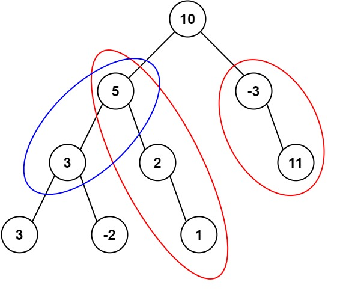

# 437. 路径总和 III

[← 二叉树专题](../../02-专题/08-二叉树.md) · [总目录](../../../../README.md) · [复习清单](../../00-总览/03-复习清单.md)

<div class="meta-badges problem-meta-common" aria-label="公共题目信息"><span class="mb diff-中等"><span class="mb-k">难度</span><b>中等</b></span></div>

<div class="meta-badges problem-meta legacy-problem-meta" data-hide-in-language="python" aria-label="Java 及同源语言解题信息"><span class="mb"><span class="mb-k">Java 主方法</span><b>前缀和 DFS</b></span><span class="mb"><span class="mb-k">时间</span><b>O(n)</b></span><span class="mb"><span class="mb-k">空间</span><b>O(h)</b></span></div>

<div class="meta-badges problem-meta" data-lang-scope="true" data-lang="python" aria-label="Python 解题信息"><span class="mb"><span class="mb-k">Python 主方法</span><b>显式进入/退出栈维护路径前缀和</b></span><span class="mb"><span class="mb-k">时间</span><b>O(n)</b></span><span class="mb"><span class="mb-k">空间</span><b>O(h)</b></span></div>


## 题目与约束

给定一个二叉树的根节点 `root` ，和一个整数 `targetSum` ，求该二叉树里节点值之和等于 `targetSum` 的 **路径** 的数目。

  *约束*：路径方向必须是向下的（只能从父节点到子节点），但**起点和终点可以是任意节点**。

  **示例 1：**

  

  **输入：**`root = [10,5,-3,3,2,null,11,3,-2,null,1]`，`targetSum = 8`<br>
  **输出：**`3`<br>
  **解释：**符合条件的三条向下路径为 `5 → 3`、`5 → 2 → 1`、`-3 → 11`。

  **示例 2：**

  **输入：**`root = [5,4,8,11,null,13,4,7,2,null,null,5,1]`，`targetSum = 22`<br>
  **输出：**`3`

[🔗 前往力扣原题验证 →](https://leetcode.cn/problems/path-sum-iii/?envType=study-plan-v2&envId=top-100-liked)

<section class="legacy-solution-panel java-solution-panel" data-hide-in-language="python" data-legacy-scope="true" markdown="1">

## Java 完整推导


### Java 核心不变量


> 当前前缀为 sum 时，祖先前缀 sum-target 的次数就是新增路径数。

## 完整推导

### 思路推导
  1. **直觉与痛点（双重 DFS 暴力破解）**：

     既然起点不固定，那我就“广撒网”。用一个主 DFS 遍历树里的每一个节点，把它们都当成起点；然后再写一个辅助 DFS，从这个起点一直往下找，凑够了目标值就加 1。

     **痛点**：这种解法有大量的重复计算。时间复杂度在最坏情况下（树退化成链表）会飙升到 $O(N^2)$。对于面试面试来说，这只能算是个“低保解法”。

  2. **破局思路（引入“前缀和”与“哈希表”）**：

     假设有一条从根节点一直向下的路径：`A -> B -> C -> D`。

     如果在跑到 `D` 的时候，整条路径的总和是 `currSum`。而我们想要找的是和为 `targetSum` 的子路径（假设是 `C -> D`）。

     这就意味着：一定存在一个在它上面的节点（比如 `B`），它到根节点的前缀和正好是 `currSum - targetSum`！

     **结论**：只要我们在往下走的过程中，用一个哈希表把一路上的“前缀和”记录下来。每次走到一个新节点，只需要查一下哈希表里有没有 `currSum - targetSum` 这个数字，如果有，说明我们截获了一条合法路径！

  3. **逻辑推演（致命难点：状态回溯）**：

     二叉树不是单一的一条线，它有分叉！

     当我们在左子树探索完，准备回退去探索右子树的时候，左子树里的那些前缀和，**对于右子树来说是完全不可见的（它们不是一条路径上的）**。

     所以，每当一个节点完成它的使命准备向上返回时，必须**把属于它的前缀和从哈希表里删掉**。这就是大名鼎鼎的**回溯（Backtracking）**！

### Java 实现（前缀和 + 回溯 $O(N)$ 满分版）
```java
import java.util.HashMap;

/**
 * Definition for a binary tree node.
 * public class TreeNode {
 * int val;
 * TreeNode left;
 * TreeNode right;
 * TreeNode() {}
 * TreeNode(int val) { this.val = val; }
 * TreeNode(int val, TreeNode left, TreeNode right) {
 * this.val = val;
 * this.left = left;
 * this.right = right;
 * }
 * }
 */
class Solution {
    public int pathSum(TreeNode root, int targetSum) {
        // 哈希表记录：<某个前缀和, 该前缀和出现的次数>
        // 注意：由于树的节点值可能很大，前缀和必须用 Long，防止 Integer 溢出！
        HashMap<Long, Integer> prefixMap = new HashMap<>();

        // 🌟 极其致命的初始化：代表“什么节点都不选”的情况下，前缀和 0 出现了一次。
        // 这意味着：如果当前节点自身的前缀和正好等于 targetSum，它减去 targetSum 就是 0。
        // 必须有这个底座，才能把从根节点开始的合法路径统计进去！
        prefixMap.put(0L, 1);

        // 开始深度优先搜索
        return dfs(root, prefixMap, 0L, targetSum);
    }

    private int dfs(TreeNode node, HashMap<Long, Integer> prefixMap, long currSum, int targetSum) {
        // 1. 终止条件
        if (node == null) {
            return 0;
        }

        // 2. 将当前节点的值加入前缀和
        currSum += node.val;

        // 3. 查字典：看看以前走过的路径中，有没有能和现在凑成 targetSum 的
        // 我们要找的历史前缀和 = 当前前缀和 - 目标值
        long targetPrefix = currSum - targetSum;
        int count = prefixMap.getOrDefault(targetPrefix, 0);

        // 4. 将当前的前缀和加入字典，供下面的子节点使用
        prefixMap.put(currSum, prefixMap.getOrDefault(currSum, 0) + 1);

        // 5. 带着这本字典，继续去左子树和右子树里寻宝
        count += dfs(node.left, prefixMap, currSum, targetSum);
        count += dfs(node.right, prefixMap, currSum, targetSum);

        // 6. 🌟 灵魂回溯：当前节点的所有子树都遍历完了。
        // 它要把自己加进字典的那个前缀和撤销掉，以免污染它兄弟节点的路径判断！
        prefixMap.put(currSum, prefixMap.get(currSum) - 1);

        return count;
    }
}
```
### 复杂度
  - **时间复杂度**：$O(N)$。每个节点仅仅被访问一次，哈希表的插入和查询时间都是 $O(1)$，真正的全方位优化思路。
  - **空间复杂度**：$O(N)$。主要开销是哈希表存储的不同前缀和的数量，以及递归调用栈的最大深度（最坏退化成链表时均为 $N$）。

### 易错点与扩展（面试生死狙击）

1. **踩坑警告 1：类型溢出陷阱 (Integer Overflow)**
   - 这道题在 LeetCode 上被偷偷修改过测试用例！有很多大数字连加，会导致普通的 `int currSum` 直接溢出变成负数，从而导致哈希表查错。
   - **破局**：前缀和变量 `currSum` 必须声明为 `long`，哈希表的 Key 也必须是 `Long` 类型。这是考察工程素养的必杀技！
2. **踩坑警告 2：被遗忘的 `prefixMap.put(0L, 1)`**
   - 如果不加这句，你会漏掉所有**恰好从根节点开始**的合法路径。
   - *举例*：树是 `[5, 3]`，`target = 8`。走到 3 时，`currSum = 8`。我们要找的历史前缀和是 `8 - 8 = 0`。如果你一开始没把 `0L` 存进去，程序会认为没找到，从而返回错误答案！
3. **踩坑警告 3：不回溯会怎样？**
   - 如果不回溯，你在左子树深处计算出来的前缀和，会被留在哈希表里。当你退出来去逛右子树的时候，右子树的代码会“隔空”查到左子树的前缀和，从而拼凑出一条“左下 -> 拐弯上来到根 -> 右下”的倒 V 型路径！但这道题严令禁止倒 V 型，只准单向向下！回溯，就是为了保证哈希表里的数据永远只属于“一条直挺挺向下的线”。

----

</section>

<section class="language-panel" data-lang-scope="true" data-lang="python" markdown="1">

## Python 完整推导

### 用“当前路径和”减去旧前缀

路径只能向下。设当前节点到根的前缀和为 `current`，如果某段祖先后面到当前节点这一段的和恰好是 `targetSum`，那么祖先之前的根路径和就应该是 `current - targetSum`。因此每到一个节点，查找这个差值在历史路径里出现过几次，就能得到以当前节点结尾的合法路径数。

二叉树有分叉，左子树的前缀不能留给右子树使用。`stack` 里的第三项 `leaving` 区分进入和退出：进入时登记前缀，节点整棵子树处理完后用退出事件撤销。

### 在 `[10,5,-3,3,2,None,11,3,-2,None,1]`、目标 8 中走一段

1. 进入 10：`current = 10`，查 `10 - 8 = 2`，没有；登记 10，次数变为 1。
2. 进入左孩子 5：`current = 15`，查 `15 - 8 = 7`，没有；登记 15。
3. 进入 3：`current = 18`，查 10，有 1 次，说明从根 10 之后开始，即 5→3，这一段路径和为 8，所以答案加一。
4. 继续访问 3 的孩子等分支；等 3 的整棵子树完成，退出事件把前缀 18 的计数减掉。之后才处理与 3 同属 5 下面的其他分支，它们不会看到已经离开路径的 18。

栈先压退出、再压右、再压左，因此实际先处理左子树。左子树全部进入/退出完成后，右子树开始时历史字典仍然只有根到父节点的真实前缀。

### Python 实现

> 参考来源：经典解法实现
>
> 沿用旧 Python/Java 的前缀和加回溯算法；为保留 1500 节点深链回归，将嵌套递归改为显式进入/退出事件栈，变量和注释由本站整理。

```python
from typing import Optional


class Solution:
    def pathSum(self, root: Optional[TreeNode], targetSum: int) -> int:
        if root is None:
            return 0

        historical = {0: 1}
        answer = 0
        stack = [(root, 0, False)]

        while stack:
            node, current, leaving = stack.pop()
            if leaving:
                historical[current] -= 1
                if historical[current] == 0:
                    del historical[current]
                continue

            current += node.val
            answer += historical.get(current - targetSum, 0)
            historical[current] = historical.get(current, 0) + 1

            stack.append((node, current, True))
            if node.right is not None:
                stack.append((node.right, current, False))
            if node.left is not None:
                stack.append((node.left, current, False))

        return answer
```

### 前缀字典的次数与删除

`historical.get(差值, 0)` 直接返回出现次数，缺失键当作 0。进入节点后，用 `get(current, 0) + 1` 累加同名前缀，因为不同祖先可能拥有相同前缀和。退出时只能减一；计数归零才删除键。

Python 整数不会被固定宽度溢出，因此前缀和无需特殊类型转换。事件栈不保存整条树的所有前缀，而只保留当前路径；最坏空间由树高决定。

### 复杂度

- 时间复杂度：`O(n)`。
- 空间复杂度：`O(h)`。

每个节点产生一次进入和一次退出事件，时间 O(n)；事件栈和当前路径上的不同前缀数都为 O(h)，没有递归调用栈。

</section>

## 力扣原题

[🔗 前往力扣原题验证 →](https://leetcode.cn/problems/path-sum-iii/?envType=study-plan-v2&envId=top-100-liked)

<section class="language-panel cpp-solution-panel" data-lang-scope="true" data-lang="cpp" markdown="1">

## C++ 实现

> 实现来源：经典解法实现

<ol class="lang-steps"><li>前缀和 + 回溯：cur 为根到当前节点的路径和</li><li>以 cur−target 为键查历史前缀表，命中次数即以当前节点结尾的合法路径数</li><li>登记当前前缀后递归子树，回溯时撤销登记（防止跨分支误配）</li></ol>

```cpp
class Solution {
    unordered_map<long, int> prefix;
    int count = 0, target = 0;
public:
    void go(TreeNode* node, long cur) {
        if (!node) return;
        cur += node->val;
        count += prefix[cur - target];        // 命中以当前节点结尾的路径
        prefix[cur]++;
        go(node->left, cur);
        go(node->right, cur);
        prefix[cur]--;                        // 回溯撤销
    }
    int pathSum(TreeNode* root, int targetSum) {
        target = targetSum;
        prefix[0] = 1;
        go(root, 0);
        return count;
    }
};
```

</section>

<section class="language-panel go-solution-panel" data-lang-scope="true" data-lang="go" markdown="1">

## Go 实现

> 实现来源：经典解法实现

<ol class="lang-steps"><li>前缀和 + 回溯：cur 为根到当前节点的路径和</li><li>以 cur−target 为键查历史前缀表，命中次数即以当前节点结尾的合法路径数</li><li>登记当前前缀后递归子树，回溯时撤销登记（防止跨分支误配）</li></ol>

```go
func pathSum(root *TreeNode, targetSum int) int {
    prefix := map[int]int{0: 1}
    count := 0
    var go func(node *TreeNode, cur int)
    go = func(node *TreeNode, cur int) {
        if node == nil { return }
        cur += node.Val
        count += prefix[cur-targetSum]
        prefix[cur]++
        go(node.Left, cur)
        go(node.Right, cur)
        prefix[cur]-- // 回溯撤销
    }
    go(root, 0)
    return count
}
```

</section>

<section class="language-panel c-solution-panel" data-lang-scope="true" data-lang="c" markdown="1">

## C 实现

> 实现来源：经典解法实现

<ol class="lang-steps"><li>前缀和 + 回溯：cur 为根到当前节点的路径和</li><li>以 cur−target 为键查历史前缀表，命中次数即以当前节点结尾的合法路径数</li><li>登记当前前缀后递归子树，回溯时撤销登记（防止跨分支误配）</li></ol>

```c
void go(struct TreeNode* node, long long cur, int target, long long* prefix, int plen, int* count) {
    if (!node) return;
    cur += node->val;
    for (int i = 0; i < plen; i++) if (prefix[i] == cur - target) (*count)++;
    prefix[plen++] = cur;
    go(node->left, cur, target, prefix, plen, count);
    go(node->right, cur, target, prefix, plen, count);
    plen--;  /* 回溯撤销 */
}
int pathSum(struct TreeNode* root, int targetSum) {
    long long prefix[1024] = {0};
    int plen = 1, count = 0;
    prefix[0] = 1;
    go(root, 0, targetSum, prefix, plen, &count);
    return count;
}
```

</section>

<!--bottom-nav-->
<div class="problem-nav">
<a class="problem-nav-btn" href="../08-二叉树/0105-从前序与中序遍历序列构造二叉树.html" target="_blank" rel="noopener noreferrer">← 上一题</a>
<a class="problem-nav-btn" href="../../../../index.html">🏠 回到 Hot 100 目录</a>
<a class="problem-nav-btn primary" href="../08-二叉树/0236-二叉树的最近公共祖先.html" target="_blank" rel="noopener noreferrer">下一题 →</a>
</div>
<!--/bottom-nav-->
