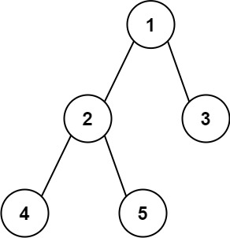

# 543. 二叉树的直径

[← 二叉树专题](../../02-专题/08-二叉树.md) · [总目录](../../../../README.md) · [复习清单](../../00-总览/03-复习清单.md)

<div class="meta-badges problem-meta-common" aria-label="公共题目信息"><span class="mb diff-中等"><span class="mb-k">难度</span><b>中等</b></span></div>

<div class="meta-badges problem-meta legacy-problem-meta" data-hide-in-language="python" aria-label="Java 及同源语言解题信息"><span class="mb"><span class="mb-k">Java 主方法</span><b>后序高度 + 全局答案</b></span><span class="mb"><span class="mb-k">时间</span><b>O(n)</b></span><span class="mb"><span class="mb-k">空间</span><b>O(h)</b></span></div>

<div class="meta-badges problem-meta" data-lang-scope="true" data-lang="python" aria-label="Python 解题信息"><span class="mb"><span class="mb-k">Python 主方法</span><b>显式后序帧计算子树高度</b></span><span class="mb"><span class="mb-k">时间</span><b>O(n)</b></span><span class="mb"><span class="mb-k">空间</span><b>O(h)</b></span></div>


## 题目与约束

给你一棵二叉树的根节点，返回该树的 **直径** 。

  二叉树的 **直径** 是指树中任意两个节点之间最长路径的 **长度** 。这条路径可能经过也可能不经过根节点 `root` 。

  两节点之间路径的 **长度** 由它们之间边数表示。

  **示例 1：**

  

  **输入：**root = [1,2,3,4,5]<br>**输出：**3<br>**解释：**3 ，取路径 [4,2,1,3] 或 [5,2,1,3] 的长度。

  **示例 2：**

  **输入：**root = [1,2]<br>**输出：**1

  **提示：**

  - 树中节点数目在范围 `[1, 104]` 内
  - `-100 <= Node.val <= 100`

[🔗 前往力扣原题验证 →](https://leetcode.cn/problems/diameter-of-binary-tree/?envType=study-plan-v2&envId=top-100-liked)

<section class="legacy-solution-panel java-solution-panel" data-hide-in-language="python" data-legacy-scope="true" markdown="1">

## Java 完整推导


### Java 核心不变量


> 经过当前节点的直径是左高加右高。

## 完整推导

### 思路推导
  1. **直觉与痛点（根节点依赖症）**：

     直觉公式：`直径 = 左子树深度 + 右子树深度`。

     **痛点**：如果你只算根节点的 `左+右`，你会漏掉那些藏在深山老林里、但内部非常宽广的子树。

  2. **破局思路（全员皆可为王）**：

     既然任何一个节点都有可能成为那条最长路径的“最高顶点”**（也就是连接左右两端的那个拐点），那我们就**一视同仁！

     在求深度的过程中，我们让**每一个节点**都暗自算一下：“如果我是最高顶点，经过我的最长路径是多少？（也就是我自己的 `左子树深度 + 右子树深度`）”。

     我们需要在代码外面挂一个**全局告示牌（全局变量 `maxDiameter`）**，每个节点算完自己的路径长度后，都去和告示牌比一下。如果比告示牌上的数字大，就擦掉旧的，写上自己的。

  3. **逻辑推演（后序遍历的妙用）**：

     我们要算深度，必须要等左右小弟都汇报完工作才行，这就是天然的**后序遍历（左右中）**。

     - **【左】**：问左小弟，左子树最大深度是多少？（`L`）
     - **【右】**：问右小弟，右子树最大深度是多少？（`R`）
     - **【中 - 夹带私货】**：算一下经过我这个节点的直径 `L + R`，如果比全局的 `maxDiameter` 大，就更新它！
     - **【向上汇报】**：向上级（父节点）汇报我这棵树的深度 `max(L, R) + 1`。
### Java 实现（满分版）
```java
/**
 * Definition for a binary tree node.
 * public class TreeNode {
 *     int val;
 *     TreeNode left;
 *     TreeNode right;
 *     TreeNode() {}
 *     TreeNode(int val) { this.val = val; }
 *     TreeNode(int val, TreeNode left, TreeNode right) {
 *         this.val = val;
 *         this.left = left;
 *         this.right = right;
 *     }
 * }
 */
class Solution {
    // 全局告示牌：记录所有节点里，能拼凑出的最大直径
    int maxDiameter = 0;

    public int diameterOfBinaryTree(TreeNode root) {
        // 调用递归函数，但我们其实不在乎它的返回值（根节点的最大深度）
        // 我们真正在乎的是它在递归过程中，顺手更新的 maxDiameter
        depth(root);
        return maxDiameter;
    }

    // 辅助函数：求节点的最大深度，并在内部“夹带私货”更新最大直径
    private int depth(TreeNode node) {
        // 终止条件：空节点深度为 0
        if (node == null) {
            return 0;
        }

        // 向下派发任务，获取左右子树的深度
        int leftDepth = depth(node.left);
        int rightDepth = depth(node.right);

        // 🌟 核心私货：更新全局最大直径
        // 注意：这里的长度是指“边数”，刚好等于 左子树深度 + 右子树深度
        maxDiameter = Math.max(maxDiameter, leftDepth + rightDepth);

        // 向上级汇报工作：返回我自己这棵树的最大深度
        return Math.max(leftDepth, rightDepth) + 1;
    }
}
```
### 复杂度
  - **时间复杂度**：$O(N)$。每个节点都被访问了一次，做了一次常数时间的运算。
  - **空间复杂度**：$O(H)$。递归调用栈的最大深度即为树的高度 $H$。

### 易错点与扩展（进阶的细节）

1. **节点数 vs 边数的陷阱**：
   - 力扣上关于路径长度的定义经常变。这道题明确了“路径长度由**边数**表示”。
   - 假设根节点的左孩子深度是 1，右孩子深度是 1。经过根节点的路径一共涉及 3 个节点，但只有 **2 条边**。刚好 `leftDepth + rightDepth = 1 + 1 = 2`。公式天生契合题目要求！如果题目要求按节点数算，你得在最后加上 1。
2. **面试追问：“为什么非要用一个全局变量？我能不能不用全局变量写出来？”**
   - **高情商回答**：在 Java 中，由于基础类型是值传递的，我们没法直接通过函数参数传递一个 `int` 的引用。但如果实在不想把变量写在类层级（污染类的状态，并发时不安全），我们可以：
     - **方法一**：传一个只有一个元素的数组 `int[] res = new int[1]` 进去当作引用传值。
     - **方法二**：设计一个自定义的返回值对象（比如 `class Result { int depth; int maxDiam; }`），让递归函数同时返回两个值（当前深度，和当前子树内的最大直径）。这种写法更符合函数式编程的理念，但在算法题中显得稍微冗长。第一种 `int[]` 是最常见的优化手段。

</section>

<section class="language-panel" data-lang-scope="true" data-lang="python" markdown="1">

## Python 完整推导

### 每个节点都可能成为最长路径的最高点

直径是一条路径上的边数。对任意节点来说，经过它的最长路径可以先从左边向上走一段，再在它这里拐弯，最后走右边一段；长度就是左子树高度加右子树高度。真正的直径可能在任意节点拐弯，所以每个节点都要用自己的左右高度尝试结算。

计算高度必须等孩子先完成，天然是后序遍历。`stack` 的每一帧保存 `[node, stage, left_height, right_height]`：阶段 0 处理左孩子，阶段 1 处理右孩子，阶段 2 才用两个已完成的高度计算。

### 走一遍 `[1,2,3,4,5]`

树中节点 `2` 有孩子 `4`、`5`。处理 `4` 和 `5` 时都没有孩子，阶段 2 得到高度 1，并把这两个高度写回 `2` 的帧。轮到 `2` 结算时，`left = 1`、`right = 1`：

- 经过 `2` 的边数是 `1 + 1 = 2`，`best` 更新为 2。
- 向上返回的高度是 `max(1,1) + 1 = 2`。

处理根节点 `1` 时，左帧高度为 2；右边节点 `3` 高度为 1。结算得到 `2 + 1 = 3`，比 2 更大，因此最终答案是 3。三条边正好是 `4 -> 2 -> 1 -> 3`。

注意向上只能汇报 `max(left, right) + 1`。父节点如果继续接到当前节点，只能接着走一条分支；如果把左右两边都带上去，路径会在当前节点分叉。

### Python 实现

> 参考来源：经典解法实现
>
> 沿用项目旧 Python/Java 的后序高度和全局直径思路；为处理 1500 节点深链回归，将递归改为等价的三阶段显式栈，属于可靠性修正。

```python
from typing import Optional


class Solution:
    def diameterOfBinaryTree(self, root: Optional[TreeNode]) -> int:
        if root is None:
            return 0

        best = 0
        stack = [[root, 0, 0, 0]]
        while stack:
            frame = stack[-1]
            node = frame[0]
            stage = frame[1]
            if stage == 0:
                frame[1] = 1
                if node.left is not None:
                    stack.append([node.left, 0, 0, 0])
                continue
            if stage == 1:
                frame[1] = 2
                if node.right is not None:
                    stack.append([node.right, 0, 0, 0])
                continue

            left = frame[2]
            right = frame[3]
            best = max(best, left + right)
            height = max(left, right) + 1
            stack.pop()
            if stack:
                parent = stack[-1]
                if parent[1] == 1:
                    parent[2] = height
                else:
                    parent[3] = height
        return best
```

### 阶段帧怎样把值交给父节点

当子帧完成时，它检查父帧还停在阶段 1 还是阶段 2：阶段 1 表示左边刚完成，把高度写入左侧；否则当前一定是正在等右孩子的阶段，把高度写入右侧。

`best` 使用左右高度之和且不加一，因为题目计算边数。返回给父节点的高度则要加一，表示从父节点到当前节点新增了一条边。

### 复杂度

- 时间复杂度：`O(n)`。
- 空间复杂度：`O(h)`。

每个节点只创建并完成一个显式帧，时间 O(n)；栈中最多保存一条根到叶路径的 O(h) 个帧，没有递归调用栈。

</section>

## 力扣原题

[🔗 前往力扣原题验证 →](https://leetcode.cn/problems/diameter-of-binary-tree/?envType=study-plan-v2&envId=top-100-liked)

<section class="language-panel cpp-solution-panel" data-lang-scope="true" data-lang="cpp" markdown="1">

## C++ 实现

> 实现来源：经典解法实现

<ol class="lang-steps"><li>直径必经过某个节点，长度 = 其左子树深度 + 右子树深度</li><li>后序递归：自底向上返回子树深度（max(左,右)+1）</li><li>每层用 左+右 更新全局最大直径</li></ol>

```cpp
class Solution {
    int best = 0;
public:
    int go(TreeNode* node) {
        if (!node) return 0;
        int L = go(node->left), R = go(node->right);
        best = max(best, L + R);              // 经过该节点的路径长
        return max(L, R) + 1;
    }
    int diameterOfBinaryTree(TreeNode* root) {
        go(root);
        return best;
    }
};
```

</section>

<section class="language-panel go-solution-panel" data-lang-scope="true" data-lang="go" markdown="1">

## Go 实现

> 实现来源：经典解法实现

<ol class="lang-steps"><li>直径必经过某个节点，长度 = 其左子树深度 + 右子树深度</li><li>后序递归：自底向上返回子树深度（max(左,右)+1）</li><li>每层用 左+右 更新全局最大直径</li></ol>

```go
func diameterOfBinaryTree(root *TreeNode) int {
    best := 0
    var go func(node *TreeNode) int
    go = func(node *TreeNode) int {
        if node == nil { return 0 }
        L, R := go(node.Left), go(node.Right)
        if L+R > best { best = L + R }
        if L > R { return L + 1 }
        return R + 1
    }
    go(root)
    return best
}
```

</section>

<section class="language-panel c-solution-panel" data-lang-scope="true" data-lang="c" markdown="1">

## C 实现

> 实现来源：经典解法实现

<ol class="lang-steps"><li>直径必经过某个节点，长度 = 其左子树深度 + 右子树深度</li><li>后序递归：自底向上返回子树深度（max(左,右)+1）</li><li>每层用 左+右 更新全局最大直径</li></ol>

```c
int best = 0;
int go(struct TreeNode* node) {
    if (!node) return 0;
    int L = go(node->left), R = go(node->right);
    if (L + R > best) best = L + R;
    return (L > R ? L : R) + 1;
}
int diameterOfBinaryTree(struct TreeNode* root) {
    best = 0;
    go(root);
    return best;
}
```

</section>

<!--bottom-nav-->
<div class="problem-nav">
<a class="problem-nav-btn" href="../08-二叉树/0101-对称二叉树.html" target="_blank" rel="noopener noreferrer">← 上一题</a>
<a class="problem-nav-btn" href="../../../../index.html">🏠 回到 Hot 100 目录</a>
<a class="problem-nav-btn primary" href="../08-二叉树/0102-二叉树的层序遍历.html" target="_blank" rel="noopener noreferrer">下一题 →</a>
</div>
<!--/bottom-nav-->
