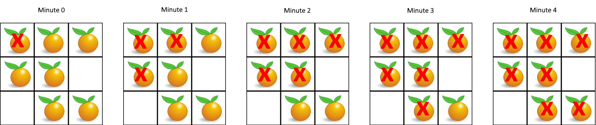

# 994. 腐烂的橘子

[← 图论专题](../../02-专题/09-图论.md) · [总目录](../../../../README.md) · [复习清单](../../00-总览/03-复习清单.md)

<div class="meta-badges problem-meta-common" aria-label="公共题目信息"><span class="mb diff-中等"><span class="mb-k">难度</span><b>中等</b></span></div>

<div class="meta-badges problem-meta legacy-problem-meta" data-hide-in-language="python" aria-label="Java 及同源语言解题信息"><span class="mb"><span class="mb-k">Java 主方法</span><b>多源 BFS</b></span><span class="mb"><span class="mb-k">时间</span><b>O(mn)</b></span><span class="mb"><span class="mb-k">空间</span><b>O(mn)</b></span></div>

<div class="meta-badges problem-meta" data-lang-scope="true" data-lang="python" aria-label="Python 解题信息"><span class="mb"><span class="mb-k">Python 主方法</span><b>多源 BFS 分层扩散</b></span><span class="mb"><span class="mb-k">时间</span><b>O(m·n)</b></span><span class="mb"><span class="mb-k">空间</span><b>O(m·n)</b></span></div>


## 题目与约束

给定一个 $M \times N$ 的网格，每个单元格有三种状态：`0`（空）、`1`（新鲜橘子）、`2`（腐烂橘子）。
每过一分钟，任何与腐烂橘子（上下左右）相邻的新鲜橘子都会腐烂。
返回直到单元格中没有新鲜橘子为止所必须经过的最小分钟数。如果不可能，返回 `-1`。
* **示例 1：**

  

  **输入：**`grid = [[2,1,1],[1,1,0],[0,1,1]]`<br>
  **输出：**`4`

* **示例 2：**

  **输入：**`grid = [[2,1,1],[0,1,1],[1,0,1]]`<br>
  **输出：**`-1`<br>
  **解释：**左下角的橘子无法通过上下左右相邻关系被感染。

* **示例 3：**

  **输入：**`grid = [[0,2]]`<br>
  **输出：**`0`<br>
  **解释：**初始时已经没有新鲜橘子。

[🔗 前往力扣原题验证 →](https://leetcode.cn/problems/rotting-oranges/?envType=study-plan-v2&envId=top-100-liked)

<section class="legacy-solution-panel java-solution-panel" data-hide-in-language="python" data-legacy-scope="true" markdown="1">

## Java 完整推导


### Java 核心不变量


> 所有初始腐烂橘子同时作为第 0 分钟入队。

## 完整推导

---

### 思路推导
1. **直觉与痛点（为什么不能用 DFS？）**：
假设你用 DFS 顺着一个腐烂的橘子一路往下感染，记录了感染某个橘子需要 5 分钟。但其实它的旁边就有一个其他的腐烂橘子，1 分钟就能把它感染。DFS 很难处理这种“多点同时爆发，按最短时间算”的并行逻辑。
2. **破局思路（超级感染体与分层队列）**：
想一想我们在「102. 二叉树的层序遍历」里学过的套路：用一个队列（Queue），每次只处理“当前这一层”的所有节点，然后再进入下一层。
在这道题里，“每一层”就代表着“每一分钟”。
* **第 0 分钟**：我们把地图上**所有一开始就腐烂的橘子（零号病人）**，全部塞进队列！同时，数一数地图上一共有多少个新鲜橘子（`freshCount`）。
* **第 1 分钟开始**：队列里的零号病人们同时出动，向四周喷洒病毒。只要遇到新鲜橘子，就把它变腐烂，然后把这个新感染的橘子**塞进队列的尾部（作为下一分钟的传染源）**，并且新鲜橘子总数减 1。
* **结束条件**：当队列空了，病毒传不下去了。此时如果 `freshCount == 0`，说明全都感染了，返回耗费的分钟数；如果 `freshCount > 0`，说明有橘子藏在死角（周围全是 0 空地），永远无法被感染，返回 `-1`。
### Java 实现（多源 BFS 满分版）
```java
import java.util.LinkedList;
import java.util.Queue;

class Solution {
    public int orangesRotting(int[][] grid) {
        int rows = grid.length;
        int cols = grid[0].length;

        Queue<int[]> queue = new LinkedList<>();
        int freshCount = 0;

        // 1. 战前准备：扫描全图，寻找“零号病人”和“幸存者总数”
        for (int r = 0; r < rows; r++) {
            for (int c = 0; c < cols; c++) {
                if (grid[r][c] == 2) {
                    // 发现腐烂橘子，加入初始队列
                    queue.offer(new int[]{r, c});
                } else if (grid[r][c] == 1) {
                    // 统计新鲜橘子数量
                    freshCount++;
                }
            }
        }

        // 如果一开始就没有新鲜橘子，直接返回 0 分钟
        if (freshCount == 0) return 0;

        int minutes = 0;
        // 上下左右四个方向的偏移量（这是网格 BFS/DFS 的标配）
        int[][] directions = {{-1, 0}, {1, 0}, {0, -1}, {0, 1}};

        // 2. 开始生化危机：只要队列里还有传染源，且还有新鲜橘子，就继续
        while (!queue.isEmpty() && freshCount > 0) {
            minutes++; // 每一轮大循环代表 1 分钟

            // 🌟 必须锁死当前层的传染源数量！
            int levelSize = queue.size();
            for (int i = 0; i < levelSize; i++) {
                int[] curr = queue.poll();
                int r = curr[0];
                int c = curr[1];

                // 向四个方向试探
                for (int[] dir : directions) {
                    int nr = r + dir[0];
                    int nc = c + dir[1];

                    // 如果越界，或者不是新鲜橘子，跳过
                    if (nr < 0 || nr >= rows || nc < 0 || nc >= cols || grid[nr][nc] != 1) {
                        continue;
                    }

                    // 感染它！
                    grid[nr][nc] = 2;
                    freshCount--;
                    // 把新感染的橘子扔进队列，留给下一分钟去发威
                    queue.offer(new int[]{nr, nc});
                }
            }
        }

        // 3. 结算：如果还有新鲜橘子，说明有死角，返回 -1
        return freshCount == 0 ? minutes : -1;
    }
}

```
### 复杂度
* **时间复杂度**：$O(M \times N)$。扫描一遍全图需要 $M \times N$。BFS 过程中，每个格子最多进队一次、出队一次，也是 $M \times N$。整体依然是极速的线性时间。
* **空间复杂度**：$O(M \times N)$。最坏情况下（比如全图都是腐烂橘子），队列需要存储 $M \times N$ 个坐标。

---

### 易错点与扩展（进阶的底层细节）

1. **高级踩坑警告：多算 1 分钟的陷阱**
* 很多同学在写 `while` 循环时，条件只写了 `while (!queue.isEmpty())`，没有加上 `freshCount > 0`。
* **致命后果**：假设在第 3 分钟，最后一个新鲜橘子被感染并放进了队列。进入第 4 分钟的循环时，这个刚被感染的橘子出队，向四周一看，没有新鲜橘子了！但是你的 `minutes` 还是错误地加了 1。这会导致最终返回 4 分钟，而正确答案应该是 3 分钟！
* **破局方案**：要么把 `freshCount > 0` 加到 `while` 条件里（提前止损，最优雅）；要么在最后返回时写 `minutes - 1`，但你要额外处理一开始全空的边界情况。

2. **面试追问：“为什么要叫【多源】BFS？”**
* **满分回答**：普通的 BFS（比如求迷宫的最短路径）通常只有一个起点，就像从一滴水荡开波纹。而这道题可能有多个起始腐烂橘子，它们**同时**开始向外扩散。这就要求我们在第 0 层把**所有源头**一次性全部放进队列中，让它们处于同一条起跑线上。图论中的“多源最短路径问题”，如果边权相同，都可以用这个套路优化思路。

---

</section>

<section class="language-panel" data-lang-scope="true" data-lang="python" markdown="1">

## Python 完整推导

### 所有腐烂源要站在同一起跑线

如果只有一个腐烂橘子，按层扩展就是按分钟扩展；但地图上可能已经有多个腐烂源，它们会同时向前蔓延。所有源一开始都放入队列，第一轮才真正表示第 1 分钟。

每轮先保存 `level_size`，只处理本轮已经存在的源。新感染的橘子加入队尾，留给下一分钟。`fresh` 随着感染逐个递减，最后一颗新鲜橘子变腐烂后，循环条件会让我们停止，不会多算一分钟。

### 用 `[[2,1,1],[1,1,0],[0,1,1]]` 走一遍

1. 初始队列只有 `(0,0)`，新鲜数是 6。第 1 分钟弹出源，感染 `(0,1)` 与 `(1,0)`；新鲜数变为 4，两个新源进入队列。
2. 第 2 分钟固定层长度 2，分别从 `(0,1)`、`(1,0)` 扩散，感染 `(0,2)`、`(1,1)`；新鲜数变为 2。
3. 第 3 分钟从 `(0,2)`、`(1,1)` 扩散，只有 `(2,1)` 被感染；新鲜数变为 1。
4. 第 4 分钟从新感染的 `(2,1)` 扩散，右下角 `(2,2)` 变腐烂；新鲜数变为 0。虽然新感染的橘子还在队列中，`while queue and fresh` 因 `fresh == 0` 在下一轮前结束。
5. 返回 4。地图中两个 0 只是空位，不影响新鲜橘子计数。

如果最后仍剩新鲜橘子，说明它们被 0 完全隔开，没有任何源能到达，返回 -1。

多个源同时扩散时，不能让一个源先走完整张图。分层队列保证每个橘子第一次被感染的时间就是最短时间，后续不会再被改写。

### Python 实现

> 参考来源：经典解法实现
>
> 沿用项目旧 Python 的多源 BFS 代码与旧 Java 的“所有零号病人同层出发”说明；仅整理变量、导入和边界注释。

```python
from collections import deque
from typing import List


class Solution:
    def orangesRotting(self, grid: List[List[int]]) -> int:
        rows, cols = len(grid), len(grid[0])
        queue = deque()
        fresh = 0

        for row in range(rows):
            for col in range(cols):
                if grid[row][col] == 2:
                    queue.append((row, col))
                elif grid[row][col] == 1:
                    fresh += 1

        minutes = 0
        while queue and fresh:
            minutes += 1
            level_size = len(queue)
            for _ in range(level_size):
                row, col = queue.popleft()
                for next_row, next_col in (
                    (row + 1, col),
                    (row - 1, col),
                    (row, col + 1),
                    (row, col - 1),
                ):
                    if (
                        0 <= next_row < rows
                        and 0 <= next_col < cols
                        and grid[next_row][next_col] == 1
                    ):
                        grid[next_row][next_col] = 2
                        fresh -= 1
                        queue.append((next_row, next_col))

        return minutes if fresh == 0 else -1
```

### 层边界对应分钟

`queue.popleft()` 取当前腐烂源；新感染坐标由 `queue.append()` 放到下一层。固定 `level_size` 后，即使队列在循环中变长，本轮也只处理原来的源。

感染时立刻写入 2，这个标记同时充当 visited，防止另一个源再次把同一新鲜橘子加入队列。`fresh` 与网格状态必须一起更新。

### 复杂度

- 时间复杂度：`O(m·n)`。
- 空间复杂度：`O(m·n)`。

初始扫描处理每个格子一次；BFS 中每个橘子至多入队、出队一次，deque 操作为 O(1)，总时间 O(m·n)。队列最坏 O(m·n)。

</section>

## 力扣原题

[🔗 前往力扣原题验证 →](https://leetcode.cn/problems/rotting-oranges/?envType=study-plan-v2&envId=top-100-liked)

<section class="language-panel cpp-solution-panel" data-lang-scope="true" data-lang="cpp" markdown="1">

## C++ 实现

> 实现来源：经典解法实现

<ol class="lang-steps"><li>多源 BFS：所有腐烂橘子同时入队作为第 0 层</li><li>每分钟一层：新鲜邻居被感染并入下一层</li><li>结束后还有新鲜橘子 → -1；否则层数（无新鲜橘子则为 0）</li></ol>

```cpp
class Solution {
public:
    int orangesRotting(vector<vector<int>>& grid) {
        int m = grid.size(), n = grid[0].size(), fresh = 0, minutes = 0;
        queue<pair<int,int>> q;
        for (int r = 0; r < m; r++) for (int c = 0; c < n; c++) {
            if (grid[r][c] == 2) q.push({r, c});
            if (grid[r][c] == 1) fresh++;
        }
        int dr[] = {1,-1,0,0}, dc[] = {0,0,1,-1};
        while (!q.empty() && fresh) {
            int n = q.size(); minutes++;
            for (int i = 0; i < n; i++) {
                auto [r, c] = q.front(); q.pop();
                for (int d = 0; d < 4; d++) {
                    int nr = r + dr[d], nc = c + dc[d];
                    if (nr >= 0 && nr < m && nc >= 0 && nc < n && grid[nr][nc] == 1) {
                        grid[nr][nc] = 2; fresh--; q.push({nr, nc});
                    }
                }
            }
        }
        return fresh ? -1 : minutes;
    }
};
```

</section>

<section class="language-panel go-solution-panel" data-lang-scope="true" data-lang="go" markdown="1">

## Go 实现

> 实现来源：经典解法实现

<ol class="lang-steps"><li>多源 BFS：所有腐烂橘子同时入队作为第 0 层</li><li>每分钟一层：新鲜邻居被感染并入下一层</li><li>结束后还有新鲜橘子 → -1；否则层数（无新鲜橘子则为 0）</li></ol>

```go
func orangesRotting(grid [][]int) int {
    m, n := len(grid), len(grid[0])
    fresh, minutes := 0, 0
    var queue [][2]int
    for r := 0; r < m; r++ {
        for c := 0; c < n; c++ {
            if grid[r][c] == 2 { queue = append(queue, [2]int{r, c}) }
            if grid[r][c] == 1 { fresh++ }
        }
    }
    for len(queue) > 0 && fresh > 0 {
        minutes++
        var nxt [][2]int
        for _, p := range queue {
            for _, d := range [][2]int{{1,0},{-1,0},{0,1},{0,-1}} {
                nr, nc := p[0]+d[0], p[1]+d[1]
                if nr >= 0 && nr < m && nc >= 0 && nc < n && grid[nr][nc] == 1 {
                    grid[nr][nc] = 2
                    fresh--
                    nxt = append(nxt, [2]int{nr, nc})
                }
            }
        }
        queue = nxt
    }
    if fresh > 0 { return -1 }
    return minutes
}
```

</section>

<section class="language-panel c-solution-panel" data-lang-scope="true" data-lang="c" markdown="1">

## C 实现

> 实现来源：经典解法实现

<ol class="lang-steps"><li>多源 BFS：所有腐烂橘子同时入队作为第 0 层</li><li>每分钟一层：新鲜邻居被感染并入下一层</li><li>结束后还有新鲜橘子 → -1；否则层数（无新鲜橘子则为 0）</li></ol>

```c
typedef struct { int r, c; } Cell;
int orangesRotting(int** grid, int gridSize, int* gridColSize) {
    int m = gridSize, n = gridColSize[0], fresh = 0, minutes = 0;
    Cell queue[900]; int head = 0, tail = 0;
    for (int r = 0; r < m; r++)
        for (int c = 0; c < n; c++) {
            if (grid[r][c] == 2) { queue[tail].r = r; queue[tail].c = c; tail++; }
            if (grid[r][c] == 1) fresh++;
        }
    while (head < tail && fresh) {
        int cnt = tail - head; minutes++;
        for (int i = 0; i < cnt; i++) {
            Cell cur = queue[head++];
            int dr[] = {1,-1,0,0}, dc[] = {0,0,1,-1};
            for (int d = 0; d < 4; d++) {
                int nr = cur.r + dr[d], nc = cur.c + dc[d];
                if (nr >= 0 && nr < m && nc >= 0 && nc < n && grid[nr][nc] == 1) {
                    grid[nr][nc] = 2; fresh--;
                    queue[tail].r = nr; queue[tail].c = nc; tail++;
                }
            }
        }
    }
    return fresh ? -1 : minutes;
}
```

</section>

<!--bottom-nav-->
<div class="problem-nav">
<a class="problem-nav-btn" href="../09-图论/0200-岛屿数量.html" target="_blank" rel="noopener noreferrer">← 上一题</a>
<a class="problem-nav-btn" href="../../../../index.html">🏠 回到 Hot 100 目录</a>
<a class="problem-nav-btn primary" href="../09-图论/0207-课程表.html" target="_blank" rel="noopener noreferrer">下一题 →</a>
</div>
<!--/bottom-nav-->
