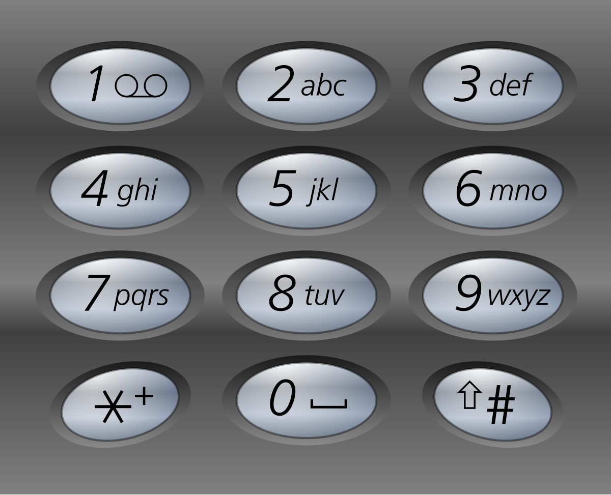

# 17. 电话号码的字母组合

[← 回溯专题](../../02-专题/10-回溯.md) · [总目录](../../../../README.md) · [复习清单](../../00-总览/03-复习清单.md)

<div class="meta-badges problem-meta-common" aria-label="公共题目信息"><span class="mb diff-中等"><span class="mb-k">难度</span><b>中等</b></span></div>

<div class="meta-badges problem-meta legacy-problem-meta" data-hide-in-language="python" aria-label="Java 及同源语言解题信息"><span class="mb"><span class="mb-k">Java 主方法</span><b>按位选择字符</b></span><span class="mb"><span class="mb-k">时间</span><b>O(4ⁿ)</b></span><span class="mb"><span class="mb-k">空间</span><b>O(n)</b></span></div>

<div class="meta-badges problem-meta" data-lang-scope="true" data-lang="python" aria-label="Python 解题信息"><span class="mb"><span class="mb-k">Python 主方法</span><b>按电话号码逐位枚举字母</b></span><span class="mb"><span class="mb-k">时间</span><b>O(n·4ⁿ)</b></span><span class="mb"><span class="mb-k">空间</span><b>O(n)</b></span></div>


## 题目与约束

给定一个仅包含数字 `2-9` 的字符串，返回所有它能表示的字母组合。答案可以按 **任意顺序** 返回。

  给出数字到字母的映射如下（与电话按键相同）。注意 1 不对应任何字母。

  

  **示例 1：**

  **输入：**digits = "23"<br>**输出：**["ad","ae","af","bd","be","bf","cd","ce","cf"]

  **示例 2：**

  **输入：**digits = "2"<br>**输出：**["a","b","c"]

  **提示：**

  - `1 <= digits.length <= 4`
  - `digits[i]` 是范围 `['2', '9']` 的一个数字。

[🔗 前往力扣原题验证 →](https://leetcode.cn/problems/letter-combinations-of-a-phone-number/?envType=study-plan-v2&envId=top-100-liked)

<section class="legacy-solution-panel java-solution-panel" data-hide-in-language="python" data-legacy-scope="true" markdown="1">

## Java 完整推导


### Java 核心不变量


> 递归层数对应电话号码下标。

## 完整推导

### 思路推导
  1. **直觉与痛点（多重嵌套循环的破产）**：

     假如输入的数字是 `"23"`，你可能会写两个 `for` 循环：外层遍历 `'a','b','c'`，内层遍历 `'d','e','f'`。

     **痛点**：如果输入的是 `"23456"` 呢？你需要写 5 层嵌套的 `for` 循环！如果输入的长度是不固定的，你根本无法用普通的 `for` 循环来写代码。**处理这种“未知层数的嵌套循环”，就是回溯算法最拿手的好戏。**

  2. **破局思路（构建横向与纵向的坐标系）**：

     回溯算法的本质是遍历一棵多叉树。

     - **树的深度（纵向）**：由输入的数字字符串长度决定。比如输入 `"23"`，那这棵树只有两层。我们用一个 `index` 变量来记录当前正在处理第几个数字。
     - **树的宽度（横向）**：由当前数字对应的字母个数决定。比如遇到数字 `'2'`，宽度就是 3（`a, b, c`）；遇到数字 `'9'`，宽度就是 4（`w, x, y, z`）。

  3. **逻辑推演（三步走战略）**：

     - **查字典**：建立一个数组或哈希表，把 `'2'` 到 `'9'` 映射到具体的字符串上。
     - **做选择 -> 下一层 -> 撤销选择**：抓取当前数字对应的字母集。选一个字母装进口袋，然后 `index + 1` 进入下一层（处理下一个数字）。等下一层处理完退回来时，把刚才装进口袋的字母掏出来，换下一个字母继续试。
     - **收获结果**：当口袋里的字母数量等于输入数字的长度时，说明所有的按键都按了一遍，保存结果并返回。
### Java 实现（满分 StringBuilder 优化版）
```Java
import java.util.ArrayList;
import java.util.List;

class Solution {
    // 1. 建立九宫格字典（利用数组的索引巧妙对应数字）
    // index 0 和 1 留空，对应真实的按键 '0' 和 '1'（虽然题目说只包含 2-9，但这样写更严谨规范）
    private final String[] MAPPING = {
        "", "", "abc", "def", "ghi", "jkl", "mno", "pqrs", "tuv", "wxyz"
    };

    // 全局结果集
    private List<String> res = new ArrayList<>();

    public List<String> letterCombinations(String digits) {
        // 🌟 致命边界检查：如果输入是空字符串 ""，应该返回空列表 []，而不是 [""]
        if (digits == null || digits.length() == 0) {
            return res;
        }

        // 准备一个“口袋”用来临时装字母
        StringBuilder path = new StringBuilder();
        // 从第 0 个数字开始回溯
        backtrack(digits, 0, path);

        return res;
    }

    private void backtrack(String digits, int index, StringBuilder path) {
        // 1. 终止条件：当走过的深度（index）等于按键个数时，说明一条路走到头了
        if (index == digits.length()) {
            res.add(path.toString());
            return;
        }

        // 2. 拿到当前这一层需要处理的数字字符
        char digit = digits.charAt(index);
        // 将字符 '2' 转换成真正的整数 2（利用 ASCII 码相减）
        String letters = MAPPING[digit - '0'];

        // 3. 遍历当前数字对应的所有字母（横向宽度）
        for (int i = 0; i < letters.length(); i++) {
            // --- 做选择 ---
            path.append(letters.charAt(i));

            // --- 带着这个选择，进入下一层处理下一个数字 ---
            backtrack(digits, index + 1, path);

            // --- 撤销选择（回溯！） ---
            // 把刚刚加进去的最后一个字母删掉，腾出位置给 for 循环里的下一个字母
            path.deleteCharAt(path.length() - 1);
        }
    }
}
```
### 复杂度
  - **时间复杂度**：$O(3^N \times 4^M)$。其中 $N$ 是对应 3 个字母的数字个数（如 2,3,4,5,6,8），$M$ 是对应 4 个字母的数字个数（如 7,9）。最坏情况下，我们要把所有的组合都生成一遍。
  - **空间复杂度**：$O(N + M)$。空间消耗主要在递归调用栈的深度以及 `StringBuilder` 的长度，它们都等于输入字符串的长度。

### 易错点与扩展（进阶的底层细节）

1. **极度高频坑点：`""` (空字符串) 的特殊处理**

   - 如果不加 `if (digits.length() == 0) return res;`，当输入为 `""` 时，代码会直接进入 `backtrack`。由于 `index == digits.length() == 0`，它会触发终止条件，往 `res` 里塞入一个空字符串，最终返回 `[""]`。
   - 但题目要求输入 `""` 时返回 `[]`（里面什么都没有）。这个微小的差别是这道题错误率最高的地方。

2. **面试代码品味大考问：“为什么要把 `path` 定义成 `StringBuilder`，如果我传 `String` 会怎样？”**

   - **低手回答**：传 `String` 也能做，代码还更短。

     Java

```java
// 传 String 的写法，连撤销选择的代码都省了，看起来很爽：
backtrack(digits, index + 1, path + letters.charAt(i));
```

   - **高手抢答**：在 Java 中，`String` 是不可变对象。如果你在递归里写 `path + "a"`，Java 底层会**重新开辟一块内存**，把老字符串拷过去，再拼上新字母。在巨大的回溯树中，这会疯狂产生无数个 `String` 垃圾对象，导致频繁触发 GC（垃圾回收），速度极慢且极其浪费内存！

   - 使用 `StringBuilder` 并且配合 `deleteCharAt` 进行撤销操作，意味着**整个递归过程自始至终只复用了同一块内存**！这才是真正的工业级代码素养。

</section>

<section class="language-panel" data-lang-scope="true" data-lang="python" markdown="1">

## Python 完整推导

### 输入多长，决策树就多深

如果输入只有一个数字，选它的一个字母就能结束；输入两个数字，就要先选第一位字母，再为第二位选一个字母。这种嵌套层数由输入长度决定，普通写死的 for 循环无法覆盖任意长度，回溯正好按层生成。

字典 `mapping` 把数字字符映射到候选字符串。`index` 说明现在处理第几位，`path` 保存已经选出的字母。走到 `index == len(digits)` 时，一条组合完成，用 `join` 连接。

### 用 `"23"` 走一遍

1. `index=0`，当前数字 2 给出 `"abc"`。先追加 `a`，进入 `index=1`。
2. 数字 3 给出 `"def"`。依次追加 d、e、f，分别生成 `ad`、`ae`、`af`；每次返回后弹出末尾字母。
3. 回到 index 0，弹出 `a`，选择 `b`，下一层又生成 `bd`、`be`、`bf`。
4. 再选 `c`，生成 `cd`、`ce`、`cf`。递归结束，得到 9 个组合。

若输入是空字符串，根本没有“第 0 位”可以展开；如果仍进入回溯，终止条件会在还没选择任何字母时加入 `""`。提前返回空列表才能符合题意。

mapping 把数字字符直接作为键，避免依赖字符编码做下标换算。实际输入只含 2 到 9，所以每次 mapping 查询都能得到非空候选串，递归才会稳定推进到下一位。

### Python 实现

> 参考来源：代码随想录（programmercarl.com）
>
> 沿用项目旧 Python 的数字到字母映射和回溯逻辑，并恢复旧 Java 的纵向位数、横向字母集说明；变量与导入按本站整理。

```python
from typing import List


class Solution:
    def letterCombinations(self, digits: str) -> List[str]:
        if not digits:
            return []

        mapping = {
            "2": "abc",
            "3": "def",
            "4": "ghi",
            "5": "jkl",
            "6": "mno",
            "7": "pqrs",
            "8": "tuv",
            "9": "wxyz",
        }
        answer = []
        path = []

        def backtrack(index):
            if index == len(digits):
                answer.append("".join(path))
                return
            for ch in mapping[digits[index]]:
                path.append(ch)
                backtrack(index + 1)
                path.pop()

        backtrack(0)
        return answer
```

### path 与字符串构造

`path` 始终是列表，追加和弹出都是 O(1)；只有到达叶子时才执行一次 `"".join(path)`。这比每层都生成新的不可变字符串更适合需要反复撤销的回溯路径。

`mapping[digits[index]]` 说明两个前提：index 仍在范围内，且字符属于 2 到 9。题目保证输入合法，因此不需要额外防御分支。

### 复杂度

- 时间复杂度：`O(n·4ⁿ)`。
- 空间复杂度：`O(n)`。

最坏每层有 4 个候选，搜索树叶节点至多 4ⁿ；每个叶子还需用 join 复制 n 个字符构造结果，因此时间 O(n·4ⁿ)。递归深度和 path 长度 O(n)，答案空间另计。

</section>

## 力扣原题

[🔗 前往力扣原题验证 →](https://leetcode.cn/problems/letter-combinations-of-a-phone-number/?envType=study-plan-v2&envId=top-100-liked)

<section class="language-panel cpp-solution-panel" data-lang-scope="true" data-lang="cpp" markdown="1">

## C++ 实现

> 实现来源：代码随想录（programmercarl.com）


```cpp
vector<string> result;
string s;
void backtracking(const string& digits, int index)
```

</section>

<section class="language-panel go-solution-panel" data-lang-scope="true" data-lang="go" markdown="1">

## Go 实现

> 实现来源：代码随想录（programmercarl.com）


```go
var (
    m []string
    path []byte
    res []string
)
func letterCombinations(digits string) []string {
    m = []string{"abc", "def", "ghi", "jkl", "mno", "pqrs", "tuv", "wxyz"}
    path, res = make([]byte, 0), make([]string, 0)
    if digits == "" {
        return res
    }
    dfs(digits, 0)
    return res
}
func dfs(digits string, start int) {
    if len(path) == len(digits) {  //终止条件，字符串长度等于digits的长度
        tmp := string(path)
        res = append(res, tmp)
        return
    }
    digit := int(digits[start] - '0')  // 将index指向的数字转为int（确定下一个数字）
    str := m[digit-2]   // 取数字对应的字符集（注意和map中的对应）
    for j := 0; j < len(str); j++ {
        path = append(path, str[j])
        dfs(digits, start+1)
        path = path[:len(path)-1]
    }
}
```

</section>

<section class="language-panel c-solution-panel" data-lang-scope="true" data-lang="c" markdown="1">

## C 实现

> 实现来源：代码随想录（programmercarl.com）


```c
char* path;
int pathTop;
char** result;
int resultTop;
char* letterMap[10] = {"", //0
        "", //1
        "abc", //2
        "def", //3
        "ghi", //4
        "jkl", //5
        "mno", //6
        "pqrs", //7
        "tuv", //8
        "wxyz", //9
};
void backTracking(char* digits, int index) {
    //若当前下标等于digits数组长度
    if(index == strlen(digits)) {
        //复制digits数组，因为最后要多存储一个0，所以数组长度要+1
        char* tempString = (char*)malloc(sizeof(char) * strlen(digits) + 1);
        int j;
        for(j = 0; j < strlen(digits); j++) {
            tempString[j] = path[j];
        }
        //char数组最后要以0结尾
        tempString[strlen(digits)] = 0;
        result[resultTop++] = tempString;
        return ;
    }
    //将字符数字转换为真的数字
    int digit = digits[index] - '0';
    //找到letterMap中对应的字符串
    char* letters = letterMap[digit];
    int i;
    for(i = 0; i < strlen(letters); i++) {
        path[pathTop++] = letters[i];
        //递归，处理下一层数字
        backTracking(digits, index+1);
        pathTop--;
    }
}
```

</section>

<!--bottom-nav-->
<div class="problem-nav">
<a class="problem-nav-btn" href="../10-回溯/0078-子集.html" target="_blank" rel="noopener noreferrer">← 上一题</a>
<a class="problem-nav-btn" href="../../../../index.html">🏠 回到 Hot 100 目录</a>
<a class="problem-nav-btn primary" href="../10-回溯/0039-组合总和.html" target="_blank" rel="noopener noreferrer">下一题 →</a>
</div>
<!--/bottom-nav-->
