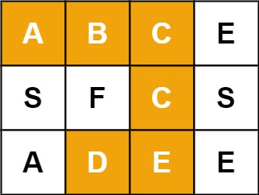
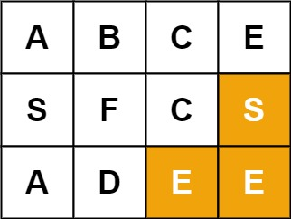
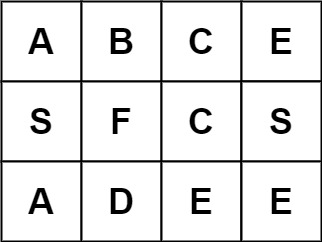

# 79. 单词搜索

[← 回溯专题](../../02-专题/10-回溯.md) · [总目录](../../../../README.md) · [复习清单](../../00-总览/03-复习清单.md)

<div class="meta-badges problem-meta-common" aria-label="公共题目信息"><span class="mb diff-中等"><span class="mb-k">难度</span><b>中等</b></span></div>

<div class="meta-badges problem-meta legacy-problem-meta" data-hide-in-language="python" aria-label="Java 及同源语言解题信息"><span class="mb"><span class="mb-k">Java 主方法</span><b>网格 DFS + 原地标记</b></span><span class="mb"><span class="mb-k">时间</span><b>O(mn·4ᴸ)</b></span><span class="mb"><span class="mb-k">空间</span><b>O(L)</b></span></div>

<div class="meta-badges problem-meta" data-lang-scope="true" data-lang="python" aria-label="Python 解题信息"><span class="mb"><span class="mb-k">Python 主方法</span><b>网格 DFS 原位标记回溯</b></span><span class="mb"><span class="mb-k">时间</span><b>O(m·n·3ᴸ)</b></span><span class="mb"><span class="mb-k">空间</span><b>O(L)</b></span></div>


## 题目与约束

给定一个 `m x n` 二维字符网格 `board` 和一个字符串单词 `word` 。如果 `word` 存在于网格中，返回 `true` ；否则，返回 `false` 。

  单词必须按照字母顺序，通过相邻的单元格内的字母构成，其中“相邻”单元格是那些水平相邻或垂直相邻的单元格。同一个单元格内的字母不允许被重复使用。

  **示例 1：**

  

  **输入：**board = [['A','B','C','E'],['S','F','C','S'],['A','D','E','E']], word = "ABCCED"<br>**输出：**true

  **示例 2：**

  

  **输入：**board = [['A','B','C','E'],['S','F','C','S'],['A','D','E','E']], word = "SEE"<br>**输出：**true

  **示例 3：**

  

  **输入：**board = [['A','B','C','E'],['S','F','C','S'],['A','D','E','E']], word = "ABCB"<br>**输出：**false

  **提示：**

  - `m == board.length`
  - `n = board[i].length`
  - `1 <= m, n <= 6`
  - `1 <= word.length <= 15`
  - `board` 和 `word` 仅由大小写英文字母组成

  **进阶：**你可以使用搜索剪枝的技术来优化解决方案，使其在 `board` 更大的情况下可以更快解决问题？

[🔗 前往力扣原题验证 →](https://leetcode.cn/problems/word-search/?envType=study-plan-v2&envId=top-100-liked)

<section class="legacy-solution-panel java-solution-panel" data-hide-in-language="python" data-legacy-scope="true" markdown="1">

## Java 完整推导


### Java 核心不变量


> 一个格子在同一路径中只能使用一次，返回前恢复。

## 完整推导

### 思路推导
  1. **直觉与痛点（网格上的全排列）**：

     我们需要在地图上先用两层 `for` 循环作为“雷达”，寻找单词的**第一个字母**（比如单词是 `"ABCCED"`，先在图里找 `'A'`）。

     一旦找到起点，就立刻从这个格子发起深度优先搜索（DFS），向它的上下左右四个邻居去高喊：“谁是下一个字母 `'B'` ？”

     **痛点**：因为同一个格子不能重复使用，你走过去之后必须把它标记为“已访问”。但是，如果这条路走到一半发现后面断了，你得退回来去试别的方向，这时候你必须**把刚才标记过的格子再恢复原状**，否则就会断了其他正确路径的活路（这就是“不吃回头草”与“回溯恢复”的博弈）。

  2. **核心微操（高效的原地标记法）**：

     很多同学为了记录“哪些格子访问过”，会开辟一个 `boolean[][] visited` 矩阵。

     **空间优化**：在真实的工业级面试中，我们可以直接利用原网格进行“位运算标记”**或**“特殊字符替换标记”。

     - 比如：我们要访问 `board[r][c]` 时，先把它的原始字符存入临时变量 `char temp = board[r][c];`。
     - 然后把这个格子改成一个绝对不可能在单词里出现的特殊符号，比如 `board[r][c] = '\0';`（空字符）或者 `board[r][c] = '#';`。
     - 等上下左右全部递归探路完毕、准备退出当前函数时，再用 `board[r][c] = temp;` 把原来的字母复原。真正的 $O(1)$ 额外空间，品味直接拉满！
### Java 实现（原地回溯剪枝满分版）
```Java
class Solution {
    public boolean exist(char[][] board, String word) {
        int rows = board.length;
        int cols = board[0].length;

        // 1. 双重 for 循环，扮演雷达，寻找单词的“大本营”（第一个字母）
        for (int r = 0; r < rows; r++) {
            for (int c = 0; c < cols; c++) {
                // 只要第一个字母对上了，立刻启动 DFS 深钻
                if (board[r][c] == word.charAt(0)) {
                    // 初始参数：网格，坐标(r,c)，当前要匹配的单词字符索引(0)
                    if (dfs(board, r, c, word, 0)) {
                        return true; // 只要有一条路通了，直接大获全胜！
                    }
                }
            }
        }
        return false;
    }

    private boolean dfs(char[][] board, int r, int c, String word, int index) {
        // 🌟 终极终止条件：如果当前匹配的索引已经等于单词长度了，说明全词匹配成功！
        if (index == word.length()) {
            return true;
        }

        // 1. 边界防御与剪枝
        // 越界检查，或者当前格子的字母和我们要找的字母不匹配（包括撞见被标记的 '#'）
        if (r < 0 || c < 0 || r >= board.length || c >= board[0].length || board[r][c] != word.charAt(index)) {
            return false;
        }

        // 2. --- 开始做选择（原地打标记） ---
        char temp = board[r][c];
        board[r][c] = '#'; // 把当前格子染成 '#'，防止接下来的递归自己踩到自己，造成死循环

        // 3. --- 纵深探索 ---
        // 向上下左右四个方向扩散，寻找单词的下一个字母 (index + 1)
        // 🌟 带有“短路效应”的或运算：只要有一个方向成功了，后面的方向连试都不用试，直接一路返回 true
        boolean isFound = dfs(board, r - 1, c, word, index + 1) || // 上
                          dfs(board, r + 1, c, word, index + 1) || // 下
                          dfs(board, r, c - 1, word, index + 1) || // 左
                          dfs(board, r, c + 1, word, index + 1);   // 右

        // 4. --- 撤销选择（回溯魔法） ---
        // 🌟 极其致命！无论有没有找到，都必须把当前格子的字符还原，因为别的分支还要用它！
        board[r][c] = temp;

        return isFound;
    }
}
```
### 复杂度
  - **时间复杂度**：$O(M \times N \times 3^L)$。其中 $M, N$ 为网格的行数和列数，$L$ 为单词 `word` 的长度。我们需要在网格中遍历 $M \times N$ 个起点。对于每个起点，DFS 探索时，除了第一次有 4 个方向可选，后续由于不能走回头路，每次最多只有 3 个方向可选。所以单次 DFS 的最大分支数是 $3^L$。
  - **空间复杂度**：$O(L)$。因为我们采用了“原地修改字符”的神仙微操，完全不需要 `visited` 矩阵。唯一的空间开销来自于系统递归调用栈，其最大深度等于单词的长度 $L$。

### 易错点与扩展（面试高频细节）

1. **踩坑警告（致命错误）：为什么一定要在终止条件里写 `index == word.length()`，而不是在下面写？**
   - 很多同学喜欢把终止条件写在函数最开头：`if (index == word.length() - 1) return true;`。
   - **致命后果**：如果输入的单词正好只有一个字母（比如 `board = [['A']], word = "A"`）。你的主循环查到 `board[0][0] == 'A'`，进入 DFS。此时 `index = 0`。如果你在开头判定匹配，可能就漏掉了某些边界越界的校验，或者是导致多字符匹配时逻辑错乱。
   - **最佳规范**：永远让 `index` 走到 `word.length()`。当 `index` 代表“我已经完美匹配完了前 `index` 个字母”时，逻辑才是最无懈可击的。
2. **面试追问：“如果我要在网格里同时搜索成千上万个单词呢？你难道要对每个单词都跑一遍这个算法吗？”（对应力扣 212 题：单词搜索 II - Hard 难度）**
   - **满分抢答（直击高级数据结构精髓）**：那绝对不行！如果单词量巨大，针对每个单词独立搜索会导致严重超时。
   - **终极融合方案**：我们应该把这道题的“网格回溯 DFS”**和我们之前学过的**「208. 前缀树 (Trie)」进行跨界缝合！
   - 我们首先把成千上万个待查单词全部织入一棵前缀树中。然后，我们只需对网格的每个格子启动一次 DFS。在网格里每走一步，前缀树的指针也跟着走一步。如果网格里拼出的前缀在前缀树里根本不存在，直接斩断整个网格分支（大面积剪枝）！这属于面试风控、搜索引擎底层的核心算法。

</section>

<section class="language-panel" data-lang-scope="true" data-lang="python" markdown="1">

## Python 完整推导

### 在网格上沿着单词走

起点可以是任意一个与首字母相同的格子。从起点进入后，下一步只能去上下左右中字符等于下一个字母的格子；同一条路径中，已经走过的格子不能再来一次。

原位标记利用一个格子只能保存一个字符的事实：当前格匹配并准备下探前，先把原字符存到 `saved`，再写成 `#`。如果下一步绕回来，看到 `#` 显然不等于目标字符，自然被拒绝。整条分支结束后，把 `saved` 写回去。

### 走示例 `ABCCED`

输入网格：

```text
A B C E
S F C S
A D E E
```

1. 从 A 的坐标 `(0,0)` 出发；向右到 `B(0,1)`，再向右到 `C(0,2)`，已经匹配 ABC。
2. 从 `C(0,2)` 向下到 `C(1,2)`，再从 `C(1,2)` 向下到 `E(2,2)`。
3. 最后从 `E(2,2)` 向左到 `D(2,1)`，完整路径为 `(0,0)→(0,1)→(0,2)→(1,2)→(2,2)→(2,1)`，长度 6，返回 True。
4. 代码用 `or` 串起四个方向。失败的分支结束后都已经恢复原字符；成功分支恢复后仍返回 True，当前网格也不会被永久修改。

若单词是 `AA` 而网格只有一个 A，第一层把 A 标成 `#`，第二层想从同一格得到 A 时会看到 `#`，返回 False，于是正确拒绝重复使用同一格。
再如 `word = "AB"` 时，从一个 A 出发，第二层只接受 B。试完所有方向都失败的 `found` 会是 False，但当前 A 仍在返回前被恢复；外层随后还可以拿这个格子尝试作为另一个路径的起点。

算法会恢复每一次临时标记，因此外层 any 切换到另一格时看到的是原网格；这也是同一个 board 能被多次测试调用而不残留状态的原因。

### Python 实现

> 参考来源：经典解法实现
>
> 沿用项目旧 Python 的网格四向搜索和原位标记恢复，并恢复旧 Java 的“路径内不重复、返回前恢复”说明；变量、导入与换行由本站整理。

```python
from typing import List


class Solution:
    def exist(self, board: List[List[str]], word: str) -> bool:
        rows, cols = len(board), len(board[0])

        def search(row, col, index):
            if index == len(word):
                return True
            if (
                row < 0
                or row >= rows
                or col < 0
                or col >= cols
                or board[row][col] != word[index]
            ):
                return False

            saved = board[row][col]
            board[row][col] = "#"
            found = (
                search(row + 1, col, index + 1)
                or search(row - 1, col, index + 1)
                or search(row, col + 1, index + 1)
                or search(row, col - 1, index + 1)
            )
            board[row][col] = saved
            return found

        return any(
            search(row, col, 0)
            for row in range(rows)
            for col in range(cols)
        )
```

### 边界顺序与短路

条件先检查行列是否越界，再用 `or` 进入后续字符比较；Python 的短路保证不会越界读取。标记发生在匹配检查之后，因为必须先确认当前格就是 `word[index]`。

`any(...)` 从所有起点依次尝试，生成器中任意一次返回 True 就停止搜索。`index == len(word)` 是成功条件，不访问第 L 个字符，因此长度为 1 的单词也能正常工作。

### 复杂度

- 时间复杂度：`O(m·n·3ᴸ)`。
- 空间复杂度：`O(L)`。

有 m·n 个起点；起点之后每步最多有 3 个非返回方向，长度 L 的最坏搜索量为 O(m·n·3ᴸ)；递归栈 O(L)，不计输入。

</section>

## 力扣原题

[🔗 前往力扣原题验证 →](https://leetcode.cn/problems/word-search/?envType=study-plan-v2&envId=top-100-liked)

<section class="language-panel cpp-solution-panel" data-lang-scope="true" data-lang="cpp" markdown="1">

## C++ 实现

> 实现来源：经典解法实现

<ol class="lang-steps"><li>从每个格子出发 DFS 匹配单词首字母</li><li>走过的格子临时标记（防重复使用），回溯时恢复</li><li>匹配完成返回 true；任一起点成功即 true</li></ol>

```cpp
class Solution {
public:
    bool exist(vector<vector<char>>& board, string word) {
        int m = board.size(), n = board[0].size();
        function<bool(int,int,int)> go = [&](int r, int c, int i) {
            if (i == word.size()) return true;
            if (r < 0 || r >= m || c < 0 || c >= n || board[r][c] != word[i]) return false;
            char saved = board[r][c];
            board[r][c] = '#';                       // 标记已用
            bool found = go(r+1,c,i+1) || go(r-1,c,i+1) || go(r,c+1,i+1) || go(r,c-1,i+1);
            board[r][c] = saved;                     // 回溯恢复
            return found;
        };
        for (int r = 0; r < m; r++)
            for (int c = 0; c < n; c++)
                if (go(r, c, 0)) return true;
        return false;
    }
};
```

</section>

<section class="language-panel go-solution-panel" data-lang-scope="true" data-lang="go" markdown="1">

## Go 实现

> 实现来源：经典解法实现

<ol class="lang-steps"><li>从每个格子出发 DFS 匹配单词首字母</li><li>走过的格子临时标记（防重复使用），回溯时恢复</li><li>匹配完成返回 true；任一起点成功即 true</li></ol>

```go
func exist(board [][]byte, word string) bool {
    m, n := len(board), len(board[0])
    var go func(r, c, i int) bool
    go = func(r, c, i int) bool {
        if i == len(word) { return true }
        if r < 0 || r >= m || c < 0 || c >= n || board[r][c] != word[i] { return false }
        saved := board[r][c]
        board[r][c] = '#'
        found := go(r+1,c,i+1) || go(r-1,c,i+1) || go(r,c+1,i+1) || go(r,c-1,i+1)
        board[r][c] = saved
        return found
    }
    for r := 0; r < m; r++ {
        for c := 0; c < n; c++ {
            if go(r, c, 0) { return true }
        }
    }
    return false
}
```

</section>

<section class="language-panel c-solution-panel" data-lang-scope="true" data-lang="c" markdown="1">

## C 实现

> 实现来源：经典解法实现

<ol class="lang-steps"><li>从每个格子出发 DFS 匹配单词首字母</li><li>走过的格子临时标记（防重复使用），回溯时恢复</li><li>匹配完成返回 true；任一起点成功即 true</li></ol>

```c
bool go(char** board, int m, int n, int r, int c, char* word, int i) {
    if (word[i] == 0) return true;
    if (r < 0 || r >= m || c < 0 || c >= n || board[r][c] != word[i]) return false;
    char saved = board[r][c];
    board[r][c] = '#';
    bool found = go(board,m,n,r+1,c,word,i+1) || go(board,m,n,r-1,c,word,i+1)
               || go(board,m,n,r,c+1,word,i+1) || go(board,m,n,r,c-1,word,i+1);
    board[r][c] = saved;
    return found;
}
bool exist(char** board, int boardSize, int* boardColSize, char* word) {
    for (int r = 0; r < boardSize; r++)
        for (int c = 0; c < boardColSize[0]; c++)
            if (go(board, boardSize, boardColSize[0], r, c, word, 0)) return true;
    return false;
}
```

</section>

<!--bottom-nav-->
<div class="problem-nav">
<a class="problem-nav-btn" href="../10-回溯/0022-括号生成.html" target="_blank" rel="noopener noreferrer">← 上一题</a>
<a class="problem-nav-btn" href="../../../../index.html">🏠 回到 Hot 100 目录</a>
<a class="problem-nav-btn primary" href="../10-回溯/0131-分割回文串.html" target="_blank" rel="noopener noreferrer">下一题 →</a>
</div>
<!--/bottom-nav-->
