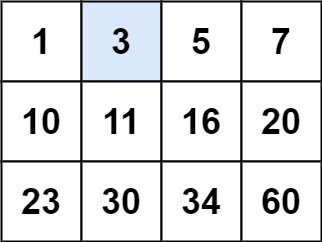
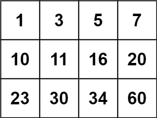

# 74. 搜索二维矩阵

[← 二分查找专题](../../02-专题/11-二分查找.md) · [总目录](../../../../README.md) · [复习清单](../../00-总览/03-复习清单.md)

<div class="meta-badges problem-meta-common" aria-label="公共题目信息"><span class="mb diff-中等"><span class="mb-k">难度</span><b>中等</b></span></div>

<div class="meta-badges problem-meta legacy-problem-meta" data-hide-in-language="python" aria-label="Java 及同源语言解题信息"><span class="mb"><span class="mb-k">Java 主方法</span><b>二维下标映射一维</b></span><span class="mb"><span class="mb-k">时间</span><b>O(log(mn))</b></span><span class="mb"><span class="mb-k">空间</span><b>O(1)</b></span></div>

<div class="meta-badges problem-meta" data-lang-scope="true" data-lang="python" aria-label="Python 解题信息"><span class="mb"><span class="mb-k">Python 主方法</span><b>二维坐标映射的一维二分</b></span><span class="mb"><span class="mb-k">时间</span><b>O(log(m·n))</b></span><span class="mb"><span class="mb-k">空间</span><b>O(1)</b></span></div>


## 题目与约束

给你一个满足下述两条属性的 `m x n` 整数矩阵：

  - 每行中的整数从左到右按非严格递增顺序排列。
  - 每行的第一个整数大于前一行的最后一个整数。

  给你一个整数 `target` ，如果 `target` 在矩阵中，返回 `true` ；否则，返回 `false` 。

  你必须编写一个时间复杂度为 `O(log(m * n))` 的解决方案。

  **示例 1：**

  

  **输入：**matrix = [[1,3,5,7],[10,11,16,20],[23,30,34,60]], target = 3<br>**输出：**true

  **示例 2：**

  

  **输入：**matrix = [[1,3,5,7],[10,11,16,20],[23,30,34,60]], target = 13<br>**输出：**false

  **提示：**

  - `m == matrix.length`
  - `n == matrix[i].length`
  - `1 <= m, n <= 100`
  - `-104 <= matrix[i][j], target <= 104`

[🔗 前往力扣原题验证 →](https://leetcode.cn/problems/search-a-2d-matrix/?envType=study-plan-v2&envId=top-100-liked)

<section class="legacy-solution-panel java-solution-panel" data-hide-in-language="python" data-legacy-scope="true" markdown="1">

## Java 完整推导


### Java 核心不变量


> mid / n 得行，mid % n 得列。

## 完整推导

### 思路推导
  1. **直觉与痛点（被二维表象欺骗）**：

     如果把矩阵一层层拆开，你会发现第一行结尾是 7，第二行开头是 10；第二行结尾 20，第三行开头 23。

     这说明什么？这说明如果**把每一行首尾相连拼起来，它就是一个完完全全严格递增的“一维数组”！**

  2. **破局思路（虚拟的一维数组）**：

     假如矩阵有 `m` 行 `n` 列，里面一共有 `m * n` 个元素。

     我们可以假设有一个长度为 `m * n` 的一维数组。用最标准的二分查找模板：`left = 0`，`right = m * n - 1`。

     每次算出 `mid`。

  3. **核心微操（时空折叠：一维到二维的坐标映射）**：

     算法最大的难点在于：我们没有真的去创建一个一维数组（因为那会白白消耗 $O(M \times N)$ 的空间）。我们在内存里面对的依然是二维矩阵。

     当算出虚拟的一维索引 `mid` 时，怎么知道它对应二维矩阵里的第几行、第几列呢？

     **黄金公式（死记硬背）：**

     - **行号 `row` = `mid / n`** （即 `mid / 列数`，看看 `mid` 里面包含了几个完整的行）
     - **列号 `col` = `mid % n`** （即 `mid % 列数`，看看除掉完整行后，剩下的余数偏移量）
### Java 实现（完美的降维二分版）
```Java
class Solution {
    public boolean searchMatrix(int[][] matrix, int target) {
        // 边界防御：严谨的工程师永远会先检查空指针和空矩阵
        if (matrix == null || matrix.length == 0 || matrix[0].length == 0) {
            return false;
        }

        int m = matrix.length;       // 行数
        int n = matrix[0].length;    // 列数

        // 虚拟一维数组的左右边界
        int left = 0;
        int right = m * n - 1;

        // 标准的二分查找模板
        while (left <= right) {
            int mid = left + (right - left) / 2;

            // 🌟 优化思路的核心魔法：将 1D 索引映射回 2D 坐标
            int midValue = matrix[mid / n][mid % n];

            if (midValue == target) {
                return true; // 命中目标，大吉大利！
            } else if (midValue < target) {
                left = mid + 1; // 目标在右半边
            } else {
                right = mid - 1; // 目标在左半边
            }
        }

        // 循环结束也没找到，说明真没有
        return false;
    }
}
```
### 复杂度
  - **时间复杂度**：$O(\log(m \times n))$。直接对总元素个数进行二分，完美达到理论最优极速。
  - **空间复杂度**：$O(1)$。我们只用了 `left`、`right`、`mid` 几个整型变量，所有的“一维数组”都是通过坐标映射在脑海中虚拟出来的。

### 易错点与扩展（面试连环进阶题）

- **面试终极追问：“如果我把这道题的条件改一下，【每行的第一个整数 不一定 大于前一行的最后一个整数】，仅仅保证【每行从左到右递增，每列从上到下递增】，你还能用二分吗？”（对应力扣 240 题：搜索二维矩阵 II）**

  - **满分优化思路（右上角破局法 / BST法）**：

    一旦失去首尾相连递增的特性，你就**不能**再把它拍平当一维数组处理了！

    但此时有另一种极其惊艳的 $O(M + N)$ 解法：我们把目光锁定在矩阵的**右上角**！

    - 站在右上角，向左走，数字越来越小；向下走，数字越来越大。

    - **这难道不就是一棵把根节点放在右上角的 二叉搜索树（BST） 吗？！**

    - 拿右上角的数字和目标比：如果比目标大，就向左走一步（排除一列）；如果比目标小，就向下走一步（排除一行）。一路贪心，走到越界还没找到就是 false。

      如果你能在面试时顺嘴提一句这个变种和它的右上角（或左下角）走迷宫解法，面试官会直接在你的简历上画个大大的优！

----

</section>

<section class="language-panel" data-lang-scope="true" data-lang="python" markdown="1">

## Python 完整推导

### 把矩阵想成一条连续数轴

题目给出两个条件：行内从左到右递增，行尾小于下一行行首。因此把所有行首尾相接后，得到一条严格递增的一维序列。我们不真的创建新列表，只用一个整数 `middle` 在这条虚拟数轴上二分。

虚拟下标到真实位置的换算由 `divmod(middle, cols)` 完成：商是走过多少整行，即行号；余数是在该行内的位置，即列号。

### 在 `[[1,3,5],[10,11,16],[23,30,34]]` 中找 16

虚拟数组是 `[1,3,5,10,11,16,23,30,34]`，共 9 项，初始 `[0,8]`。

1. `middle=4`，映射为第 1 行第 1 列，值是 11；11 小于 16，left 移到 5。
2. 区间 `[5,8]`，`middle=6`，映射为第 2 行第 0 列，值是 23；23 大于 16，right 移到 5。
3. 区间 `[5,5]`，`5 // 3 = 1`、`5 % 3 = 2`，所以映射为第 1 行第 2 列，值是 16。命中并返回 True。

搜索过程中没有展开矩阵，二维坐标都由当前虚拟中点临时计算。

即使矩阵只有一行或一个元素，虚拟下标仍然只取 0 到 m·n-1；行列映射会自然退化，不需要单独拆出“一维矩阵”分支，二分结束条件也不变，仍逐项检查。

### Python 实现

> 参考来源：代码随想录（programmercarl.com）
>
> 沿用项目旧 Python 的一维坐标映射二分和旧 Java 的“时空折叠”叙述；仅整理变量、导入和注释。

```python
from typing import List


class Solution:
    def searchMatrix(self, matrix: List[List[int]], target: int) -> bool:
        rows, cols = len(matrix), len(matrix[0])
        left = 0
        right = rows * cols - 1

        while left <= right:
            middle = (left + right) // 2
            row, col = divmod(middle, cols)
            value = matrix[row][col]
            if value == target:
                return True
            if value < target:
                left = middle + 1
            else:
                right = middle - 1
        return False
```

### 坐标映射与闭区间

`rows * cols - 1` 是最后一个可访问的一维下标；映射后最大行号为 rows-1，列号为 cols-1。若写成 `right = rows - 1` 会漏掉除第一行外的绝大多数元素。

`divmod` 同时给出整除结果和余数，比分别写 `//`、`%` 少一次概念切换。题目保证矩阵至少一个元素，因此 `matrix[0]` 可用。

### 复杂度

- 时间复杂度：`O(log(m·n))`。
- 空间复杂度：`O(1)`。

虚拟数组长度 m·n 每轮减半，每次坐标映射和读取 O(1)，时间 O(log(m·n))；只保存常数下标，空间 O(1)。

</section>

## 力扣原题

[🔗 前往力扣原题验证 →](https://leetcode.cn/problems/search-a-2d-matrix/?envType=study-plan-v2&envId=top-100-liked)

<section class="language-panel cpp-solution-panel" data-lang-scope="true" data-lang="cpp" markdown="1">

## C++ 实现

> 实现来源：站内标准实现


```cpp
class Solution {
public:
    bool searchMatrix(vector<vector<int>>& matrix, int target) {
        int m = matrix.size(), n = matrix[0].size();
        int lo = 0, hi = m * n - 1;   // 展平成一维后二分
        while (lo <= hi) {
            int mid = lo + (hi - lo) / 2;
            int v = matrix[mid / n][mid % n];
            if (v == target) return true;
            if (v < target) lo = mid + 1; else hi = mid - 1;
        }
        return false;
    }
};
```

</section>

<section class="language-panel go-solution-panel" data-lang-scope="true" data-lang="go" markdown="1">

## Go 实现

> 实现来源：代码随想录（programmercarl.com）


```go
func searchMatrix(matrix [][]int, target int) bool {
    rows, cols := len(matrix), len(matrix[0])
    left, right := 0, rows*cols-1

    for left <= right {
        mid := left + (right-left)/2
        row, col := mid/cols, mid%cols
        value := matrix[row][col]

        if value < target {
            left = mid + 1
        } else if value > target {
            right = mid - 1
        } else {
            return true
        }
    }
    return false
}
```

</section>

<!--bottom-nav-->
<div class="problem-nav">
<a class="problem-nav-btn" href="../11-二分查找/0035-搜索插入位置.html" target="_blank" rel="noopener noreferrer">← 上一题</a>
<a class="problem-nav-btn" href="../../../../index.html">🏠 回到 Hot 100 目录</a>
<a class="problem-nav-btn primary" href="../11-二分查找/0034-在排序数组中查找元素的第一个和最后一个位置.html" target="_blank" rel="noopener noreferrer">下一题 →</a>
</div>
<!--/bottom-nav-->
