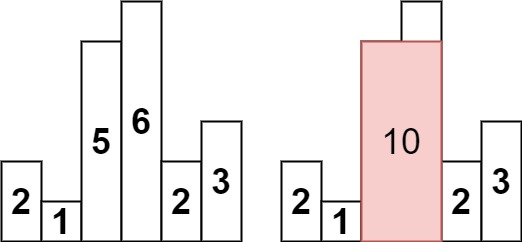
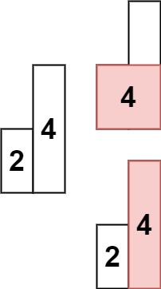

# 84. 柱状图中最大的矩形

[← 栈专题](../../02-专题/12-栈.md) · [总目录](../../../../README.md) · [复习清单](../../00-总览/03-复习清单.md)

<div class="meta-badges problem-meta-common" aria-label="公共题目信息"><span class="mb diff-困难"><span class="mb-k">难度</span><b>困难</b></span></div>

<div class="meta-badges problem-meta legacy-problem-meta" data-hide-in-language="python" aria-label="Java 及同源语言解题信息"><span class="mb"><span class="mb-k">Java 主方法</span><b>单调递增栈 + 哨兵</b></span><span class="mb"><span class="mb-k">时间</span><b>O(n)</b></span><span class="mb"><span class="mb-k">空间</span><b>O(n)</b></span></div>

<div class="meta-badges problem-meta" data-lang-scope="true" data-lang="python" aria-label="Python 解题信息"><span class="mb"><span class="mb-k">Python 主方法</span><b>双哨兵单调非递减栈</b></span><span class="mb"><span class="mb-k">时间</span><b>O(n)</b></span><span class="mb"><span class="mb-k">空间</span><b>O(n)</b></span></div>


## 题目与约束

给定 *n* 个非负整数，用来表示柱状图中各个柱子的高度。每个柱子彼此相邻，且宽度为 1 。

  求在该柱状图中，能够勾勒出来的矩形的最大面积。

  **示例 1:**

  

  **输入：**heights = [2,1,5,6,2,3]<br>**输出：**10<br>**解释：**最大的矩形为图中红色区域，面积为 10

  **示例 2：**

  

  **输入：** heights = [2,4]<br>**输出：** 4

  **提示：**

  - `1 <= heights.length <=105`
  - `0 <= heights[i] <= 104`

[🔗 前往力扣原题验证 →](https://leetcode.cn/problems/largest-rectangle-in-histogram/?envType=study-plan-v2&envId=top-100-liked)

<section class="legacy-solution-panel java-solution-panel" data-hide-in-language="python" data-legacy-scope="true" markdown="1">

## Java 完整推导


### Java 核心不变量


> 出栈时当前柱子的左右第一个更矮边界已经确定。

## 完整推导

### 思路推导
  1. **直觉与痛点（木桶效应的死局）**：

     矩形的面积 = 宽 $\times$ 高。如果我们选定某一个柱子作为矩形的“高度”，那么这个矩形能向左右延伸多远？

     **答案是：直到遇到比它矮的柱子为止（木桶效应）**。

     暴力解法就是遍历每一个柱子，向左向右寻找第一个比它矮的柱子。但在最坏情况下（比如数组呈倒 V 型），每次都要扫描两边，时间复杂度会退化到 $O(N^2)$，绝对超时。

  2. **破局思路（单调递增栈的优化思路）**：

     我们需要在 $O(N)$ 的时间里，一次性把每个柱子的“左边界”**和**“右边界”**都找出来。 我们维护一个**从栈底到栈顶严格递增的栈（存索引）：

     - 当新来的柱子比栈顶**高**时，直接入栈（因为栈顶的右边界还没找到，还能继续延伸）。
     - 🌟 当新来的柱子比栈顶**矮**时，高能预警！这说明**栈顶柱子的右边界找到了**（就是当前这个矮柱子）！
     - 此时，将栈顶柱子弹出。那么它的**左边界是谁**？就是它弹出后，**此时露出来的新的栈顶**！（因为栈是单调递增的，它下面压着的，必定是左边第一个比它矮的柱子）。
     - 高度有了，左右边界有了，面积立刻结算！

  3. **核心微操（惊为天人的“双哨兵”技巧）**：

     如果原数组是 `[2, 4, 6, 8]`（完全递增），那么所有柱子都会压入栈，最后没有矮柱子来触发结算，导致最后还要写个 `while` 循环去清空栈。

     如果在开头遇到极小的柱子，弹出栈顶后，栈空了，左边界怎么算？又要写大量的 `if-else`。

     **面试进阶技：首尾加哨兵（Sentinel）！**

     我们在原数组的最前面和最后面，各强行塞入一个高度为 `0` 的柱子！

     - **开头的 0**：保证栈永远不会空，省去了判断栈空的麻烦（它天然是所有元素的左边界）。
     - **结尾的 0**：保证遍历到最后时，所有的柱子都会因为比 0 高，被强制全部弹出并结算！
### Java 实现（满分双哨兵单调栈版）
```Java
import java.util.ArrayDeque;
import java.util.Deque;

class Solution {
    public int largestRectangleArea(int[] heights) {
        // 1. 数组扩容，首尾各加一个“0”作为哨兵
        int[] newHeights = new int[heights.length + 2];
        // 默认第一位和最后一位都是 0，把原数组的数据拷贝到中间
        System.arraycopy(heights, 0, newHeights, 1, heights.length);

        int maxArea = 0;
        // 单调栈，专门存放索引，且对应的高度从栈底到栈顶单调递增
        Deque<Integer> stack = new ArrayDeque<>();

        // 2. 开始遍历加了哨兵的新数组
        for (int i = 0; i < newHeights.length; i++) {
            // 🌟 核心逻辑：当前柱子比栈顶柱子矮，说明栈顶柱子的“右边界”找到了！
            // 开始“大清算”，把比当前柱子高的栈顶全弹出来结算面积
            while (!stack.isEmpty() && newHeights[i] < newHeights[stack.peek()]) {
                // 弹出栈顶，它就是我们当前要计算的矩形的高度
                int midIndex = stack.pop();
                int h = newHeights[midIndex];

                // 此时栈顶剩下的元素，就是弹出元素的“左边界”
                int leftIndex = stack.peek();
                // 当前柱子 i，就是弹出元素的“右边界”
                int rightIndex = i;

                // 计算宽度：右边界 - 左边界 - 1 （注意这里是开区间，不包含左右边界本身）
                int w = rightIndex - leftIndex - 1;

                // 挑战历史最大面积
                maxArea = Math.max(maxArea, h * w);
            }

            // 当前柱子处理完毕，入栈等待自己的右边界到来
            stack.push(i);
        }

        return maxArea;
    }
}
```
### 复杂度
  - **时间复杂度**：$O(N)$。加上首尾哨兵后，数组共有 $N+2$ 个元素。每个元素最多只会入栈一次、出栈一次。没有任何重复遍历，是极致的线性时间。
  - **空间复杂度**：$O(N)$。开辟了长度为 $N+2$ 的新数组 `newHeights`，以及一个最坏情况下深度为 $N+2$ 的单调栈。

### 易错点与扩展（面试的连环计）

1. **极度高频坑点：宽度的计算公式到底为什么是 `w = right - left - 1`？**

   - 闭上眼睛想象：假设高度是 `[1, 5, 6, 2]`，栈里现在压着 `1, 5, 6`。
   - 遇到 `2` 的时候，比 `6` 矮，弹出 `6` 计算面积。
   - 此时 `6` 的右边界是 `2`（索引为 3），左边界是 `5`（索引为 1）。
   - 这说明包含 `6` 的矩形，**只能卡在索引 1 和索引 3 之间**，真正属于它的只有索引 2 本身！
   - $3 - 1 - 1 = 1$，宽度为 1。公式完美闭环。

2. **面试终极追踪：“如果我把这个一维的柱状图，变成一个由 `0` 和 `1` 组成的【二维矩阵】，让你求里面最大的全为 `1` 的矩形面积，你该怎么做？”（对应力扣 85 题：最大矩形 - Hard 难度）**

   - **满分优化思路（矩阵压缩法）**：这也是面试面试中最爱玩的套路——把新题降维成旧题。

   - 遇到二维矩阵，我们只需要**以每一行为地基，把上面的 `1` 累加起来，当做柱子的高度**。

   - 比如矩阵：

     `1 0 1 0 0` -> 这一层柱子是 `[1, 0, 1, 0, 0]`

     `1 0 1 1 1` -> 这一层柱子是 `[2, 0, 2, 1, 1]` (遇到 0 直接归零，遇到 1 累加)

     `1 1 1 1 1` -> 这一层柱子是 `[3, 1, 3, 2, 2]`

   - 我们只需要把每一层算出来的一维数组，**当做 84 题里的 `heights`，调用 $M$ 次（行数）上面写好的单调栈算法，取最大值即可**。这绝对是展现你算法体系融会贯通的最佳时刻！

</section>

<section class="language-panel" data-lang-scope="true" data-lang="python" markdown="1">

## Python 完整推导

### 固定高度后，矩形能向两边延伸多远

选定一根柱子作为矩形高度后，宽度会一直延伸到左右第一个严格更矮的柱子之前；与它等高的柱子仍可包含在矩形内。暴力做法会对每根柱子分别寻找边界，最坏是平方时间。

当前高度严格小于栈顶时，它已经封住了栈顶柱子的右边界。弹出一个栈顶后，新的栈顶可能是更矮柱，也可能与它等高。等高时，较早的等高柱还没有被弹出，后续会继续把同一高度向左侧扩展。

### 用 `[2, 1, 5, 6, 2, 3]` 看结算过程

先构造 `values = [0, 2, 1, 5, 6, 2, 3, 0]`，并把左哨兵下标 0 放进栈。

1. 下标 1 高度 2，高于 0，入栈，栈为 `[0, 1]`。
2. 下标 2 高度 1，弹出 1。高度是 2，左边界 0、右边界 2，宽度 `2 - 0 - 1 = 1`，面积 2。栈恢复后压入 2。
3. 下标 3、4 的高度 5、6 依次入栈，栈为 `[0, 2, 3, 4]`。
4. 下标 5 的高度 2，先弹 4：高度 6，夹在 3 和 5 之间，宽 1，面积 6；再弹 3：高度 5，夹在 2 和 5 之间，宽 `5 - 2 - 1 = 2`，面积 10。此时栈顶高度 1 更矮，停止并压入 5。
5. 下标 6 高度 3 入栈。右哨兵高度 0 会继续弹出栈顶所有正高度；真实高度为 0 的柱子与哨兵等高，会留在栈中。它们代表的面积是 0，不影响正高度的最大面积。

最终 `best = 10`。每根柱子恰好入栈一次、最多出栈一次，所以尽管有多个弹出动作，总时间仍是线性的。

### 高度相等时怎样处理

当前代码只在 `values[index] < values[stack[-1]]` 时弹出，等高柱会同时留在栈中。以 `[2, 2]` 为例，加哨兵后是 `[0, 2, 2, 0]`。处理右哨兵时先弹出后一个 2，新栈顶是前一个等高 2，这一步面积是 `2 × 1 = 2`；继续弹出前一个 2，宽度才扩成 2，面积变为 `2 × 2 = 4`。因此较早的等高柱最后获得最大宽度，而不是第一个弹出时就找到严格更矮的左边界。

### Python 实现

> 参考来源：代码随想录（programmercarl.com）
>
> 沿用旧项目收录的《代码随想录》Python 单调栈主解与双哨兵思路；避免旧实现的 `heights.insert` 原地修改，变量与注释按本页整理。

```python
from typing import List


class Solution:
    def largestRectangleArea(self, heights: List[int]) -> int:
        values = [0] + heights + [0]
        stack = [0]
        best = 0
        for index in range(1, len(values)):
            while values[index] < values[stack[-1]]:
                middle = stack.pop()
                width = index - stack[-1] - 1
                best = max(best, values[middle] * width)
            stack.append(index)
        return best
```

### 哨兵与列表操作

`values = [0] + heights + [0]` 创建新列表，不修改调用方传入的 `heights`。左哨兵保证正高度一定能在左侧找到更矮位置。右哨兵高度为 0，只会在它严格小于栈顶时弹出栈顶的正高度；真实 0 柱与右哨兵等高，可能保留在栈中，不会被误算成正面积。

`middle = stack.pop()` 确定当前要计算的高度。当前 `index` 是它右侧第一个严格更矮位置；弹栈后的新栈顶可能与 `middle` 等高，此时它不是已经执行的严格左边界，而是同一高度组里更早、仍待结算的柱子。宽度 `index - stack[-1] - 1` 对当前这一轮仍然成立，较早等高柱之后会把宽度继续扩大。

### 为什么不是平方

`index` 每次只加入栈一次，也可能只被弹出一次。`while` 的总迭代次数与入栈次数同阶，因此不能因为代码里有一个内层循环就判定为 O(n²)。

### 复杂度

- 时间复杂度：`O(n)`。
- 空间复杂度：`O(n)`。

加哨兵后的每个下标最多入栈一次、出栈一次，总时间 O(n)；新高度列表和栈最坏都保存 O(n) 项。

</section>

## 力扣原题

[🔗 前往力扣原题验证 →](https://leetcode.cn/problems/largest-rectangle-in-histogram/?envType=study-plan-v2&envId=top-100-liked)

<section class="language-panel cpp-solution-panel" data-lang-scope="true" data-lang="cpp" markdown="1">

## C++ 实现

> 实现来源：代码随想录（programmercarl.com）


```cpp
class Solution {
public:
    int largestRectangleArea(vector<int>& heights) {
        int sum = 0;
        for (int i = 0; i < heights.size(); i++) {
            int left = i;
            int right = i;
            for (; left >= 0; left--) {
                if (heights[left] < heights[i]) break;
            }
            for (; right < heights.size(); right++) {
                if (heights[right] < heights[i]) break;
            }
            int w = right - left - 1;
            int h = heights[i];
            sum = max(sum, w * h);
        }
        return sum;
    }
};
```

</section>

<section class="language-panel go-solution-panel" data-lang-scope="true" data-lang="go" markdown="1">

## Go 实现

> 实现来源：代码随想录（programmercarl.com）


```go
func largestRectangleArea(heights []int) int {
    sum := 0
    for i := 0; i < len(heights); i++ {
        left, right := i, i
        for left >= 0 {
            if heights[left] < heights[i] {
                break
            }
            left--
        }
        for right < len(heights) {
            if heights[right] < heights[i] {
                break
            }
            right++
        }
        w := right - left - 1
        h := heights[i]
        sum = max(sum, w * h)
    }
    return sum
}
```

</section>

<!--bottom-nav-->
<div class="problem-nav">
<a class="problem-nav-btn" href="../12-栈/0739-每日温度.html" target="_blank" rel="noopener noreferrer">← 上一题</a>
<a class="problem-nav-btn" href="../../../../index.html">🏠 回到 Hot 100 目录</a>
<a class="problem-nav-btn primary" href="../13-堆/0215-数组中的第K个最大元素.html" target="_blank" rel="noopener noreferrer">下一题 →</a>
</div>
<!--/bottom-nav-->
