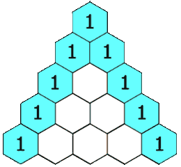

# 118. 杨辉三角

[← 动态规划专题](../../02-专题/15-动态规划.md) · [总目录](../../../../README.md) · [复习清单](../../00-总览/03-复习清单.md)

<div class="meta-badges problem-meta-common" aria-label="公共题目信息"><span class="mb diff-简单"><span class="mb-k">难度</span><b>简单</b></span></div>

<div class="meta-badges problem-meta legacy-problem-meta" data-hide-in-language="python" aria-label="Java 及同源语言解题信息"><span class="mb"><span class="mb-k">Java 主方法</span><b>逐行递推</b></span><span class="mb"><span class="mb-k">时间</span><b>O(n²)</b></span><span class="mb"><span class="mb-k">空间</span><b>O(n²)</b></span></div>

<div class="meta-badges problem-meta" data-lang-scope="true" data-lang="python" aria-label="Python 解题信息"><span class="mb"><span class="mb-k">Python 主方法</span><b>逐行递推杨辉三角</b></span><span class="mb"><span class="mb-k">时间</span><b>O(n²)</b></span><span class="mb"><span class="mb-k">空间</span><b>O(n²)（包含输出）</b></span></div>


## 题目与约束

给定一个非负整数 *`numRows`，*生成「杨辉三角」的前 *`numRows`*行。

  在**「杨辉三角」**中，每个数是它左上方和右上方的数的和。

  

  **示例 1:**

  **输入:** numRows = 5<br>**输出:** [[1],[1,1],[1,2,1],[1,3,3,1],[1,4,6,4,1]]

  **示例 2:**

  **输入:** numRows = 1<br>**输出:** [[1]]

  **提示:**

  - `1 <= numRows <= 30`

[🔗 前往力扣原题验证 →](https://leetcode.cn/problems/pascals-triangle/?envType=study-plan-v2&envId=top-100-liked)

<section class="legacy-solution-panel java-solution-panel" data-hide-in-language="python" data-legacy-scope="true" markdown="1">

## Java 完整推导


### Java 核心不变量


> 内部元素来自上一行左上与正上方。

## 完整推导

### 思路推导
  1. **直觉与痛点（形与实的转换）**：

     杨辉三角在视觉上是一个等腰三角形，但在计算机内存中，我们很难直接建一个等腰三角形。

     **破局点**：把它全部**向左对齐**，变成一个“直角三角形”（也就是每一行长度不断加一的二维数组/嵌套列表）。

     排版后你会发现规律：

     `[1]`

     `[1, 1]`

     `[1, 2, 1]`

     `[1, 3, 3, 1]`

  2. **寻找规律（状态转移方程）**：

     经过左对齐后，我们可以极其清晰地总结出两条铁律：

     - **边界铁律**：每一行的第一位（索引 `0`）和最后一位（索引 `i`），永远是 `1`。

     - **内部铁律**：对于中间的任何一个数字，它的值等于**上一行的同一列**与**上一行的前一列**之和。

       转换为极其标准的状态转移方程：

       $dp[i][j] = dp[i-1][j-1] + dp[i-1][j]$

  3. **核心微操（两层循环，步步为营）**：

     外层循环 `i` 控制行数（从 0 到 `numRows - 1`）。

     内层循环 `j` 控制每一行里面的元素（从 0 到 `i`）。

     根据 `j` 是不是首尾位置，分别塞入 `1` 或者执行相加公式即可。
### Java 实现（满分嵌套列表版）
```Java
import java.util.ArrayList;
import java.util.List;

class Solution {
    public List<List<Integer>> generate(int numRows) {
        // 创建一个用于存储整个大三角的嵌套列表
        List<List<Integer>> triangle = new ArrayList<>();

        // 边界防御
        if (numRows == 0) {
            return triangle;
        }

        // 外层循环：逐行构建杨辉三角
        for (int i = 0; i < numRows; i++) {
            // 准备一个新列表，用来装当前这一行的数字
            List<Integer> row = new ArrayList<>();

            // 内层循环：逐个生成当前行的数字
            // 注意：第 i 行有 i + 1 个数字，所以 j <= i
            for (int j = 0; j <= i; j++) {
                // 边界铁律：每一行的开头和结尾必定是 1
                if (j == 0 || j == i) {
                    row.add(1);
                }
                // 内部铁律：中间的数字等于上一行的 (j-1) 和 (j) 位置之和
                else {
                    // 🌟 核心状态转移：向上面的行去借数据
                    // previousRow 就是 triangle.get(i - 1)
                    List<Integer> previousRow = triangle.get(i - 1);
                    int leftParent = previousRow.get(j - 1);
                    int rightParent = previousRow.get(j);

                    row.add(leftParent + rightParent);
                }
            }

            // 当前行构建完毕，装入大三角中
            triangle.add(row);
        }

        return triangle;
    }
}
```
### 复杂度
  - **时间复杂度**：$O(numRows^2)$。我们需要生成 $\frac{numRows \times (numRows + 1)}{2}$ 个元素，每个元素的计算时间是 $O(1)$ 的加法，属于完美的等差数列求和。
  - **空间复杂度**：$O(1)$（如果不考虑返回值的空间）。如果算上用来存放结果的嵌套列表，空间复杂度为 $O(numRows^2)$。

### 易错点与扩展（面试的数学连环计）

1. **面试追问 1：“如果我不需要整个三角形，我只想要第 `rowIndex` 行，并且【只允许你使用 $O(rowIndex)$ 的额外空间】，该怎么做？”（对应力扣 119 题：杨辉三角 II）**
   - **满分抢答（滚动数组的艺术）**：这也是面试最爱考的 DP 空间压缩技巧！
   - 因为第 `i` 行的计算**仅仅依赖于第 `i-1` 行**，更早的行全都没用了。所以我们只需要一个一维数组。
   - **致命细节（倒序遍历）**：更新一维数组时，必须**从后往前遍历**（`j` 从 `i-1` 递减到 `1`）。因为如果你从前往后更新，你刚算出来的 `dp[j]` 覆盖了旧数据，等会儿算 `dp[j+1]` 需要用到旧的 `dp[j]` 时，数据已经被污染了！倒序遍历是原地压缩空间的神级手法。
2. **面试终极进阶：“你能用纯数学公式，在 $O(n)$ 时间内直接算出第 `rowIndex` 行的每一个数吗？”**
   - **满分优化思路（组合数学公式）**：杨辉三角的本质其实是**二项式展开的系数**，也就是大名鼎鼎的**组合数 $C_n^m$**！
   - 第 $n$ 行的第 $m$ 个数（索引从 0 开始），其值严格等于 $C_n^m$。
   - 根据组合数的递推公式：$C_n^m = C_n^{m-1} \times \frac{n - m + 1}{m}$。我们甚至不需要哪怕一次加法，直接用乘除法就能在 $O(n)$ 内顺推生成特定行的所有数字！

</section>

<section class="language-panel" data-lang-scope="true" data-lang="python" markdown="1">

## Python 完整推导

### 当前行只借上一行相邻两项

杨辉三角左对齐后，第 `row` 行有 `row + 1` 个数，首位和末位固定为 1。中间任意位置 `col` 的值，等于上一行第 `col - 1` 项与第 `col` 项之和。

因此可以逐行生成本行，而不用组合数公式。先生成整行全 1 的列表，再只覆盖下标 1 到 `row - 1` 的中间项；两端保持 1。

### 生成前 4 行的状态

1. 第 0 行没有任何中间位置，得到 `[1]`。
2. 第 1 行有两个端点，没有中间位置，得到 `[1, 1]`。
3. 第 2 行先生成 `[1, 1, 1]`；下标 1 借上一行的 `[1, 1]`，得到 `1 + 1 = 2`，整行为 `[1, 2, 1]`。
4. 第 3 行先生成 `[1, 1, 1, 1]`；下标 1 等于 `1 + 2 = 3`，下标 2 等于 `2 + 1 = 3`，得到 `[1, 3, 3, 1]`。

继续即可得到第 4 行 `[1, 4, 6, 4, 1]`。结果按行追加到二维列表，后续行直接读取 `triangle[-1]` 作为上一行。

### Python 实现

> 参考来源：经典解法实现
>
> 沿用旧项目“经典解法实现”的逐行嵌套列表 Python 代码；变量名、类型签名、注释和换行按本页整理。

```python
from typing import List


class Solution:
    def generate(self, numRows: int) -> List[List[int]]:
        triangle = []
        for row_index in range(numRows):
            row = [1] * (row_index + 1)
            for col in range(1, row_index):
                row[col] = triangle[-1][col - 1] + triangle[-1][col]
            triangle.append(row)
        return triangle
```

### 列表创建与下标范围

`[1] * (row_index + 1)` 创建当前行的基础列表，乘号重复的是整数 1，因此不存在多个引用共享的问题。`range(1, row_index)` 不包含 `row_index`，只处理中间位置；首项 0 和末项 `row_index` 会一直保留为 1。

当前行必须新建，不能直接在上一行中间插入，否则左侧下标会移动。`triangle.append(row)` 保存完整当前行后，下一次循环才会使用它。

### 输出与边界

`numRows = 0` 时外层循环不执行，返回空列表。总元素数是 1+2+...+(n)，即 O(n²)；返回值本身也保存这么多整数。

### 复杂度

- 时间复杂度：`O(n²)`。
- 空间复杂度：`O(n²)（包含输出）`。

第 row 行包含 row+1 项，所有行元素数和为 O(n²)：每个内部元素一次加法；输出嵌套列表本身占 O(n²)。

</section>

## 力扣原题

[🔗 前往力扣原题验证 →](https://leetcode.cn/problems/pascals-triangle/?envType=study-plan-v2&envId=top-100-liked)

<section class="language-panel cpp-solution-panel" data-lang-scope="true" data-lang="cpp" markdown="1">

## C++ 实现

> 实现来源：经典解法实现

<ol class="lang-steps"><li>第 r 行有 r+1 个元素，两端为 1</li><li>中间每个数 = 上一行左右两数之和</li><li>逐行递推构造</li></ol>

```cpp
class Solution {
public:
    vector<vector<int>> generate(int numRows) {
        vector<vector<int>> tri;
        for (int r = 0; r < numRows; r++) {
            vector<int> row(r + 1, 1);
            for (int c = 1; c < r; c++) row[c] = tri[r - 1][c - 1] + tri[r - 1][c];
            tri.push_back(row);
        }
        return tri;
    }
};
```

</section>

<section class="language-panel go-solution-panel" data-lang-scope="true" data-lang="go" markdown="1">

## Go 实现

> 实现来源：经典解法实现

<ol class="lang-steps"><li>第 r 行有 r+1 个元素，两端为 1</li><li>中间每个数 = 上一行左右两数之和</li><li>逐行递推构造</li></ol>

```go
func generate(numRows int) [][]int {
    tri := make([][]int, numRows)
    for r := 0; r < numRows; r++ {
        tri[r] = make([]int, r+1)
        for c := 0; c <= r; c++ {
            if c == 0 || c == r { tri[r][c] = 1 } else { tri[r][c] = tri[r-1][c-1] + tri[r-1][c] }
        }
    }
    return tri
}
```

</section>

<section class="language-panel c-solution-panel" data-lang-scope="true" data-lang="c" markdown="1">

## C 实现

> 实现来源：经典解法实现

<ol class="lang-steps"><li>第 r 行有 r+1 个元素，两端为 1</li><li>中间每个数 = 上一行左右两数之和</li><li>逐行递推构造</li></ol>

```c
int** generate(int numRows, int* returnSize, int** returnColumnSizes) {
    int** tri = malloc(sizeof(int*) * numRows);
    *returnSize = numRows;
    *returnColumnSizes = malloc(sizeof(int) * numRows);
    for (int r = 0; r < numRows; r++) {
        (*returnColumnSizes)[r] = r + 1;
        tri[r] = malloc(sizeof(int) * (r + 1));
        for (int c = 0; c <= r; c++)
            tri[r][c] = (c == 0 || c == r) ? 1 : tri[r-1][c-1] + tri[r-1][c];
    }
    return tri;
}
```

</section>

<!--bottom-nav-->
<div class="problem-nav">
<a class="problem-nav-btn" href="../15-动态规划/0070-爬楼梯.html" target="_blank" rel="noopener noreferrer">← 上一题</a>
<a class="problem-nav-btn" href="../../../../index.html">🏠 回到 Hot 100 目录</a>
<a class="problem-nav-btn primary" href="../15-动态规划/0198-打家劫舍.html" target="_blank" rel="noopener noreferrer">下一题 →</a>
</div>
<!--/bottom-nav-->
