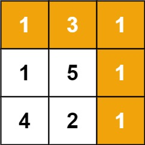

# 64. 最小路径和

[← 多维动态规划专题](../../02-专题/16-多维动态规划.md) · [总目录](../../../../README.md) · [复习清单](../../00-总览/03-复习清单.md)

<div class="meta-badges problem-meta-common" aria-label="公共题目信息"><span class="mb diff-中等"><span class="mb-k">难度</span><b>中等</b></span></div>

<div class="meta-badges problem-meta legacy-problem-meta" data-hide-in-language="python" aria-label="Java 及同源语言解题信息"><span class="mb"><span class="mb-k">Java 主方法</span><b>网格最小代价</b></span><span class="mb"><span class="mb-k">时间</span><b>O(mn)</b></span><span class="mb"><span class="mb-k">空间</span><b>O(1) 可原地</b></span></div>

<div class="meta-badges problem-meta" data-lang-scope="true" data-lang="python" aria-label="Python 解题信息"><span class="mb"><span class="mb-k">Python 主方法</span><b>二维前缀最小路径 DP</b></span><span class="mb"><span class="mb-k">时间</span><b>O(m·n)</b></span><span class="mb"><span class="mb-k">空间</span><b>O(m·n)</b></span></div>


## 题目与约束

给定一个包含非负整数的 `m x n` 网格 `grid` ，请找出一条从左上角到右下角的路径，使得路径上的数字总和为最小。

  **说明：**每次只能向下或者向右移动一步。

  **示例 1：**

  

  **输入：**grid = [[1,3,1],[1,5,1],[4,2,1]]<br>**输出：**7<br>**解释：**因为路径 1→3→1→1→1 的总和最小。

  **示例 2：**

  **输入：**grid = [[1,2,3],[4,5,6]]<br>**输出：**12

  **提示：**

  - `m == grid.length`
  - `n == grid[i].length`
  - `1 <= m, n <= 200`
  - `0 <= grid[i][j] <= 200`

[🔗 前往力扣原题验证 →](https://leetcode.cn/problems/minimum-path-sum/?envType=study-plan-v2&envId=top-100-liked)

<section class="legacy-solution-panel java-solution-panel" data-hide-in-language="python" data-legacy-scope="true" markdown="1">

## Java 完整推导


### Java 核心不变量


> 当前位置最小代价来自上方和左方较小者。

## 完整推导

### 思路推导
  1. **直觉与痛点（局部贪心的灾难）**：

     很多人的第一直觉是“走一步看一步”：每次站在一个格子里，对比下面和右边的数字，谁小就往谁走。

     **痛点**：这种纯贪心是致命的！比如面临向右是 1，向下是 2。你贪心选了 1，结果 1 的后面跟着一个巨大的 100；而 2 的后面全都是 0。贪心算法无法预知未来，必然掉进陷阱。

  2. **降维破局（全局视角的代价沉淀）**：

     我们要用动态规划的“上帝视角”来俯瞰全局。

     闭上眼睛想一想：到达坐标为 `(i, j)` 的格子，**只可能是从上面 `(i-1, j)` 走下来的，或者是从左边 `(i, j-1)` 走过来的**。

     既然只有这两条路，那我只要问：

     “上面那个格子，它一路走过来的历史最低成本是多少？”

     “左边那个格子，它一路走过来的历史最低成本是多少？”

     我从中挑一个**最小的**，然后加上我自己这个格子的过路费，就是到达我这里的最低总成本！

  3. **核心微操（状态转移方程与边界）**：

     状态转移方程极其优雅：

     $dp[i][j] = \min(dp[i-1][j], dp[i][j-1]) + grid[i][j]$

     **边界基石**：

     - 网格的左上角起点：起点就是自带的数字。
     - **第一行**：只能从左边一路走过来，不断累加。
     - **第一列**：只能从上面一路走下来，不断累加。
### Java 实现（满分一维空间压缩版）
> 同样的，我们可以将二维 DP 数组压缩成一个**一维的滚动数组**，来把空间复杂度优化思路到 $O(n)$。
```Java
class Solution {
    public int minPathSum(int[][] grid) {
        int m = grid.length;
        int n = grid[0].length;

        // dp 数组记录到达当前行每一列的最小路径和
        int[] dp = new int[n];

        // 1. 初始化第一行的状态（第一行只能从左往右走）
        dp[0] = grid[0][0];
        for (int j = 1; j < n; j++) {
            dp[j] = dp[j - 1] + grid[0][j];
        }

        // 2. 从第二行开始，逐行向下扫描
        for (int i = 1; i < m; i++) {
            // 当前行的第一列，只能从上一行的第一列走下来
            // 此时的 dp[0] 存的是上一行的值，直接累加即可
            dp[0] = dp[0] + grid[i][0];

            // 从当前行的第二列开始，进行真正的状态转移
            for (int j = 1; j < n; j++) {
                // 此时的 dp[j] 代表上方格子的最小路径和（旧数据）
                // 此时的 dp[j-1] 代表左方格子的最小路径和（刚刚算出的新数据）
                // 取两者较小值，加上当前格子的过路费
                dp[j] = Math.min(dp[j], dp[j - 1]) + grid[i][j];
            }
        }

        // 最终推导到一维数组的最后一位，就是右下角的最小路径和
        return dp[n - 1];
    }
}
```
### 复杂度
  - **时间复杂度**：$O(m \times n)$。我们需要遍历每一个格子一次来进行状态转移计算。
  - **空间复杂度**：$O(n)$。我们优化掉了二维数组，仅仅使用了一个长度为列数 $n$ 的一维滚动数组。

### 易错点与扩展（面试的工程与算法博弈）

1. **面试追问 1：“我看你用了一维数组，空间复杂度是 $O(n)$。你能把空间复杂度优化到极其绝对的 $O(1)$ 吗？”**
   - **满分抢答（原地修改原数组）**：绝对可以！因为原网格 `grid` 中的数据，我们在用过一次之后就不再需要它原本的“过路费”了。所以我们可以**直接在 `grid` 数组上原地修改**，让 `grid[i][j]` 变成到达该格子的最小路径和。
   - **架构师的高能反转（工程操守）**：但在面试中，你一定要紧接着补上一句：“**虽然这样可以做到 $O(1)$ 空间，但在实际工业级工程中，我们通常极其反对修改传入的输入参数（Input Mutation）。** 这会导致脏数据，破坏了函数的幂等性和调用方的状态。所以如果内存不紧缺，保留 $O(n)$ 的一维滚动数组是工程上最优雅的妥协。” —— 面试官听到这句话，绝对会在心里给你打上“Senior 工程师”的标签。
2. **面试追问 2：“这道题规定了只能【向下】或【向右】走。如果我放开限制，允许你【上下左右】随便走，代码该怎么改？”**
   - **优化思路（知识领域跨越）**：这就不再是一道动态规划题了！因为如果能上下左右走，就会产生**环（Cycles）**，DP 的“无后效性”被彻底打破（当前状态会依赖未来状态）。
   - 此时，网格退化成了一张带权有向图，求最短路径。我们必须祭出图论领域的王牌：**Dijkstra 算法**（结合优先队列/小顶堆进行广度优先搜索最短路）。

</section>

<section class="language-panel" data-lang-scope="true" data-lang="python" markdown="1">

## Python 完整推导

### 到达当前格子的代价只取决于两个前驱

从左上角到 `(row, col)` 的最后一步只能从上方或左方进入。上方和左方各自已经有“到达该处的最小累计代价”，取较小者再加上当前格子的通行成本，就是当前格子的最小累计代价。

这里使用二维 DP。第一行只能从左来，第一列只能从上来，要先把它们累加；其他格子才同时拥有两个前驱。

### 用 `[[1,3,1],[1,5,1],[4,2,1]]` 填表

1. 第一行只能向右：`[1, 4, 5]`。
2. 第二行第一列为 `1 + 1 = 2`；格子 `(1,1)` 取上方 4、左方 2 的较小值 2，再加 5 得 7；`(1,2)` 取上方 5、左方 7 的较小值 5，再加 1 得 6。
3. 第三行第一列为 `4 + 2 = 6`；`(2,1)` 取上方 7、左方 6 的较小值 6，再加 2 得 8；终点 `(2,2)` 取上方 6、左方 8 的较小值 6，再加 1 得 7。

最终最小路径和是 7，对应路线为右、右、下、下，经过 `1,3,1,1,1`。二维表让每一步的累计代价都能直接核对。

### Python 实现

> 参考来源：经典解法实现
>
> 沿用旧项目“经典解法实现”的二维 DP Python 代码；变量命名、边界循环、类型签名和注释按本页整理。

```python
from typing import List


class Solution:
    def minPathSum(self, grid: List[List[int]]) -> int:
        rows = len(grid)
        cols = len(grid[0])
        dp = [[0] * cols for _ in range(rows)]
        dp[0][0] = grid[0][0]

        for col in range(1, cols):
            dp[0][col] = dp[0][col - 1] + grid[0][col]
        for row in range(1, rows):
            dp[row][0] = dp[row - 1][0] + grid[row][0]

        for row in range(1, rows):
            for col in range(1, cols):
                dp[row][col] = (
                    min(dp[row - 1][col], dp[row][col - 1])
                    + grid[row][col]
                )
        return dp[rows - 1][cols - 1]
```

### 二维表的下标与初始化

`dp[0][0] = grid[0][0]`。随后第一行用 `dp[0][col-1] + grid[0][col]`，第一列用 `dp[row-1][0] + grid[row][0]`，分别表示“只能一直向右”和“只能一直向下”。

主体循环从第 1 行、第 1 列开始。`min(dp[row-1][col], dp[row][col-1]) + grid[row][col]` 先比较两个前驱，再加当前通行成本。

### 边界与可选优化

只有一行或一列的网格会由两个边界循环正确处理。也可以原地写回 `grid` 或用一维数组滚动；这里保留独立二维 `dp`，让每一步来源直观可见，同时不修改输入网格。

### 复杂度

- 时间复杂度：`O(m·n)`。
- 空间复杂度：`O(m·n)`。

每个格子计算一次并做常数次比较，时间 O(m·n)；独立的 m 行乘 n 列 dp 表占 O(m·n) 空间。

</section>

## 力扣原题

[🔗 前往力扣原题验证 →](https://leetcode.cn/problems/minimum-path-sum/?envType=study-plan-v2&envId=top-100-liked)

<section class="language-panel cpp-solution-panel" data-lang-scope="true" data-lang="cpp" markdown="1">

## C++ 实现

> 实现来源：经典解法实现

<ol class="lang-steps"><li>dp[i][j] = 到达 (i,j) 的最小路径和 = min(上, 左) + grid[i][j]</li><li>首行只能从左来，首列只能从上来，先初始化</li><li>其余逐格递推，右下角即答案</li></ol>

```cpp
class Solution {
public:
    int minPathSum(vector<vector<int>>& grid) {
        int m = grid.size(), n = grid[0].size();
        vector<vector<int>> dp(m, vector<int>(n));
        dp[0][0] = grid[0][0];
        for (int c = 1; c < n; c++) dp[0][c] = dp[0][c-1] + grid[0][c];
        for (int r = 1; r < m; r++) dp[r][0] = dp[r-1][0] + grid[r][0];
        for (int r = 1; r < m; r++)
            for (int c = 1; c < n; c++)
                dp[r][c] = min(dp[r-1][c], dp[r][c-1]) + grid[r][c];
        return dp[m-1][n-1];
    }
};
```

</section>

<section class="language-panel go-solution-panel" data-lang-scope="true" data-lang="go" markdown="1">

## Go 实现

> 实现来源：经典解法实现

<ol class="lang-steps"><li>dp[i][j] = 到达 (i,j) 的最小路径和 = min(上, 左) + grid[i][j]</li><li>首行只能从左来，首列只能从上来，先初始化</li><li>其余逐格递推，右下角即答案</li></ol>

```go
func minPathSum(grid [][]int) int {
    m, n := len(grid), len(grid[0])
    dp := make([][]int, m)
    for r := range dp { dp[r] = make([]int, n) }
    dp[0][0] = grid[0][0]
    for c := 1; c < n; c++ { dp[0][c] = dp[0][c-1] + grid[0][c] }
    for r := 1; r < m; r++ { dp[r][0] = dp[r-1][0] + grid[r][0] }
    for r := 1; r < m; r++ {
        for c := 1; c < n; c++ {
            dp[r][c] = min(dp[r-1][c], dp[r][c-1]) + grid[r][c]
        }
    }
    return dp[m-1][n-1]
}
```

</section>

<section class="language-panel c-solution-panel" data-lang-scope="true" data-lang="c" markdown="1">

## C 实现

> 实现来源：经典解法实现

<ol class="lang-steps"><li>dp[i][j] = 到达 (i,j) 的最小路径和 = min(上, 左) + grid[i][j]</li><li>首行只能从左来，首列只能从上来，先初始化</li><li>其余逐格递推，右下角即答案</li></ol>

```c
int minPathSum(int** grid, int gridSize, int* gridColSize) {
    int m = gridSize, n = gridColSize[0];
    int** dp = malloc(sizeof(int*) * m);
    for (int r = 0; r < m; r++) dp[r] = malloc(sizeof(int) * n);
    dp[0][0] = grid[0][0];
    for (int c = 1; c < n; c++) dp[0][c] = dp[0][c-1] + grid[0][c];
    for (int r = 1; r < m; r++) dp[r][0] = dp[r-1][0] + grid[r][0];
    for (int r = 1; r < m; r++)
        for (int c = 1; c < n; c++)
            dp[r][c] = (dp[r-1][c] < dp[r][c-1] ? dp[r-1][c] : dp[r][c-1]) + grid[r][c];
    int ans = dp[m-1][n-1];
    return ans;
}
```

</section>

<!--bottom-nav-->
<div class="problem-nav">
<a class="problem-nav-btn" href="../16-多维动态规划/0062-不同路径.html" target="_blank" rel="noopener noreferrer">← 上一题</a>
<a class="problem-nav-btn" href="../../../../index.html">🏠 回到 Hot 100 目录</a>
<a class="problem-nav-btn primary" href="../16-多维动态规划/0005-最长回文子串.html" target="_blank" rel="noopener noreferrer">下一题 →</a>
</div>
<!--/bottom-nav-->
