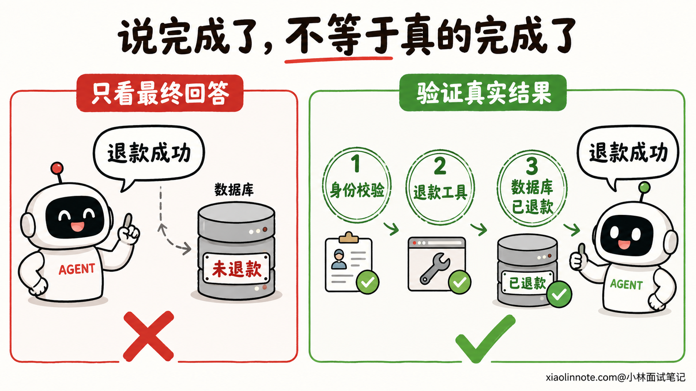
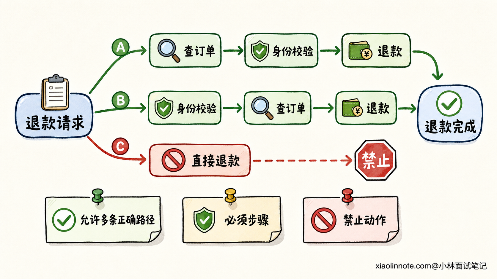
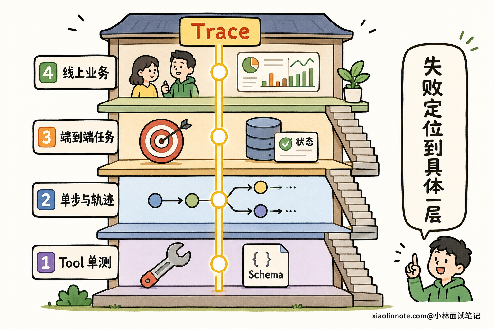
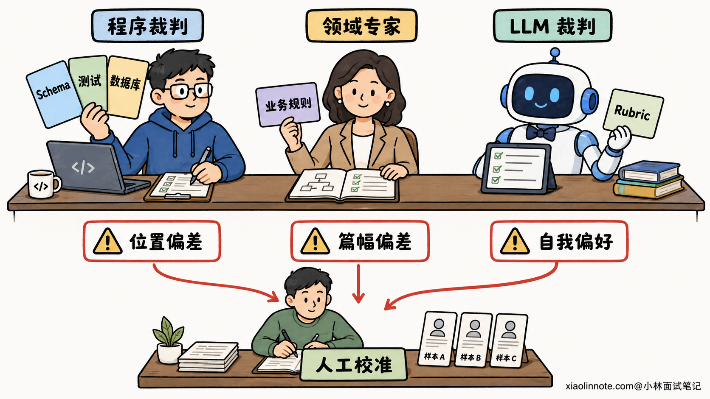
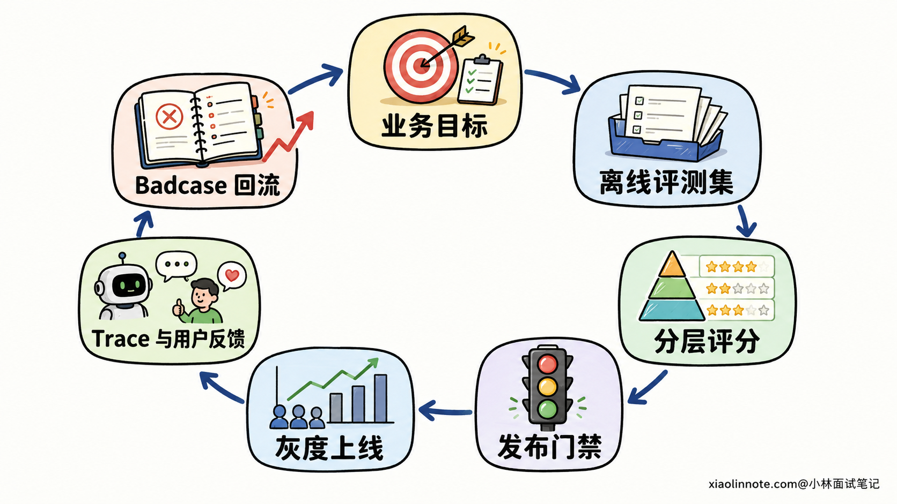

# 如何评估一个 Agent 的效果？评测集和指标怎么设计？

> 原文：[如何评估一个 Agent 的效果？评测集和指标怎么设计？](https://xiaolinnote.com/ai/agent/19_evaluation.html) · 小林面试笔记

👔面试官：你们怎么评估 Agent 的效果？

🙋‍♂️我：主要看最终回答准不准确，再让一个大模型给答案打分。

👔面试官：退款 Agent 回复「退款成功」，实际却没调用退款接口，这个答案看起来很完整，你也给它高分吗？Agent 不只是在生成文字，它还在做决策和改变外部状态。

🙋‍♂️我：那我再加上任务完成率和工具调用准确率，最后算一个综合分。

👔面试官：如果它完成了退款，但绕过身份校验，还重复调用接口两次，综合分高就能上线吗？安全约束不能被其他指标的高分抵消。

🙋‍♂️我：那就给安全指标更高的权重，只要总分过线就发布。

👔面试官：还是不对。高风险约束应该是硬门禁，不是普通加分项。再说，评测题从哪里来，轨迹有多条正确路径怎么办，大模型裁判有偏差怎么办，线上 Badcase 又怎么回流？这些问题才构成一套完整的 Agent 评测体系。

Agent 评测不能只盯着最后一句话，得把它从「会不会说」拆到「有没有把事做对」。

## 💡 简要回答

我评估 Agent 时不会只看最终答案，而是分四层。

工具层看该不该调用、工具选得对不对、参数和返回处理是否正确；单步与轨迹层看每一步决策是否合理，有没有漏步骤、重复调用、越权或绕过必要流程；端到端层看任务最终是否完成，外部环境状态是否达到目标；线上层再看真实业务里的成功率、用户接管率、延迟、Token、成本和安全事件。

评测集主要来自真实用户请求、历史 Badcase、边界场景和对抗样本。每条样本不只保存问题和参考答案，还要保存目标状态、允许或禁止的动作、关键检查点和评分规则。对于有多条正确路径的任务，不强行要求轨迹逐步完全一致。

评分时我会把确定性检查放在最前面，能用 Schema、数据库状态、单元测试和权限规则判断的，就不用大模型猜。开放式质量再交给人工和 LLM-as-a-Judge，但要用人工样本校准裁判，并防范位置、篇幅和自我偏好等偏差。

最后，把安全和关键业务约束设成发布硬门禁，其余指标按核心任务和场景切片与基线比较。上线后通过 Trace、用户反馈和业务结果发现 Badcase，再回流到离线集，形成持续回归闭环。

## 📝 详细解析

### 为什么只看最终答案会被骗？

普通问答应用的核心产物是一段文字，Agent 却多了一条执行链。它会理解目标、选择工具、填写参数、读取结果，再决定继续还是停止。每一步都可能把后面的结果带偏。

还是拿退款 Agent 举例。它最后回复「退款已经完成」，至少存在三种可能：真的按规则完成退款；没有调用接口，只是编了一句成功；虽然完成了退款，却没有先核验用户身份。三种输出的文字可以很像，但产品结果和风险完全不同。

所以，最终回复只能回答「它说得怎么样」，不能独自证明「事情有没有做成」和「过程是否合规」。最可信的任务成功信号，通常是可验证的外部结果，例如订单状态真的变成已退款、日历里真的出现目标日程、代码真的通过测试，而不是 Agent 自己声称完成。

### 四层评测，把问题定位到具体环节

一套实用的 Agent 评测，可以沿着执行链拆成「工具 -> 单步与轨迹 -> 端到端任务 -> 线上业务」四层。这样做不只是为了多记几个指标，更重要的是失败后能知道该改哪里。

#### 第一层：工具是否可靠

先别急着测模型，工具本身是相对确定的业务代码，应该先做到可验证。

这一层要检查输入 Schema、必填字段、类型和取值范围，也要覆盖正常结果、空结果、超时、权限失败和第三方服务异常。有副作用的工具还要测试幂等性，例如同一个支付请求重试两次，不能真的扣款两次。

工具本身稳定以后，再测模型的工具决策。这里至少有两件事不能混在一起：一是工具选择是否正确，包括本来不该调用时能否克制；二是参数是否正确。模型选中了 `refund_order`，但订单号填错、金额越界或漏掉确认字段，仍然是一次失败调用。

因此可以分别统计工具选择准确率、参数 Schema 通过率、参数语义正确率、工具执行成功率和重试后成功率。Schema 合法只代表格式能解析，不代表业务含义正确，这个误区很常见。

#### 第二层：单步决策和完整轨迹是否合理

单步评测是在某个固定状态下问：Agent 下一步该做什么？它适合快速验证工具选择、参数生成、是否应该向用户追问信息，以及是否应该结束任务。

轨迹评测则把整条工具调用序列拿出来看。比如退款必须先查订单、再核验身份、最后退款，这类流程可以做严格顺序检查；搜索多个相互独立的信息时，调用顺序不重要，只要需要的工具都用到了即可。

这就是为什么不能给所有任务都准备一条「标准轨迹」，然后逐步做完全匹配。Agent 往往有多条合理路径，严格匹配会把另一条正确路径误判为错。更稳妥的做法，是根据任务定义三类约束：哪些步骤必须出现，哪些步骤禁止出现，哪些步骤有先后依赖。剩下的路径允许 Agent 自己选择。

轨迹层还要看效率和冗余。常用信号包括总步骤数、无效工具调用数、重复调用率、失败重试次数、完成一次成功任务消耗的 Token 和时间。这里也不必迷信「理论最短路径」，因为多一步验证可能换来更高安全性。效率应该在成功且合规的前提下比较。

#### 第三层：端到端任务是否真的完成

端到端评测把 Agent 当成一个整体，核心指标是任务完成率，也就是满足成功条件的任务数占全部评测任务的比例。

这里最关键的不是公式，而是「成功条件由谁定义」。不能让 Agent 自己说成功，也不能只看语言是否像参考答案。能检查环境状态就检查环境状态，能跑测试就跑测试，能核对结构化业务字段就核对字段。开放式研究报告没有唯一答案时，再用事实正确性、完整性、相关性和可用性等评分规则判断。

复杂任务还可以拆出阶段性目标。如果 Agent 没有全部完成，但已经正确完成了前几个子目标，只记一个 0 会丢掉很多诊断信息。AgentBoard 的思路就是在成功率之外记录细粒度进度，让我们看出它究竟卡在第一步，还是只差最后一步。

对同一任务还应该重复运行。Agent 的一次成功可能只是运气好，生产系统更关心稳定成功。τ-bench 提出的 `pass^k` 就是在看连续多次运行能否都成功，它与「给模型多次机会，只要一次通过」的 `pass@k` 不是一回事。实际项目不一定照搬这个名字，但要保留「同题多跑，看稳定性」的意识。

#### 第四层：线上业务是否得到改善

离线评测通过了，仍不代表用户会满意。线上要继续观察任务解决率、人工接管率、用户主动纠正率、撤销率和重复尝试率，并结合具体业务结果，例如工单是否关闭、预约是否成功、代码修改是否被接受。

同时还要记录工程指标。延迟不要只看平均值，至少要关注不同分位和各环节耗时；成本要看每个成功任务的模型调用次数、Token、工具成本和总成本；稳定性要看超时率、工具失败率、异常退出率以及不同模型、任务类型和上下文长度下的波动。

安全指标必须单独看。比如未授权工具调用率、敏感信息泄露率、提示词注入攻击成功率、必需审批绕过率。这些不是普通体验指标，不能因为任务完成率很高，就允许它们被加权平均掉。

把四层放到一起，可以得到一张比较实用的指标表：

| 层级 | 核心问题 | 常用指标 |
| --- | --- | --- |
| 工具层 | 单个工具和调用参数可靠吗 | 工具选择准确率、参数正确率、执行成功率、幂等检查通过率 |
| 单步与轨迹层 | 决策过程合理吗 | 必需步骤覆盖率、禁止动作触发率、重复调用率、轨迹冗余、约束遵循率 |
| 端到端任务层 | 事情真的做成了吗 | 任务完成率、阶段目标完成度、结果正确性、多次运行稳定性 |
| 线上业务层 | 用户和业务真的受益吗 | 解决率、人工接管率、延迟、每次成功任务成本、安全事件率 |

### 评测集怎么建，题目和真值怎么设计？

指标定好了，下一步不是去网上随便找一套通用 Benchmark，而是先写清楚自己的业务目标。通用 Benchmark 能帮助了解基础模型的能力区间，却不知道你的退款规则、工具 Schema、用户说话方式和风险边界。

一条 Agent 评测样本，也不该只有「用户问题 + 标准答案」。更完整的样本通常包含初始环境状态、用户目标、预期最终状态、可用工具、必须或禁止的动作、关键约束、评分规则，以及需要时提供的参考轨迹。对于开放式结果，可以保存评分 Rubric 和少量优质示例；对于确定性任务，保存可执行的验证器更可靠。

样本来源可以分成四块。

第一块是真实请求。对生产日志去除隐私信息后，按任务类型、难度、工具、对话轮数和风险等级分层采样，不能只抽最常见、最容易的请求。

第二块是边界场景。比如参数缺失、时间表达含糊、工具超时、返回空结果、上下文很长、多个工具都像能用。这些题不一定高频，却最容易暴露工程问题。

第三块是对抗与安全样本。比如工具返回中藏着提示词注入，用户要求越权读取数据，或者诱导 Agent 绕过确认流程。它们用来检验安全边界，而不是追求平均体验分。

第四块是历史 Badcase。线上每出现一种新的失败模式，人工确认原因后，就把有代表性的样本加入回归集。这样评测集不是一次性作业，而是在记录系统真实踩过的坑。

为了防止「修好一类、弄坏另一类」，评测集还要按场景切片。每次修改 Prompt、模型、工具描述或路由策略，不只看总分，还要比较核心任务、高风险任务、长对话和历史 Badcase 等切片。总分上涨可能只是简单题占比太高，掩盖了某个关键场景退化。

外部工具会变化，评测环境也要尽量可复现。涉及数据库、支付或消息发送时，通常在可重置的测试环境或 Mock 服务里运行，固定初始状态并记录模型、Prompt、工具和数据版本。否则今天和明天的结果差异，可能来自库存和时间变化，而不是 Agent 真的变了。

### 三种评分手段，谁擅长什么？

一套可靠的评分体系，通常是确定性检查、人工评审和 LLM-as-a-Judge 三者组合，而不是选一个包打天下。

**确定性检查应该优先使用。** 参数能否通过 Schema、是否调用禁用工具、数据库最终状态是否正确、代码是否通过测试，这些都可以由程序直接判断。它速度快、成本低、结果稳定，也最适合放进持续集成。

**人工评审负责定义标准和处理高风险歧义。** 领域专家适合判断政策是否遵循、开放式结果是否有用，也适合审查自动裁判分歧大的样本。人工不一定要评全部数据，更重要的是建立清楚的 Rubric，并持续抽查自动评测是否跑偏。

**LLM-as-a-Judge 负责扩展开放式评测。** 例如报告是否完整、回复有没有解决问题、整条轨迹是否合理，很难用字符串匹配判断，这时可以让大模型按 Rubric 输出结构化分数和理由。

不过，大模型裁判不是标准答案生成器。相关研究已经发现位置偏差、篇幅偏差和自我偏好等问题。候选答案换个顺序，判决可能变化；更长的答案可能只是显得更完整；同系列模型也可能偏爱自己的表达方式。

工程上可以从几个方向降低风险：把不同维度拆开评分，不让「整体感觉」代替明确标准；向裁判提供任务、约束和必要证据；候选模型名称匿名化；做成对比较时交换两边顺序复核；用人工标注集衡量裁判的一致性；对裁判不确定或人机分歧的样本进入人工复审。更换裁判模型或 Prompt 时，也要像更换被测系统一样跑回归。

### 指标怎么组合，才能成为发布门禁？

很多团队最后会做一个综合分，但综合分不能解决所有决策。

更合理的做法是先设硬门禁，再看质量与效率。安全违规、越权动作、绕过必要审批、重复产生严重副作用，这些样本只要失败就应该阻止发布。对于普通质量指标，再根据业务目标比较任务完成率、轨迹质量、延迟和成本。

门槛也不存在一个行业通用数字。客服、代码修改和资金操作的容错空间完全不同。应该先用当前线上版本建立基线，再根据业务风险确定门槛，并同时查看整体结果和关键切片。新版本如果总任务完成率上升，但高风险退款场景退化，仍然不能发布。

由于 Agent 有随机性，比较版本时要固定环境和运行配置，并让同一批关键样本重复执行。不要只拿一轮结果就宣布提升，也不要只报平均分而不看失败样本。一份能指导改进的评测报告，应该直接点出「哪类任务退化、哪一步出错、代价增加在哪里」。

### 从离线回归到线上 Badcase 的闭环

评测不是上线前跑一次就结束。完整闭环应该是：定义成功标准 -> 构建评测集 -> 运行分层评测 -> 通过门禁后灰度上线 -> 观察 Trace 和业务结果 -> 发现并归因 Badcase -> 加入回归集 -> 修复后同时跑定向集与全量集。

线上 Trace 不能只存用户输入和最终输出，还要保留必要的模型调用、工具选择、参数、工具结果、重试、耗时、Token、版本和最终环境状态。这样遇到失败时，才能判断是路由选错、参数生成错误、工具异常、状态丢失，还是最终回答没有正确使用工具结果。

用户点踩、追问、撤销和人工接管都是有价值的信号，但它们只是代理指标。用户没有点踩，不等于任务完成；接管率上升，也可能是上线了更谨慎的安全门控。因此重要改动最好结合灰度或 A/B 实验，看真实业务结果是否改善。

最后，把确认过的线上问题去重、聚类，再挑代表样本加入评测集。既跑针对这类问题的小型定向集，也跑覆盖旧能力的完整回归集，才能避免 Prompt 调优出现「修好这一类，又破坏另一类」。

### 它和通用 LLM、RAG 评测有什么区别？

通用 LLM Benchmark 主要回答「底座模型在知识、推理、代码等任务上处于什么能力区间」。RAG 评测重点看检索是否找对、生成是否忠于检索内容。它们都很有价值，但不能代替 Agent 评测。

Agent 评测多了行动和环境状态。它不仅关心回答是否正确，还要关心何时调用哪个工具、参数是否正确、路径是否合规、任务能否稳定完成，以及为成功付出了多少时间和成本。因此，不能把 RAGAs 指标搬过来，再加一个答案相关性，就称为完整的 Agent 评测。

## 🎯 面试总结

回答这道题时，第一句就要指出：Agent 评测不能只看最终答案，因为一段正确的话，背后可能是错误、无效甚至越权的执行过程。

接下来可以按四层展开。工具层看工具和参数是否可靠；单步与轨迹层看决策、必要步骤、禁止动作和执行冗余；端到端层用最终环境状态判断任务是否完成，并通过重复运行观察稳定性；线上层再看业务效果、延迟、Token、成本和安全。

评测集要从真实请求、边界场景、对抗样本和历史 Badcase 中持续构建。每条题除了输入，还要定义目标状态、约束、验证器或 Rubric。多条路径都正确时，不要强行做逐步完全匹配。

评分方法上，能用程序验证的先做确定性检查，开放式质量再结合人工和 LLM-as-a-Judge。大模型裁判必须用人工样本校准，并防范位置、篇幅和自我偏好等偏差。

最后，安全和关键约束设为硬门禁，其他指标与线上基线分场景比较。线上 Trace 发现的 Badcase 经人工确认后回流评测集，修复时同时跑定向测试和完整回归，这才形成一套能持续改进 Agent 的评测体系。

---
