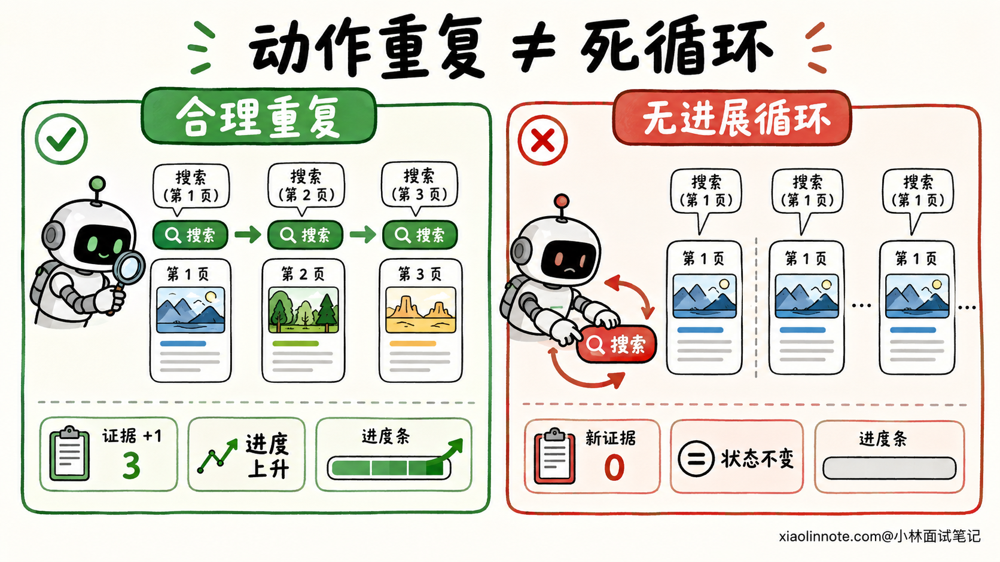
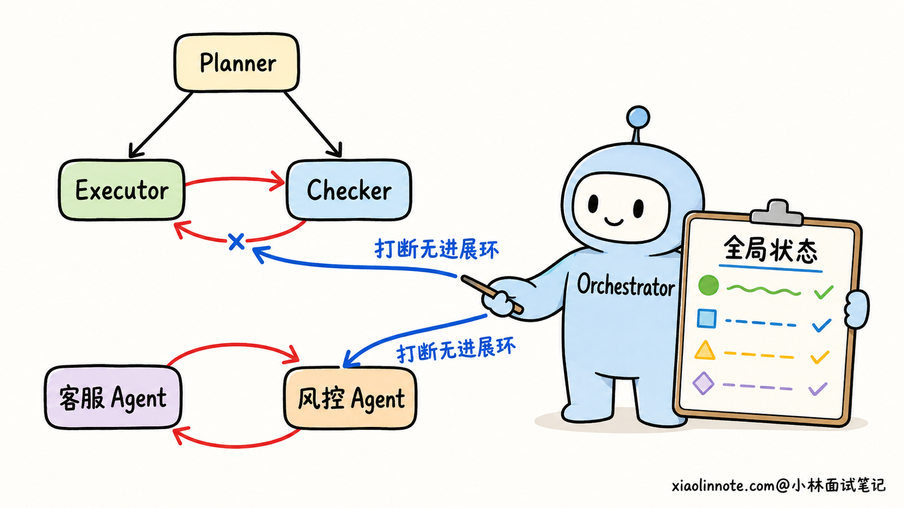
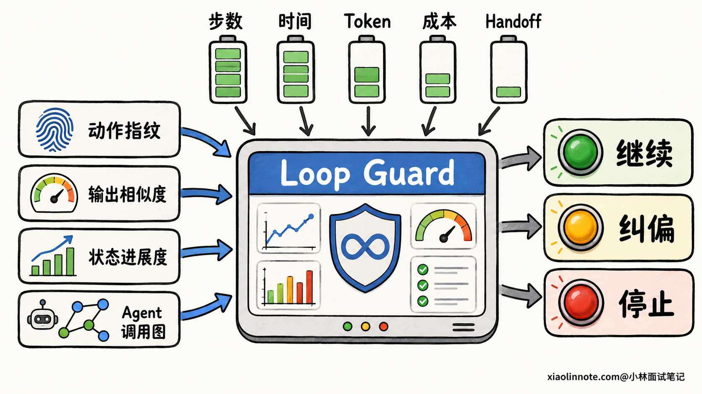
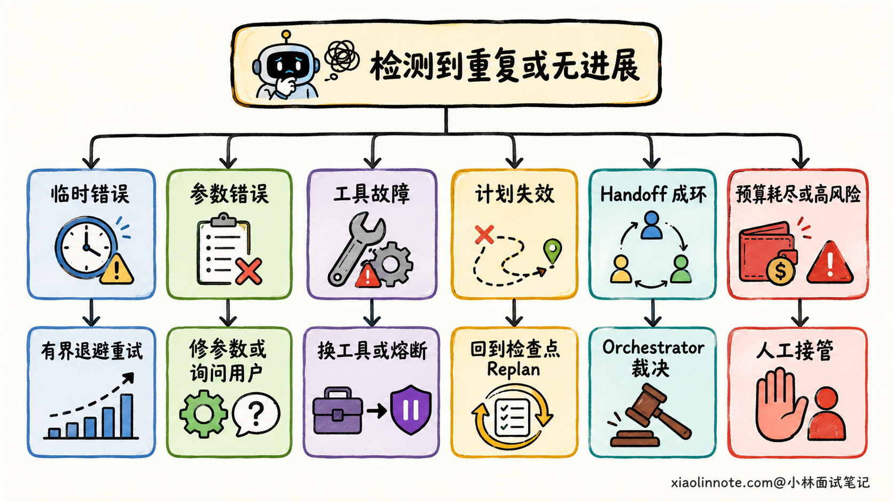

# Agent 为什么会出现路径震荡、重复调用和死循环？怎么检测和治理？

> 原文：[Agent 为什么会出现路径震荡、重复调用和死循环？怎么检测和治理？](https://xiaolinnote.com/ai/agent/20_loop_stability.html) · 小林面试笔记

👔面试官：Agent 执行任务时，一直重复搜索或者在几个 Agent 之间来回交接，你怎么处理？

🙋‍♂️我：给 ReAct 循环设一个最大步数，超过就终止。

👔面试官：最大步数只能兜底。一个原本需要较多步骤的深度研究任务，可能会被你提前杀掉。你怎么在资源耗尽前发现它在空转？

🙋‍♂️我：记录每次的工具名和参数，只要连续几次一样就当成死循环。

👔面试官：也不够。接口限流后的有界重试，调用可能完全相同，但它属于合理容错。反过来，Agent 每次只改一个搜索词，参数都不同，却可能始终没找到新证据。你该看什么？

🙋‍♂️我：还要看工具输出和任务状态有没有变化，判断整个任务是否有进展。

👔面试官：这才是关键。检测到无进展之后，也不能只会终止。合理重试、换参数、换工具、重新规划和人工接管，分别在什么情况下触发？

这道题考的是，你能不能把 Agent 的「一直在忙」和「任务在推进」分清楚。

## 💡 简要回答

Agent 出现路径震荡，常见原因是目标和停止条件模糊，工具失败后只返回空结果，任务状态没有随执行结果更新，或者多 Agent 的职责边界不清，交接时形成 A -> B -> A 的循环。

我会在调度层记录每一步的 Agent、工具、标准化参数、结果摘要和执行前后的状态。检测时结合动作指纹、输出相似度、状态变化和 Agent 调用图，并用步数、时间、Token、成本和交接次数作为全局预算。单纯动作重复只是预警，「状态长时间没有向完成标准推进」才是更可靠的循环信号。

触发预警后，我会先区分临时性错误和无进展循环。临时性错误走有界重试和退避；参数或权限错误直接修正或询问用户；执行路径没有进展时，禁用当前失败路径，改用其他参数或工具，必要时从检查点重新规划。预算耗尽或风险越界后，系统停止自动执行，将已完成结果、卡点和可选方案交给用户或人工处理。

## 📝 详细解析

### 路径震荡到底是什么？

想象 Agent 正在帮用户订会议室。它发现 A 会议室已被占用，于是又查了一遍 A；查不到新结果，便把任务交给日程 Agent；日程 Agent 认为订会议室应该由会议室 Agent 处理，又把任务送了回去。日志不断增长，工具也一直在调，但「订好一间可用会议室」这个目标始终没有推进。

这种现象可以分成三个程度。「重复调用」指同一个工具和近似参数多次出现；「路径震荡」指 Agent 在几条路径之间来回切换，比如搜索 -> 总结 -> 再搜索，或 A -> B -> A；「死循环」则是系统缺少有效出口，在外部预算耗尽前无法自己停下。

三者有关联，但不能只凭「动作又出现了」就下结论。搜索 Agent 正在分页拉取数据，工具名每次相同，但页码和已收集证据在变，任务有进展。接口第一次返回限流，系统按错误类型等待后再试，也是合理容错。

无进展循环的关键特征，是新一轮没有带来新证据、没有完成新子任务，也没有缩小与成功标准的差距。检测时要同时看「做了什么」和「状态变了什么」。

### Agent 为什么会原地打转？

第一类问题出在「什么算完成」。用户说「帮我查一下合适的会议时间」，系统却没有定义要返回几个可用时段，是否需要所有人都有空，工具查不到满足条件的结果时又要怎么退出。Checker 没有可执行的验收标准，只能不断让 Executor 「再试一下」。

第二类问题出在工具反馈。超时、限流、参数错误和权限拒绝如果都被包装成一句「调用失败」，模型就不知道失败是否值得重试，更不知道该改参数、换凭据还是换工具。它最容易继续输出上一个动作。

第三类问题出在状态。工具明明已经成功，系统却没有把已完成步骤、新证据和外部副作用写回状态，下一轮模型仍然以为「这件事还没做」。如果邮件发送、扣款、建群这类有副作用的工具缺少幂等键，重复调用还会再次改变外部系统，风险比多花一些 Token 大得多。

第四类问题出在路由。多 Agent 都只能看到自己的局部任务，客服 Agent 认为需要风控 Agent 批准，风控 Agent 又认为资料不齐，应该交回客服 Agent 补充。两边都没有全局决策权，交接图上就出现了环。同样的问题也会出现在 Planner 和 Executor 之间，原计划已被工具结果证明不可行，Planner 却没有改计划版本，Executor 便一直执行过时步骤。

### 怎么在运行中发现无进展循环？

检测要从「动作、结果、状态、路径」四个角度同时看，单一信号容易误判。

先看动作。每一步可以生成一个「动作指纹」，把当前子任务、Agent 名称、工具名和标准化后的参数组合再取哈希。标准化很重要，参数键的顺序变了，或搜索词多了一个空格，不应该被当成全新动作。指纹在近期窗口里反复出现时，系统先打上预警标记。

再看结果和状态。文本工具可以比较结果摘要的完全一致性或语义相似度，结构化工具更适合直接比较关键字段。任务状态则要看已完成步骤是否增加，待办集合是否缩小，是否拿到了新证据，阻塞原因是否发生变化。如果动作相似、输出也相似，任务状态又没有推进，循环判断才有足够证据。

然后看路径。系统可以把一次任务的调用链画成有向图，节点是 Agent 或工具，边是调用或 Handoff。A -> B -> A 只能说路径上出现了环，还要检查回到 A 时任务状态有没有更新。审核 Agent 要求修改，执行 Agent 修改后再交回审核，这条环可能是正常的；审核意见没有新内容，文档也没变，这条环才需要被打断。

最后加全局预算。系统在任务开始时分配最大步数、执行时间、Token、成本、单工具重试和 Handoff 次数。这些限额不是循环根因诊断，而是防止问题无限放大的保险丝。简单查询和深度研究不能共用一组数字，阈值要通过离线轨迹回放和线上数据按任务类型校准。

### 检测到之后，怎么把 Agent 拉出来？

第一步不是立刻换模型，而是读懂上一步失败。工具应该返回结构化错误，至少包含错误码、错误类型、是否可重试、建议等待时间和可行的下一步。网络抖动、限流这类临时性错误，可以在预算内按退避策略重试，并加入随机抖动避免同一时间集中重试。参数错误、权限不足和资源不存在需要换参数、请求用户授权或补充信息，继续原样重试没有意义。

第二步是换路。当前动作可以改参数时，系统要说清楚上次为什么失败，并要求新动作和旧动作有实质差异。当前工具的能力边界不匹配时，换备选工具或降级到能完成部分目标的路径。一个工具在连续多个任务中都失败，调度层可以暂时打开熔断器，快速拒绝后续调用，避免每个 Agent 都在同一个故障上浪费预算。

第三步是 Replan。如果单个动作换了参数和工具仍无法推进，问题往往在原计划本身。系统从最近的检查点恢复，把原始目标、已完成结果、当前阻塞和已尝试路径交给 Planner，让它生成一份新的剩余计划。新计划应该有新版本，并把已证明无效的路径写入约束，否则 Replan 只是用更多 Token 再生成一遍旧计划。

多 Agent 的 Handoff 环需要 Orchestrator 介入。它读取各 Agent 的职责、已访问路径和全局任务状态，决定是改派给有处置权的 Agent，还是暂停并请用户补充信息。Agent 的交接目标和接收条件也要写进路由规则，不能让两个角色随意把任务踢给对方。

### 系统要在循环发生前做什么？

最省成本的治理发生在第一次执行之前。每个子任务都要同时定义输入、预期输出、完成标准和失败出口。「查找有用信息」没有办法验收，改成「找到支持结论的可核验证据，若指定来源无结果则返回缺失项」，Checker 才知道什么时候可以停。

状态更新也要成为执行协议的一部分。工具成功后，调度层要在一个事务中记录结果标识、已完成步骤和对外部系统的影响。有副作用的工具要用任务 ID 和动作 ID 生成幂等键，业务系统根据幂等键识别重复请求。即使 Agent 因为超时没拿到响应而重试，同一个动作也不会反复产生副作用。

路由层要限定职责边界。每个 Agent 写清接收条件、可交接对象和交接前必须附带的事实。能用确定性状态机表达的主流程，就由代码控制路由；只把没有固定规则的边缘决策交给模型，可以减少无意义的来回交接。

还要把每步的输入、输出、错误、状态增量、路由决策和预算消耗写进 Trace。线上警报告诉你「某类任务开始空转」，完整 Trace 才能说明是工具反馈、状态写回还是路由规则出了问题。修改策略后，把这条失败轨迹加入回归集，检查新策略能否打断循环，也要检查它会不会误伤正常的长任务。

## 🎯 面试总结

回答这道题时，先说判断标准：动作重复不等于死循环，任务状态长时间没有向完成标准推进，才是需要治理的无进展循环。

成因可以沿执行链条往下排查：目标和停止条件是否可验收，工具有没有返回可操作的错误，执行后状态是否及时更新，计划是否过时，多 Agent 交接图里是否出现了无进展环。

检测时用动作指纹找重复，用输出相似度和状态差分确认有没有进展，用调用图发现 Handoff 成环，再用步数、时间、Token 和成本预算做最后止损。阈值要按任务类型设置，不能把一组经验数字用在所有任务上。

治理时先区分错误类型，临时性错误才走有界退避重试，无进展时换参数、换工具或 Replan。系统到达风险和预算边界后要停止自动执行，保留检查点、已完成结果和失败原因，让用户或人工可以接着处理，而不是只返回一句「超过最大步数」。

---
