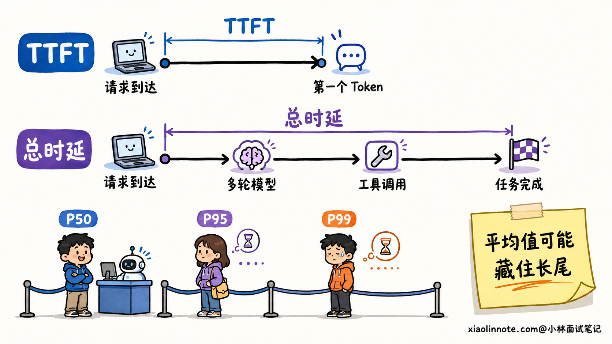
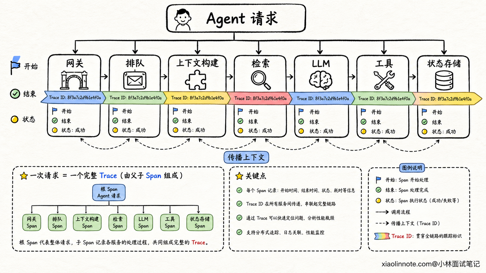
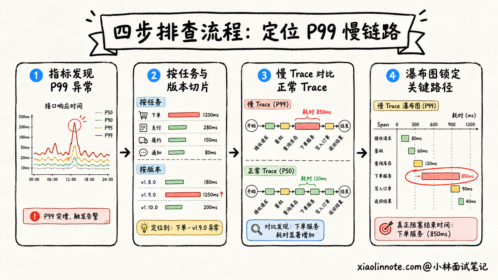
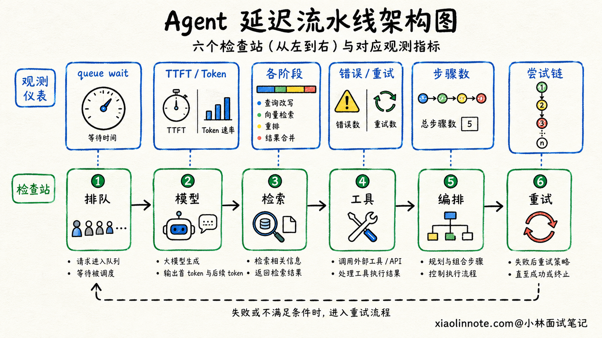
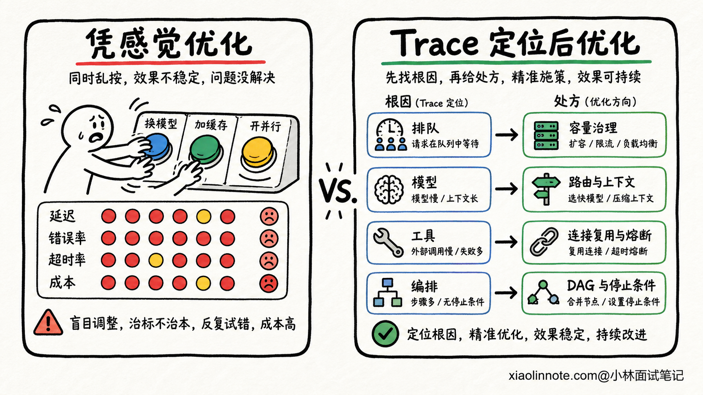
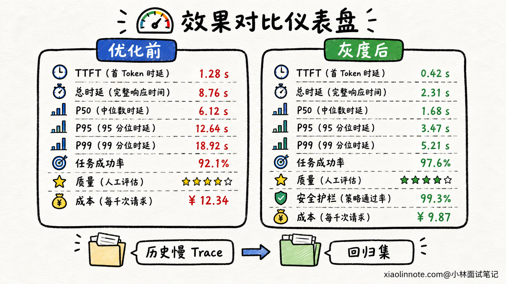

# 线上 Agent 延迟明显升高时，如何通过 Trace 定位和优化？

> 原文：[线上 Agent 延迟明显升高时，如何通过 Trace 定位和优化？](https://xiaolinnote.com/ai/agent/21_agent_latency_trace.html) · 小林面试笔记

👔面试官：线上 Agent 的响应突然变慢，你会怎么定位？

🙋‍♂️我：Agent 最耗时的就是大模型调用，我先换一个更快的模型。

👔面试官：如果真正变慢的是工具接口排队，换模型不但没用，还可能影响效果。你连时间花在哪里都不知道，怎么能先改模型？

🙋‍♂️我：那我先看接口的平均响应时间，平均值上涨就说明服务确实变慢了。

👔面试官：大部分请求都很快，少量请求慢几十秒，平均值可能看不出来。用户抱怨的往往正是尾延迟，你不看 P95、P99，也不区分首字等待和完整任务耗时吗？

🙋‍♂️我：那就给每个环节记一下开始和结束时间，找到最慢的环节，再把它改成并行执行。

👔面试官：有依赖关系的步骤不能强行并行，多个并行 Span 的耗时也不能直接相加。你得先还原一次请求的完整链路，找到关键路径，再判断是排队、模型、检索、工具、编排还是异常重试导致的。

排查 Agent 延迟，最怕一上来凭感觉优化。正确思路是先把一次任务「拆开看」，再沿着真正拖慢结果的路径动手。

## 💡 简要回答

我会先确认慢的是 TTFT，也就是用户多久看到第一个 Token，还是总时延，也就是任务从接收到完成一共用了多久。然后按任务类型、模型版本、工具、租户和发布时间切分 P50、P95、P99，先判断是整体都变慢，还是只有少量长尾请求出问题。

接着，我会用同一个 Trace ID 串起网关、排队、上下文构建、检索、模型调用、工具调用、编排决策和最终生成。每个环节建独立 Span，记录耗时、状态、重试次数、输入输出规模、Token 数和错误类型，但不直接记录密码、完整提示词等敏感内容。

定位时先用指标圈定异常范围，再抽取慢 Trace 和正常 Trace 做对比，从瀑布图里找关键路径。重点看排队时间是否上涨，模型 TTFT 或生成速度是否变化，检索和工具是否出现长尾，Agent 步数和重试次数是否膨胀，以及原本能并行的步骤是否被串行执行。

优化要对症下药。排队问题做容量和并发治理，模型问题从路由、上下文、输出长度和缓存入手，检索与工具问题考虑连接复用、缓存、批量和安全并行，编排问题则减少无效步骤、重复调用和过度反思。修改后通过历史轨迹回放、灰度和分位数对比验证，同时守住任务成功率、答案质量、安全和成本，不能只把耗时压下来就算成功。

## 📝 详细解析

### 先别急着看 Trace，得先说清楚「慢」是什么

用户说 Agent 变慢，可能指的是两件完全不同的事。

第一种是页面迟迟没有内容，用户一直面对空白。这更接近 TTFT，也就是从请求发出到第一个 Token 到达的时间。网关排队、上下文构建、首轮检索、模型服务排队和模型预填充，都可能把 TTFT 拉长。

第二种是很快就开始输出，但 Agent 调了很多轮工具，迟迟不能把任务做完。这时 TTFT 可能正常，总时延却很高。模型生成速度、工具调用、Planner 决策、失败重试、反思次数和任务步数，都会影响总时延。

所以我不会用一个「响应时间」概括所有问题，而是至少同时观察 TTFT 和端到端总时延。对于有多个工具步骤的任务，还会记录每一步完成时间和整个任务完成时间。

只看平均值也容易被骗。假设 90 多个请求只用两秒，少数请求用了几十秒，平均值看起来可能还能接受，但命中慢请求的用户已经等得很难受。P50 可以帮助观察典型请求，P95 和 P99 更适合发现尾部请求是否恶化。具体关注哪个分位数，要结合流量、任务类型和业务承诺来定，不能照抄一套固定阈值。

还要先确认比较口径。简单问答和深度研究任务不能放在一起统计，新模型版本和旧版本也不能混着看。我通常会按任务类型、模型与供应商、工具、地区、租户、输入长度、输出长度和发布版本切片。只有同类请求之间对比，才能判断延迟上涨到底来自系统变化，还是最近恰好来了更多复杂任务。

### 一条 Agent Trace 应该长什么样？

普通接口可能只有一次数据库查询和一次下游调用，Agent 却是一条动态执行链。同样一句用户请求，这次可能只调用一次模型，下次也可能经过检索、规划、三个工具和两轮反思。只看应用日志，很难把散落在各服务里的记录拼回同一个任务。

Trace 的作用，就是给一次端到端任务建立一份完整的「病例」。根 Span 表示整个 Agent 请求，下面再拆出网关鉴权、调度排队、上下文构建、检索、模型调用、工具调用、状态存储和结果整理等子 Span。一个 Span 代表其中一段具体操作，应该记录开始与结束时间、成功或失败状态，以及能帮助诊断的属性。

同一条链路中的 Span 要共享 Trace ID，每个 Span 自己再有 Span ID，并保存父子关系。Agent 调用远程工具、消息队列或子 Agent 时，还要传播 Trace 上下文。这样跨进程、跨服务以后，后端才能知道这些操作属于同一次任务，而不是一堆互不相干的日志。

如果存在异步执行或一个任务由多个上游共同触发，单纯父子树不一定能表达全部因果关系，可以再用关联信息把相关 Span 连起来。业务里的任务 ID、会话 ID 和调用 ID 可以作为关联 ID 保留，方便从工单或会话反查链路，但它们不能替代 Trace ID 和 Span ID 的父子关系。

Span 里记录什么，决定了以后能不能找到问题。模型调用除了耗时和状态，还可以记录模型名称、输入与输出 Token 数、首个 Token 到达时间和结束原因。检索环节记录 Query 类型、召回数量和各阶段耗时。工具环节记录工具名、结果状态、错误类型和重试次数。编排环节记录当前步骤、路由结果、计划版本和累计步数。

但可观测性不是把所有内容原样塞进日志。完整 Prompt、用户原文、数据库结果、工具凭证和个人信息可能包含敏感数据。更稳妥的做法是记录长度、哈希、分类标签和脱敏后的摘要，并配合访问控制、保存周期和审计策略。排查性能不能以制造数据泄漏为代价。

流量很大时，Trace 还会涉及采样。如果只在请求刚进入系统时随机抽样，罕见的超慢请求和错误请求可能刚好被漏掉。工程上可以结合错误状态、业务重要性和完成后的总耗时保留更有诊断价值的 Trace，同时通过普通样本维持整体代表性。采样比例同样要按流量与存储成本校准，不应该背一个固定数字。

### 从告警到根因，定位顺序不能反过来

收到延迟告警后，我不会先随机点开一条 Trace。单条请求只能说明一个故事，不能证明整个系统发生了什么。

第一步是用指标确认异常边界。我要看 TTFT 和总时延从什么时候开始上涨，是 P50、P95 还是 P99 上涨，成功率和超时率有没有一起变化。然后按模型、工具、任务类型和发布版本切分，找出变化最明显的那一组。如果延迟上涨正好和一次发布、模型切换或下游服务异常在时间上重合，这些信息会成为后续排查的方向。

第二步才是选取慢 Trace。不能只看最慢的一条，而要从异常分组里抽取多条慢 Trace，再找同类型、同版本的正常 Trace 做对照。这样才能判断慢请求共有的特征，是都卡在某个工具，还是都比正常请求多跑了几轮模型。

第三步看瀑布图和关键路径。瀑布图会把各 Span 按时间铺开，最长的 Span 值得关注，但真正决定总时延的是「从请求开始到任务完成的关键路径」。两个工具并行执行，各自耗时三秒，对总时延的贡献通常接近三秒，而不是六秒。因此不能把所有子 Span 的耗时简单相加，也不能看到某个 Span 很长就认定它一定是根因。

最后才下钻到 Span 对应的日志、错误和资源指标。比如模型 Span 变慢，要继续确认是客户端连接、供应商排队、首 Token、生成速度还是输出变长；工具 Span 变慢，要看下游接口、连接池、数据库和重试；应用内部计算变慢，则可能还要看 CPU、内存和线程池。Trace 负责告诉你「哪一段可疑」，日志和指标负责继续解释「为什么可疑」。

### 六类常见瓶颈，Trace 上分别怎么看？

第一类是排队。请求还没进入真正的模型或工具调用，调度队列里的等待时间已经变长。这通常和突发流量、并发上限、线程池耗尽、租户争抢资源或下游限流有关。如果没有单独的 queue Span，排队时间很容易被算进模型耗时，最后把锅甩错地方。

第二类是模型调用。这里要把网络连接、服务端等待、TTFT 和持续生成分开看。TTFT 上涨但输出速率正常，可能是服务排队、输入上下文变长或预填充变慢；首 Token 很快但总时延变长，可能是输出变长、生成速率下降，或模型后面又触发了更多步骤。流式输出只能改善用户感受到的等待，不会自动缩短任务真正完成的时间。

第三类是检索。一次 RAG 可能包含 Query 改写、Embedding、向量召回、关键词召回、Rerank 和文档读取。只建一个名叫 retrieval 的大 Span，发现它慢了也不知道该改哪里。拆开后才能看出是向量库长尾、Rerank 变慢，还是一次请求召回和读取了过多文档。

第四类是工具。第三方接口、数据库、浏览器和代码执行环境的延迟特征都不一样。除了单次耗时，还要关注超时、错误码、重试次数、返回数据大小和冷启动。同一个工具被连续调用多次，也可能不是工具自身慢，而是 Agent 没有正确利用上一次结果。

第五类是编排。单个 Span 都不算慢，整条 Trace 却非常长，这时要检查步骤是不是膨胀了。Planner 是否把简单任务拆得过细，反思机制是否反复推翻正确结果，路由是否在多个 Agent 之间绕路，原本没有依赖的工具是否被逐个串行调用，这些问题都会让总时延累积起来。

第六类是重试。失败调用本身可能只花一秒，但如果默认重试多轮，并且每轮都有退避等待，总时延就会突然拉长。Trace 要把每次尝试单独记录，并保留它们属于同一个逻辑调用的关系。这样既能看到第一次为什么失败，也能算清重试到底付出了多少时间。

### 找到瓶颈之后，怎么优化才不会治错病？

如果瓶颈在排队，就先解决容量和流量治理。可以根据实际负载扩容，隔离不同优先级或不同租户的工作负载，设置并发上限、背压和准入策略。请求携带端到端截止时间后，下游就不用继续执行一个已经来不及返回的任务。这里不能只靠无限加机器，如果流量进入速度长期高于处理速度，队列迟早还会堆满。

如果瓶颈在模型，可以根据任务难度做模型路由，让简单分类、改写和格式校验交给更轻的模型，把复杂推理留给能力更强的模型。上下文里重复且稳定的部分可以利用缓存，动态内容则要裁掉无关信息。还可以约束不必要的超长输出，合理使用流式传输改善 TTFT。切换模型或缩短上下文后，必须重新验证任务质量，不能拿正确率换一张漂亮的延迟图。

如果瓶颈在检索和工具，独立调用可以安全并行，有明确批量接口时优先合并请求，高频且时效要求允许的结果可以缓存。连接复用、索引优化、返回字段裁剪和减少无意义的大结果，也能降低单次耗时。下游持续异常时要有超时、熔断和降级路径，避免每个请求都等到最后一刻才失败。

如果瓶颈在编排，就要回到执行轨迹。没有依赖的子任务可以用 DAG 并行调度，有依赖的步骤仍然保持顺序。Planner、Executor 和 Reviewer 之间要有清楚的完成标准与停止条件，避免每轮都重新规划。系统还应该设置步数、时间、Token 和重试预算，发现连续步骤没有带来新结果时及时换路或停止。

重试优化最容易被误解成「少重试几次」。正确做法是先按错误类型判断是否值得重试。网络抖动和临时限流可以在总截止时间内做有界退避，并加入随机抖动；参数错误、权限不足和资源不存在，原样重试没有意义。对于有副作用的工具，还要使用幂等键，避免超时重试导致重复扣款、重复发消息等事故。

### 优化完成后，怎么证明真的有效？

优化不能以「我试了几次感觉快了」收尾。上线前可以先把历史慢 Trace 和典型任务整理成回放集，在相同输入和环境下比较修改前后数据。除了端到端时延，还要比较各阶段 Span 对关键路径的贡献，确认下降来自预期环节，而不是因为某个步骤被意外跳过。

上线时采用灰度或受控实验，继续按同一口径观察 TTFT、总时延以及 P50、P95、P99。平均值下降但 P99 上升，说明尾部用户可能反而更差；TTFT 下降但任务总时延和超时率上涨，也不能算完整成功。阈值应该根据业务基线、流量规模和服务目标确定，不编造一组适用于所有 Agent 的秒数。

延迟之外还要设置护栏。任务成功率、答案质量、工具执行正确率、安全违规率和单任务成本至少不能出现不可接受的退化。比如减少检索文档确实能提速，但如果答案依据不够，优化就走偏了；把五轮验证砍成一轮可能缩短时间，却也可能放过错误结果。

最后，把这次异常对应的任务切片、慢 Trace 特征和根因加入监控与回归集。下次相同问题出现时，系统可以更快告警，团队也能直接从已经验证过的定位路径开始排查。一次性能优化真正留下来的，不应该只有一段更快的代码，还应该有可复现的证据和不会轻易反弹的守护机制。

### 面试时容易踩哪些坑？

第一个坑，是一听到 Agent 慢就默认模型慢。Agent 是一条动态链路，排队、检索、工具、编排和重试都可能比模型更慢，必须让 Trace 先给出证据。

第二个坑，是只报平均响应时间。平均值适合看总体趋势，却可能掩盖少数特别慢的请求。回答时主动区分 TTFT、总时延和不同分位数，会比背一个平均值完整得多。

第三个坑，是找到最长 Span 就认为找到根因。并行 Span 会重叠，父 Span 也可能包含子 Span 的时间，所有耗时不能直接相加。应该沿关键路径判断哪个操作真正推迟了任务结束。

第四个坑，是用并行解决所有问题。只有没有依赖关系、共享副作用可控的步骤才适合并行。盲目并行可能压垮下游，还可能产生状态竞争和重复操作。

第五个坑，是优化后只验延迟。Agent 的目标是把任务正确、安全地做完。任何性能改动都必须与成功率、质量、安全和成本一起验收。

## 🎯 面试总结

回答这道题时，先把「慢」拆清楚：用户多久看到第一个 Token，看 TTFT；任务多久真正完成，看端到端总时延；典型体验和尾部体验，则分别结合 P50、P95、P99 判断。不要只报平均值，也不要编造适用于所有业务的固定阈值。

接着说明 Trace 怎么建。用 Trace ID 串起一次完整任务，用 Span 拆开排队、上下文、检索、模型、工具、编排和重试，并传播链路上下文。Span 里记录耗时、状态、规模、Token、步骤和错误信息，同时做好脱敏与访问控制。

定位顺序是先用指标圈定异常切片，再对比慢 Trace 和正常 Trace，然后沿瀑布图寻找关键路径，最后结合日志与资源指标确认根因。重点排查排队是否堆积、模型 TTFT 和生成是否变化、检索或工具是否出现长尾、Agent 步数是否膨胀，以及重试是否放大故障。

优化时要对症下药。排队问题做容量与背压，模型问题看路由、上下文、缓存和输出，检索与工具考虑批量、复用、缓存、熔断和安全并行，编排问题减少无效步骤并加好停止条件。最后通过回放、灰度和分位数对比验证，并用成功率、质量、安全和成本做护栏，这才是一套完整的 Agent 延迟治理方案。

---
