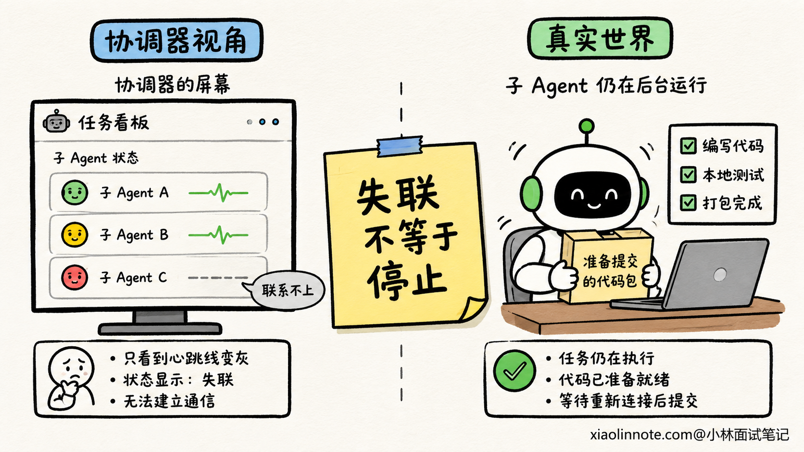
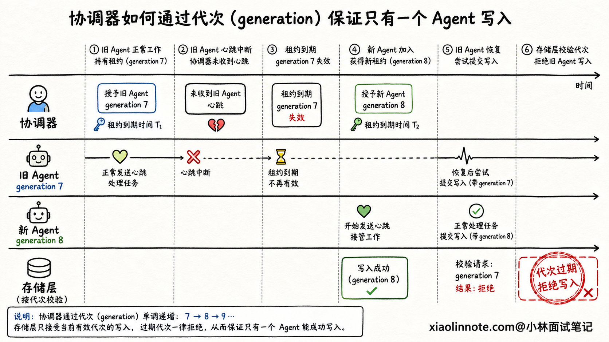
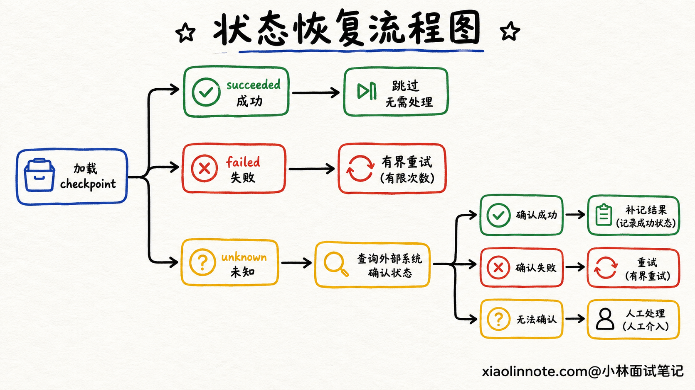
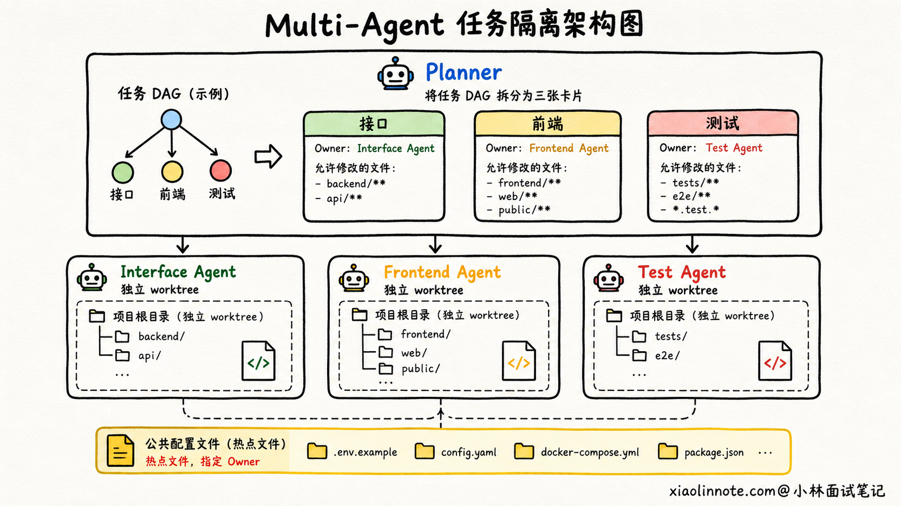
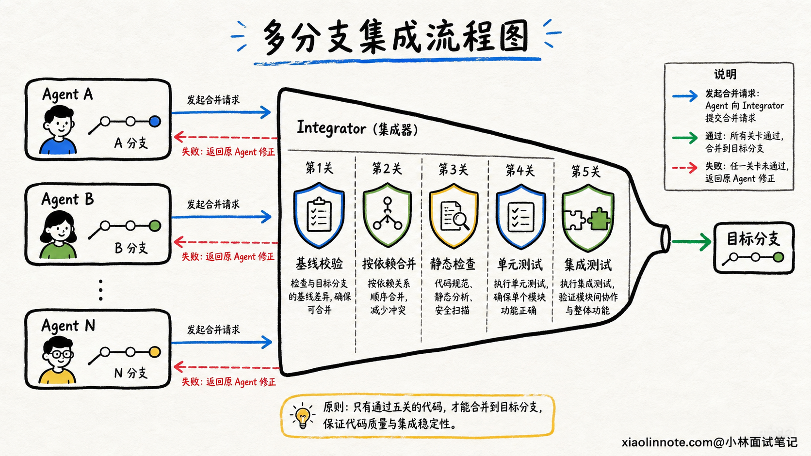

# Multi-Agent 系统如何处理子 Agent 超时、失联和并发修改冲突？

> 原文：[Multi-Agent 系统如何处理子 Agent 超时、失联和并发修改冲突？](https://xiaolinnote.com/ai/agent/22_multi_agent_resilience.html) · 小林面试笔记

👔面试官：一个子 Agent 执行任务时超时或失联了，你会怎么处理？

🙋‍♂️我：设一个超时时间，超过以后杀掉它，再启动一个新的 Agent 重跑任务。

👔面试官：旧 Agent 可能只是网络断了，实际上还在运行。新 Agent 接管以后，两个实例一起写数据怎么办？

🙋‍♂️我：那就给任务加分布式锁，同一时间只允许一个 Agent 执行。

👔面试官：锁可能过期，旧 Agent 也可能恢复后继续提交。而且多个 Agent 修改不同文件时全部串行，Multi-Agent 还有什么意义？

🙋‍♂️我：可以让每个 Agent 建一个 Git 分支，最后把所有分支合并到主分支，有冲突再解决。

👔面试官：没有文本冲突不代表逻辑正确。一个 Agent 改接口，另一个还按旧接口写调用方，Git 可能顺利合并，程序却直接坏掉。谁负责最终集成和验收？重试产生的外部副作用又怎么去重？

这道题真正想考的，不是你会不会写一个超时重试，而是你能不能让一群 Agent 在部分失败和并发执行时，仍然只把正确结果提交一次。

## 💡 简要回答

我会先把「通信问题」和「一致性问题」分开。心跳中断只能说明协调器暂时看不到子 Agent，不能直接证明它已经停止。任务分配时应该带租约和递增的执行代次，子 Agent 定期续租；租约过期后协调器才能安排接管，旧执行者即使恢复，也不能再用过期代次提交结果。

接管不能简单从头重跑。我会保存任务 checkpoint，记录已经完成的步骤、产物版本和外部副作用。重试使用稳定的任务 ID、步骤 ID 和幂等键，遇到结果未知的写操作先查询外部系统，再决定继续、补偿还是人工确认。连续失败时还要支持换模型、换工具、拆小任务和人工接管等降级路径。

多个 Agent 修改同一个仓库时，先按任务依赖和文件所有权尽量减少重叠写入，再让每个 Agent 在独立 worktree 或 branch 中工作。提交时校验基线版本，对普通文件采用乐观并发，对少数热点文件使用带租约的短锁。最终只有 Integrator 有权合入目标分支，它按依赖顺序合并，并运行静态检查、单元测试和集成测试。出现文本冲突或语义冲突时，把最新基线、冲突原因和失败测试交回对应 Agent 修正，而不是让多个 Agent 直接抢写主分支。

## 📝 详细解析

### 超时、失联和失败，真的是一回事吗？

先想一个场景。协调器让代码 Agent 修改支付模块，十分钟后没有收到回复。这时能不能直接宣布它失败？不能，因为至少有三种可能：模型调用确实卡死了，Agent 进程已经退出，或者 Agent 仍在执行，只是心跳消息没传回来。

前两种属于执行失败，最后一种更接近通信故障。协调器看到的是「暂时联系不上」，不是「旧执行者绝对不会再动」。如果这时直接派一个新 Agent 从头执行，旧 Agent 恢复网络后也可能提交，于是同一任务就有了两个执行者。

这也是 Multi-Agent 容错最容易踩的坑。系统一看到超时就重试，看起来可用性提高了，实际上把一次故障变成了重复写入、结果覆盖甚至重复扣款。

因此，系统至少要分别记录执行状态和通信状态。执行状态可以是 `PENDING -> RUNNING -> SUCCEEDED`，通信状态则记录最近心跳时间、租约到期时间和进程健康信息。两者不能混成一个简单的 `online` 字段。

### 为什么任务租约比永久锁更适合故障接管？

锁解决的是「现在谁能进门」，租约解决的是「这把临时钥匙到什么时候失效」。调度器把任务交给子 Agent 时，可以同时发出一份有期限的租约，里面至少包含 `task_id`、`worker_id`、`lease_expire_at` 和递增的 `generation`。

子 Agent 正常工作时定期发送心跳并续租。协调器在一两次心跳没有到达时只标记为可疑，不立即重派；超过租约和宽限期后，才把任务放回队列，并给新的执行者分配更大的 `generation`。

问题来了，旧 Agent 恢复后不知道自己已经过期，仍然提交结果怎么办？只靠锁的 TTL 挡不住它，因为旧进程可能早就进入临界区。更稳妥的做法，是让任务状态和产物存储都检查执行代次。旧 Agent 带着 `generation=7` 提交，而任务当前已经是 `generation=8`，存储层直接拒绝这次旧写入。这个递增代次也常被叫作 fencing token，可以理解为会失效的排队号码。

超时也不应该只有一个数字。模型首字延迟、工具调用超时、整个子任务预算和租约时长，代表的是不同边界。一个深度检索任务可能二十分钟都合理，但单次 HTTP 调用卡住二十分钟通常不合理。生产系统会为每一层分别设置软超时和硬预算，软超时用于取消当前动作或切换路径，硬预算负责终止整项任务并升级处理。

### 为什么重试一定要和幂等、checkpoint 一起设计？

超时以后直接重跑，最大的风险不是多花一点 Token，而是重复产生副作用。比如 Agent 已经创建了工单，只是成功响应在网络中丢失。调度器看到超时后重新执行，又创建了一张内容相同的工单。

所以每个可重试步骤都要有稳定身份。常见做法是用 `task_id + step_id + operation_type` 生成幂等键，同一个逻辑动作不管由哪个 Agent 接管，都携带同一个键。下游服务保存幂等键和第一次执行结果，后续重复请求直接返回原结果，而不是再次写入。

但并不是所有外部系统都支持幂等键。这时 checkpoint 就很关键。它不能只保存一句「做到第三步」，还要记录已完成步骤、输入版本、产物位置、工具调用编号、外部资源 ID，以及写操作当前是 `planned`、`succeeded`、`failed` 还是 `unknown`。

接管者遇到 `succeeded` 就跳过，遇到明确的 `failed` 才在预算内重试。遇到 `unknown` 不能凭感觉再执行一次，而要先按业务键查询外部系统。如果既无法查询，也无法幂等重放，就应该暂停并请求人工确认。

这里还有一个常见误区，给任务加幂等键不等于系统就能实现严格的「只执行一次」。网络故障下，执行方通常无法仅凭超时判断远端是否成功。工程上更现实的目标是允许「至少一次」投递，再通过幂等、唯一约束、结果查询和补偿，把最终副作用收敛到业务可接受的一次。

### 子 Agent 失效后，谁来接管任务？

租约到期只是允许接管，接下来还要决定怎么接。协调器应该先读取最近一次已提交的 checkpoint，而不是把原始 Prompt 原封不动地再发一遍。接管上下文要包含原目标、验收标准、已完成产物、当前阻塞、尝试过的路径和剩余预算。

如果只是某个工具暂时限流，可以由同能力 Agent 在退避后继续。如果模型多次无法完成同一步，可以换更强模型，或把任务拆成更小的确定性步骤。如果外部依赖不可用，可以返回部分结果并明确缺失项。如果任务涉及付款、删除、发布等高风险动作，且历史结果无法确认，就应该停止自动接管，转给人工。

接管也要限制次数。一个坏任务被十个 Agent 轮流接走，不叫高可用，只是把死循环扩大了。系统需要记录接管次数、连续失败类型和剩余预算；超过阈值后进入降级或人工处理，并保留完整 Trace，方便判断到底是工具故障、任务不可执行，还是模型能力不足。

### 多个 Agent 改同一个仓库，先别急着上锁

很多人看到并发修改，第一反应是「整个仓库加一把锁」。这样确实很安全，但所有 Agent 都排队干活，吞吐量也回到了单 Agent。

更好的第一步，是在规划阶段减少写集合重叠。Planner 不只要拆任务，还要为每个子任务标出预计修改的模块、文件和接口，并声明任务所有权与文件所有权。比如 Agent A 负责服务端接口，Agent B 负责前端页面，Agent C 负责测试。公共类型文件、依赖清单和全局配置属于热点资源，默认由一个明确的 Owner 修改。

这里要区分两种所有权。任务所有权回答「谁对这个子任务的最终结果负责」，文件所有权回答「当前阶段谁可以提交这个文件」。同一个任务可能修改多个文件，同一个文件也可能在不同阶段交给不同 Agent，但同一版本不能没有明确的写入者。

### worktree、乐观并发和锁应该怎么配合？

规划只能减少冲突，不能保证完全没有冲突。真正执行时，应该让每个 Agent 在独立的 Git worktree 或 branch 中工作，并记录开始时的 `base_commit`。这样 Agent A 的半成品不会污染 Agent B 的上下文，失败任务也不会在共享目录里留下难以识别的修改。

普通文件可以采用乐观并发。Agent 提交时，Integrator 比较它的 `base_commit` 和当前目标分支。如果相关文件没有变化，就尝试合并；如果已经被其他任务修改，就要求基于新版本重新应用补丁，或把冲突上下文交回原 Agent 修正。

少数高频热点资源，例如全局路由表、数据库迁移序号和依赖锁文件，可以加带租约的短锁。锁只保护真正不能并行的提交阶段，不应该覆盖 Agent 思考、生成代码和运行局部测试的整个过程。否则一个 Agent 调模型卡住，就会拖住所有任务。

需要注意，Git 只能发现文本层面的冲突，发现不了语义冲突。Agent A 把函数参数从字符串改成对象，Agent B 在另一个文件继续按字符串调用，两个分支可能自动合并成功，但代码已经不一致。接口契约、Schema、测试和静态分析，才是识别这类问题的第二道防线。

### 为什么必须有一个最终提交者？

多个 Agent 都能直接往主分支写，系统就很难回答「当前仓库状态由谁负责」。更稳妥的设计，是只有 Integrator 或 Orchestrator 拥有最终提交权，其他 Agent 只产出候选分支、补丁和验证证据。

Integrator 先按任务 DAG 和接口依赖确定合并顺序。例如先合入公共类型和服务端接口，再合入调用方，最后合入测试。每次合并后都运行格式检查、静态检查和受影响的单元测试，全部候选合并后再运行集成测试或端到端测试。

如果出现文本冲突，Integrator 不应该让模型随意选择一边，而要保留两边意图、最新基线和冲突文件，让负责该模块的 Agent 重新生成补丁。如果自动合并成功但测试失败，则把失败用例、相关 Trace 和接口变更一并交回。直到验收条件通过，才生成唯一的最终提交。

这也解释了为什么通信问题和一致性问题不能用同一个办法解决。心跳、租约和超时主要解决「谁还活着、谁可以接管」；幂等键、执行代次、版本校验和合并验收解决「多个执行者出现时，结果怎么保持一致」。给消息中间件加重试，能提高消息到达率，却不能自动解决重复副作用和代码语义冲突。

### 线上怎么判断这套机制有没有生效？

首先要让一项任务从分配到最终合并都有统一 Trace。Trace 里应该串起租约代次、心跳、每次执行尝试、checkpoint 版本、工具副作用、分支提交、冲突处理和测试结果。否则线上只看到「任务失败」，很难判断问题发生在失联、接管还是集成阶段。

指标也要围绕风险来设计。除了完成率和耗时，还可以观察租约过期率、误判失联率、平均接管次数、重复副作用次数、旧代次写入被拒绝次数、分支冲突率、自动合并后的测试失败率，以及从故障发生到恢复完成的时间。

最后要主动做故障演练。可以在测试环境中随机暂停心跳、延迟工具响应、让 Worker 在外部写入后崩溃，或让两个 Agent 修改同一接口。只有确认旧执行者无法覆盖新结果、接管者不会重复产生副作用、冲突代码无法越过验收门禁，这套容错机制才不只是写在设计文档里。

## 🎯 面试总结

回答这道题时，我会先指出：超时和失联只代表协调器暂时看不到子 Agent，不等于旧执行者已经停止。任务应该使用可续租的 lease 和递增执行代次，租约过期后才能接管，旧代次恢复后也不能覆盖新结果。

接管流程要依赖 checkpoint，而不是盲目从头重跑。每个步骤使用稳定的任务 ID、步骤 ID 和幂等键；外部写入结果不确定时先查询，无法确认时转人工。重试次数必须有界，并支持换 Agent、换工具、拆任务和部分降级。

并发修改代码时，先用任务所有权和文件所有权减少重叠，再用独立 worktree 或 branch 隔离工作区。普通文件通过基线版本做乐观并发，热点文件才使用短租约锁。Git 冲突只能发现文本问题，接口契约、静态检查、单元测试和集成测试还要负责发现语义冲突。

最后由唯一的 Integrator 按依赖顺序合并和验收。心跳与租约解决的是通信和活性问题，幂等、版本与最终提交者解决的是一致性问题。把这两层讲清楚，才算真正回答了 Multi-Agent 系统怎样在故障和并发下稳定运行。

---
