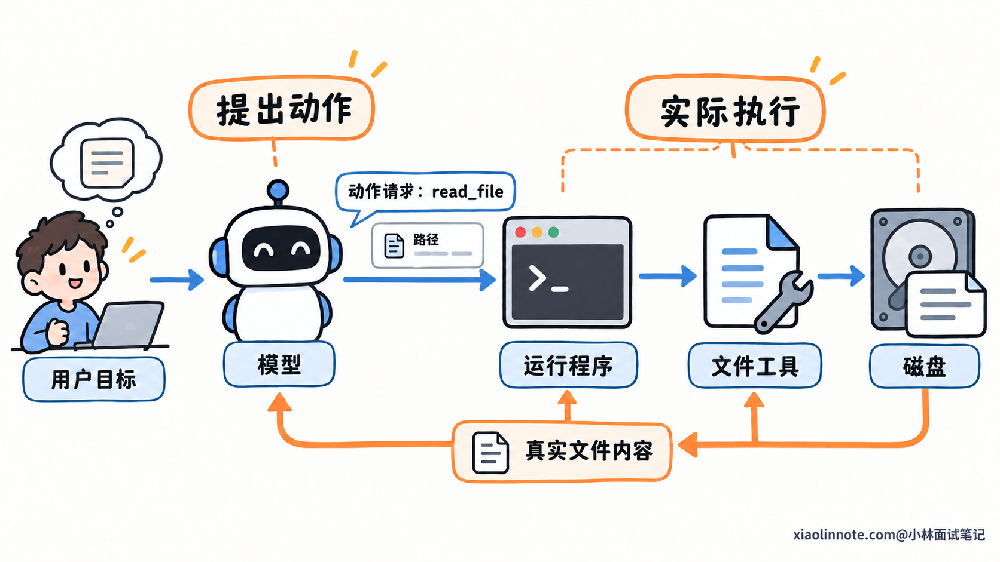
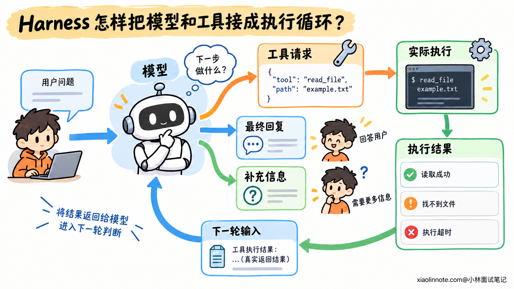
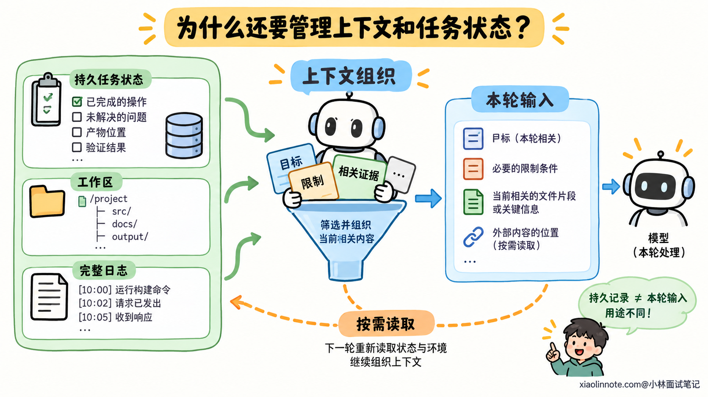
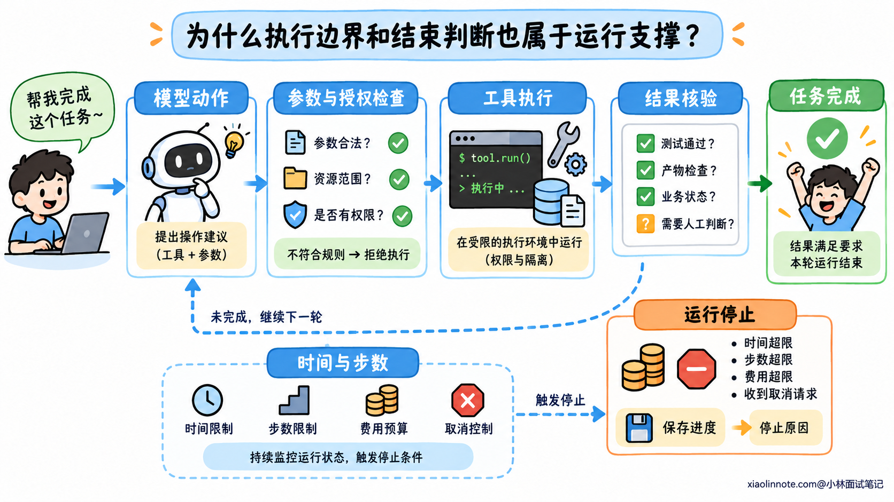
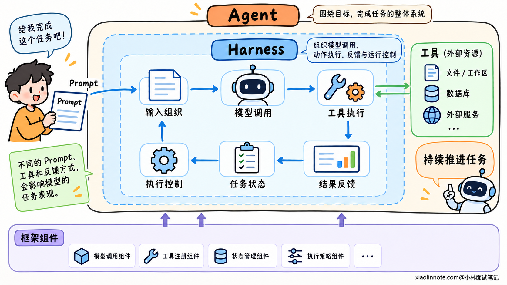

# Agent Harness 是什么？

> 原文：[Agent Harness 是什么？](https://xiaolinnote.com/ai/agent/25_harness.html) · 小林面试笔记


👔面试官：你提到 Agent Harness，讲讲它是什么？

🙋‍♂️我：就是给大模型接几个工具，模型就能自己完成任务了。

👔面试官：模型返回一个工具请求，谁真正执行它，又是谁把结果交回模型？

🙋‍♂️我：那就是写个循环，模型调用工具，一直跑到它说完成。

👔面试官：下一轮给模型看哪些材料，执行到一半中断以后，任务怎么继续？

🙋‍♂️我：这些交给 Agent 框架就行，用框架就等于有完整的 Harness。

👔面试官：框架提供哪些能力是一回事，任务实际怎样运行是另一回事。权限、进度和完成判断由谁负责？

咱们从一次模型调用讲起，逐步理解把模型接入真实任务需要哪些运行支撑。

## 💡 简要回答

Agent Harness 可以理解为围绕大模型的一套运行支撑，核心是组织模型调用和工具执行的循环，让模型能根据实际结果连续推进任务。

模型负责理解目标、判断下一步，输出回复或工具请求。Harness 接住这些输出，检查并安排实际执行，再把工具结果放进下一轮输入，继续调用模型。工具请求本身只是模型提出的动作，真正的文件读取、命令执行或接口调用，需要外部程序完成。

任务变长以后，Harness 还需要组织每轮上下文，并配合任务记录保存进度，让中断后的运行能够接上已有结果。它也会落实动作权限、运行预算和结束判断，避免只凭模型说完成就结束任务。

所以，模型提供理解与决策能力，工具提供具体操作，Harness 把它们组织成可持续运行的任务过程。框架可以提供这些组件，也可能直接封装好运行机制，具体要看它实际包含什么能力。

## 📝 详细解析

### 一次模型调用，为什么还不等于任务执行？

大模型收到目标和材料以后，可以分析问题、提出计划，也可以生成下一步需要调用的工具。但是仓库文件、数据库和外部服务都在模型之外，模型输出了操作意图，这些对象不会因此自动发生变化。

例如模型输出「读取文件」，只是描述了一个动作。即使输出采用了结构化格式，包含工具名 `read_file` 和文件路径，它仍然是一个请求，需要程序找到对应实现，实际打开文件。

程序读取完成后，还要把内容交回模型。没有这个反馈，模型就不知道文件里实际写了什么，也无法根据新材料继续判断。

这里存在两种不同能力：模型根据输入选择动作，外部程序让动作发生，并提供实际结果。模型擅长分析，并不能替代程序访问文件或启动进程的能力。



因此，从模型推理走到 Agent 执行，需要在模型之外组织调用、动作和反馈。Agent Harness 所指的，就是围绕模型建立的这层运行支撑。它可以由开发者自己实现，也可以由已有 SDK 或系统提供。

这里的「支撑」不只指模型能够访问哪些工具，还包括程序怎样使用这些工具、怎样处理结果，以及怎样继续运行。理解了这一点，就不会把提供一个工具列表，当成整个任务执行机制已经完成。

### Harness 怎样把模型和工具接成执行循环？

一次工具执行只完成一个动作，而多步任务需要根据结果继续选择。Harness 的核心工作，就是安排这种连续的交接。

每一轮开始，运行程序准备当前输入，包括目标、约束、相关材料和可用工具说明，再调用模型。模型返回工具请求后，程序解析工具名和参数，进行必要检查，然后调用实际工具。

工具执行结束，程序取得结果，再按照模型接口的要求，把请求与结果放进后续输入。下一轮模型看到真实观察，才能决定继续使用工具、调整做法，还是给出最终回复。

这条过程可以概括为：

```text
准备输入 -> 调用模型 -> 处理模型输出 -> 执行工具
   ↑                                         ↓
   <-             纳入实际执行结果            <-
```

负责推进这个循环的是运行程序。模型根据当前信息选择下一步，程序安排下一次调用，并处理等待、取消、执行失败等情况。

**固定的是交接机制，具体动作可以根据观察变化。** 模型读到新的材料以后，可能需要补查信息，也可能发现原来的判断不成立。Harness 不必提前写死每一步使用哪个工具，但需要规定请求怎样解析、操作怎样执行、结果怎样返回。



反馈的内容会影响后续判断。工具返回「找不到文件」，与返回「读取成功但内容为空」，意味着不同事实；命令超时，也不能直接当成命令从未执行。运行程序需要尽量区分实际状态，避免模型基于含糊的成功或失败继续推理。

所以，Harness 的价值不只是多调用几次模型。它让每轮决策建立在前一次实际执行的结果上，把推理与环境变化接起来。

### 为什么还要管理上下文和任务状态？

循环运行以后，模型每轮收到的材料会逐渐增多。工具输出、历史分析和中间结果都可能很长，其中一些已经失效，一些暂时与当前步骤无关。

把全部历史持续拼进输入，既会接近上下文容量，也会让当前信息与旧信息混在一起。例如一个错误已经解决，后续出现了新问题，模型需要知道哪个结果是当前的，不能把旧报错继续当作现状。

因此，Harness 通常要在调用前组织上下文。保留目标、限制和当前相关证据，减少重复内容；较长的文件或日志可以存放在外部，只带必要内容和可读取的位置，后续再按需补查。

这个步骤决定的是「模型这一轮看见什么」。它与任务状态的保存有关，但用途不同。

任务状态记录的是「任务现在进行到哪里」，例如已执行的操作、未解决的问题、产物位置和验证结果。当前上下文则从这些记录和实际环境中选择本轮需要的信息。任务记录可以长期保存，每轮输入不必包含记录里的全部内容。



这种区分对暂停和恢复很重要。程序中断以后，不能只给模型一句「继续」，还需要读取进度，并核对当前产物。新一轮运行才能知道哪些操作已经完成、哪些结论还没有验证。

聊天里说「准备保存文件」，不代表文件已经保存；记录里写着「请求已发出」，也不代表外部系统已经成功处理。恢复时仍然要核对实际状态，才能决定是继续下一步，还是补查未决操作。

状态可以保存在文件、数据库或外部会话服务中，工具也可以运行在另一个执行环境。Harness 可以调用这些组件来组织任务，并不要求所有能力都放在同一个进程里。

简单任务可能只需要短循环和少量历史，长任务才更需要持久进度与恢复机制。理解 Harness 时，应看任务需要哪些运行支撑，而不是把一组复杂模块当成每种实现都必须具备的固定清单。

### 为什么执行边界和结束判断也属于运行支撑？

模型能够提出动作，不意味着每个动作都应执行。请求可能格式不正确，也可能访问不允许的资源，或者超过用户授权的范围。

Harness 需要在实际执行路径上落实约束，例如哪些工具可用、哪些文件能修改、什么操作需要确认。工具或执行环境再通过权限与隔离机制控制实际访问。Prompt 可以告诉模型遵守要求，真正阻止越界操作仍然需要程序检查与环境限制。

这并不要求程序判断每个动作的全部业务含义，但明确的权限边界不能仅依赖模型自觉遵守。模型提供操作建议，执行层决定请求是否满足运行规则。

持续运行还要有资源与停止控制。某个工具一直不返回，或者模型重复执行没有进展的操作，都需要处理。时间、步数和费用预算可以限制一次运行的消耗，取消请求也需要传递到对应执行过程。



这里要分清「运行停止」和「任务完成」。达到预算只说明这一轮不能继续，不能把任务标成成功；模型输出「完成」，也只是一个需要结合结果判断的结论。

对于有明确验收条件的任务，运行系统可以通过测试、产物检查或业务状态查询提供依据。有些结果需要人判断，也可以保存产物并交给人审查。验证能力取决于任务，Harness 负责组织判断所需的过程与信息，不会自动知道所有业务结果是否正确。

这层控制让执行循环有明确边界，也让最终结果有可追溯依据。工具成功、模型认为完成、任务满足要求，是不同层面的判断，需要在运行过程中区分。

### Harness 与模型、Prompt、工具和框架是什么关系？

这些概念容易混在一起，是因为它们通常出现在同一套产品中。但从承担的职责看，可以分别理解。

模型负责处理输入、生成判断与下一步输出。Prompt 是模型收到的指令与要求，会影响它怎样理解目标和使用工具。工具则提供真实操作，例如查询数据、读取文件或调用接口。

Harness 组织这些部分怎样配合：选择和准备输入，调用模型，处理输出，安排工具执行，再把结果用于下一轮。Prompt 的装配、工具的接入和相关运行策略，都可以是 Harness 的一部分。

所以，这些词不是互相排斥的模块名称。一个 Harness 可以预置提示和工具，也可以让使用者替换它们；它还可以把存储与执行交给外部服务，再负责协调这些服务。

| 名称 | 在任务中的主要作用 |
| --- | --- |
| 模型 | 理解材料，形成判断，生成下一步输出 |
| Prompt | 向模型表达目标、约束与行为要求 |
| 工具 | 提供文件、数据和外部系统的实际操作 |
| Harness | 组织模型调用、动作执行、反馈与运行控制 |
| Agent | 模型与运行机制配合后，围绕目标工作的整体系统 |



框架或 SDK 与 Harness 的关系，则取决于封装范围。通用框架可能提供模型调用、工具注册和状态组件，开发者用它们搭建运行机制；已经预置循环、上下文处理和执行策略的 SDK，本身就可以提供 Harness 能力。不能只凭使用了某个框架，就判断任务运行的所有问题已经解决。

不同项目对 Harness 的具体范围有不同叫法，理解时抓住它围绕模型组织实际执行的职责即可。

同一个模型，拿到的材料、可用的操作和反馈方式不同，任务表现也可能不同。模型决定怎样分析当前信息，Harness 则影响它能看见什么、能执行什么，以及怎样根据结果继续工作。

## 🎯 面试总结

开头只接工具，漏掉了实际执行与反馈；只写循环，没有说明上下文、进度和运行边界；只提框架，则没有回答这些职责怎样在系统中落实。

Agent Harness 的核心，是围绕模型组织调用、工具执行和结果反馈。任务变长以后，再通过上下文组织与任务记录支撑持续推进，并在执行路径上落实权限、预算和结束判断。

模型提供理解与决策，工具提供实际操作，Harness 协调它们如何运行。这层分工说明了 Harness 为什么会影响 Agent 能看到的材料、能执行的动作，以及持续推进任务的能力。

---
