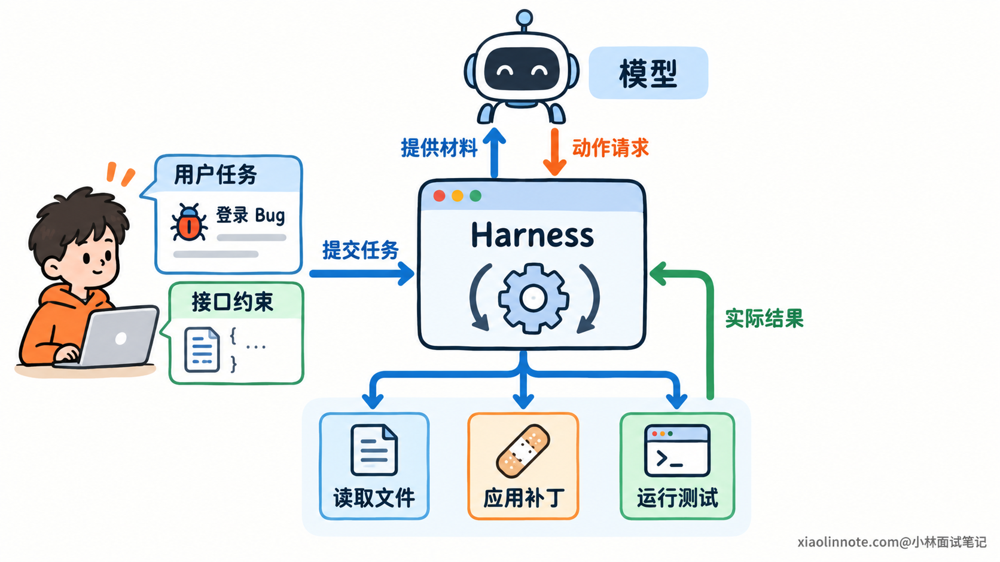
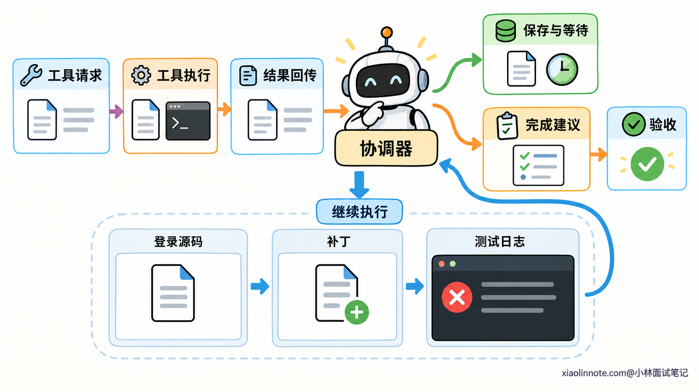
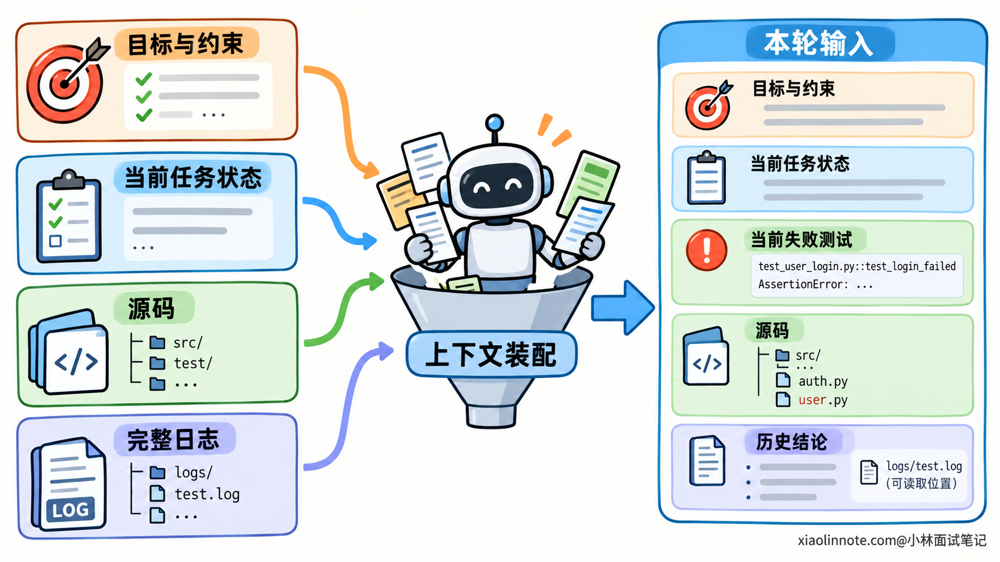
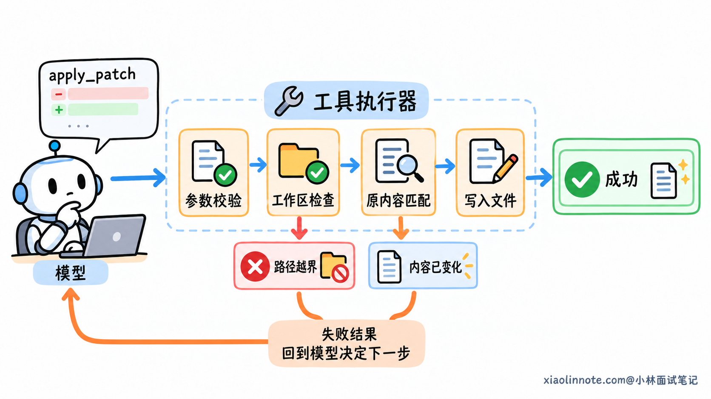
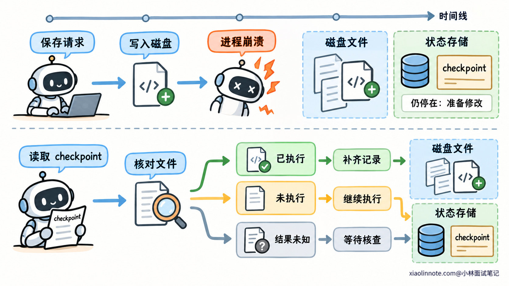
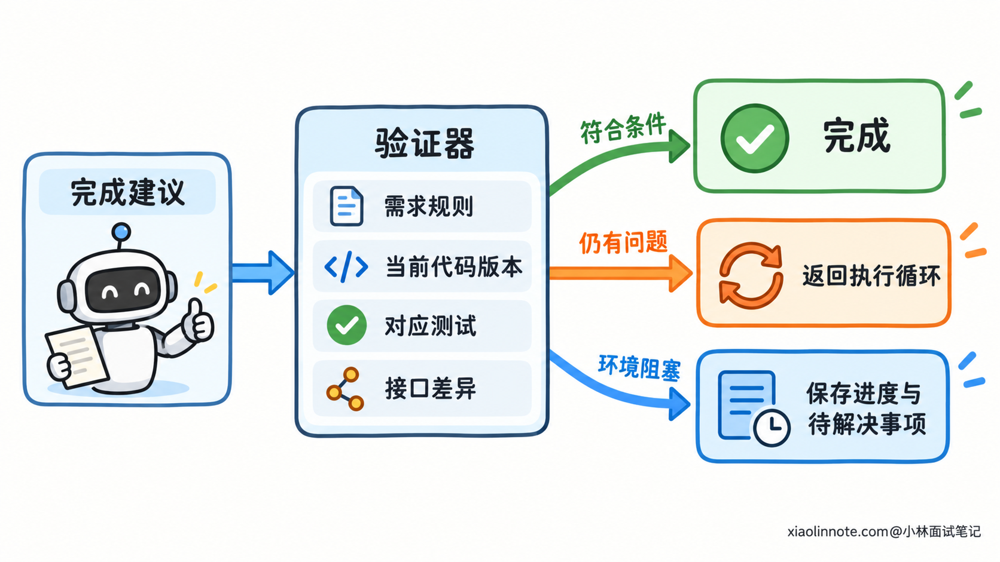
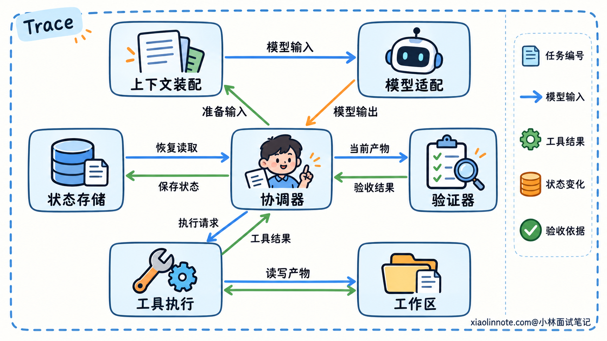

# 如何设计一个完整的 Agent Harness？

> 原文：[如何设计一个完整的 Agent Harness？](https://xiaolinnote.com/ai/agent/26_harness_design.html) · 小林面试笔记


👔面试官：如果让你设计一个完整的 Agent Harness，你会怎么做？

🙋‍♂️我：给模型接上读文件、改代码、运行测试的工具，它就能自己完成任务了。

👔面试官：模型返回一个工具调用之后，谁来执行？执行失败以后，又是谁让任务继续？

🙋‍♂️我：那就写个 while 循环，把工具结果一直交回模型，直到它说完成。

👔面试官：测试日志越来越多，上下文放不下了怎么办？服务重启以后，之前的修改和进度还找得回来吗？

🙋‍♂️我：把聊天记录存进数据库，再让模型自己判断任务有没有做完。

👔面试官：聊天里说「准备修改」和文件已经改好，是两件事。模型说「修复完成」和测试真的通过，也是两件事。你的程序怎样区分这些状态？

咱们拿「修复一个登录 Bug」来搭这套运行程序，看看每一部分是怎样从实际问题里长出来的。

## 💡 简要回答

我会把 Harness 的核心做成一个执行循环：程序准备上下文，调用模型，接住它的工具请求，执行后把结果交回去，再让模型决定下一步。比如修复 Bug，模型负责判断要读哪些代码、怎么改，程序负责读文件、应用修改和运行测试。

每轮调用前，我会保留任务目标、约束、当前进度和相关材料。完整日志放在外部，需要时再读，避免把所有历史都塞给模型。工具执行要在允许的工作区和权限范围内，还要限制耗时，并把成功、失败或结果未知的情况传回来。

长任务的进度需要单独持久化，包括已经做过的操作、产物和未解决的问题。中断以后先核对实际文件和未决操作，再恢复执行。任务结束则以事先确定的验收条件为准，比如修改符合需求、相关测试通过；模型说完成时，程序还要检查这些证据。

另外，我会给整个任务设步数、时间和费用预算，并记录每轮输入、工具结果和状态变化。这样既能控制循环，也能在失败时查清问题出在模型决策、工具执行还是运行程序。最初这些模块可以放在一个服务里，接口分清楚以后，再按需要拆分。

## 📝 详细解析

### 从修复一个 Bug，看清要搭建哪些运行部分

假设用户提出这样一个需求：

「登录接口在密码为空时返回了 500，帮我修复，但不要改变现有的接口字段。」

模型能分析这个问题，但仓库里的文件、终端里的测试进程，都在模型之外。它生成一句「读取登录源码」，程序还得打开文件；它生成一个补丁，程序还得把补丁写进去。

你要设计的 Harness，就是负责组织这些操作的运行程序，以及配合它工作的上下文、状态和执行控制机制。

先把最基本的关系画出来：用户把任务交给运行程序，程序给模型提供材料；模型返回下一步请求，程序调用工具，再把结果交回模型。

在这个过程中，模型可以决定先看源码还是先跑测试。开发者规定的是动作怎样执行、结果怎样返回，以及哪些动作允许执行。具体的排查顺序可以随着观察结果变化。

比如读完登录函数，模型发现问题可能来自参数转换，就继续读取转换函数。读取哪个文件由模型选择，读取流程由程序提供。这样既保留了模型的判断能力，又能让每次操作按规定的接口运行。



一开始不需要把系统拆成许多服务。一个程序里放模型调用、工具注册和运行循环，就可以开始做。但这些部分应当有各自的接口，否则以后增加暂停、恢复或权限检查时，就容易把所有逻辑挤进同一个函数。

### 用执行循环，把一次推理接成多步任务

现在来看这个程序最核心的部分：一次模型调用结束以后，程序接着做什么？

第一轮，模型收到需求和工具说明，提出读取登录函数。程序执行读取，把源码交回去。第二轮，模型看到源码，提出修改参数检查。程序应用补丁，回传是否修改成功。第三轮，模型提出运行相关测试，程序启动测试进程，回传退出状态和报错。

如果测试仍然失败，下一轮模型可以继续排查。这里每轮新增的工具结果，都会影响后续选择。

负责安排下一轮调用的模块，可以叫「运行协调器」。名字听着抽象，其实它做的就是：接收模型输出，判断应该走哪个分支，再安排对应操作。

至少要区分三种情况。

模型请求调用工具，就进入执行分支。模型缺少必要信息，比如无法确定用户指的是哪个接口，就进入等待用户的分支。模型提出任务完成，就进入结果检查分支。

不要把所有文本都当作命令。模型说「我打算查看源码」只是文字；通过约定接口返回的工具名和参数，才是程序可以解析的请求。

下面这段流程描述了一个顺序执行工具的最小循环，其中每行注释说明程序承担的职责：

```text
循环，直到任务进入结束状态：
    # 每轮都从当前任务记录准备输入，避免使用过期进度
    上下文 = 装配上下文(任务状态)
    模型输出 = 调用模型(上下文)

    # 工具请求进入执行器，实际结果再写回任务
    如果模型输出是工具请求：
        工具结果 = 校验并执行(工具请求)
        保存工具结果，更新任务状态
        继续下一轮

    # 缺少必要信息时保存进度，等待用户回复
    如果模型输出需要用户补充：
        保存待解决问题，把任务设为等待
        返回

    # 完成声明进入验证；通过才结束，未通过则反馈差距
    如果模型输出提出完成：
        检查验收条件，更新任务状态
```

这里只展示了主流程。真实程序还要处理模型接口失败、任务预算和取消请求，但它们都围绕这个循环工作。

有些模型一次会请求多个工具。程序可以先顺序执行；需要提高速度时，再让互不依赖的读取操作并行。修改文件和验证修改之间有依赖，测试必须看到对应版本的代码，不能为了并行把这个顺序打乱。



有了这个循环，任务能够向前推进。不过，循环只规定了「接下来调用谁」，下一轮模型具体看到什么，还需要单独设计。

### 每轮装配上下文，让模型看见当前有效的信息

第一次调用时，输入很简单：用户需求、操作约束和工具说明。

运行几轮以后，已经积累了源码、补丁和几份测试日志。如果程序每轮都拼接所有材料，上下文会越来越大。更麻烦的是，旧报错和新结果放在一起，模型可能继续围绕已经修好的问题工作。

所以需要一个「上下文装配」的步骤。它根据当前任务，选择这轮调用需要的内容。

比如密码为空的异常已经修好，但原有正常登录测试出现了回归。下一轮应该重点放当前失败测试、相关代码和接口约束。旧的空值异常可以保留一句处理结论，原始日志留在外部，需要时再取。

这里要分清三类信息。

用户目标和限制决定任务范围，例如「保持接口字段不变」。任务进度说明已经做了什么、还有什么没完成。源码和日志提供判断依据，它们可能很长，也可能随着执行而更新。

这三类信息不必都以聊天消息的形式保存。程序可以从任务记录中读取进度，从工作区读取当前源码，再选取最近相关的消息，一起组成模型输入。

工具调用记录还需要遵守模型接口的消息格式。请求和结果通常通过调用编号关联，不能删掉请求，只留下一段不知属于哪次调用的结果。整理历史时，要保持必要的对应关系。



工具返回也应该控制大小。测试可能生成几万行日志，可以把完整日志写进文件，只返回失败用例、关键报错和日志路径。模型想查某一段，再调用读取工具。

调用前还要检查输入占用，为输出留出空间。接近容量边界时，可以减少无关材料，或把已经结束的过程整理成摘要。摘要必须保留任务约束和未解决状态，原始资料也要能够找回。

这些做法的共同目的，是让模型拿到眼前这一步所需的材料。模型需要继续判断时，仍然有工具可以补查，而不用依赖一份可能丢掉细节的历史概括。

### 通过工具执行器，把模型请求变成真实操作

模型已经提出「修改登录函数」。运行协调器可以直接把这段输出丢给系统执行吗？

还差一个工具执行器。它把模型请求转换成实际操作，并负责检查动作是否符合运行规则。

以应用补丁为例，执行器先确认工具存在、参数格式正确，再检查目标路径是否在允许的工作区。还要核对待修改内容与当前文件是否匹配，避免模型基于旧源码生成补丁，覆盖别人刚做的修改。

校验通过以后，执行器才写入文件，然后返回实际结果。补丁没匹配上，就明确告诉模型修改未应用，让它重新读取当前源码；不能只回一句「操作完成」，把失败藏起来。

运行测试也是一样。执行器记录工作目录和命令，启动进程，取得退出码、输出和耗时。模型据此判断失败来自代码断言，还是环境没有安装依赖。

这两种失败需要不同处理。如果断言失败，模型可以调整实现；如果执行环境缺少依赖，反复改登录函数没有意义。结果表达得越清楚，后续决策越有依据。



对命令执行，还需要限制文件访问、网络访问和资源使用。可以通过受限账号、容器或其他隔离环境落实这些约束。只在 Prompt 里写「不要访问其他目录」，不能形成操作系统层面的隔离。

等待时间也要有上限。测试进程卡住以后，程序需要取消或终止它，并确认处理结果。如果只是等待超时，却没有终止进程，后台任务可能还在运行。

因此，工具结果有时要表达「尚未完成」或「结果未知」。遇到这类状态，程序先查询进程、文件或外部系统，确认动作是否发生，再决定下一步。

如果工具会发邮件、创建订单或支付，还需要业务侧的幂等和结果查询。幂等的意思是同一项业务动作重复提交，系统按约定避免重复产生效果。它需要接口配合，Harness 不能只靠重试逻辑就保证动作只发生一次。

### 单独保存任务状态，才能暂停和恢复

前面的循环已经能读代码、改文件、跑测试。但这些操作可能持续几分钟，甚至跨越多次运行。只把进度放在程序内存里，进程一退出就丢了。

所以任务需要一份持久化状态，可以存在数据库，也可以在简单实现里保存到文件。关键是状态能够描述当前进度，并指向已经产生的结果。

对于这个登录 Bug，某一时刻的记录可能是：

```text
任务目标：空密码不再触发 500，保持接口字段不变。
运行状态：等待用户补充。
已完成：定位登录函数，应用参数检查补丁。
验证情况：空密码测试通过，正常登录测试未通过。
待解决问题：测试环境要求的配置从哪里获取。
产物位置：补丁记录、当前工作区与两份测试日志。
未决操作：无。
```

这份记录与聊天历史的区别，在于它明确区分了「做过什么」和「验证到了哪里」。聊天里的一句「接下来跑测试」，不能当作已经执行测试。

工具请求、开始执行和返回结果，也应该分别记录。这样服务重启时，程序才能识别哪次操作没有最终结果，需要进一步核对。

为了恢复方便，可以在关键步骤保存状态快照，通常叫 checkpoint。它记录保存时的进度，程序恢复后就有一个继续工作的起点。

但快照与实际工作区是两份东西。假设补丁已经写入磁盘，程序还没来得及保存成功状态就崩溃了，快照仍然停在「准备修改」。恢复程序如果原样再应用一次，可能匹配失败，也可能造成重复修改。

正确的恢复过程要先读取记录，检查未决操作，再核对当前文件或业务结果。确认补丁已经应用，就补齐记录；确认没有应用，才重新执行；暂时无法确认，就保留未知状态。



等待用户时，也可以保存状态后释放工作进程。用户回复再根据任务编号唤醒任务，补充信息，核对当前环境，继续循环。任务在等待，进程不必一直占着资源。

如果同一个任务可能由多个工作进程接手，还需要限制同时运行的实例，或者对状态更新做版本检查。否则两个进程可能同时基于旧进度修改同一份代码。并发控制应当落在程序和存储层，不能让模型靠聊天约定互相避让。

### 把完成条件和运行预算放进循环

任务能持续执行以后，还要确定什么时候结束。

模型说「登录 Bug 已修好」，程序可以把它当成结束建议，再执行验收。对于当前任务，至少要核对空密码场景、原有正常登录行为，以及接口字段是否保持不变。

验收依据来自用户需求和事先确定的业务规则。模型可以提出需要补充哪些测试，但不能通过改掉失败断言，把原本错误的结果算成成功。

测试结果还要对应当前修改。如果模型跑完测试又改了文件，旧的通过结果就不能直接证明新代码也通过。验证器需要核对代码版本和验证记录，必要时重新运行相关检查。

检查通过，任务可以标记完成；没有通过，就把具体差距交回模型继续处理。遇到环境阻塞或无法核验的部分，则说明已经完成的范围和剩余问题。



另一种结束来自运行限制。模型可能反复读同一个文件，或者连续几次提出同样的修改，任务一直没有新进展。

可以给整条任务设置步数、总耗时和费用预算，给单次模型调用与工具执行设置等待上限。程序还可以结合重复动作和相同结果，识别卡住的情况，再决定暂停、换一种处理方式或请求必要信息。

这些限制不是完成证据。达到步数上限，只说明这次运行该停了；测试通过，才是验收中的一项证据。所以状态里要区分成功、失败、等待、取消和预算耗尽，并保存对应原因。

### 记录每轮过程，让架构能够被检查和改进

到这里，系统已经有运行循环、上下文装配、工具执行、状态保存和完成验证。上线以后，你还需要知道它们实际怎样工作。

比如 Agent 改错了文件，只看最终回复很难找出原因。模型是否从一开始就选错了路径？上下文装配时是否放入旧源码？还是执行器没有核对补丁对应的版本？

需要沿同一个任务编号，把各轮模型调用、工具请求、执行结果和状态变化串起来。这类关联记录通常叫 Trace，可以理解为一份按时间排列的任务操作记录。

每次模型调用记录实际使用的模型、输入材料或可复原的引用、输出和用量。每次工具执行记录参数、开始与结束时间、结果位置和错误。验收阶段再记录检查项、对应版本和判断依据。

凭这些记录，你就能看到两次执行从哪一步开始不同，也能确定等待主要花在模型调用还是某个工具上。敏感信息需要脱敏或受控存储，调试记录不能变成一个额外的数据泄露入口。

把前面设计的部分放到一起，模块之间的交接就清楚了：

| 模块 | 接收什么，交出什么 |
| --- | --- |
| 运行协调器 | 接收任务和模型输出，安排下一步调用或状态转换 |
| 上下文装配器 | 读取当前状态和相关材料，生成这一轮模型输入 |
| 模型适配器 | 调用模型，把返回内容解析成回复、工具请求等事件 |
| 工具执行器 | 校验并执行请求，返回实际状态与结果引用 |
| 状态存储 | 保存任务进度、操作记录和产物位置，供恢复使用 |
| 验证器 | 核对验收条件与实际证据，给出完成或未完成的依据 |

Trace 穿过这些模块，记录每次交接。它与任务状态用途不同：任务状态方便程序继续执行，Trace 方便追查这个状态怎样产生。



后续优化也有了依据。工具返回太长，就调整返回内容和按需读取方式；经常中断后从头探索，就检查恢复记录；模型提前宣布完成，就检查验收是否落实。改完以后用同一批任务比较完成情况、耗时和成本，才能判断这次调整是否有用。

## 🎯 面试总结

开头只接工具，缺少的是工具结果怎样进入下一轮；只写循环，又没有解决输入越来越长、任务中断和结束判断的问题。完整的 Harness 要围绕执行过程，把这些部分接起来。

执行循环负责推进任务，上下文装配提供当前材料，工具执行器落实真实操作和权限边界。状态记录保存做过什么、验证到哪里，恢复时再核对实际产物，避免把「准备执行」误当成「已经执行」。

模型提出完成以后，程序还要按照任务要求检查结果；达到运行预算，则明确保存停止原因。最后用关联记录追查每轮输入、动作和状态变化，这套系统才既能运行，也能恢复和解释结果。

---
