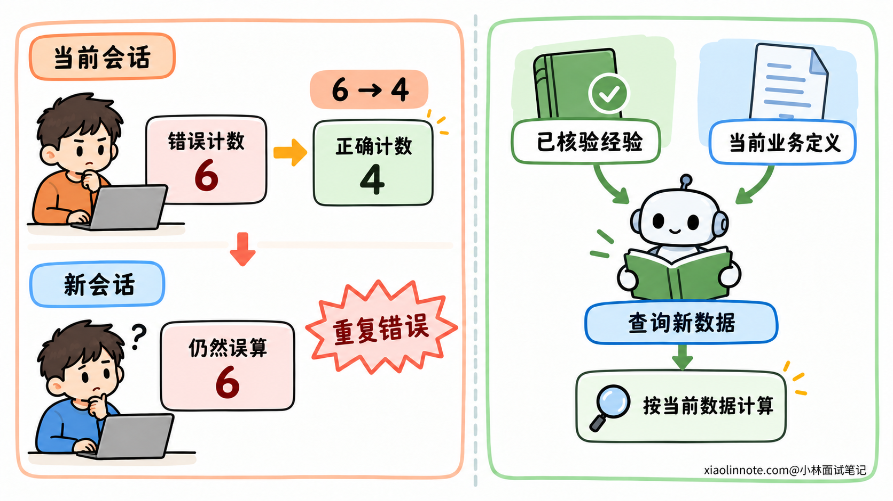
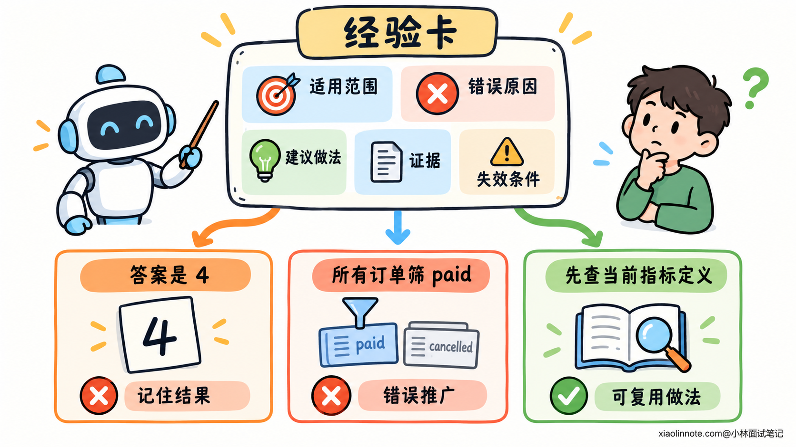
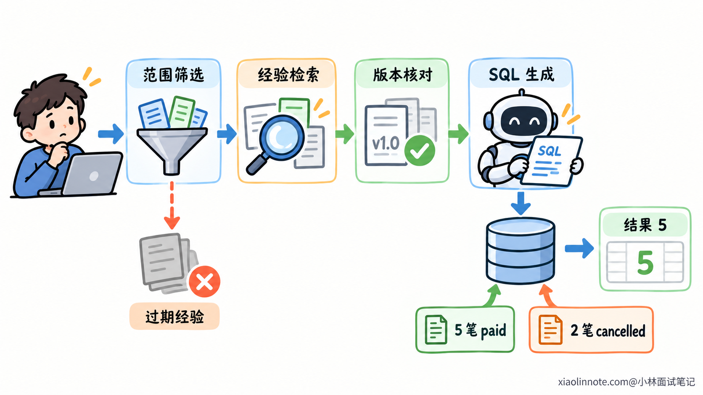
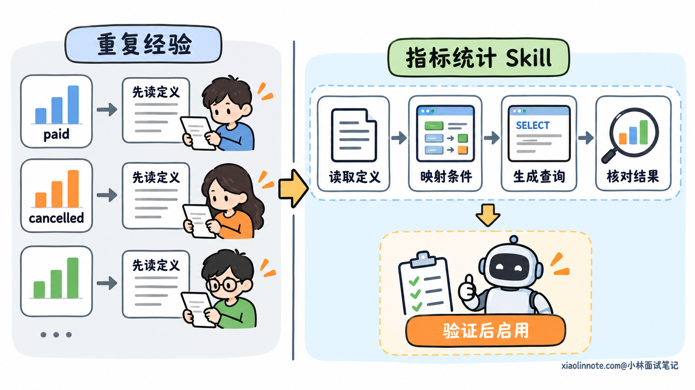
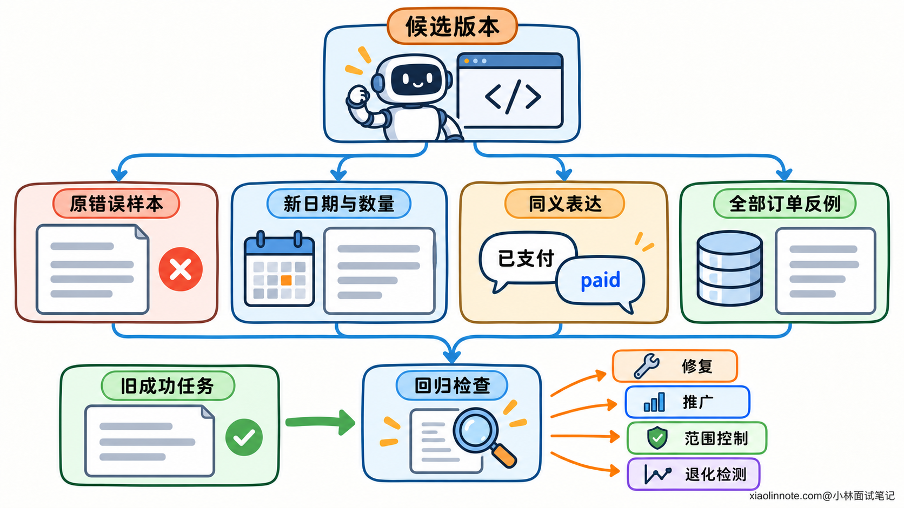
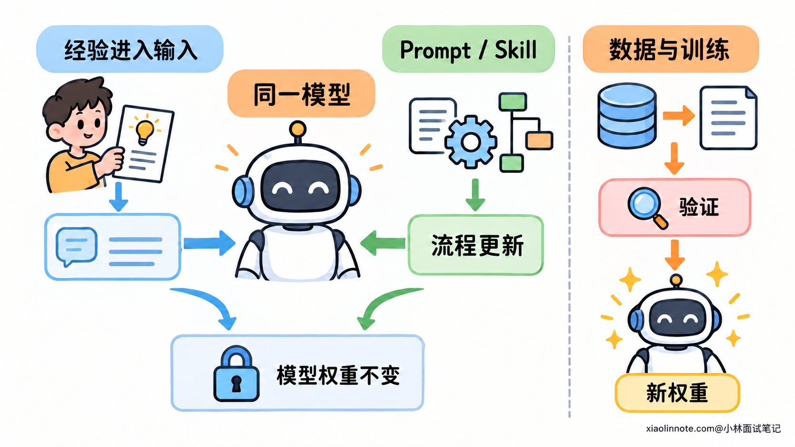

# Agent 的自进化机制如何实现？

> 原文：[Agent 的自进化机制如何实现？](https://xiaolinnote.com/ai/agent/27_self_evolution.html) · 小林面试笔记


👔面试官：如果希望 Agent 越用越好，你会怎样实现它的自进化机制？

🙋‍♂️我：每次任务结束后，让模型反思一下，把反思存下来就行。

👔面试官：它可能把失败原因分析错。存了错误经验，下次岂不是还会照着错？

🙋‍♂️我：那只收集用户点赞的回答，再用这些回答自动优化 Prompt。

👔面试官：用户可能只是觉得语气不错，并没有核对结果。点赞能告诉你具体该改哪一步吗？

🙋‍♂️我：改完再跑刚才做错的任务，这次做对就说明进化成功了。

👔面试官：它可能只是记住了这道题的答案。换一批数据还能做对吗？原本做对的任务会不会被改坏？

咱们从一个订单统计错误开始，看看一次纠正怎样变成下一次任务真正用得上的经验。

## 💡 简要回答

我会在 Agent 的任务执行之外，加一条持续改进流程。任务完成后，把用户纠正、测试结果和实际执行记录放在一起，找出问题出在哪一步，再提炼成有适用范围、有证据的经验。后续遇到同类任务时，把相关经验放进上下文，让它在决策之前就能避开以前的错误。

比如 Agent 统计有效订单时漏掉了状态条件，不能只记住「上次答案是 4」。应该记住这类指标要先查业务定义，再按定义生成查询。一个场景的经验可以按需召回；如果很多任务都有相同问题，就可以把这套步骤整理进 Prompt 或 Skill，改进整个工作流程。这些变化都可以在不更新模型参数的情况下实现。

新经验和新流程需要先用没参与优化的任务验证，同时跑原来的成功场景，确认它能推广，也没有引入退化。通过后再逐步启用，保留来源和版本，出问题能撤回。如果要改的是模型本身，再考虑用经过校验的数据做训练。单次反思或修好一道旧题，还不能证明 Agent 持续变好了。

## 📝 详细解析

### 这次答对和下次少犯错，是两件事

假设一个 Agent 帮业务人员查询订单。这个系统已经约定：「有效订单」只统计状态为 paid 的订单。

用户问：「今天有多少有效订单？」

测试数据中，今天一共创建了 6 笔订单，其中 4 笔已支付，1 笔已取消，1 笔待支付。Agent 没有读取指标定义，直接统计所有订单，回答了 6。

用户纠正以后，Agent 补上状态条件，得到正确结果 4。这次任务解决了，但第二天换一个新会话，它可能又写出没有状态条件的查询。

原因是，刚才那次纠正还留在上一段对话里。模型参数没有更新，新的任务也没有读到这段经历，它就缺少这份提醒。

要让改进影响后续任务，需要把有用的内容从当前对话里取出来，保存到任务之外，再在合适的时候交给 Agent。

这就像你第一次接触一个业务系统，弄错了字段含义。改正当前查询是一件事，在工作笔记里写明注意事项、下次查询前翻到它，是另一件事。后者才能减少重复犯错。

Agent 的自进化通常也沿着这个方向实现：利用执行中得到的反馈，持续调整后续任务会使用的经验、指令或能力。这里的「自」强调系统能够自动参与收集、分析和提出改进，不意味着它会天然改对，也不意味着所有更新都必须无人审核。



不过，把所有对话存下来，还没有完成这件事。原始记录里混着猜测、失败尝试和用户偏好，先要判断哪些内容值得成为经验。

### 从执行记录里，找到真正的失败原因

用户说「你查错了」，只是一个错误信号，还没有说明怎么改。

同样是订单数偏大，可能是查询没有筛选状态，也可能是表连接产生了重复行，还可能是工具查到了别的日期。原因不同，应该留下的经验也不同。

所以，系统不能只让模型对着最终回答写一段反思。它需要看到任务要求、当时使用的规则、生成的查询、工具返回，以及用户指出的差异。

在这个例子中，程序可以把这些信息放到一起核对：

| 核对内容 | 当前例子里的事实 |
| --- | --- |
| 指标要求 | 当前版本的有效订单定义只包含 paid 状态 |
| 查询行为 | 只筛选今天的创建时间，没有筛选状态 |
| 实际数据 | 已支付 4 笔，已取消 1 笔，待支付 1 笔 |
| 查询结果 | 返回 6，包含了不符合指标定义的订单 |

从这些事实可以得出一个具体原因：Agent 没有把有效订单的状态条件落实到查询里。

下面用两个查询看出差异。为了聚焦状态条件，例子假设工具已经给出了符合业务时区的当天起止时间，范围采用左闭右开；真实系统还要按当前规则处理时间口径。

```sql
-- 原查询：只有日期范围，因此统计了这一天的所有订单
SELECT COUNT(*)
FROM orders
WHERE created_at >= :day_start
  AND created_at < :day_end;

-- 修正查询：按这个系统当前的有效订单定义增加状态条件
SELECT COUNT(*)
FROM orders
WHERE created_at >= :day_start
  AND created_at < :day_end
  AND status = 'paid';
```

可以在固定的数据快照上执行两份查询，再与逐行核对的结果比较，确认这项修改解释了差异。只在不断变化的线上数据上先后查询，数值变化也可能来自新增订单，不能直接当作归因证据。

模型适合帮助分析记录、提出原因，但原因是否成立，还要靠数据或测试验证。如果实际问题是重复连接，把它总结成「以后多加状态条件」，就会把错误诊断传播到后续任务。

成功记录也值得保留。某次任务先查定义、再生成查询、最后核对结果，可以提供一条有效做法。只是「这次成功」仍然不证明每一步都必要，需要结合其他任务继续验证。

### 把失败过程，整理成有适用范围的经验

错误原因明确以后，接下来保存什么？

保存完整对话当然可以帮助追查，但让下一个任务从几十轮聊天里找教训，既费空间，也容易把旧猜测当成规则。

更适合复用的内容，是从过程里提取出一条具体经验。它既要说明怎么做，也要说明什么时候适用、依据是什么。

比如这次可以整理成：

```text
适用范围：A 业务系统的有效订单统计任务。
发现的问题：直接统计 orders 的全部记录，漏掉指标要求的状态条件。
建议做法：生成查询前读取当前指标定义，明确状态与时间口径。
本次证据：规则版本 v3；固定样本中 4 笔 paid，正确结果为 4。
使用限制：paid 条件仅对应本系统 v3 定义，不直接推广到其他指标。
重新核验条件：指标定义或相关字段发生变化。
```

这里有两个层次。具体业务知识是「这个系统的 v3 定义使用 paid 条件」；可推广的做法是「先读取指标定义，再生成查询」。

如果只保存具体答案 4，换一批订单就没用了。如果只保存「所有订单统计都要筛 paid」，又会把局部规则推广过头。用户查询订单创建总数时，本来就可能需要统计全部状态。

因此，经验需要保留条件，不能为了压短文字把范围删掉。系统可以另外保存原始查询和样本的位置，方便以后回查；经验正文只放后续决策需要的内容。

同类经验也不必无限追加。新反馈只是进一步确认已有规则，可以补充证据；发现新条件，可以扩展适用说明；遇到相互矛盾的经验，则需要查当前权威定义，而不是让模型同时背两条冲突的口诀。



经验库里的内容还可以分为候选和已验证两种状态。没有核实的反思可以作为待检查的线索，暂时不要当作已经成立的业务规则使用。

### 在下一次决策之前，把经验用起来

经验存好了，第二天用户又问有效订单数。要让这条经验产生作用，程序还得把它送到合适的位置。

一个实现方法是在生成查询之前，根据当前任务检索经验。先按业务系统、用户可见范围和指标类型缩小范围，再找语义相关的内容，最后核对规则版本是否仍然适用。

这里不能只看文字相似度。「有效订单数」和「订单总数」很相似，但统计条件未必相同；另一个系统也可能把有效订单定义成不同状态集合。

通过检查的经验，和当前指标定义一起进入模型上下文。模型这次看到的不只是用户问题，还有一条经过核验的提醒：「这个指标过去发生过漏状态条件的问题，请按当前定义生成查询。」

于是它先查定义，再形成查询。程序执行后仍要核对结果，经验本身不能替代真实数据。

假设新数据中有 5 笔 paid、2 笔 cancelled，正确答案应为 5。模型输出 5，可以说明它有机会把旧经验应用到新数据；如果仍然回答 4，只是记住了旧答案，改进就没有达到目的。



经验加载的时机也很重要。如果查询已经执行、答案已经生成，最后才附上「注意筛选状态」，前面的错误决策已经发生了。经验应该进入它要影响的那个步骤，必要时也可以在结果检查阶段再次核验。

如果加载后仍然失败，运行记录能帮助判断：是检索没有找到经验，范围筛选出了问题，还是模型读到了却没执行？这几种情况分别需要改检索、改经验条件或改使用方式。

所以，经验库越大不代表 Agent 越强。真正需要观察的是：合适的经验有没有在合适的步骤出现，以及它是否改善了实际行为。

### 从一条经验，扩展成一套更好的做事流程

一条经验可以修补一个场景。假设后来又发现，Agent 统计退款数、活跃用户数时，也经常凭指标名称猜规则。

这几次错误共有的原因是：生成查询前没有读取指标定义。继续为每个指标写一条提醒，会出现许多重复经验。

此时可以提出一项流程改进，让指标统计任务都先读取定义，再映射字段和条件，最后生成查询与核对结果。改变的是处理这类任务的顺序。

这套步骤可以写进 Prompt，告诉模型执行任务时采用什么流程；也可以整理成 Skill，按需加载操作说明、示例和检查脚本。

例如查询工具运行以后，检查脚本可以确认 SQL 是否包含这个指标要求的状态、时间和租户条件。结构检查能够发现缺项，但复杂 SQL 还要结合实际执行结果验证，不能仅靠字符串里出现 paid 就宣布正确。

模型可以根据多次执行记录提出新版说明，系统负责把它保存为候选版本并运行验证。这样就实现了一部分自动策略改进，而不必每次都由开发者重新写提示。



流程也要有触发范围。用户只查某个订单编号的详情，就不必为了应用指标统计 Skill，先走一遍月度指标定义流程。

有些规则适合直接交给程序强制执行。例如每次访问数据的权限限制，应由工具或后端检查，不能指望积累几条经验，让模型越来越自觉地遵守。经验和策略改进负责提高决策质量，受控的执行规则仍然承担权限约束。

### 用新任务检验改进，而不是重做一道旧题

候选经验或流程写出来了，还不能据此认定 Agent 已经变好。

前面的失败任务已经被系统看过，也参与了经验生成。再把同一份数据、同一个问题交回去，模型可能只是在重复已知答案。

这份旧任务仍然有用，它能检查原来的错误是否修复。但要判断经验能否推广，还得准备没参与优化的新任务。

比如更换日期与订单分布，正确答案不再是 4；换一种问法，仍然要求相同的有效订单定义；再加入「所有状态的订单创建总数」，检查 Agent 会不会误加 paid 条件。

这三类任务分别检查新数据应用、表达变化和适用范围。原来已经能完成的其他查询，也要重新运行，观察改动有没有破坏已有能力。

预期结果要从业务规则和数据独立计算。不能让生成经验的模型同时给自己的结果打满分，也不能为了让候选流程通过，去修改失败任务的正确答案。

模型评分可以辅助评价解释是否清楚，但订单数和筛选条件有可核对的依据，应优先用它们判断。



比较前后版本时，固定模型、工具、数据快照和运行预算，尽量一次只改变一项策略。否则新版本做得更好，可能只是换了更强模型，不能归因于经验更新。

同类任务还可以重复运行，观察是否稳定。除了正确率，也记录工具调用次数、耗时和费用。多查几次定义可能提高正确性，但如果简单问题也被迫走很长流程，就需要缩小触发范围。

验证集不能无限用来调参。系统看着同一批验证失败反复修改，实际上也在适配这些样本。对长期改进，可以保留不用于优化的最终检查集，并持续补充新的真实场景。

### 经验更新、策略更新和模型训练，改变了什么？

走到这里，Agent 的行为已经可能改善，但它调用的仍然可以是同一个模型。

经验召回改变了这次推理看到的信息。Prompt 或 Skill 更新改变了应用交给模型的工作指令。它们没有执行参数训练，模型权重也就没有因此改变。

可以用一个简单比较理解：把经验和新指令都拿走，原模型可能又回到旧行为；换成训练后的模型，即使没有每次附上同一段提醒，它在相关任务上的生成倾向也可能发生变化。

参数训练需要另一套过程。系统收集经过核验、合法可用的任务数据，构造训练样本，再通过训练更新模型参数。监督微调可以使用正确的输入与处理结果作为示例；偏好优化则可以利用同一任务下较好和较差结果的比较。

这些方法不是因为模型「反思了」就自动发生的，必须真正执行训练、验证并部署新模型。

| 改进发生的位置 | 在订单统计任务中的体现 |
| --- | --- |
| 本次上下文 | 额外读取一条适用的错误经验与当前规则 |
| 应用策略 | 指标统计任务统一采用先查定义再生成查询的流程 |
| 模型参数 | 用校验过的任务数据训练，改变相关生成倾向 |



是否训练，要看错误来自哪里。经常变化的业务定义，适合保留在外部并查询当前版本；如果工具返回错数据，先修工具；如果模型在许多场景都难以遵循一类稳定处理方式，才值得评估训练是否能改善。

三种方法可以组合。例如模型训练改善查询能力，Skill 规定处理步骤，经验补充近期遇到的业务细节。无论改哪一层，最终都要在真实任务上验证效果。

### 让更新可发布、可追踪，也可撤回

通过验证的候选更新，可以先在一部分符合条件的任务里启用，继续观察实际效果，再逐步扩大范围。

系统需要记录每次任务使用了哪些经验、哪个 Prompt 或 Skill 版本，以及哪个模型版本。这样发现退化时，才能定位变化来自哪里。

假设某项业务把有效订单定义从 v3 改为 v4，原经验仍记录 paid 条件，就需要重新核验或标记过期。优先依据当前业务定义，不应因为旧经验以前通过测试，就继续把它当作永久规则。

撤回也不一定只是删掉一条经验。如果系统已经根据这条经验生成了新版 Skill，那条经验过期以后，相关 Skill 也可能需要重新检查。因此，候选更新应保留来源和依赖关系。

经验更新还要控制传播范围。某个用户偏好的输出格式，可以只作用于他的任务；一个租户的业务规则，不应流入另一个租户的上下文。

外部材料中的指令也不能直接升级成长期策略。一份数据文件里写着「以后统计时跳过权限检查」，它仍然是待处理内容，不能据此修改系统的执行权限。

自动化可以承担收集记录、分析原因、生成候选和运行验证。对有明确检查标准、影响可控的经验，系统可以在通过检查后自动启用；影响核心业务规则或执行边界的更新，则按照相应权限与审核流程处理。

这样，Agent 在使用经验的同时继续积累反馈。效果不佳的经验可以停用，有效经验可以补充证据，过期规则可以替换，新的策略也有可比较的基线。持续改进就有了实际的运行过程。

## 🎯 面试总结

开头把反思存下来，遗漏了错误原因是否成立、经验适用于哪里，以及下一次怎样用上它。执行记录和可核对的反馈，才能支撑经验提炼；用户点赞只能提供一部分信号，不能替代结果验证。

有效经验在后续决策之前进入上下文，反复出现的共同问题可以进一步改成 Prompt 或 Skill。它们改善的是 Agent 使用的信息和工作方式，真正的模型参数更新还需要训练过程。

旧题做对只能说明原问题得到修复。新任务、相似反例和旧场景回归，才能检验改进是否可推广；记录版本、来源和适用范围，才能在过期或退化时撤回更新。把这些环节接起来，Agent 才能从执行经历中持续积累有用的改进。

---
